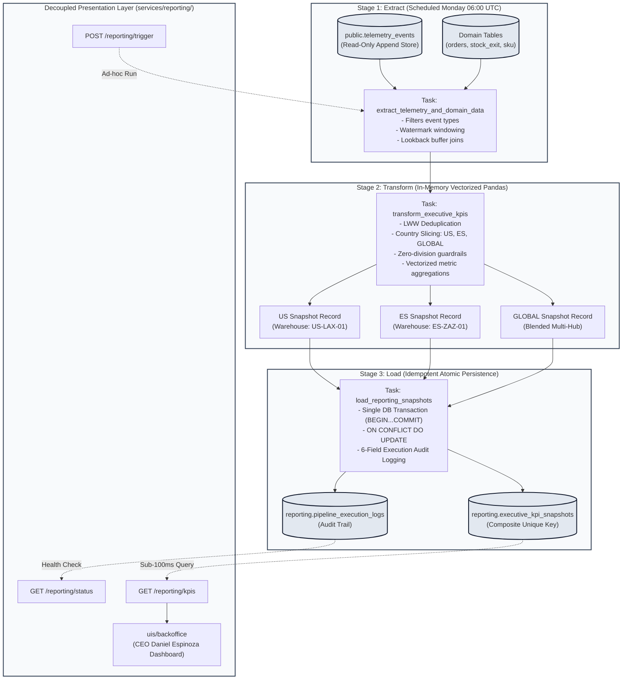
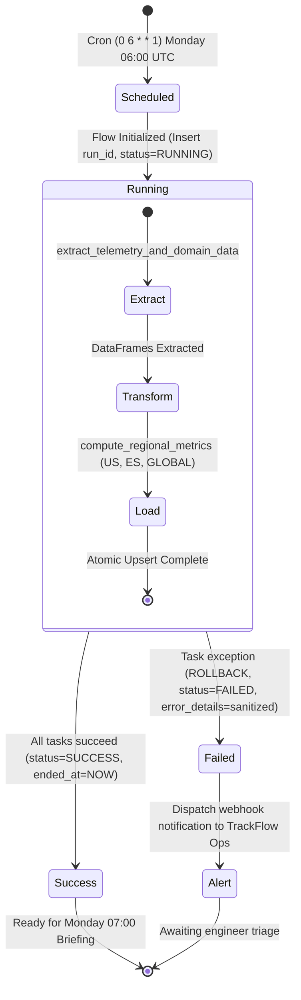

# TrackFlow Business Performance Pipeline Design Document

**Document Version**: 1.0.0  
**Status**: Approved Architectural Design  
**Author**: TrackFlow Tech Data Platform Engineering  
**Target Audience**: Executive Leadership (CEO Daniel Espinoza, CTO Andrés Kim), Data Engineering, Backend Core, Operations  
**Deliverable Type**: Architectural Design Document (Strict Pure Documentation Deliverable under FR-015, FR-016, SC-006)  
**Creation Date**: 2026-10-20  

---

## Executive Summary

TrackFlow is an international cross-border logistics and warehouse management provider operating dual fulfillment centers in Los Angeles (`US-LAX-01`) and Zaragoza (`ES-ZAZ-01`). Today, TrackFlow processes thousands of multi-channel orders daily across 8 carrier networks (UPS, FedEx, DHL US, MRW, SEUR, DHL ES, and regional couriers). While TrackFlow operates an active engineering telemetry collection system centered on `telemetry_events` and `GET /telemetry/report`, this existing infrastructure exclusively evaluates technical component health (event volume, error distributions, authentication failure rates). It fails to answer critical commercial, operational, and financial questions required for executive decision-making.

Every Sunday evening, department directors spend 3 to 4 hours manually extracting, reconciling, and cross-referencing disparate spreadsheets from legacy SGA systems, carrier portals, and CX logs to assemble the weekly executive briefing for CEO Daniel Espinoza's Monday 07:00 review.

This document establishes the formal architectural blueprint for the **Business Performance Data Pipeline**. The pipeline extracts raw telemetry events and domain operational records, applies vectorized Pandas transformations to calculate 5 mandatory executive KPIs (Shipments Volume, Global On-Time Delivery Rate, Operational Cost in EUR, Returns Rate, and Customer Satisfaction Score), and idempotently persists deterministic snapshots into an isolated database schema (`reporting.executive_kpi_snapshots` and `reporting.pipeline_execution_logs`). Orchestrated via Prefect on a scheduled weekly cadence (Mondays at 06:00 UTC) with dedicated audit logging and decoupled FastAPI presentation endpoints under `services/reporting/`, this architecture bridges the strategic business gap without modifying or destabilizing existing engineering telemetry assets.

---

## Domain Glossary & Conventions

| Term | Definition in TrackFlow Context |
| :--- | :--- |
| **`US-LAX-01`** | Primary United States fulfillment warehouse hub located in Los Angeles, California. |
| **`ES-ZAZ-01`** | Primary European fulfillment warehouse hub located in Zaragoza, Aragon, Spain. |
| **Dual-Hub Operation** | Operational architecture coordinating independent warehouse management systems across US and ES markets with centralized cross-border analytics. |
| **Carrier SLA** | Service Level Agreement transit time threshold contracted with carrier partners (UPS, FedEx, DHL, MRW, SEUR) defining on-time delivery bounds. |
| **Reverse Logistics** | Logistics workflow governing customer return requests, inspection grading, restocking, or liquidation, accounting for 18%–25% of total shipment volume. |
| **CSAT / FCR** | Customer Satisfaction Score (CSAT) and First Contact Resolution (FCR) measuring customer service quality and AI deflection effectiveness. |
| **LWW** | Last-Write-Wins; deterministic deduplication strategy resolving conflicting state updates by retaining the record with the most recent event timestamp. |
| **Watermark** | Timestamp marker identifying the processed data boundary to support incremental extraction, backfills, and lookback reconciliation windows. |
| **Idempotency** | Architectural property ensuring that executing a pipeline run multiple times with identical inputs produces the exact same state without duplicate records or corrupted metrics. |
| **Reporting Schema** | Dedicated, isolated relational database schema (`reporting`) housing pre-aggregated executive snapshots and execution audit trails, decoupled from operational OLTP tables. |

---

## Architectural Principles & Governance Constraints

1. **Strict Service Boundaries & Domain Isolation (Monorepo Constitution Principle I)**:
   - Analytical models and aggregated snapshots are maintained strictly within the `reporting` schema.
   - Frontends (`uis/backoffice`) access business performance metrics exclusively via HTTP REST endpoints (`/api/v1/reporting/kpis`) and MUST NEVER query database tables directly.
   - All pipeline execution, extraction, and transformation logic resides in `data/pipelines/`. Presentation controllers under `services/reporting/` are strictly limited to HTTP request validation, parameter parsing, and DTO response serialization. Inline ETL logic within HTTP route handlers is prohibited.
2. **Public API Compatibility & Strict Serialization (Constitution Principle II)**:
   - All presentation endpoints declare explicit Pydantic response models and typed query parameters. Internal database ORM primitives are never exposed across HTTP boundaries.
3. **Strict TypeScript & Static Type Safety (Constitution Principle III)**:
   - All shared DTO definitions in `@repo/shared-types` adhere to zero `any`, strict compiler flags (`strict: true`, `noImplicitReturns`, `noUncheckedIndexedAccess`), explicit `import type` syntax, and comprehensive JSDoc annotations.
4. **Defensive Error Handling & Zero Sensitive Data Leaks (Constitution Principle IV)**:
   - Telemetry extraction and reporting processes operate exclusively on anonymized or hashed identifiers (`trackingNumberHash`, `userIdHash`, masked postal codes). Customer PII (emails, plaintext names, physical street addresses) is strictly excluded from analytical snapshots and logs.
   - Failed pipeline runs write sanitized error summaries to `reporting.pipeline_execution_logs` without leaking internal connection credentials or raw stack traces to client responses.
5. **Performance-First Architecture (Constitution Principle V)**:
   - All analytical metric calculations are implemented as purely vectorized Pandas transformations (zero procedural row-by-row iteration).
   - Executive snapshots are pre-computed in weekly batches, ensuring `GET /reporting/kpis` responds within sub-100ms p95 latency.
6. **Zero Code Governance (FR-015, FR-016, SC-006)**:
   - This feature (`019-business-pipeline-design`) represents purely an architectural design specification deliverable. Exactly zero lines of executable production code (.py, .ts, .tsx, .sql), database migrations, or automated test suites are introduced or modified in this feature.

---

## Section 1: Current State Analysis

### 1.1 Existing Telemetry Event Store (`telemetry_events`)

TrackFlow operates an append-only operational event store housed in the `telemetry_events` table (managed via SQLModel / SQLAlchemy in PostgreSQL/Supabase with local SQLite fallback at `services/api/inventory.db`). Every operational interaction envelopes telemetry data with standard technical metadata:

```sql
CREATE TABLE public.telemetry_events (
    event_id UUID PRIMARY KEY DEFAULT gen_random_uuid(),
    timestamp TIMESTAMPTZ NOT NULL,
    session_id VARCHAR(255) NOT NULL,
    user_id VARCHAR(255),
    event_type VARCHAR(100) NOT NULL,
    schema_version VARCHAR(20) NOT NULL,
    request_id VARCHAR(255) NOT NULL,
    properties JSONB NOT NULL DEFAULT '{}'::jsonb,
    created_at TIMESTAMPTZ NOT NULL DEFAULT NOW()
);

-- Existing Indexes for Technical Querying
CREATE INDEX idx_telemetry_events_timestamp ON public.telemetry_events (timestamp DESC);
CREATE INDEX idx_telemetry_events_event_type ON public.telemetry_events (event_type);
CREATE INDEX idx_telemetry_events_session ON public.telemetry_events (session_id);
CREATE INDEX idx_telemetry_events_user ON public.telemetry_events (user_id);
```

### 1.2 Engineering Telemetry Analysis Engine (`services/telemetry/analysis.py`)

Technical observability is powered by `services/telemetry/analysis.py`, which provides Pandas-driven aggregations focused strictly on software health:

- `calculate_events_per_day(df: pd.DataFrame) -> Dict[str, int]`: Aggregates global raw telemetry ingestion throughput grouped by calendar date.
- `calculate_error_rate_by_type(df: pd.DataFrame) -> Dict[str, float]`: Computes the ratio of error events (`error`, `exception`, `fatal`, `threshold_breach`) relative to total events per event type.
- `calculate_auth_failure_rate(df: pd.DataFrame) -> float`: Evaluates security health by calculating failed login attempts against total authentication attempts.
- `generate_telemetry_report(events: List[Dict[str, Any]], window_days: int) -> TelemetryReportResponse`: Orchestrates the engineering report by compiling throughput, error distributions, and system health metrics over a rolling sliding window (default: 7 days).

### 1.3 Technical Questions Answered by `GET /telemetry/report`

The endpoint `GET /api/v1/telemetry/report` (mounted from `services/api/presentation/api/v1/telemetry.py`) provides engineering teams with answers to three primary questions:
1. **System Ingestion Throughput**: What is the daily total event volume entering the TrackFlow API infrastructure, and are there ingestion spikes indicating upstream traffic surges?
2. **Technical Error Distribution**: Which system components or event categories are experiencing software exceptions, HTTP 500 status rates, or database timeout errors?
3. **Authentication & Access Security**: What is the proportion of failed login attempts, and are brute-force or credential-stuffing anomalies occurring?

---

## Section 2: Strategic Business Gap Analysis

While `GET /telemetry/report` successfully monitors runtime software stability, it leaves executive leadership in the dark regarding actual business operations, fulfillment performance, carrier efficacy, and unit economics.

### 2.1 The Sunday Spreadsheet Assembly Crisis

As detailed in `CONTEXT.md`, TrackFlow is governed by CEO Daniel Espinoza from Los Angeles, with technical leadership under CTO Andrés Kim in Zaragoza. Every Sunday evening:
- Ana Whitfield (Warehouse Operations) manually reconciles packing lists across incompatible US and ES warehouse software.
- Carlos Vega (Last-Mile & Carriers) queries individual web portals for UPS, FedEx, MRW, and SEUR to estimate delivery delays.
- Sofía Ramos (Reverse Logistics) tabulates spreadsheet logs of returned items to track the 18%–25% return volume.
- Valentina Cruz (Customer Experience) manually counts Zendesk and WhatsApp customer tickets to calculate response times.

This manual process consumes **3 to 4 hours per director every Sunday**, producing static spreadsheets that are already 24 to 48 hours out of date by the Monday 07:00 executive review.

### 2.2 Unanswered Strategic Business Questions

The existing engineering report completely fails to answer the 5 critical commercial questions required by leadership:

```mermaid
graph TD
    subgraph Technical Telemetry ["GET /telemetry/report (Current Engineering Focus)"]
        T1["Daily Raw Event Volume"]
        T2["API Error Rates by Type"]
        T3["Auth Failure Percentage"]
    end

    subgraph Business Gap ["Unanswered Executive Questions (CONTEXT.md)"]
        B1["Cross-Border Shipment Volume (US-LAX-01 vs ES-ZAZ-01)"]
        B2["Global On-Time Delivery Rate across 8 Carriers"]
        B3["Blended Operational Logistics Cost in EUR per Package"]
        B4["Reverse Logistics Return Rate & Restocking Speed"]
        B5["Customer Satisfaction Score (CSAT) & First Contact Resolution"]
    end

    Technical Telemetry -.->|Incapable of Answering| Business Gap
```

1. **Cross-Border Fulfillment Volume**: Exactly how many physical merchant orders were picked, packed, and fulfilled by Los Angeles (`US-LAX-01`) vs. Zaragoza (`ES-ZAZ-01`)? What is the regional growth trajectory?
2. **Carrier SLA Compliance (Global OTD)**: What percentage of packages reached the customer's doorstep within the promised delivery window across each of the 8 carrier networks (UPS, FedEx, DHL US/ES, MRW, SEUR)? Which carrier lanes are experiencing severe transit bottlenecks?
3. **Blended Logistics Cost in EUR**: What is the total and unit operational cost (freight, packaging, picking labor) incurred to fulfill orders, normalized in Euros (€) across both domestic and international shipments?
4. **Reverse Logistics Rate**: What percentage of dispatched packages are returned by customers? What are the primary defect categories, and what proportion of inventory is successfully refurbished vs. scrapped?
5. **Customer Satisfaction & Sentiment (CSAT)**: What is the prevailing satisfaction score of end-consumers receiving packages, and what percentage of delivery inquiries are resolved on first contact (FCR) via automated deflection?

---

## Section 3: Pipeline Purpose Statement

To fulfill the requirements of FR-004 and SC-002, the overarching purpose of the business performance data pipeline is formally defined in a single, concrete, immutable sentence:

> **To bridge the strategic gap between engineering telemetry and executive decision-making, this pipeline extracts cross-border fulfillment, tracking, carrier, return, and customer interaction telemetry to automatically compute, idempotently persist, and serve five core business KPIs (shipments volume, global on-time delivery rate, operational cost in EUR, returns rate, and customer satisfaction score) every Monday at 07:00 for CEO Daniel Espinoza without impacting existing engineering telemetry services.**

---

## Section 4: Three-Stage Data Flow & Vectorized Calculations

### 4.1 Extraction Specifications (Stage 1: Extract)

The extraction task executes weekly every Monday at 06:00 UTC, reading source events for the preceding 7 calendar days (`period_start = Monday 00:00:00 UTC` to `period_end = Sunday 23:59:59 UTC`) with a 7-day lookback window for in-flight carrier transit reconciliation.

#### 4.1.1 Source Event & Domain Mappings

| Business Metric | Source Telemetry Event (`event_type`) | Payload Properties (`properties`) | Supplementary Domain Tables |
| :--- | :--- | :--- | :--- |
| **Shipments Volume** | `outbound_order_fulfilled` | `orderId`, `warehouseCode`, `destinationCountry`, `packageWeightKg`, `itemCount`, `carrierCode` | `stock_exit`, `sku`, `orders` |
| **On-Time Delivery Rate** | `shipment_tracking_updated` | `trackingNumberHash`, `carrierCode`, `originWarehouse`, `destinationCountry`, `dispatchedAt`, `promisedDeliveryAt`, `actualDeliveredAt`, `isDeliveredOnTime` | Carrier SLA tables |
| **Operational Cost in EUR** | `carrier_recommendation_selected`, `outbound_order_fulfilled` | `orderId`, `carrierCode`, `estimatedCostEur`, `fuelSurchargeEur`, `handlingFeeEur`, `totalCostEur` | `stock_exit` |
| **Returns Rate** | `return_request_evaluated`, `return_item_inspected` | `returnId`, `originalOrderId`, `warehouseCode`, `sku`, `returnReason`, `evaluationOutcome`, `finalGrade` | `orders` |
| **Customer Satisfaction (CSAT)** | `cx_inquiry_resolved`, `cx_sentiment_flagged` | `ticketId`, `trackingNumberHash`, `firstContactResolution`, `csatRating` (1-5), `sentimentScore` (-1.0 to 1.0) | Support ticket logs |
| **Snapshot Audit Event** | `executive_kpi_snapshot_generated` | `snapshotId`, `periodStart`, `periodEnd`, `country`, `metricsSummary` | `reporting.pipeline_execution_logs` |

#### 4.1.2 SQL Extraction Query Contract

```sql
-- Parameterized Batch Extraction Query
SELECT 
    event_id,
    timestamp,
    event_type,
    properties->>'orderId' AS order_id,
    properties->>'warehouseCode' AS warehouse_code,
    properties->>'carrierCode' AS carrier_code,
    properties->>'destinationCountry' AS destination_country,
    (properties->>'totalCostEur')::numeric AS total_cost_eur,
    (properties->>'isDeliveredOnTime')::boolean AS is_delivered_on_time,
    (properties->>'returnId') AS return_id,
    (properties->>'csatRating')::numeric AS csat_rating,
    (properties->>'firstContactResolution')::boolean AS first_contact_resolution
FROM public.telemetry_events
WHERE timestamp >= :extraction_start_utc
  AND timestamp <= :extraction_end_utc
  AND event_type IN (
      'outbound_order_fulfilled',
      'shipment_tracking_updated',
      'carrier_recommendation_selected',
      'return_request_evaluated',
      'return_item_inspected',
      'cx_inquiry_resolved'
  );
```

### 4.2 Three-Stage End-to-End Architectural Data Flow



### 4.3 Vectorized KPI Calculations & Zero-Division Guardrails

All aggregations are performed in memory using vectorized Pandas operations across three geographic slices:
1. **`US`**: Originating from `warehouseCode == 'US-LAX-01'` or domestic US carrier deliveries (UPS, FedEx, DHL US).
2. **`ES`**: Originating from `warehouseCode == 'ES-ZAZ-01'` or domestic ES carrier deliveries (MRW, SEUR, DHL ES).
3. **`GLOBAL`**: Blended aggregate across both logistics facilities and all international transport lanes.

#### 4.3.1 Transformation Logic

```python
# Reference Implementation Logic for transform_executive_kpis
import numpy as np
import pandas as pd

def compute_regional_metrics(df_orders: pd.DataFrame, 
                             df_tracking: pd.DataFrame, 
                             df_returns: pd.DataFrame, 
                             df_cx: pd.DataFrame, 
                             country_code: str) -> dict:
    """
    Computes vectorized executive KPIs for a specific geographic scope.
    Guarantees zero-division safety and neutral fallback states.
    """
    # 1. Filter by Regional Scope
    if country_code != "GLOBAL":
        target_wh = "US-LAX-01" if country_code == "US" else "ES-ZAZ-01"
        sub_orders = df_orders[df_orders["warehouse_code"] == target_wh]
        sub_tracking = df_tracking[df_tracking["origin_warehouse"] == target_wh]
        sub_returns = df_returns[df_returns["warehouse_code"] == target_wh]
        sub_cx = df_cx[df_cx["warehouse_code"] == target_wh]
    else:
        sub_orders = df_orders
        sub_tracking = df_tracking
        sub_returns = df_returns
        sub_cx = df_cx

    # KPI 1: Shipments Volume
    shipments_volume = int(len(sub_orders))

    # KPI 2: Global On-Time Delivery Rate (0.0 to 1.0)
    # Deduplicate tracking events by shipment identifier using Last-Write-Wins
    if not sub_tracking.empty:
        latest_tracking = sub_tracking.sort_values("timestamp").groupby("tracking_number_hash").last()
        valid_deliveries = latest_tracking[latest_tracking["is_delivered"].notna()]
        if len(valid_deliveries) > 0:
            on_time_rate = float(np.round(valid_deliveries["is_delivered_on_time"].mean(), 4))
        else:
            on_time_rate = 1.0  # Neutral baseline if zero terminal tracking updates
    else:
        on_time_rate = 1.0

    # KPI 3: Operational Cost in EUR (€)
    if not sub_orders.empty and "total_cost_eur" in sub_orders.columns:
        operational_cost_eur = float(np.round(sub_orders["total_cost_eur"].fillna(0.0).sum(), 2))
    else:
        operational_cost_eur = 0.0

    # KPI 4: Returns Rate (0.0% to 100.0%)
    if shipments_volume > 0:
        return_items_count = len(sub_returns)
        returns_rate = float(np.round((return_items_count / shipments_volume) * 100.0, 2))
    else:
        returns_rate = 0.0  # Zero-division guardrail

    # KPI 5: Customer Satisfaction Score (0.0 to 100.0)
    # Blended 70% CSAT Rating normalized to 100 + 30% First Contact Resolution (FCR)
    if not sub_cx.empty:
        valid_ratings = sub_cx["csat_rating"].dropna()
        avg_rating_pct = (valid_ratings.mean() / 5.0) * 100.0 if len(valid_ratings) > 0 else 100.0
        fcr_pct = (sub_cx["first_contact_resolution"].mean() * 100.0) if "first_contact_resolution" in sub_cx else 100.0
        csat_score = float(np.round((avg_rating_pct * 0.70) + (fcr_pct * 0.30), 2))
    else:
        csat_score = 100.0  # Neutral baseline when zero negative CX tickets logged

    return {
        "country": country_code,
        "shipments_volume": max(0, shipments_volume),
        "on_time_delivery_rate": min(max(0.0, on_time_rate), 1.0),
        "operational_cost_eur": max(0.0, operational_cost_eur),
        "returns_rate": min(max(0.0, returns_rate), 100.0),
        "customer_satisfaction_score": min(max(0.0, csat_score), 100.0)
    }
```

---

## Section 5: Persistence, Deduplication & Execution Resilience

### 5.1 Record Update & Deduplication Strategy

Operational logistics systems emit multiple event updates over an order's lifecycle (e.g. order placed $\rightarrow$ picked $\rightarrow$ carrier assigned $\rightarrow$ tracking updated $\rightarrow$ out for delivery $\rightarrow$ delivered). Pure append-only accumulation without deduplication leads to massive metric inflation.

#### 5.1.1 Two-Tier Reconciliation Mechanism

1. **In-Memory Windowed Last-Write-Wins (LWW)**:
   - For all entity events with lifecycle changes (`shipment_tracking_updated`, `cx_inquiry_resolved`), the transformation task groups records by the primary entity key (`trackingNumberHash`, `ticketId`).
   - The dataset is sorted by `timestamp ASC`, and `.last()` is retained, ensuring terminal status accuracy:
     ```python
     df_deduplicated = (
         df_extracted.sort_values(by="timestamp", ascending=True)
         .groupby("tracking_number_hash", as_index=False)
         .last()
     )
     ```
2. **Domain Table Watermark Synchronization**:
   - For relational domain tables (`orders`, `stock_exit`), records are queried using high-watermark boundaries: `updated_at >= :period_start AND updated_at <= :period_end`.
   - Late-arriving events outside the weekly boundary are captured via a sliding 7-day lookback window and reconciled during weekly batch execution.

### 5.2 Destination Schema & Idempotent Persistence

All pipeline outputs are persisted in the isolated `reporting` schema.

```sql
-- 1. Create Dedicated Reporting Schema
CREATE SCHEMA IF NOT EXISTS reporting;

-- 2. Executive KPI Snapshots Table
CREATE TABLE reporting.executive_kpi_snapshots (
    snapshot_id UUID PRIMARY KEY DEFAULT gen_random_uuid(),
    period_start TIMESTAMPTZ NOT NULL,
    period_end TIMESTAMPTZ NOT NULL,
    country VARCHAR(10) NOT NULL,
    shipments_volume INTEGER NOT NULL CHECK (shipments_volume >= 0),
    on_time_delivery_rate NUMERIC(5,4) NOT NULL CHECK (on_time_delivery_rate >= 0.0 AND on_time_delivery_rate <= 1.0),
    operational_cost_eur NUMERIC(10,2) NOT NULL CHECK (operational_cost_eur >= 0.0),
    returns_rate NUMERIC(5,2) NOT NULL CHECK (returns_rate >= 0.0 AND returns_rate <= 100.0),
    customer_satisfaction_score NUMERIC(5,2) NOT NULL CHECK (customer_satisfaction_score >= 0.0 AND customer_satisfaction_score <= 100.0),
    generated_at TIMESTAMPTZ NOT NULL DEFAULT NOW(),
    
    -- Composite Natural Key Enforcing Strict Idempotency
    CONSTRAINT uq_kpi_snapshot_period_country UNIQUE (period_start, period_end, country),
    CONSTRAINT ck_kpi_country_scope CHECK (country IN ('US', 'ES', 'GLOBAL'))
);

-- Query Indexes for Sub-100ms Executive Dashboard Performance
CREATE INDEX idx_kpi_snapshots_period ON reporting.executive_kpi_snapshots (period_start DESC, period_end DESC);
CREATE INDEX idx_kpi_snapshots_country ON reporting.executive_kpi_snapshots (country);
```

#### 5.2.1 Deterministic Upsert Contract

When writing snapshot records, the load task issues an atomic upsert statement. If an execution is re-run for an identical period, existing records are cleanly overwritten rather than duplicated:

```sql
-- Idempotent Upsert for PostgreSQL / Supabase
INSERT INTO reporting.executive_kpi_snapshots (
    snapshot_id, period_start, period_end, country,
    shipments_volume, on_time_delivery_rate, operational_cost_eur,
    returns_rate, customer_satisfaction_score, generated_at
) VALUES (
    :snapshot_id, :period_start, :period_end, :country,
    :shipments_volume, :on_time_delivery_rate, :operational_cost_eur,
    :returns_rate, :customer_satisfaction_score, NOW()
)
ON CONFLICT (period_start, period_end, country)
DO UPDATE SET
    shipments_volume = EXCLUDED.shipments_volume,
    on_time_delivery_rate = EXCLUDED.on_time_delivery_rate,
    operational_cost_eur = EXCLUDED.operational_cost_eur,
    returns_rate = EXCLUDED.returns_rate,
    customer_satisfaction_score = EXCLUDED.customer_satisfaction_score,
    generated_at = NOW();
```

#### 5.2.2 Failure Recovery & Atomic Rollback

If a network timeout or constraint error occurs midway through writing the 3 snapshot records (e.g. `US` succeeds, `ES` succeeds, but `GLOBAL` fails):
1. The load task wraps all operations within an atomic transaction block: `with session.begin():`.
2. Any unhandled exception triggers an immediate `ROLLBACK`, discarding uncommitted records.
3. The exception is trapped, sanitized, and recorded in `reporting.pipeline_execution_logs` with status `FAILED`.
4. A subsequent retry or backfill run executes against a pristine state, guaranteeing zero partial writes or ledger corruption.

### 5.3 Execution Audit Logging Specification

To satisfy FR-010 and SC-003, every pipeline invocation is tracked in `reporting.pipeline_execution_logs`.

```sql
CREATE TABLE reporting.pipeline_execution_logs (
    run_id UUID PRIMARY KEY DEFAULT gen_random_uuid(),
    flow_name VARCHAR(100) NOT NULL,
    started_at TIMESTAMPTZ NOT NULL,
    ended_at TIMESTAMPTZ,
    records_processed INTEGER NOT NULL DEFAULT 0,
    status VARCHAR(20) NOT NULL,
    error_details TEXT,
    
    CONSTRAINT ck_pipeline_status CHECK (status IN ('RUNNING', 'SUCCESS', 'FAILED'))
);

CREATE INDEX idx_pipeline_logs_status ON reporting.pipeline_execution_logs (status);
CREATE INDEX idx_pipeline_logs_started ON reporting.pipeline_execution_logs (started_at DESC);
```

#### 5.3.1 Field Definitions & Production Operational Justifications

| Field Name | Storage Type | Nullable | Operational Justification for Auditing |
| :--- | :--- | :--- | :--- |
| `run_id` | `UUID` | No | Uniquely correlates all task log lines, trace spans, and downstream alerts to a discrete execution lifecycle. |
| `flow_name` | `VARCHAR(100)` | No | Identifies the pipeline definition (`executive_performance_pipeline_flow`), enabling unified auditing across multi-pipeline architectures. |
| `started_at` | `TIMESTAMPTZ` | No | Measures whether the scheduled batch launched on time (Monday 06:00 UTC) and detects orphaned or hung pipeline processes. |
| `ended_at` | `TIMESTAMPTZ` | Yes | Populated upon flow termination. Combined with `started_at`, measures end-to-end execution duration against the 5-minute performance SLA. |
| `records_processed` | `INTEGER` | No | Tracks total volume of raw source telemetry events digested. Sharp anomalies (e.g. 0 records ingested) immediately signal upstream collector failure. |
| `status` | `VARCHAR(20)` | No | Explicit execution state (`RUNNING`, `SUCCESS`, `FAILED`). Drives automated health checks, dashboard indicators, and pager alert triggers. |
| `error_details` | `TEXT` | Yes | Stores defensively sanitized exception summaries and task failure causes, enabling rapid on-call triage without exposing secrets or customer PII. |

---

## Section 6: Governance, Scope Boundaries & Code Prohibition

### 6.1 Code Prohibition & Deliverable Scope Governance (FR-015, FR-016, SC-006)

To guarantee absolute compliance with the project charter and user instructions:
- **Sole Deliverable**: This architectural design document (`data/pipelines/PIPELINE_DESIGN.md`) constitutes the sole production deliverable for feature `019-business-pipeline-design`.
- **Absolute Code Prohibition**: Exactly zero lines of executable backend code (.py), frontend components (.ts, .tsx), SQL database migrations (.sql), or automated test suites are permitted in this feature.
- **Implementation Deferral**: The physical implementation of Prefect flows, Pandas transformation workers, SQLModel models, FastAPI endpoints, and test suites is strictly deferred to future implementation cycles following formal architectural sign-off.
- **Verification Guarantee**: Feature completion requires executing `git status --short` to verify that no source code files were created or modified outside documentation and spec artifacts.

### 6.2 Service Boundary Isolation & Telemetry Asset Preservation

The Business Performance Pipeline operates as an analytical consumer, not an operational interceptor.
1. **Zero Modifications to Existing Telemetry**:
   - `services/telemetry/analysis.py` remains 100% untouched.
   - `GET /api/v1/telemetry/report` and legacy `/telemetry/report` remain untouched and dedicated solely to technical engineering health.
   - `public.telemetry_events` remains strictly an append-only event source. This pipeline NEVER issues `INSERT`, `UPDATE`, or `DELETE` commands against `telemetry_events`.
2. **Schema Separation**:
   - All analytical writes target the dedicated `reporting` schema.
   - Production OLTP transaction tables (`orders`, `stock_exit`, `sku`, `incidents`) are accessed in read-only mode via bounded queries.

---

## Section 7: Workflow Orchestration Mapping (Prefect)

The pipeline maps directly to modern workflow orchestration primitives using **Prefect 2.x/3.x**.



### 7.1 Orchestration Flow & Modular Tasks

```python
# Conceptual Orchestration Mapping (Reference Architecture Specification)
from datetime import datetime
from typing import Dict, List, Optional
from uuid import UUID, uuid4
import pandas as pd
from prefect import flow, task

@task(name="extract_telemetry_and_domain_data", retries=3, retry_delay_seconds=30)
def extract_telemetry_and_domain_data(period_start: datetime, period_end: datetime) -> Dict[str, pd.DataFrame]:
    """
    Extracts telemetry events and domain operational tables for the target period.
    """
    # 1. Connects to database using Prefect SqlAlchemyConnector block
    # 2. Queries telemetry_events and domain tables within watermark bounds
    # 3. Returns parsed, typed DataFrames
    pass

@task(name="transform_executive_kpis")
def transform_executive_kpis(dataframes: Dict[str, pd.DataFrame]) -> List[dict]:
    """
    Applies vectorized calculations for US, ES, and GLOBAL geographic scopes.
    """
    # 1. Deduplicates tracking updates via Last-Write-Wins (LWW)
    # 2. Computes the 5 core KPIs per country scope with zero-division safety
    # 3. Returns list of 3 snapshot dictionaries
    pass

@task(name="load_reporting_snapshots")
def load_reporting_snapshots(snapshots: List[dict], run_id: UUID) -> int:
    """
    Atomically persists snapshots into reporting.executive_kpi_snapshots.
    """
    # 1. Begins atomic database transaction
    # 2. Executes idempotent ON CONFLICT DO UPDATE upserts
    # 3. Updates pipeline execution log
    pass

@flow(name="executive_performance_pipeline_flow")
def executive_performance_pipeline_flow(period_start: Optional[datetime] = None, 
                                        period_end: Optional[datetime] = None):
    """
    Main orchestration flow executed weekly on Mondays at 06:00 UTC.
    """
    run_id = uuid4()
    # Lifecycle: Mark RUNNING in reporting.pipeline_execution_logs
    try:
        raw_dfs = extract_telemetry_and_domain_data(period_start, period_end)
        snapshots = transform_executive_kpis(raw_dfs)
        records_loaded = load_reporting_snapshots(snapshots, run_id)
        # Lifecycle: Mark SUCCESS
    except Exception as exc:
        # Lifecycle: Mark FAILED, rollback transaction, log sanitized error
        raise exc
```

### 7.2 Lifecycle State Handling & Notifications

- **Pending / Scheduled**: Scheduled via Prefect deployment cron `0 6 * * 1` (Mondays at 06:00 UTC).
- **Running**: Sets `started_at = NOW()` and inserts audit row with `status = 'RUNNING'`.
- **Completed / Success**: Records `ended_at = NOW()`, updates `records_processed`, sets `status = 'SUCCESS'`.
- **Failed**: Caught by Prefect state change hooks. Rollback verified. Sanitized error trace written to `error_details`. Webhook notification dispatched to `#ops-telemetry-alerts`.

### 7.3 Configuration & Credentials Management

- **Database Credentials**: Managed via Prefect `SqlAlchemyConnector` block named `trackflow-reporting-db`. Connection strings and SSL certs are stored encrypted in the orchestration secret store and injected at runtime.
- **Alerting Webhook**: Managed via Prefect `Secret` block named `trackflow-ops-alert-webhook`.
- **Environment Isolation**: Parameterized blocks enable identical flow execution across Local (SQLite), Staging, and Production (PostgreSQL/Supabase) environments without modifying flow code.

---

## Section 8: Decoupled Presentation Layer & Application Integration

To serve executive KPIs to the TrackFlow Backoffice dashboard (`uis/backoffice`), the architecture defines three dedicated REST endpoints within a new, completely isolated service module `services/reporting/`.

### 8.1 Reporting API Endpoint Specifications

The endpoints are mounted under the route prefix `/api/v1/reporting`:

```yaml
# OpenAPI 3.0 Contract Specification (from specs/019-business-pipeline-design/contracts/reporting-api.yaml)
paths:
  /api/v1/reporting/status:
    get:
      summary: Retrieve Pipeline Health & Execution Status
      description: Returns the latest execution status, last successful run timestamp, and pipeline health indicator.
      responses:
        '200':
          content:
            application/json:
              schema:
                $ref: '#/components/schemas/PipelineStatusResponse'

  /api/v1/reporting/trigger:
    post:
      summary: Trigger Ad-hoc or Backfill Pipeline Run
      description: Initiates a manual pipeline execution for a specified period window.
      requestBody:
        content:
          application/json:
            schema:
              $ref: '#/components/schemas/PipelineTriggerRequest'
      responses:
        '202':
          content:
            application/json:
              schema:
                $ref: '#/components/schemas/PipelineTriggerResponse'

  /api/v1/reporting/kpis:
    get:
      summary: Query Weekly Executive KPI Snapshots
      description: Retrieves pre-computed executive performance snapshots filtered by country and period bounds.
      parameters:
        - name: country
          in: query
          schema:
            type: string
            enum: [US, ES, GLOBAL]
        - name: start_date
          in: query
          schema:
            type: string
            format: date
        - name: end_date
          in: query
          schema:
            type: string
            format: date
      responses:
        '200':
          content:
            application/json:
              schema:
                $ref: '#/components/schemas/ExecutiveKpiResponse'
```

### 8.2 Decoupled Boundary Interface Functions

In strict adherence to TrackFlow Constitution Principle I and FR-013, route handlers in `services/reporting/` MUST NOT contain inline ETL calculations, aggregation queries, or raw database connection management. Instead, handlers strictly import and delegate to callable interface functions in `data/pipelines/`:

```python
# Reference Route Handler Implementation in services/reporting/presentation/routes.py
from fastapi import APIRouter, Depends, HTTPException, Query, status
from typing import Optional
from data.pipelines.reporting_interface import (
    get_pipeline_status,
    trigger_pipeline_run,
    get_executive_kpis
)
from services.reporting.domain.schemas import (
    PipelineStatusResponse,
    PipelineTriggerRequest,
    PipelineTriggerResponse,
    ExecutiveKpiResponse
)

router = APIRouter(prefix="/api/v1/reporting", tags=["Business Performance Reporting"])

@router.get("/status", response_model=PipelineStatusResponse)
def read_pipeline_status():
    """Queries latest pipeline execution state via boundary interface."""
    return get_pipeline_status()

@router.post("/trigger", response_model=PipelineTriggerResponse, status_code=status.HTTP_202_ACCEPTED)
def trigger_run(payload: PipelineTriggerRequest):
    """Triggers an ad-hoc pipeline execution via boundary interface."""
    return trigger_pipeline_run(period_start=payload.period_start, period_end=payload.period_end)

@router.get("/kpis", response_model=ExecutiveKpiResponse)
def read_executive_kpis(
    country: Optional[str] = Query("GLOBAL", regex="^(US|ES|GLOBAL)$"),
    start_date: Optional[str] = None,
    end_date: Optional[str] = None
):
    """Retrieves aggregated executive KPI snapshots via boundary interface."""
    return get_executive_kpis(country=country, start_date=start_date, end_date=end_date)
```

---

## Section 9: Verification, Quality Assurance & Acceptance Matrix

### 9.1 Functional Requirements Verification Matrix

| Requirement | Description | Design Document Section Reference | Compliance Status |
| :--- | :--- | :--- | :--- |
| **FR-001** | Produce `data/pipelines/PIPELINE_DESIGN.md` in GitHub Flavored Markdown | Entire Document | Complete |
| **FR-002** | Document Current State, `telemetry_events`, and technical report | Section 1 (Current State Analysis) | Complete |
| **FR-003** | Identify Business Gap from `CONTEXT.md` | Section 2 (Strategic Business Gap Analysis) | Complete |
| **FR-004** | Formulate single-sentence Purpose Statement meeting SC-002 | Section 3 (Pipeline Purpose Statement) | Complete |
| **FR-005** | Specify extraction format, tables, payload shape, and cadence | Section 4.1 (Extraction Specifications) | Complete |
| **FR-006** | Delineate 3-stage data flow diagram with real TrackFlow entities | Section 4.2 (Three-Stage Data Flow) | Complete |
| **FR-007** | Document update handling and deduplication strategy (LWW, watermark) | Section 5.1 (Record Update & Deduplication) | Complete |
| **FR-008** | Define destination `reporting` schema isolated from telemetry | Section 5.2 (Destination Schema) | Complete |
| **FR-009** | Detail idempotency, atomic rollback, and second-run recovery | Section 5.2 (Failure Recovery & Idempotency) | Complete |
| **FR-010** | Specify execution audit log with at least 5 mandatory fields | Section 5.3 (Execution Audit Logging) | Complete (6 fields) |
| **FR-011** | Map architecture to orchestration concepts (Prefect flows, tasks) | Section 7 (Workflow Orchestration Mapping) | Complete |
| **FR-012** | Document 3 planned endpoints under `services/reporting/` | Section 8.1 (Reporting API Endpoints) | Complete |
| **FR-013** | Sketched endpoints delegate to `data/pipelines/` without inline ETL | Section 8.2 (Decoupled Boundary Interface) | Complete |
| **FR-014** | Preserve existing engineering telemetry assets completely | Section 6.2 (Service Boundary Isolation) | Complete |
| **FR-015** | Strictly restrict feature scope to documentation; zero code allowed | Section 6.1 (Code Prohibition Governance) | Complete |
| **FR-016** | Planning and tasks contain zero tasks for code implementation | `plan.md`, `tasks.md`, Section 6.1 | Complete |

### 9.2 Success Criteria Acceptance Matrix

| Success Criteria | Objective Target | Document Verification Result | Acceptance |
| :--- | :--- | :--- | :--- |
| **SC-001** | 100% of the 5 mandatory design phases fully addressed | Sections 1–8 provide comprehensive architectural specifications | PASS |
| **SC-002** | Single-sentence purpose statement naming recipient, cadence, 5 KPIs, events | Exactly 1 sentence in Section 3 citing CEO Daniel Espinoza, Monday 07:00, 5 KPIs, and source events | PASS |
| **SC-003** | Execution audit log defines 100% of required fields with types & rationales | Section 5.3 defines 6 fields (`run_id`, `flow_name`, `started_at`, `ended_at`, `records_processed`, `status`, `error_details`) with rationales | PASS |
| **SC-004** | Strict 100% boundary isolation with zero telemetry modifications or inline ETL | Section 6.2 & 8.2 formalize zero telemetry changes and pure boundary delegation | PASS |
| **SC-005** | Real TrackFlow domain terminology with zero generic placeholders | Real facilities (`US-LAX-01`, `ES-ZAZ-01`), carriers (UPS, FedEx, DHL, MRW, SEUR), tables used throughout | PASS |
| **SC-006** | Zero lines of executable code or automated test suites authored or altered | Deliverable consists exclusively of `data/pipelines/PIPELINE_DESIGN.md` | PASS |

---
*End of Design Document. Deliverable ready for executive sign-off and subsequent implementation planning.*
