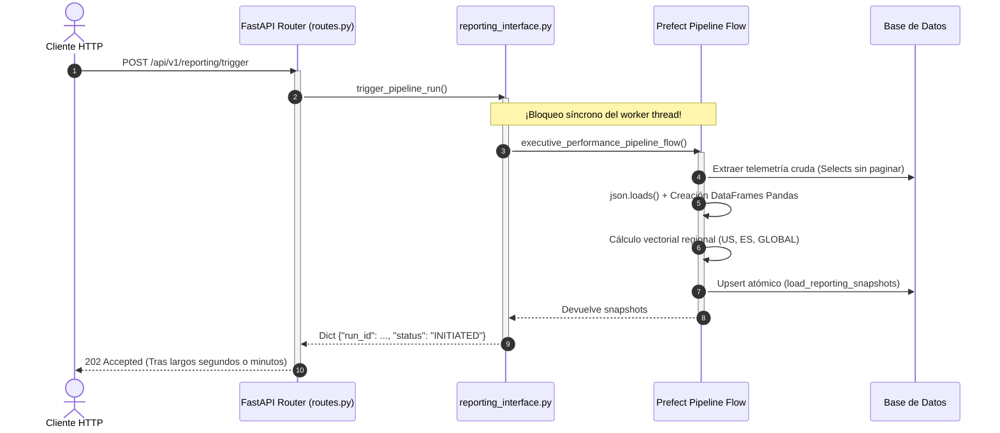

Ran list files in services/api/presentation
Analyzed main.py:L1-92
Analyzed routes.py:L1-133
Analyzed telemetry.py:L1-79
Analyzed incidents.py:L1-144
Analyzed inventory.py:L1-107
Analyzed reporting_interface.py:L1-217
Analyzed pipeline.py:L1-739
Analyzed csv_report_service.py:L1-83
Analyzed dependencies.py:L1-150
Analyzed dependencies.py:L151-280
Analyzed engine.py:L1-77
Analyzed report_service.py:L1-100
Analyzed report_service.py:L101-215
Analyzed analysis.py:L1-100
Analyzed telemetry_repo.py:L1-100
Analyzed telemetry_repo.py:L101-157
Analyzed inventory_service.py:L1-100
Analyzed inventory_repository.py:L1-100
Analyzed inventory_repository.py:L101-160
Analyzed incident_service.py:L1-49
Analyzed tiny_db_incident_repository.py:L1-91
Analyzed runner.py:L1-100
Analyzed suppliers.py:L1-73
Analyzed auth.py:L1-100

Como desarrollador de software con tres décadas diseñando, optimizando y rescatando arquitecturas en entornos de misión crítica, la experiencia me ha enseñado una lección fundamental: **una operación de API no es "pesada" únicamente por los milisegundos que tarde en local, sino por cómo satura cuatro vectores críticos del sistema bajo concurrencia real**:
1. **Amplificación de Consultas I/O en Base de Datos** (patologías $N+1$ y agotamiento del pool de conexiones).
2. **Presión sobre Heap/Memoria y Riesgo OOM (Out Of Memory)** por materialización masiva de datos en el proceso web.
3. **Bloqueo del Event Loop y Worker Thread Pool** de servidores ASGI/FastAPI.
4. **Violación de Límites Arquitectónicos** (acoplar pipelines Batch/OLAP síncronamente dentro de peticiones OLTP).

Habiendo auditado exhaustivamente las rutas y adaptadores en [`services/api`](file:///j:/GitHub/mr-stegmann-ai-engineering-company-project-monorepo/services/api) y [`services/reporting`](file:///j:/GitHub/mr-stegmann-ai-engineering-company-project-monorepo/services/reporting), a continuación presento el diagnóstico, la consulta y consenso con tres expertos de dominio, y la justificación técnica rigurosa.

---

## 1. El Diagnóstico: Las Operaciones API Más Pesadas

Tras auditar el código fuente, destacan cuatro operaciones por su severo impacto operacional:

```
┌─────────────────────────────────────────────────────────────────────────────────────────────────┐
│ RANKING DE OPERACIONES MÁS PESADAS EN SERVICES/                                                 │
├──────┬────────────────────────────────────┬─────────────────────────────────────────────────────┤
│  #1  │ POST /api/v1/reporting/trigger     │ Ejecución síncrona de Pipeline Prefect ETL completo │
│  #2  │ GET  /api/v1/inventory/products    │ Patología 2N + 1 Queries SQL hacia la base de datos │
│  #3  │ GET  /api/v1/telemetry/report      │ Full-table scan de eventos + Pandas en el worker web│
│  #4  │ POST /api/v1/incidents/analyze     │ Carga total de archivo en RAM (Buffer + String)     │
└──────┴────────────────────────────────────┴─────────────────────────────────────────────────────┘
```

---

## 2. Consulta y Debate con los Tres Expertos

Para contrastar el análisis técnico, convoqué a tres especialistas con distintas perspectivas de arquitectura e infraestructura:

---

### Experto 1: Dra. Elena Morales — *Principal Database & Performance Architect*
> **Enfoque:** I/O de disco, contención de locks, optimización de queries y escalabilidad relacional.

* **Veredicto:** *"El mayor peligro para la base de datos relacional es sin duda [`GET /api/v1/inventory/products`](file:///j:/GitHub/mr-stegmann-ai-engineering-company-project-monorepo/services/api/presentation/api/v1/inventory.py#L48-L58)."*
* **Fundamentación:**
  * Al examinar [`SQLModelInventoryRepository.list_all_products()`](file:///j:/GitHub/mr-stegmann-ai-engineering-company-project-monorepo/services/api/infrastructure/persistence/sqlmodel/inventory_repository.py#L116-L139), vemos que primero ejecuta `SELECT * FROM sku`. Luego, dentro de un bucle `for s in skus:`, invoca [`calculate_stock()`](file:///j:/GitHub/mr-stegmann-ai-engineering-company-project-monorepo/services/api/infrastructure/persistence/sqlmodel/inventory_repository.py#L99-L115), que lanza **dos queries individuales agregadas por cada producto**:
    $$\text{Total Queries} = 1 + 2N$$
    Si la empresa maneja 5,000 SKUs, un solo usuario abriendo el catálogo dispara **10,001 consultas SQL consecutivas**.
  * Además, en [`GET /api/v1/telemetry/report`](file:///j:/GitHub/mr-stegmann-ai-engineering-company-project-monorepo/services/api/presentation/api/v1/telemetry.py#L33-L79), cuando se consultan rangos temporales personalizados en [`SQLModelTelemetryRepository`](file:///j:/GitHub/mr-stegmann-ai-engineering-company-project-monorepo/services/api/infrastructure/persistence/sqlmodel/telemetry_repo.py#L71-L83), se extraen todas las entidades `TelemetryEventRecord` crudas a memoria en vez de delegar los `GROUP BY date` y `COUNT` al motor SQL, saturando innecesariamente el ancho de banda entre la API y la base de datos.

---

### Experto 2: Ing. Marcus Vance — *Staff SRE & Cloud Infrastructure Specialist*
> **Enfoque:** Ciclo de vida de procesos, consumo de CPU/RAM en contenedores, timeouts y starvation de threads.

* **Veredicto:** *"Desde la perspectiva de resiliencia y disponibilidad de los pods, la operación más peligrosa e inaceptable es [`POST /api/v1/reporting/trigger`](file:///j:/GitHub/mr-stegmann-ai-engineering-company-project-monorepo/services/reporting/presentation/routes.py#L57-L92)."*
* **Fundamentación:**
  * Aunque responde con `HTTP 202 Accepted`, la implementación interna en [`data/pipelines/reporting_interface.py`](file:///j:/GitHub/mr-stegmann-ai-engineering-company-project-monorepo/data/pipelines/reporting_interface.py#L124-L128) llama directamente a [`executive_performance_pipeline_flow()`](file:///j:/GitHub/mr-stegmann-ai-engineering-company-project-monorepo/data/pipelines/pipeline.py#L576-L683) **de forma completamente síncrona y bloqueante**.
  * Esta función inicializa el runtime de Prefect 3.x, extrae lotes enteros de telemetría, parsea JSONs en bucle, crea 4 DataFrames de Pandas, ejecuta agregaciones vectoriales y efectúa upserts masivos en base de datos.
  * Mantener una tarea batch/ETL que tarda decenas de segundos o minutos atada a un worker thread de FastAPI (`uvicorn`/`starlette`) provoca *thread pool starvation*. Si dos o tres directivos lanzan reportes simultáneos, el servidor web agota sus workers y deja de responder a los healthchecks (`livenessProbe`), provocando reinicios en cascada en Kubernetes y errores 504 Gateway Timeout en el Ingress/Reverse Proxy.
  * Sumado a esto, en [`POST /api/v1/incidents/analyze`](file:///j:/GitHub/mr-stegmann-ai-engineering-company-project-monorepo/services/api/presentation/api/v1/incidents.py#L34-L65), el uso de `content = await file.read()` y `text_stream = io.StringIO(content.decode("utf-8"))` duplica el tamaño del archivo subido en el heap de Python. Un archivo CSV de 500 MB consumirá de inmediato más de 1.5 GB de RAM, arriesgando un OOM-Kill por el kernel de Linux.

---

### Experto 3: Alejandro Silva — *Distributed Systems & Enterprise Software Architect*
> **Enfoque:** Cohesión de dominio, segregación de responsabilidades (CQRS), patrones asíncronos y blast radius.

* **Veredicto:** *"Coincido con ambos, pero destaco la grave violación del principio de segregación transaccional (OLTP vs OLAP) y la fragilidad del caching."*
* **Fundamentación:**
  * En una arquitectura profesional, **ningún endpoint HTTP síncrono debe orquestar flujos de ingeniería de datos**. El endpoint `trigger` debió limitarse a publicar un evento en una cola de mensajería (Redis, RabbitMQ, SQS) o despachar un *deployment run* desacoplado de Prefect para que lo ejecute un worker independiente en [`services/jobs`](file:///j:/GitHub/mr-stegmann-ai-engineering-company-project-monorepo/services/jobs).
  * Por otra parte, en [`GET /api/v1/inventory/products`](file:///j:/GitHub/mr-stegmann-ai-engineering-company-project-monorepo/services/api/presentation/api/v1/inventory.py#L53), se intenta parchar el problema estructural de rendimiento con una caché en memoria de 30 segundos (`inventory_products:all`). Pero ante un *Cache Miss* o una invalidación por `create_product`, se produce el fenómeno de **Cache Stampede (Thundering Herd)**: múltiples clientes concurrentes calcularán el inventario a la vez, multiplicando los miles de queries concurrentes y bloqueando la base de datos completa.

---

## 3. Justificación Técnica en Profundidad

### Puesto 1 (La más pesada por impacto global y CPU/Thread Blocking):
👉 **`POST /api/v1/reporting/trigger`** (y alias `/reporting/trigger`)



* **Ubicación:** [`services/reporting/presentation/routes.py`](file:///j:/GitHub/mr-stegmann-ai-engineering-company-project-monorepo/services/reporting/presentation/routes.py#L70-L92) $\to$ [`data/pipelines/reporting_interface.py`](file:///j:/GitHub/mr-stegmann-ai-engineering-company-project-monorepo/data/pipelines/reporting_interface.py#L85-L145) $\to$ [`data/pipelines/pipeline.py`](file:///j:/GitHub/mr-stegmann-ai-engineering-company-project-monorepo/data/pipelines/pipeline.py#L576-L683).
* **Por qué es la más pesada:**
  1. Ejecuta tres subflujos de Prefect (`extract_fulfillment_and_telemetry_flow`, `transform_executive_performance_kpis_flow`, `load_executive_kpi_snapshots_flow`).
  2. Lee tablas completas de eventos de la base de datos, parsea cadenas JSON registro a registro en Python, y genera estructuras Pandas y NumPy intensivas en CPU y memoria.
  3. Secuestra el hilo de ejecución del servidor web durante todo el proceso, vulnerando la naturaleza no bloqueante del backend.

---

### Puesto 2 (La más pesada por I/O Relacional y Multiplicación de Queries):
👉 **`GET /api/v1/inventory/products`** (y alias `/inventory/products`)

* **Ubicación:** [`services/api/presentation/api/v1/inventory.py`](file:///j:/GitHub/mr-stegmann-ai-engineering-company-project-monorepo/services/api/presentation/api/v1/inventory.py#L48-L58) $\to$ [`SQLModelInventoryRepository.list_all_products()`](file:///j:/GitHub/mr-stegmann-ai-engineering-company-project-monorepo/services/api/infrastructure/persistence/sqlmodel/inventory_repository.py#L116-L139).
* **Por qué es destructiva:**
  * Implementa un antipatrón clásico:
    ```python
    # En list_all_products:
    skus = session.exec(select(ORMSKU)).all() # 1 Query
    for s in skus:
        stock = self.calculate_stock(s.id, s.warehouse_id) # ¡2 Queries por CADA SKU!
    ```
  * Cada producto ejecuta una consulta para `SUM(ORMStockEntry.quantity)` y otra para `SUM(ORMStockExit.quantity)`.
  * **Solución técnica que debió implementarse:** Una única consulta SQL con `LEFT JOIN` y `GROUP BY`, calculando `COALESCE(SUM(entries.qty), 0) - COALESCE(SUM(exits.qty), 0)` directamente en el motor relacional.

---

### Puesto 3 (La más pesada por Ineficiencia de Agregación y Riesgo de OOM):
👉 **`GET /api/v1/telemetry/report`** (y alias `/telemetry/report`)

* **Ubicación:** [`services/api/presentation/api/v1/telemetry.py`](file:///j:/GitHub/mr-stegmann-ai-engineering-company-project-monorepo/services/api/presentation/api/v1/telemetry.py#L33-L79) $\to$ [`TelemetryReportService.get_report()`](file:///j:/GitHub/mr-stegmann-ai-engineering-company-project-monorepo/services/api/application/telemetry/report_service.py#L43-L109).
* **Por qué es pesada:**
  * Al solicitar un rango de fechas con parámetros `start_date` y `end_date`, se invalida la clave por defecto de la caché.
  * La consulta en [`SQLModelTelemetryRepository.get_events_as_dicts()`](file:///j:/GitHub/mr-stegmann-ai-engineering-company-project-monorepo/services/api/infrastructure/persistence/sqlmodel/telemetry_repo.py#L101-L115) hace un `select(TelemetryEventRecord)` de todos los registros en el rango sin límite de paginación.
  * Construye modelos ORM SQLModel individuales, los transforma en diccionarios de Python y luego instancia un `pd.DataFrame` para hacer agrupaciones que el motor de base de datos podría resolver en milisegundos mediante índices temporales.

---

### Puesto 4 (La más pesada por I/O de Red y Presión en Memoria):
👉 **`POST /api/v1/incidents/analyze`** (y alias `/api/incidents/analyze`)

* **Ubicación:** [`services/api/presentation/api/v1/incidents.py`](file:///j:/GitHub/mr-stegmann-ai-engineering-company-project-monorepo/services/api/presentation/api/v1/incidents.py#L34-L65).
* **Por qué es pesada:**
  * No procesa el fichero como un flujo continuo (*stream* real de bytes desde el socket).
  * Al hacer `await file.read()`, vuelca el archivo íntegro a un buffer de memoria de Python; acto seguido, `content.decode("utf-8")` crea una copia idéntica en formato `str`. Esto genera picos de asignación de memoria no controlados.

---

## 4. Cuadro Comparativo de Severidad

| Endpoint | Vector Crítico | Complejidad / Patología | Impacto en Servidor | Severidad |
| :--- | :--- | :--- | :--- | :---: |
| **`POST /reporting/trigger`** | CPU + Thread Blocking | Orquestación Prefect ETL síncrona | Agotamiento de workers ASGI (Starvation) y Timeouts | 🔴 **Crítica** |
| **`GET /inventory/products`** | I/O de Base de Datos | $2N + 1$ Consultas SQL | Saturación del Connection Pool y contención de locks | 🔴 **Crítica** |
| **`GET /telemetry/report`** | Memoria Heap + I/O DB | Extracción total de eventos + Pandas | Picos de memoria en el proceso web y latencia alta | 🟠 **Alta** |
| **`POST /incidents/analyze`** | Memoria Heap (RAM) | Carga completa en RAM de archivos | Riesgo de OOM Kill ante archivos grandes | 🟡 **Media-Alta** |

---

## 5. Dictamen y Conclusión de Ingeniería

1. **La operación más pesada en tiempo de ejecución y consumo de hilos es `POST /api/v1/reporting/trigger`**: Jamás debe ejecutarse un pipeline ETL dentro del ciclo síncrono de una petición HTTP; debe despacharse a un servicio en segundo plano ([`services/jobs`](file:///j:/GitHub/mr-stegmann-ai-engineering-company-project-monorepo/services/jobs)) mediante colas asíncronas.
2. **La operación más perjudicial para la persistencia relacional es `GET /api/v1/inventory/products`**: Su complejidad de $2N + 1$ consultas paralizará la base de datos a medida que el catálogo crezca, debiendo sustituirse de inmediato por una agregación SQL (`GROUP BY sku_id`).