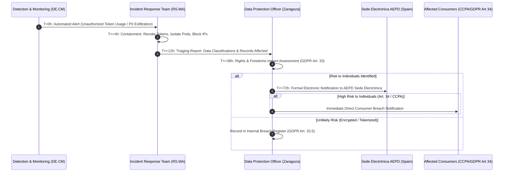

# Incident Response Runbook: GDPR 72-Hour AEPD SLA & CCPA/CPRA Compliance

**Version**: 1.0.0  
**Effective Date**: 2026-11-25  
**Operational Footprint**: Los Angeles (California, USA) & Zaragoza (Aragón, Spain)  
**Lead Supervisory Authority**: Agencia Española de Protección de Datos (AEPD)  
**Lead US Authority**: California Privacy Protection Agency (CPPA) / Attorney General  
**Governing Regulations**: EU General Data Protection Regulation (GDPR / RGPD UE 2016/679) Articles 33 & 34; California Consumer Privacy Act / California Privacy Rights Act (CCPA/CPRA Cal. Civ. Code § 1798.100 et seq.)

---

## 1. Executive Summary & Legal Mandates

TrackFlow Tech operates transatlantic logistics intelligence services processing both Personally Identifiable Information (`RESTRICTED_PII`: recipient delivery addresses, customer contact numbers, tracking identifiers) and B2B commercial logistics data (`CONFIDENTIAL_B2B`: carrier rates, warehouse performance metrics).

In the event of a confirmed or suspected security incident involving unauthorized access, exfiltration, or tampering with personal delivery data:
1. **EU GDPR Article 33**: TrackFlow is legally mandated to notify the **Agencia Española de Protección de Datos (AEPD)** within **72 hours** of becoming aware of the breach, unless the personal data breach is unlikely to result in a risk to the rights and freedoms of natural persons.
2. **EU GDPR Article 34**: If the breach is likely to result in a **high risk** to individuals, TrackFlow must communicate the breach to the affected data subjects without undue delay.
3. **California CCPA / CPRA**: Mandates rapid notification to California residents if unencrypted sensitive personal information has been accessed or exfiltrated, with statutory civil remedies for affected consumers.

---

## 2. Transatlantic Incident Response Lifecycle



---

## 3. Strict 72-Hour Response Milestones

| Milestone | Target Window | Responsible Entity | Concrete Operational Actions |
|---|---|---|---|
| **Phase 1: Detection & Triaging** | **T = 0h to T + 4h** | Security Ops / On-Call Lead | 1. Identify breach vector (API token abuse, SSRF, prompt injection leak).<br>2. Immediate credential revocation & rotation.<br>3. Quarantine compromised container pods or origin IP ranges.<br>4. Snapshot volatile memory & container audit logs. |
| **Phase 2: Scope Quantification** | **T + 4h to T + 12h** | Lead Security Engineer & Lead DBA | 1. Query `SecurityAuditLogEntry` and telemetry archives.<br>2. Determine exact data categories (`RESTRICTED_PII` addresses, names, phones).<br>3. Quantify affected user count partitioned by jurisdiction (ES/EU vs. US/California). |
| **Phase 3: DPO Legal Assessment** | **T + 12h to T + 36h** | Data Protection Officer (Zaragoza) | 1. Evaluate risk to rights and freedoms of data subjects (financial fraud, physical security risk from address disclosure).<br>2. Determine if Article 33 notification threshold is triggered.<br>3. Determine if Article 34 individual consumer notice is required. |
| **Phase 4: Regulatory Drafting** | **T + 36h to T + 60h** | Legal Counsel & DPO | 1. Draft formal AEPD submission via standardized telemetric payload.<br>2. If > 72 hours, prepare documented legal justification for phased notification. |
| **Phase 5: Formal Submission** | **T <= 72h** | Primary DPO Office (Zaragoza) | 1. Electronically submit breach notification via Sede Electrónica AEPD.<br>2. Obtain cryptographic submission receipt and filing dossier ID. |

---

## 4. Standardized AEPD Article 33 Notification Payload

The following structured schema represents the telemetric filing transmitted to the AEPD:

```json
{
  "supervisory_authority": "Agencia Española de Protección de Datos (AEPD)",
  "legal_basis": "GDPR Art. 33 / RGPD UE 2016/679",
  "incident_id": "INC-2026-AEPD-001",
  "detected_at": "2026-11-25T10:00:00Z",
  "notification_submitted_at": "2026-11-26T14:30:00Z",
  "elapsed_hours": 28.5,
  "is_within_72h_sla": true,
  "late_submission_justification": null,
  "dpo_contact": {
    "office": "TrackFlow Zaragoza DPO Office",
    "email": "dpo.zaragoza@trackflow.io",
    "country": "ES"
  },
  "breach_assessment": {
    "nature_of_breach": "Unauthorized API token exfiltration affecting customer delivery queries",
    "affected_data_categories": [
      "DELIVERY_ADDRESS",
      "RECIPIENT_FULL_NAME",
      "PHONE_NUMBER",
      "TRACKING_NUMBER"
    ],
    "approximate_data_subjects_count": 85,
    "likely_consequences": "Temporary risk of unauthorized contact or address disclosure.",
    "containment_measures_taken": [
      "Invalidated all active JWT sessions and rotated API secrets",
      "Isolated suspicious egress IPs",
      "Enforced rate limiting and prompt boundary verification"
    ]
  }
}
```

---

## 5. California CCPA/CPRA Consumer Rights Fulfillment Runbook

For users residing in California (US):
1. **Right to Know (Access)**:
   - Endpoint: `GET /api/v1/users/privacy/access`
   - SLA: Deliver all collected telemetry, customer order history, and agent conversation transcripts within 45 calendar days (free of charge).
2. **Right to Delete (Erasure)**:
   - Endpoint: `POST /api/v1/users/privacy/delete`
   - SLA: Purge ephemeral chat logs, memory proposals, and temporary order caches across SQLite, TinyDB, and Qdrant within 45 days.
3. **Do Not Sell or Share My Personal Information**:
   - TrackFlow maintains strict **zero-sale** compliance:
   - Third-party model providers (Anthropic) operate under commercial zero-data-retention DPAs (`zero_data_retention_active == True`).
   - Consumer personal data is never monetized, brokered, or shared with external advertising networks.

---

## 6. Post-Incident Review & NIST CSF Recover Phase

1. **Root Cause Analysis (RCA)**: Completed within 14 calendar days by the Lead Security Architect and CISO.
2. **Residual Risk Ledger Update**: Any identified architectural vulnerability is entered into `specs/037-nist-security-practices/data/residual_risks.json` with assigned risk owner and scheduled remediation milestone.
3. **Executive Reporting**: Biannual audit report submitted to the Board of Directors and Transatlantic Compliance Committee.
