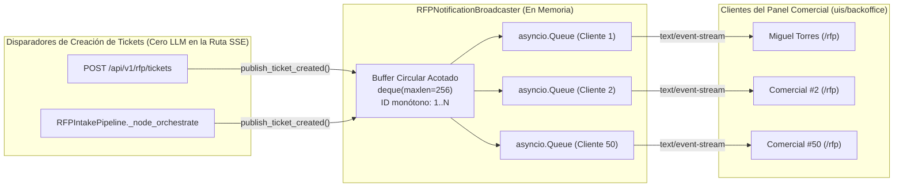

# Análisis Arquitectónico: Notificaciones de Tickets RFP en Tiempo Real (SSE Parte 1 de 2)

**Funcionalidad**: `034-sse-rfp-notifications`  
**Audiencia**: Equipos Comercial y de Ingeniería de TrackFlow (Miguel Torres, Andrés Kim)  
**Referencia de Briefing**: [docs/real-time-notification/trackflow-BRIEFING.es.md](./trackflow-BRIEFING.es.md)

---

## 1. Análisis de Concurrencia y Fan-Out: 2 vs. 50+ Usuarios de Ventas Simultáneos

### 1.1 Fan-Out en Memoria en un Solo Proceso (2 a 50 Usuarios en un Único Worker)

En nuestra implementación actual (`services/api/infrastructure/messaging/rfp_notification_broadcaster.py`), `RFPNotificationBroadcaster` implementa el puerto hexagonal `RFPNotificationBroadcasterPort` (`services/api/domain/rfp/ports.py`):

* **Cómo se Gestionan 2 Usuarios Simultáneos**:
* Cada pestaña de navegador conectada invoca `GET /api/v1/rfp/notifications/stream`, que autentica al usuario mediante `Depends(get_current_user)` y registra una `asyncio.Queue(maxsize=128)` dedicada en `RFPNotificationBroadcaster.subscribe()`.
* Cuando un ticket entra al sistema con `status = analyzing`, `publish_ticket_created()` adquiere un bloqueo de hilo ligero, asigna un `event_id` monótono, añade el `SSEEnvelope` al buffer circular (`maxlen=256`) y realiza `put_nowait` sin bloqueo (o `loop.call_soon_threadsafe` cuando se invoca desde un hilo síncrono de trabajo en segundo plano) en las colas de ambos suscriptores.
* Cuando cualquiera de los clientes cierra su pestaña o pierde conectividad, el bloque `try ... finally` en `_rfp_sse_event_generator` garantiza que `broadcaster.unsubscribe(queue)` se ejecute de inmediato, evitando fugas de memoria o colas zombi.

* **Cómo se Comportan 50 Usuarios Simultáneos en un Único Worker Asíncrono**:
* Dado que FastAPI / Uvicorn ejecuta los generadores SSE como corrutinas asíncronas en un único bucle de eventos, 50 conexiones SSE concurrentes **no** consumen 50 hilos del sistema operativo. Cada cliente inactivo espera en `asyncio.wait_for(queue.get(), timeout=15.0)`, consumiendo solo unos pocos kilobytes de memoria para su marco de corrutina y su `asyncio.Queue`.
* La complejidad de fan-out es $O(N)$ inserciones de punteros en memoria sin bloqueo; para $N = 50$ comerciales conectados, emitir un frame `rfp_ticket_created` se completa en menos de `0.5 ms` sin bloquear la petición HTTP productora.
* Si el buffer de un cliente lento alcanza `maxsize=128`, el broadcaster expulsa el frame más antiguo en cola para ese cliente lento en lugar de bloquear al productor o retrasar a los otros 49 usuarios conectados.

### 1.2 Escalado a 50+ Usuarios en Múltiples Workers / Contenedores (Escalado Horizontal)

* **Qué Cambia con el Despliegue Multi-Worker (`uvicorn --workers 4` o Pods de Kubernetes)**:
* La memoria en proceso está aislada por cada proceso del sistema operativo. Si el usuario comercial A está conectado al Worker 1 y se registra un nuevo ticket RFP en el Worker 2, un broadcaster en memoria del Worker 2 no llegará a los suscriptores `asyncio.Queue` del Worker 1, ni el Worker 1 compartirá el buffer circular en memoria de `Last-Event-ID` del Worker 2.
* Además, cada conexión SSE abierta mantiene un socket abierto y —si las sesiones de base de datos se retuvieran descuidadamente en las dependencias— podría agotar los pools de conexiones SQL. (En nuestra implementación, `stream_rfp_notifications` **no** mantiene abierta intencionadamente una `Session` de SQLModel de larga duración durante el streaming; `get_current_user` valida el JWT por adelantado antes de que se ejecute el generador del stream).

* **Ruta de Evolución Multi-Worker en Producción mediante `RFPNotificationBroadcasterPort**`:
* Debido a que las rutas y los pipelines dependen de la abstracción `RFPNotificationBroadcasterPort`, escalar en múltiples workers no requiere cambios en los endpoints de presentación ni en el código frontend. Sustituimos el proveedor singleton en `presentation/dependencies.py` por un `RedisRFPNotificationBroadcaster`:
1. **Fan-Out Entre Workers**: `publish_ticket_created()` publica el `SSEEnvelope` serializado en un canal Pub/Sub de Redis (`trackflow:rfp:notifications`) y lo añade a un Redis Stream acotado (`XADD trackflow:rfp:stream MAXLEN ~ 256 *`).
2. **Relevo Local por Worker**: Cada worker de Uvicorn ejecuta una única tarea en segundo plano suscrita al canal Pub/Sub de Redis y distribuye los mensajes recibidos a sus clientes locales `asyncio.Queue`.
3. **Buffer Compartido de Reproducción**: Al reconectar con `Last-Event-ID`, cualquier worker puede consultar `XRANGE` en el Redis Stream para reproducir los eventos perdidos de forma determinista, independientemente de qué worker gestionó originalmente la creación del ticket.

---

## 2. Estrategia de Reconexión, Recuperación Híbrida de Tickets Perdidos y Deduplicación

Las redes reales sufren caídas transitorias, cambios de red Wi-Fi, timeouts de proxy y reinicios del backend. Para garantizar **cero tickets RFP perdidos** y **cero entradas duplicadas** en el panel comercial, TrackFlow implementa una estrategia de defensa en profundidad de tres capas:

### 2.1 Backoff Exponencial Progresivo con Detención por Autenticación

* Cuando el stream `fetch()` se cierra o lanza un error de red, `useRFPNotifications` cambia `connectionStatus` a `"reconnecting"` y programa el siguiente intento usando `calculateReconnectBackoffMs(attempt)`:

$$\text{delay\_ms} = \min(1000 \times 2^{\text{attempt}}, 30000)$$

produciendo la secuencia **`1s, 2s, 4s, 8s, 16s, 30s (tope)`**.
* En cuanto el handshake del stream tiene éxito (`HTTP 200 text/event-stream`), el contador de intentos se reinicia a `0`.
* Si el servidor responde con `HTTP 401 Unauthorized` o `HTTP 403 Forbidden`, el cliente lanza `SSEAuthError`, pasa a `"unauthorized"` y **detiene todos los reintentos automáticos** de inmediato para evitar ráfagas de reintentos con credenciales caducadas.

### 2.2 Recuperación Híbrida de Tickets Perdidos (Reproducción por `Last-Event-ID` SSE + Reconciliación REST)

1. **Ruta Rápida — Reproducción desde el Buffer Circular del Servidor (`Last-Event-ID`)**:

* Cada frame SSE emitido por el servidor incluye una línea monótona `id: <event_id>` (por ejemplo, `id: 1`, `id: 2`) y se almacena en el buffer circular acotado del broadcaster (`collections.deque(maxlen=256)`).
* El frontend registra el `id:` más alto visto en `lastEventIdRef` y envía `Last-Event-ID: <id>` en las cabeceras de la petición HTTP cada vez que reconecta.
* Antes de transmitir nuevos elementos de la cola en vivo, `_rfp_sse_event_generator` llama a `broadcaster.get_missed_events(last_event_id)` y emite inmediatamente todos los frames `rfp_ticket_created` almacenados en el buffer con `event_id > int(last_event_id)`.

2. **Ruta de Respaldo — Reconciliación de Estado vía REST (`GET /api/v1/rfp/tickets?limit=50`)**:

* Si un cliente estuvo desconectado el tiempo suficiente como para que el buffer circular de 256 eventos diera la vuelta, o si el servidor backend se reinició (reiniciando su contador en memoria), la reproducción por `Last-Event-ID` por sí sola no cubriría el hueco.
* Por ello, cada vez que `useRFPNotifications` completa una reconexión (`wasReconnect === true`), también dispara una petición asíncrona de reconciliación contra `GET /api/v1/rfp/tickets?limit=50` (que devuelve metadatos enriquecidos como `rfp_id`, `client_country` y `services_requested`) y fusiona en el panel cualquier ticket que falte.

### 2.3 Deduplicación Estricta por `ticket_id`

* **Deduplicación en el Servidor**: `RFPNotificationBroadcaster.publish_ticket_created()` mantiene un conjunto acotado de valores `ticket_id` publicados (`_published_ticket_ids`) de modo que, incluso si tanto `POST /api/v1/rfp/tickets` como un reintento del pipeline intentan emitir el mismo `ticket_id`, el stream SSE emite `rfp_ticket_created` como máximo una vez por ticket único.
* **Deduplicación en el Cliente**: `mergeAndDeduplicateTickets(existingTickets, incomingTickets)` en `uis/backoffice/lib/rfpNotificationsClient.ts` indexa todos los tickets en un `Map<string, IntakeTicketSummaryDTO>` cuya clave es el `ticket_id` canónico.
* Si un ticket llega simultáneamente a través de la reproducción SSE `Last-Event-ID`, el streaming SSE en vivo y la respuesta de reconciliación REST `GET /api/v1/rfp/tickets`, el `Map` los consolida en una sola fila manteniendo la insignia visual `isNewRealtimeArrival: true` (`"Nuevo en tiempo real"`).

---

## 3. Justificación de Protocolo: Por Qué Server-Sent Events (SSE) sobre WebSockets para la Parte 1

| Dimensión | Server-Sent Events (SSE) — **Elegido para la Parte 1** | WebSockets (`ws://` / `wss://`) — **Reservado para la Parte 2** |
| --- | --- | --- |
| **Dirección de Comunicación** | **Unidireccional (Servidor $\rightarrow$ Cliente)**: Encaja a la perfección para enviar notificaciones `rfp_ticket_created` a quienes visualizan el panel comercial y no envían frames hacia el servidor por el canal de notificaciones. | **Bidireccional Full-Duplex (Cliente $\leftrightarrow$ Servidor)**: Necesario para el chat conversacional interactivo (Parte 2), pero supone una sobrecarga de protocolo innecesaria para alertas unidireccionales en el panel. |
| **Infraestructura HTTP y Firewalls Corporativos** | Funciona sobre HTTP/1.1 y HTTP/2 estándar (`Content-Type: text/event-stream`). Atraviesa proxies L7 corporativos, API gateways y balanceadores de carga sin fricciones usando frames de comentario `: keep-alive` (intervalo de `15s`) y `X-Accel-Buffering: no`. | Requiere un handshake de actualización HTTP `101 Switching Protocols`, que puede ser bloqueado por proxies corporativos estrictos o exigir reglas específicas de sesiones persistentes (sticky sessions) para WebSockets. |
| **Framing Nativo y Semántica de Reproducción** | Framing nativo del estándar W3C para eventos con nombre (`event: rfp_ticket_created`), IDs de secuencia monótonos (`id: 1`) y cabeceras estandarizadas de reproducción al reconectar `Last-Event-ID`. | Sin nombres de evento, IDs de secuencia ni semántica de reproducción integradas: todo el framing, los heartbeats (`ping/pong`) y la recuperación de secuencias deben construirse a medida en la capa de aplicación. |
| **Autenticación y Seguridad** | Se consume mediante `fetch()` + `ReadableStream` enviando cabeceras estándar `Authorization: Bearer <jwt>`, reutilizando el middleware existente `Depends(get_current_user)` de FastAPI sin exponer tokens en las URL. | La API del navegador `new WebSocket(url)` no permite establecer cabeceras `Authorization` personalizadas durante el handshake, forzando a menudo soluciones alternativas mediante subprotocolos o query strings. |
