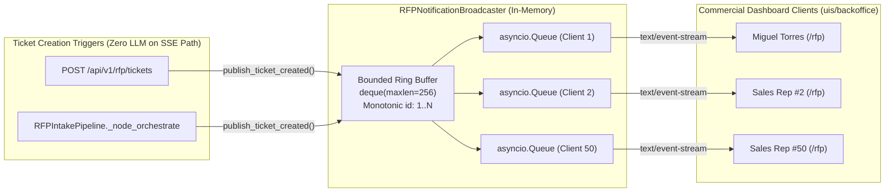

# Architectural Analysis: Real-Time RFP Ticket Notifications (SSE Part 1 of 2)

**Feature**: `034-sse-rfp-notifications`  
**Audience**: TrackFlow Commercial & Engineering Teams (Miguel Torres, Andrés Kim)  
**Briefing Reference**: [docs/real-time-notification/trackflow-BRIEFING.es.md](./trackflow-BRIEFING.es.md)

---

## 1. Concurrency & Fan-Out Analysis: 2 vs. 50+ Simultaneous Sales Users

### 1.1 Single-Process In-Memory Fan-Out (2 to 50 Users on a Single Worker)

In our current implementation (`services/api/infrastructure/messaging/rfp_notification_broadcaster.py`), `RFPNotificationBroadcaster` implements the hexagonal port `RFPNotificationBroadcasterPort` (`services/api/domain/rfp/ports.py`):

- **How 2 Simultaneous Users Are Handled**:
  - Each connected browser tab invokes `GET /api/v1/rfp/notifications/stream`, which authenticates the user via `Depends(get_current_user)` and registers a dedicated `asyncio.Queue(maxsize=128)` in `RFPNotificationBroadcaster.subscribe()`.
  - When a ticket enters the system with `status = analyzing`, `publish_ticket_created()` acquires a lightweight thread lock, assigns a monotonic `event_id`, appends the `SSEEnvelope` to the ring buffer (`maxlen=256`), and performs non-blocking `put_nowait` (or `loop.call_soon_threadsafe` when called from a synchronous background worker thread) into both subscribers' queues.
  - When either client closes their tab or loses connectivity, the `try ... finally` block in `_rfp_sse_event_generator` guarantees `broadcaster.unsubscribe(queue)` is executed immediately, preventing memory leaks or zombie queues.
- **How 50 Simultaneous Users Behave on a Single Async Worker**:
  - Because FastAPI / Uvicorn runs SSE generators as asynchronous coroutines on a single event loop, 50 concurrent SSE connections do **not** consume 50 OS threads. Each idle client awaits `asyncio.wait_for(queue.get(), timeout=15.0)`, consuming only a few kilobytes of memory for its coroutine frame and `asyncio.Queue`.
  - Fan-out complexity is $O(N)$ non-blocking in-memory pointer insertions; for $N = 50$ connected sales reps, broadcasting an `rfp_ticket_created` frame completes in `< 0.5 ms` without blocking the HTTP producer request.
  - If a slow client's buffer reaches `maxsize=128`, the broadcaster evicts the oldest queued frame for that slow client rather than blocking the producer or delaying the other 49 connected users.

### 1.2 Scaling to 50+ Users Across Multiple Workers / Containers (Horizontal Scaling)

- **What Changes with Multi-Worker Deployment (`uvicorn --workers 4` or Kubernetes Pods)**:
  - In-process memory is isolated per OS process. If Sales User A is connected to Worker 1 and a new RFP ticket is registered on Worker 2, an in-memory broadcaster on Worker 2 will not reach Worker 1's `asyncio.Queue` subscribers, nor will Worker 1 share Worker 2's in-memory `Last-Event-ID` ring buffer.
  - Additionally, each open SSE connection holds one open socket and—if database sessions were held carelessly in dependencies—could exhaust SQL connection pools. (In our implementation, `stream_rfp_notifications` intentionally does **not** hold a long-lived SQLModel `Session` open during streaming; `get_current_user` validates the JWT upfront before the stream generator runs.)
- **Production Multi-Worker Evolution Path via `RFPNotificationBroadcasterPort`**:
  - Because routes and pipelines depend on the abstract `RFPNotificationBroadcasterPort`, scaling across multiple workers requires zero changes to presentation endpoints or frontend code. We swap the singleton provider in `presentation/dependencies.py` for a `RedisRFPNotificationBroadcaster`:
    1. **Cross-Worker Fan-Out**: `publish_ticket_created()` publishes the serialized `SSEEnvelope` to a Redis Pub/Sub channel (`trackflow:rfp:notifications`) and appends it to a capped Redis Stream (`XADD trackflow:rfp:stream MAXLEN ~ 256 *`).
    2. **Local Worker Relay**: Each Uvicorn worker runs a single background task subscribed to the Redis Pub/Sub channel and fans out received messages to its local `asyncio.Queue` clients.
    3. **Shared Replay Buffer**: On reconnect with `Last-Event-ID`, any worker can query `XRANGE` on the Redis Stream to replay missed events deterministically regardless of which worker originally handled the ticket creation.

---

## 2. Reconnection, Hybrid Missed-Ticket Recovery & Deduplication Strategy

Real-world networks experience transient drops, Wi-Fi handoffs, proxy timeouts, and backend restarts. To ensure **zero missed RFP tickets** and **zero duplicate entries** on the commercial dashboard, TrackFlow implements a three-layer defense-in-depth strategy:

### 2.1 Progressive Exponential Backoff with Auth Halt

- When the `fetch()` stream closes or throws a network error, `useRFPNotifications` transitions `connectionStatus` to `"reconnecting"` and schedules the next attempt using `calculateReconnectBackoffMs(attempt)`:
  $$\text{delay\_ms} = \min(1000 \times 2^{\text{attempt}}, 30000)$$
  producing the sequence **`1s, 2s, 4s, 8s, 16s, 30s (cap)`**.
- As soon as the stream handshake succeeds (`HTTP 200 text/event-stream`), the attempt counter resets to `0`.
- If the server responds with `HTTP 401 Unauthorized` or `HTTP 403 Forbidden`, the client throws `SSEAuthError`, transitions to `"unauthorized"`, and **halts all automatic retries** immediately to prevent retry storms with expired credentials.

### 2.2 Hybrid Missed-Ticket Recovery (SSE `Last-Event-ID` Replay + REST Reconciliation)

1. **Fast Path — Server Ring-Buffer Replay (`Last-Event-ID`)**:
   - Every SSE frame emitted by the server includes a monotonic `id: <event_id>` line (e.g., `id: 1`, `id: 2`) and is stored in the broadcaster's bounded ring buffer (`collections.deque(maxlen=256)`).
   - The frontend tracks the highest seen `id:` in `lastEventIdRef` and sends `Last-Event-ID: <id>` in the HTTP request headers whenever it reconnects.
   - Before streaming new live queue items, `_rfp_sse_event_generator` calls `broadcaster.get_missed_events(last_event_id)` and immediately yields all buffered `rfp_ticket_created` frames with `event_id > int(last_event_id)`.
2. **Fallback Path — REST State Reconciliation (`GET /api/v1/rfp/tickets?limit=50`)**:
   - If a client was offline long enough for the 256-event ring buffer to wrap around, or if the backend server restarted (resetting its in-memory counter), `Last-Event-ID` replay alone would not cover the gap.
   - Therefore, whenever `useRFPNotifications` completes a reconnection (`wasReconnect === true`), it also triggers an asynchronous reconciliation fetch against `GET /api/v1/rfp/tickets?limit=50` (which returns enriched `rfp_id`, `client_country`, and `services_requested` metadata) and merges any missing tickets into the dashboard.

### 2.3 Strict Deduplication by `ticket_id`

- **Server-Side Deduplication**: `RFPNotificationBroadcaster.publish_ticket_created()` maintains a bounded set of published `ticket_id` values (`_published_ticket_ids`) so that even if both `POST /api/v1/rfp/tickets` and a pipeline retry attempt to broadcast the same `ticket_id`, the SSE stream emits `rfp_ticket_created` at most once per unique ticket.
- **Client-Side Deduplication**: `mergeAndDeduplicateTickets(existingTickets, incomingTickets)` in `uis/backoffice/lib/rfpNotificationsClient.ts` indexes all tickets in a `Map<string, IntakeTicketSummaryDTO>` keyed by canonical `ticket_id`.
  - If a ticket arrives simultaneously via `Last-Event-ID` SSE replay, live SSE streaming, and the `GET /api/v1/rfp/tickets` REST reconciliation response, the `Map` collapses them into a single row while preserving the `isNewRealtimeArrival: true` (`"Nuevo en tiempo real"`) visual highlight badge.

---

## 3. Protocol Justification: Why Server-Sent Events (SSE) Over WebSockets for Part 1

| Dimension | Server-Sent Events (SSE) — **Chosen for Part 1** | WebSockets (`ws://` / `wss://`) — **Reserved for Part 2** |
|---|---|---|
| **Communication Direction** | **Unidirectional (Server $\rightarrow$ Client)**: Perfect match for pushing `rfp_ticket_created` notifications to commercial dashboard viewers who do not send upstream frames over the notification channel. | **Full-Duplex Bidirectional (Client $\leftrightarrow$ Server)**: Required for interactive conversational chat (Part 2), but unnecessary protocol overhead for one-way dashboard alerts. |
| **HTTP Infrastructure & Corporate Firewalls** | Runs over standard HTTP/1.1 and HTTP/2 (`Content-Type: text/event-stream`). Traverses corporate L7 proxies, API gateways, and load balancers seamlessly using standard `: keep-alive` comment frames (`15s` interval) and `X-Accel-Buffering: no`. | Requires an HTTP `101 Switching Protocols` Upgrade handshake, which can be dropped by strict corporate proxies or require dedicated sticky-session WebSocket rules. |
| **Built-In Framing & Replay Semantics** | Native W3C framing for named events (`event: rfp_ticket_created`), monotonic sequence IDs (`id: 1`), and standardized `Last-Event-ID` reconnection replay headers. | No built-in event naming, sequence ID, or replay semantics—all framing, heartbeats (`ping/pong`), and sequence recovery must be custom-built at the application layer. |
| **Authentication & Security** | Consumed via `fetch()` + `ReadableStream` passing standard `Authorization: Bearer <jwt>` headers, reusing existing FastAPI `Depends(get_current_user)` middleware with zero token leakage in URLs. | Browser `new WebSocket(url)` API cannot set custom `Authorization` headers during the handshake, often forcing subprotocol or query-string workarounds. |
