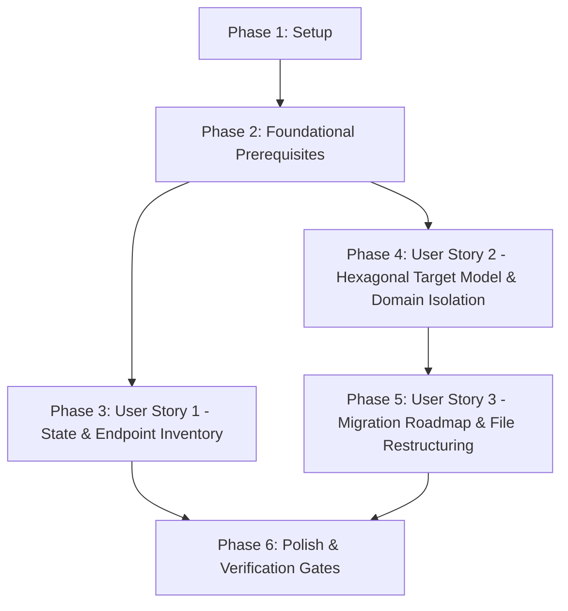

# Tasks: Backend Architecture - Switch to Hexagonal

**Input**: Design documents from `specs/016-backend-hexagonal-architecture/`  
**Prerequisites**: [plan.md](file:///j:/GitHub/mr-stegmann-ai-engineering-company-project-monorepo/specs/016-backend-hexagonal-architecture/plan.md), [spec.md](file:///j:/GitHub/mr-stegmann-ai-engineering-company-project-monorepo/specs/016-backend-hexagonal-architecture/spec.md), [research.md](file:///j:/GitHub/mr-stegmann-ai-engineering-company-project-monorepo/specs/016-backend-hexagonal-architecture/research.md), [data-model.md](file:///j:/GitHub/mr-stegmann-ai-engineering-company-project-monorepo/specs/016-backend-hexagonal-architecture/data-model.md), [contracts/](file:///j:/GitHub/mr-stegmann-ai-engineering-company-project-monorepo/specs/016-backend-hexagonal-architecture/contracts/), [quickstart.md](file:///j:/GitHub/mr-stegmann-ai-engineering-company-project-monorepo/specs/016-backend-hexagonal-architecture/quickstart.md)  
**Target Subsystem**: `services/api/`

---

## Format: `- [ ] [ID] [P?] [Story] Description with file path`

- **[P]**: Can run in parallel (different files, no dependencies on incomplete tasks)
- **[Story]**: User story mapping (`[US1]`, `[US2]`, `[US3]`) for story phase tasks
- Every task includes an exact file path and unambiguous implementation instruction

---

## Phase 1: Setup (Shared Infrastructure)

**Purpose**: Verify the backend environment, create target hexagonal directory layouts, and establish shared domain exceptions.

- [X] T001 Verify backend Python environment and sync dependencies with uv in [pyproject.toml](file:///j:/GitHub/mr-stegmann-ai-engineering-company-project-monorepo/services/api/pyproject.toml)
- [X] T002 [P] Create target directory structure for domain/, application/, infrastructure/, and presentation/api/v1/ in [services/api/](file:///j:/GitHub/mr-stegmann-ai-engineering-company-project-monorepo/services/api/)
- [X] T003 [P] Configure shared domain exceptions and base classes in [exceptions.py](file:///j:/GitHub/mr-stegmann-ai-engineering-company-project-monorepo/services/api/domain/common/exceptions.py)

---

## Phase 2: Foundational (Blocking Prerequisites)

**Purpose**: Core infrastructure and abstract ports that MUST be complete before ANY user story implementation begins.

**⚠️ CRITICAL**: No user story implementation can begin until this foundational phase is complete.

- [X] T004 [P] Define shared port interfaces (CachePort, NotificationPort) in [ports.py](file:///j:/GitHub/mr-stegmann-ai-engineering-company-project-monorepo/services/api/domain/common/ports.py)
- [X] T005 [P] Implement memory cache adapter implementing CachePort in [memory_cache_adapter.py](file:///j:/GitHub/mr-stegmann-ai-engineering-company-project-monorepo/services/api/infrastructure/cache/memory_cache_adapter.py)
- [X] T006 [P] Decouple TinyDB database client connection manager in [client.py](file:///j:/GitHub/mr-stegmann-ai-engineering-company-project-monorepo/services/api/infrastructure/persistence/tinydb/client.py)
- [X] T007 [P] Decouple SQLModel engine and session client provider in [client.py](file:///j:/GitHub/mr-stegmann-ai-engineering-company-project-monorepo/services/api/infrastructure/persistence/sqlmodel/client.py)
- [X] T008 Configure global domain-to-HTTP exception handlers in [exceptions.py](file:///j:/GitHub/mr-stegmann-ai-engineering-company-project-monorepo/services/api/core/exceptions.py)
- [X] T009 Setup centralized FastAPI dependency injection providers in [dependencies.py](file:///j:/GitHub/mr-stegmann-ai-engineering-company-project-monorepo/services/api/presentation/dependencies.py)

**Checkpoint**: Foundation ready - user story implementation can now begin in parallel or sequentially.

---

## Phase 3: User Story 1 - Comprehensive Backend State & Endpoint Inventory (Priority: P1) 🎯 MVP

**Goal**: Deliver an exhaustive, authoritative inventory and evaluation of all 23 active endpoints across all 8 functional domains, cataloging HTTP methods, URI paths, contracts, security guards, use cases, and identifying architectural anti-patterns in `docs/backend-state-analysis.md` per Constitution Principles I, II, IV, and VI.

**Independent Test**: Review [docs/backend-state-analysis.md](file:///j:/GitHub/mr-stegmann-ai-engineering-company-project-monorepo/docs/backend-state-analysis.md) and verify that every active endpoint across all domains (Suppliers, Inventory, Telemetry, Authentication, User Management, User Profiles, Incidents, and Incident Stream Analysis) is cataloged with HTTP method, URI path, file location, input/output contracts, and business use cases.

### Implementation for User Story 1

- [X] T010 [P] [US1] Audit and document Suppliers, Inventory, and Telemetry endpoints and anti-patterns in [backend-state-analysis.md](file:///j:/GitHub/mr-stegmann-ai-engineering-company-project-monorepo/docs/backend-state-analysis.md)
- [X] T011 [P] [US1] Audit and document Authentication, User Management, and Profile endpoints and anti-patterns in [backend-state-analysis.md](file:///j:/GitHub/mr-stegmann-ai-engineering-company-project-monorepo/docs/backend-state-analysis.md)
- [X] T012 [P] [US1] Audit and document Incidents and CSV Stream Analysis endpoints and anti-patterns in [backend-state-analysis.md](file:///j:/GitHub/mr-stegmann-ai-engineering-company-project-monorepo/docs/backend-state-analysis.md)
- [X] T013 [US1] Validate 100% coverage of all 23 active endpoints, schemas, and anti-pattern remediation rules in [backend-state-analysis.md](file:///j:/GitHub/mr-stegmann-ai-engineering-company-project-monorepo/docs/backend-state-analysis.md)

**Checkpoint**: At this point, User Story 1 is complete and provides full visibility and contract baseline for all backend domains.

---

## Phase 4: User Story 2 - Hexagonal Architecture Target Model & Domain Boundary Proposal (Priority: P1)

**Goal**: Define and implement the pure domain models, abstract driven port interfaces, driven persistence/infrastructure adapters, application services, and presentation routes for all 8 domains (Suppliers, Inventory, Incidents, Auth, Users, Profiles, Telemetry) ensuring 0 external dependencies in `domain/` and clean dependency inversion.

**Independent Test**: Verify that domain models contain zero external imports (`from fastapi`, `from sqlmodel`, `from tinydb`), application services depend strictly on port interfaces via constructor DI, and unit tests pass using mock repositories in `tests/unit/`.

### Tests for User Story 2 ⚠️

- [X] T014 [P] [US2] Unit test domain models and business invariants (stock calculations, incident transitions) in [test_domain_models.py](file:///j:/GitHub/mr-stegmann-ai-engineering-company-project-monorepo/services/api/tests/unit/test_domain_models.py)
- [X] T015 [P] [US2] Unit test application services with mock repository ports in [test_application_services.py](file:///j:/GitHub/mr-stegmann-ai-engineering-company-project-monorepo/services/api/tests/unit/test_application_services.py)

### Implementation for User Story 2

- [X] T016 [P] [US2] Implement pure Supplier domain model in [models.py](file:///j:/GitHub/mr-stegmann-ai-engineering-company-project-monorepo/services/api/domain/suppliers/models.py) and SupplierRepositoryPort in [ports.py](file:///j:/GitHub/mr-stegmann-ai-engineering-company-project-monorepo/services/api/domain/suppliers/ports.py)
- [X] T017 [P] [US2] Implement pure Inventory domain models in [models.py](file:///j:/GitHub/mr-stegmann-ai-engineering-company-project-monorepo/services/api/domain/inventory/models.py) and InventoryRepositoryPort in [ports.py](file:///j:/GitHub/mr-stegmann-ai-engineering-company-project-monorepo/services/api/domain/inventory/ports.py)
- [X] T018 [P] [US2] Implement pure Incident domain model in [models.py](file:///j:/GitHub/mr-stegmann-ai-engineering-company-project-monorepo/services/api/domain/incidents/models.py) and IncidentRepositoryPort in [ports.py](file:///j:/GitHub/mr-stegmann-ai-engineering-company-project-monorepo/services/api/domain/incidents/ports.py)
- [X] T019 [P] [US2] Implement pure Auth and User models in [models.py](file:///j:/GitHub/mr-stegmann-ai-engineering-company-project-monorepo/services/api/domain/auth/models.py) and UserRepositoryPort, ProfileRepositoryPort, SecurityPort in [ports.py](file:///j:/GitHub/mr-stegmann-ai-engineering-company-project-monorepo/services/api/domain/auth/ports.py)
- [X] T020 [P] [US2] Implement pure Telemetry value object in [models.py](file:///j:/GitHub/mr-stegmann-ai-engineering-company-project-monorepo/services/api/domain/telemetry/models.py) and TelemetrySinkPort in [ports.py](file:///j:/GitHub/mr-stegmann-ai-engineering-company-project-monorepo/services/api/domain/telemetry/ports.py)
- [X] T021 [P] [US2] Implement TinyDB persistence repository adapters in [infrastructure/persistence/tinydb/](file:///j:/GitHub/mr-stegmann-ai-engineering-company-project-monorepo/services/api/infrastructure/persistence/tinydb/)
- [X] T022 [P] [US2] Implement SQLModel persistence repository adapter and ORM models in [infrastructure/persistence/sqlmodel/](file:///j:/GitHub/mr-stegmann-ai-engineering-company-project-monorepo/services/api/infrastructure/persistence/sqlmodel/)
- [X] T023 [P] [US2] Implement JWT security adapter implementing SecurityPort in [jwt_security_adapter.py](file:///j:/GitHub/mr-stegmann-ai-engineering-company-project-monorepo/services/api/infrastructure/security/jwt_security_adapter.py)
- [X] T024 [P] [US2] Implement email notification adapter implementing NotificationPort in [email_adapter.py](file:///j:/GitHub/mr-stegmann-ai-engineering-company-project-monorepo/services/api/infrastructure/notifications/email_adapter.py)
- [X] T025 [P] [US2] Implement SupplierService with injected SupplierRepositoryPort and CachePort in [supplier_service.py](file:///j:/GitHub/mr-stegmann-ai-engineering-company-project-monorepo/services/api/application/suppliers/supplier_service.py)
- [X] T026 [P] [US2] Implement InventoryService with injected InventoryRepositoryPort in [inventory_service.py](file:///j:/GitHub/mr-stegmann-ai-engineering-company-project-monorepo/services/api/application/inventory/inventory_service.py)
- [X] T027 [P] [US2] Implement IncidentService and CSV AnalysisService with injected ports in [application/incidents/](file:///j:/GitHub/mr-stegmann-ai-engineering-company-project-monorepo/services/api/application/incidents/)
- [X] T028 [P] [US2] Implement AuthService, UserService, and ProfileService with injected ports in [application/auth/](file:///j:/GitHub/mr-stegmann-ai-engineering-company-project-monorepo/services/api/application/auth/)
- [X] T029 [P] [US2] Implement TelemetryService with injected TelemetrySinkPort in [telemetry_service.py](file:///j:/GitHub/mr-stegmann-ai-engineering-company-project-monorepo/services/api/application/telemetry/telemetry_service.py)

**Checkpoint**: At this point, User Story 2 delivers complete hexagonal separation of domain logic, use cases, ports, and concrete infrastructure adapters.

---

## Phase 5: User Story 3 - Incremental Migration Roadmap & File Restructuring Plan (Priority: P2)

**Goal**: Execute the file migration and restructuring matrix, consolidate controllers into canonical `presentation/api/v1/` routers, mount dual route paths in `main.py` for 100% backward compatibility, eliminate global variables and dynamic in-handler imports, and verify all automated test suites across every domain.

**Independent Test**: Verify that every file in `services/api` is migrated per the restructuring matrix, canonical routers (`/api/v1/*`) and legacy routes (`/suppliers`, `/inventory/*`, `/auth/*`, `/users/*`, `/profiles/*`, `/api/incidents/*`, `/telemetry/*`) respond with identical status codes and schemas, and all tests in `tests/api/` pass without modification.

### Tests for User Story 3 ⚠️

- [X] T030 [P] [US3] Regression test backward-compatible API contracts across all legacy route prefixes in [test_legacy_route_compatibility.py](file:///j:/GitHub/mr-stegmann-ai-engineering-company-project-monorepo/services/api/tests/api/test_legacy_route_compatibility.py)

### Implementation for User Story 3

- [X] T031 [P] [US3] Migrate and consolidate Suppliers router in [suppliers.py](file:///j:/GitHub/mr-stegmann-ai-engineering-company-project-monorepo/services/api/presentation/api/v1/suppliers.py)
- [X] T032 [P] [US3] Migrate and consolidate Inventory router in [inventory.py](file:///j:/GitHub/mr-stegmann-ai-engineering-company-project-monorepo/services/api/presentation/api/v1/inventory.py)
- [X] T033 [P] [US3] Migrate and consolidate Incidents router including CSV stream analysis in [incidents.py](file:///j:/GitHub/mr-stegmann-ai-engineering-company-project-monorepo/services/api/presentation/api/v1/incidents.py)
- [X] T034 [P] [US3] Migrate and consolidate Auth, Users, and Profiles routers in [presentation/api/v1/](file:///j:/GitHub/mr-stegmann-ai-engineering-company-project-monorepo/services/api/presentation/api/v1/)
- [X] T035 [P] [US3] Migrate and consolidate Telemetry router in [telemetry.py](file:///j:/GitHub/mr-stegmann-ai-engineering-company-project-monorepo/services/api/presentation/api/v1/telemetry.py)
- [X] T036 [US3] Refactor main.py as pure composition root with dual route mounting for canonical /api/v1/* and legacy routes in [main.py](file:///j:/GitHub/mr-stegmann-ai-engineering-company-project-monorepo/services/api/main.py)
- [X] T037 [US3] Relocate legacy root models.py, schemas.py, and remove obsolete directories (routes/, routers/) in [services/api/](file:///j:/GitHub/mr-stegmann-ai-engineering-company-project-monorepo/services/api/)

**Checkpoint**: At this point, the entire backend runs on pure Hexagonal Architecture with 100% backward compatibility and clean file organization.

---

## Phase 6: Polish & Cross-Cutting Concerns

**Purpose**: Monorepo verification, static boundary checks, and full regression test execution.

- [X] T038 [P] Validate architectural boundary isolation ensuring zero forbidden framework imports in [domain/](file:///j:/GitHub/mr-stegmann-ai-engineering-company-project-monorepo/services/api/domain/)
- [X] T039 [P] Run full backend test suite with coverage report via uv run pytest in [tests/](file:///j:/GitHub/mr-stegmann-ai-engineering-company-project-monorepo/services/api/tests/)
- [X] T040 Verify monorepo type safety and build health across packages with npm run typecheck in [package.json](file:///j:/GitHub/mr-stegmann-ai-engineering-company-project-monorepo/package.json)
- [X] T041 Execute validation scenarios from quickstart.md in [quickstart.md](file:///j:/GitHub/mr-stegmann-ai-engineering-company-project-monorepo/specs/016-backend-hexagonal-architecture/quickstart.md)
- [X] T042 Update docs/backend-state-analysis.md with final migration status and architectural sign-off in [backend-state-analysis.md](file:///j:/GitHub/mr-stegmann-ai-engineering-company-project-monorepo/docs/backend-state-analysis.md)

---

## Dependencies & Execution Order

### Phase Dependencies



- **Setup (Phase 1)**: No dependencies - can start immediately.
- **Foundational (Phase 2)**: Depends on Setup (Phase 1) - **BLOCKS** all user story implementations.
- **User Story 1 (Phase 3, P1)**: Depends on Foundational (Phase 2).
- **User Story 2 (Phase 4, P1)**: Depends on Foundational (Phase 2). Can execute in parallel with or right after US1.
- **User Story 3 (Phase 5, P2)**: Depends on User Story 2 (Phase 4) because routers and file moves rewire the implementations created in US2.
- **Polish (Phase 6)**: Depends on all user stories (US1, US2, US3) being complete.

### User Story Dependencies

- **User Story 1 (P1)**: Independent baseline audit. No dependencies on other stories.
- **User Story 2 (P1)**: Implements domain models, ports, adapters, and services. Independent from US1.
- **User Story 3 (P2)**: Consolidates routers, re-routes controllers to services created in US2, and cleans up legacy directories. Depends on US2 components being functional.

### Within Each User Story

- Tests written first, verifying baseline conditions or failing initial runs.
- Domain models and port contracts defined before concrete adapters and services.
- Application services implemented before presentation routers.
- Routers rewired before legacy directories are removed.
- Story complete and verified before advancing.

### Parallel Opportunities

- In Phase 1: `T002` and `T003` can execute in parallel.
- In Phase 2: `T004`, `T005`, `T006`, `T007` can execute in parallel.
- In Phase 3: `T010`, `T011`, `T012` can execute in parallel (different document sections / audit domains).
- In Phase 4: All domain model and port tasks (`T016`-`T020`) can execute in parallel; all adapter tasks (`T021`-`T024`) can execute in parallel; all application service tasks (`T025`-`T029`) can execute in parallel.
- In Phase 5: Router migrations (`T031`-`T035`) can execute in parallel.
- In Phase 6: `T038` and `T039` can execute in parallel.

---

## Parallel Execution Examples

### Parallel Example: User Story 1
```bash
# Launch domain audit and documentation tasks concurrently across domains:
Task T010: "Audit and document Suppliers, Inventory, and Telemetry endpoints in docs/backend-state-analysis.md"
Task T011: "Audit and document Authentication, User Management, and Profile endpoints in docs/backend-state-analysis.md"
Task T012: "Audit and document Incidents and CSV Stream Analysis endpoints in docs/backend-state-analysis.md"
```

### Parallel Example: User Story 2
```bash
# Define domain models and abstract ports concurrently across domains:
Task T016: "Implement pure Supplier domain model and SupplierRepositoryPort"
Task T017: "Implement pure Inventory domain models and InventoryRepositoryPort"
Task T018: "Implement pure Incident domain model and IncidentRepositoryPort"
Task T019: "Implement pure Auth and User models and UserRepositoryPort, SecurityPort"
Task T020: "Implement pure Telemetry value object and TelemetrySinkPort"

# Implement driven adapters concurrently:
Task T021: "Implement TinyDB persistence repository adapters"
Task T022: "Implement SQLModel persistence repository adapter and ORM models"
Task T023: "Implement JWT security adapter"
Task T024: "Implement email notification adapter"
```

### Parallel Example: User Story 3
```bash
# Migrate canonical v1 routers concurrently:
Task T031: "Migrate and consolidate Suppliers router in presentation/api/v1/suppliers.py"
Task T032: "Migrate and consolidate Inventory router in presentation/api/v1/inventory.py"
Task T033: "Migrate and consolidate Incidents router in presentation/api/v1/incidents.py"
Task T034: "Migrate and consolidate Auth, Users, and Profiles routers in presentation/api/v1/"
Task T035: "Migrate and consolidate Telemetry router in presentation/api/v1/telemetry.py"
```

---

## Implementation Strategy

### MVP First (User Story 1 Only)
1. Complete Phase 1 (Setup) and Phase 2 (Foundational prerequisites).
2. Complete Phase 3 (User Story 1): Deliver the authoritative endpoint audit and architectural analysis in `docs/backend-state-analysis.md`.
3. **STOP and VALIDATE**: Verify that all 23 active endpoints, contracts, and anti-patterns are documented.

### Incremental Delivery (Full Hexagonal Transition)
1. **Foundation Ready**: Complete Setup + Foundational phases.
2. **Phase 3 (US1)**: Finalize baseline inventory and anti-pattern documentation (MVP).
3. **Phase 4 (US2)**: Build the pure domain layer, abstract ports, driven adapters, and application services with isolated unit tests.
4. **Phase 5 (US3)**: Consolidate HTTP routers under `presentation/api/v1/`, wire FastAPI dependency injection, configure dual mounting in `main.py`, remove legacy directories, and verify contract regression tests.
5. **Phase 6 (Polish)**: Run static boundary checks, full backend `pytest` suite, and monorepo build/type checks.

---

## Notes
- All tasks strictly follow `- [ ] [ID] [P?] [Story] Description with file path`.
- Zero `any` types and strict TypeScript rules apply to monorepo package interfaces.
- Zero external framework imports permitted within `domain/` modules.
- 100% backward compatibility maintained for all 23 legacy endpoint routes and response models.
