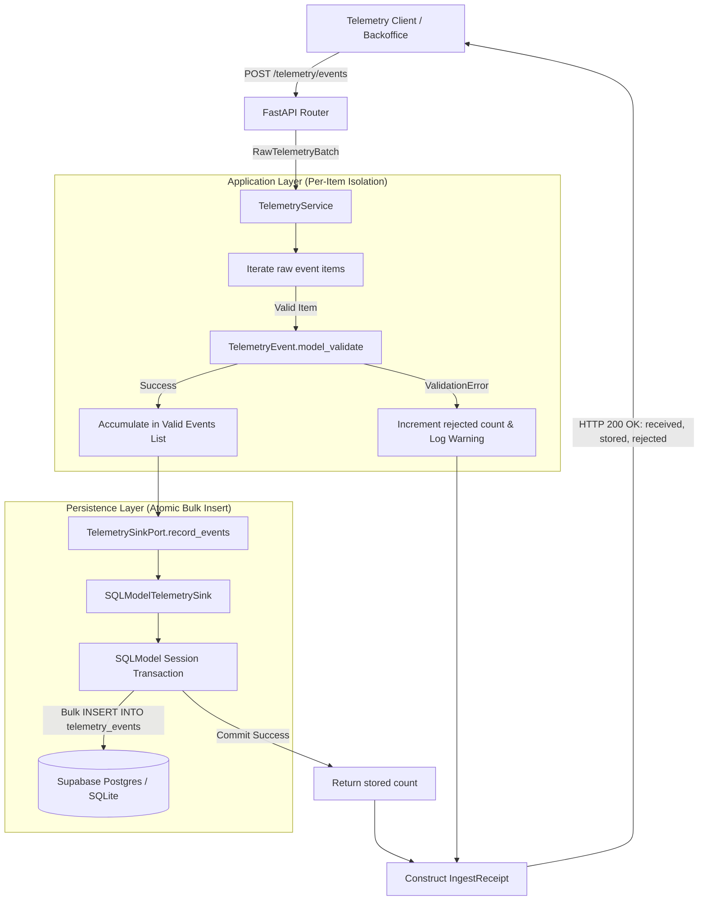
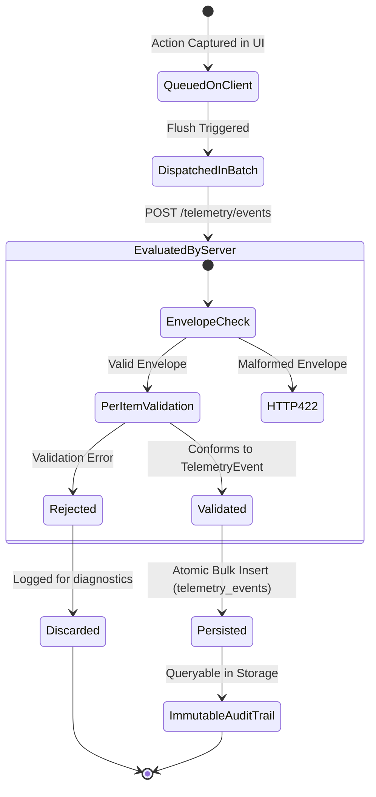

# Data Model: Telemetry Event Storage

**Feature**: `017-telemetry-event-storage`  
**Date**: 2026-10-15  
**Status**: Completed  

---

## 1. Domain Entities & Schemas

### 1.1 `TelemetryEvent` (Domain Model)

The canonical individual event envelope representing a discrete business or technical telemetry occurrence.

- **Location**: `services/api/domain/telemetry/models.py`
- **Mutability**: Immutable once instantiated
- **Configuration**: `extra="forbid"`, `populate_by_name=True`

| Field | Type | Required | Constraints / Validation | Description |
|---|---|---|---|---|
| `eventId` (`event_id`) | `UUID` | Yes | Valid UUIDv4 | Unique identifier for event deduplication and correlation. |
| `timestamp` | `datetime` | Yes | ISO 8601 UTC | Exact time the event was captured on client or server. |
| `sessionId` (`session_id`) | `str` | Yes | `min_length=1` | Client session identifier grouping consecutive actions. |
| `userId` (`user_id`) | `Optional[str]` | No | Default `None` | Pseudonymized user ID (e.g., `usr_operator_123`), never plaintext email. |
| `event_type` | `str` | Yes | Regex `^[a-z0-9]+(_[a-z0-9]+)+$` | Taxonomic name in snake_case (e.g. `inbound_order_created`, `auth_login_failed`). |
| `schemaVersion` (`schema_version`) | `str` | Yes | Regex `^[0-9]+\.[0-9]+\.[0-9]+$` | Semantic version of payload schema (e.g. `1.0.0`). |
| `requestId` (`request_id`) | `str` | Yes | `min_length=1` | Distributed trace correlation ID across request boundaries. |
| `properties` (`payload`) | `Dict[str, Any]` | No | Default `{}` | Domain-specific structured attributes and metrics. |

---

### 1.2 `RawTelemetryBatch` (Presentation / Ingestion DTO)

The outer request container accepted at HTTP ingestion boundaries. Designed for flexible ingestion that enables per-item validation.

- **Location**: `services/api/domain/telemetry/models.py` (or `presentation/api/v1/telemetry.py`)
- **Configuration**: `extra="forbid"`

| Field | Type | Required | Constraints | Description |
|---|---|---|---|---|
| `events` | `List[Dict[str, Any]]` | Yes | None (allows empty list `[]`) | Array of unparsed/raw event payloads evaluated individually. |

**Validation Invariants**:
- If `events` field is omitted or is not a list (e.g., `{}` or `{"events": "string"}`), the outer schema fails with HTTP 422 Unprocessable Entity.
- An empty list `{"events": []}` is accepted and yields `{ "received": 0, "stored": 0, "rejected": 0 }`.

---

### 1.3 `IngestReceipt` (Response DTO)

The response payload returned by the ingestion endpoint indicating batch outcome metrics.

- **Location**: `services/api/domain/telemetry/models.py`

| Field | Type | Required | Constraints | Description |
|---|---|---|---|---|
| `received` | `int` | Yes | `ge=0` | Total number of events evaluated in the incoming batch. |
| `stored` | `int` | Yes | `ge=0`, default `0` | Number of events successfully validated and persisted in storage. |
| `rejected` | `int` | Yes | `ge=0`, default `0` | Number of events rejected due to schema or validation failures. |

**Receipt Invariant**:
$$\text{received} = \text{stored} + \text{rejected}$$
This invariant MUST hold for 100% of successfully parsed batch requests.

---

## 2. Storage / Persistence Entity

### 2.1 `TelemetryEventRecord` (ORM Table Model)

Persistent relational database representation mapped to the `telemetry_events` table in PostgreSQL / Supabase and SQLite.

- **Location**: `services/api/infrastructure/persistence/sqlmodel/models.py`
- **Table Name**: `telemetry_events`
- **Access Pattern**: Write-Only / Append-Only (Immutable)

| Column Name | SQLAlchemy / SQLModel Type | Nullable | Primary Key | Index | Default / Factory |
|---|---|---|---|---|---|
| `event_id` | `UUID` | No | Yes | Yes | Caller provided |
| `timestamp` | `DateTime(timezone=True)` | No | No | Yes | Caller provided |
| `session_id` | `String` | No | No | Yes | Caller provided |
| `user_id` | `String` | Yes | No | Yes | `None` |
| `event_type` | `String` | No | No | Yes | Caller provided |
| `schema_version` | `String` | No | No | No | Caller provided |
| `request_id` | `String` | No | No | Yes | Caller provided |
| `properties` | `JSON` | No | No | No | `{}` |
| `created_at` | `DateTime(timezone=True)` | No | No | No | `datetime.now(timezone.utc)` |

---

## 3. Entity Relationships & Data Flow

---

## 4. State Transitions & Lifecycle

Telemetry events are write-only and follow a strictly unidirectional lifecycle:

### Invariants:
1. **Append-Only**: Stored records in `telemetry_events` are never modified or deleted. No `UPDATE` or `DELETE` methods are implemented in repository adapters.
2. **Atomic Ingestion**: Valid events in a single batch are persisted within a single database transaction. If the database transaction fails, zero records are persisted and an appropriate error is raised.
3. **Idempotence / Deduplication**: The primary key `event_id` ensures that re-dispatched duplicate events are prevented from corrupting data integrity.
