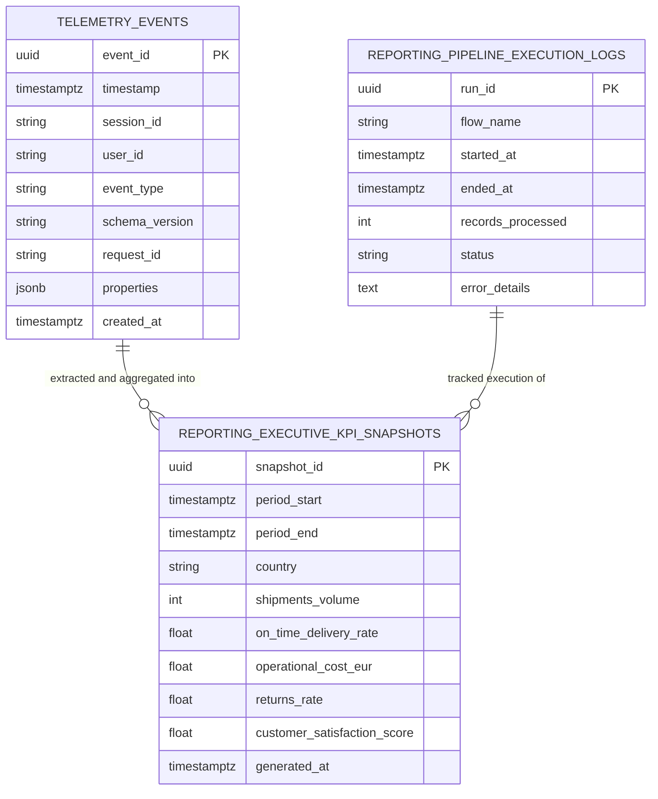
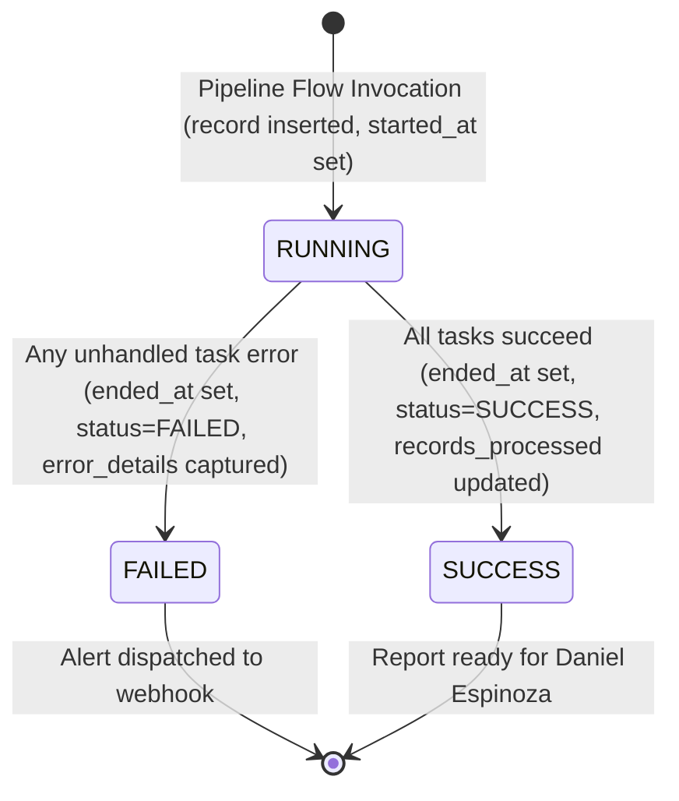

# Data Model: Business Performance Pipeline

**Feature**: `019-business-pipeline-design`  
**Date**: 2026-10-20  
**Status**: Completed  

---

## 1. Relational Schema Architecture

The Business Performance Pipeline establishes a dedicated, isolated database schema named `reporting`. This schema is physically decoupled from operational transaction tables and the append-only `telemetry_events` table.



---

## 2. Destination Entities (`reporting` Schema)

### 2.1 Entity: `reporting.executive_kpi_snapshots`
Represents the weekly aggregated business performance snapshot for a specific reporting period and geographic scope (`US`, `ES`, or `GLOBAL`).

#### Field Definitions
| Field Name | Storage Type (PG) | SQLite Fallback | Constraints | Description |
| :--- | :--- | :--- | :--- | :--- |
| `snapshot_id` | `UUID` | `TEXT` | `PRIMARY KEY` | Globally unique identifier for this specific snapshot record. |
| `period_start` | `TIMESTAMPTZ` | `TEXT` | `NOT NULL` | UTC start timestamp of the weekly rollup period (e.g. `2026-10-12T00:00:00Z`). |
| `period_end` | `TIMESTAMPTZ` | `TEXT` | `NOT NULL` | UTC end timestamp of the weekly rollup period (e.g. `2026-10-18T23:59:59Z`). |
| `country` | `VARCHAR(10)` | `TEXT` | `NOT NULL`, `CHECK (country IN ('US', 'ES', 'GLOBAL'))` | Regional scope of the aggregated metric slice. |
| `shipments_volume` | `INTEGER` | `INTEGER` | `NOT NULL`, `CHECK (shipments_volume >= 0)` | Total number of outbound packages fulfilled and dispatched. |
| `on_time_delivery_rate` | `NUMERIC(5,4)` | `REAL` | `NOT NULL`, `CHECK (on_time_delivery_rate >= 0.0 AND on_time_delivery_rate <= 1.0)` | Ratio of packages delivered within carrier SLA transit windows. |
| `operational_cost_eur` | `NUMERIC(10,2)`| `REAL` | `NOT NULL`, `CHECK (operational_cost_eur >= 0.0)` | Total blended logistics, fulfillment, and freight cost in EUR. |
| `returns_rate` | `NUMERIC(5,2)` | `REAL` | `NOT NULL`, `CHECK (returns_rate >= 0.0 AND returns_rate <= 100.0)` | Returned package volume expressed as a percentage of total shipments. |
| `customer_satisfaction_score` | `NUMERIC(5,2)` | `REAL` | `NOT NULL`, `CHECK (customer_satisfaction_score >= 0.0 AND customer_satisfaction_score <= 100.0)` | Composite CSAT or First Contact Resolution (FCR) satisfaction index. |
| `generated_at` | `TIMESTAMPTZ` | `TEXT` | `NOT NULL`, `DEFAULT NOW()` | UTC timestamp indicating when the rollup calculation completed. |

#### Table Constraints & Indexes
1. **Unique Constraint (Idempotency Key)**:
   ```sql
   CONSTRAINT uq_kpi_snapshot_period_country UNIQUE (period_start, period_end, country);
   ```
2. **Performance Indexes**:
   - `idx_kpi_snapshots_period`: `CREATE INDEX idx_kpi_snapshots_period ON reporting.executive_kpi_snapshots (period_start DESC, period_end DESC);`
   - `idx_kpi_snapshots_country`: `CREATE INDEX idx_kpi_snapshots_country ON reporting.executive_kpi_snapshots (country);`

---

### 2.2 Entity: `reporting.pipeline_execution_logs`
Records end-to-end execution audit telemetry for every data pipeline invocation.

#### Field Definitions & Operational Justifications
| Field Name | Type (PG) | Constraints | Operational Justification for Auditing |
| :--- | :--- | :--- | :--- |
| `run_id` | `UUID` | `PRIMARY KEY` | Uniquely correlates all task log lines, trace spans, and downstream alerts to a discrete execution. |
| `flow_name` | `VARCHAR(100)` | `NOT NULL` | Identifies the pipeline definition (`executive_performance_pipeline_flow`), enabling multi-pipeline auditing. |
| `started_at` | `TIMESTAMPTZ` | `NOT NULL` | Measures whether the scheduled batch started on time (Monday 06:00 UTC) and detects orphaned/zombie runs. |
| `ended_at` | `TIMESTAMPTZ` | `NULLABLE` | Records completion time; combined with `started_at`, enables tracking execution duration SLA (< 5 minutes). |
| `records_processed`| `INTEGER` | `NOT NULL`, `DEFAULT 0` | Monitors source event volume; rapid deviations (e.g. 0 records ingested) signal upstream telemetry sensor failures. |
| `status` | `VARCHAR(20)` | `NOT NULL`, `CHECK (status IN ('RUNNING', 'SUCCESS', 'FAILED'))` | Tracks execution state lifecycle; triggers immediate ops notification hooks on `FAILED`. |
| `error_details` | `TEXT` | `NULLABLE` | Stores sanitized exception messages and stack summaries, enabling on-call triage without PII/credential leakage. |

#### Table Constraints & Indexes
- `idx_pipeline_logs_status`: `CREATE INDEX idx_pipeline_logs_status ON reporting.pipeline_execution_logs (status);`
- `idx_pipeline_logs_started`: `CREATE INDEX idx_pipeline_logs_started ON reporting.pipeline_execution_logs (started_at DESC);`

---

## 3. Source Entities (Read-Only)

### 3.1 Entity: `public.telemetry_events`
The append-only operational event store.
- `event_id` (`UUID`, PK)
- `timestamp` (`TIMESTAMPTZ`, Indexed)
- `session_id` (`VARCHAR(255)`, Indexed)
- `user_id` (`VARCHAR(255)`, Nullable, Indexed)
- `event_type` (`VARCHAR(100)`, Indexed)
- `schema_version` (`VARCHAR(20)`)
- `request_id` (`VARCHAR(255)`, Indexed)
- `properties` (`JSONB` / `JSON`)
- `created_at` (`TIMESTAMPTZ`)

### 3.2 Operational Domain Entities
- **SKU Catalog (`sku`)**: `id`, `sku`, `name`, `warehouse_id` (`US-LAX-01`, `ES-ZAZ-01`), `low_stock_threshold`.
- **Stock Movement (`stock_exit`)**: `id`, `sku_id`, `warehouse_id`, `quantity`, `user_uuid`, `created_at`.
- **Incidents (`incidents`)**: `id`, `incident_type`, `carrier_code`, `status`, `created_at`.

---

## 4. Pipeline State Transitions & Lifecycle

### 4.1 Execution Log State Machine



- **State: `RUNNING`**:
  - Inserted when `executive_performance_pipeline_flow` begins.
  - `ended_at` is `NULL`.
  - `records_processed` is `0`.
- **State: `SUCCESS`**:
  - Transition occurs only after load phase commits atomically.
  - `ended_at` is populated.
  - `status` updated to `'SUCCESS'`.
  - `records_processed` records total count of source events processed.
- **State: `FAILED`**:
  - Transition occurs in the `except` block of the flow.
  - Rollback executed on destination transaction.
  - `ended_at` is populated.
  - `status` updated to `'FAILED'`.
  - `error_details` captures sanitized exception message.

---

## 5. Validation & Domain Business Rules

1. **Date Boundary Normalization**:
   - `period_start` and `period_end` MUST always be formatted as ISO 8601 UTC timestamps.
   - `period_start` MUST be strictly less than `period_end`.
2. **Geographic Scopes**:
   - The pipeline computes three discrete snapshot records for each weekly period:
     - `US`: Metrics originating from Los Angeles hub (`US-LAX-01`) and US carriers (UPS, FedEx, DHL US).
     - `ES`: Metrics originating from Zaragoza hub (`ES-ZAZ-01`) and ES carriers (MRW, SEUR, DHL ES).
     - `GLOBAL`: Blended aggregate across both facilities and all carriers.
3. **Metric Boundary Validations**:
   - `shipments_volume >= 0`
   - `0.0 <= on_time_delivery_rate <= 1.0`
   - `operational_cost_eur >= 0.0`
   - `0.0 <= returns_rate <= 100.0`
   - `0.0 <= customer_satisfaction_score <= 100.0`
4. **Zero-Division & Edge Case Guardrails**:
   - If total shipments in a period is `0`: `on_time_delivery_rate = 1.0` (or `0.0` with neutral indicator), `returns_rate = 0.0`, `operational_cost_eur = 0.0`.
   - If zero customer tickets exist: `customer_satisfaction_score = 100.0` (neutral baseline).
