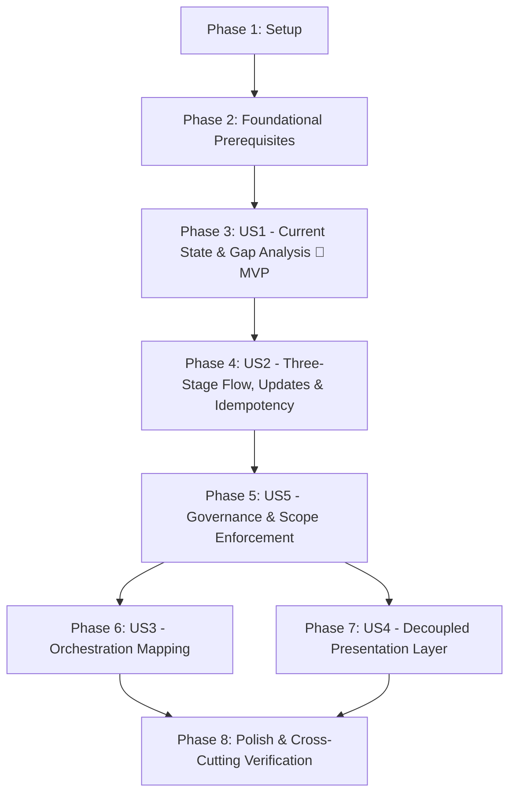

# Tasks: Business Performance Pipeline Design Document

**Input**: Design documents from `specs/019-business-pipeline-design/`  
**Prerequisites**: [plan.md](file:///j:/GitHub/mr-stegmann-ai-engineering-company-project-monorepo/specs/019-business-pipeline-design/plan.md), [spec.md](file:///j:/GitHub/mr-stegmann-ai-engineering-company-project-monorepo/specs/019-business-pipeline-design/spec.md), [data-model.md](file:///j:/GitHub/mr-stegmann-ai-engineering-company-project-monorepo/specs/019-business-pipeline-design/data-model.md), [research.md](file:///j:/GitHub/mr-stegmann-ai-engineering-company-project-monorepo/specs/019-business-pipeline-design/research.md), [quickstart.md](file:///j:/GitHub/mr-stegmann-ai-engineering-company-project-monorepo/specs/019-business-pipeline-design/quickstart.md), [contracts/](file:///j:/GitHub/mr-stegmann-ai-engineering-company-project-monorepo/specs/019-business-pipeline-design/contracts/)  
**Constitution**: [.specify/memory/constitution.md](file:///j:/GitHub/mr-stegmann-ai-engineering-company-project-monorepo/.specify/memory/constitution.md)

**MANDATORY SCOPE GOVERNANCE (FR-015, FR-016, SC-006)**: Exactly zero lines of executable code (.py, .ts, .tsx, .sql), runtime dependencies, database migrations, or automated test suites are included or permitted. All tasks MUST be exclusively documentation authoring, diagramming, and quality validation tasks for `data/pipelines/PIPELINE_DESIGN.md`.

## Format: `- [ ] [ID] [P?] [Story] Description with file path`

- **[P]**: Can run in parallel (different files, no dependencies on incomplete tasks)
- **[Story]**: Which user story this task belongs to (US1, US2, US3, US4, US5). Omitted in Setup, Foundational, and Polish phases.
- Include exact file paths in all descriptions

---

## Phase 1: Setup (Shared Infrastructure)

**Purpose**: Project initialization and basic directory structure for the design document deliverable.

- [X] T001 Create directory structure data/pipelines/ and initialize document shell in data/pipelines/PIPELINE_DESIGN.md
- [X] T002 Author document header, executive summary, and architectural context from CONTEXT.md in data/pipelines/PIPELINE_DESIGN.md

---

## Phase 2: Foundational (Blocking Prerequisites)

**Purpose**: Document conventions, structural schema, and architectural boundary constraints that MUST be established before ANY user story sections can be authored.

**⚠️ CRITICAL**: No user story authoring work can begin until this foundational phase is complete.

- [X] T003 Establish document structure, section numbering scheme, and domain terminology glossary in data/pipelines/PIPELINE_DESIGN.md
- [X] T004 Document architectural principles, schema isolation rules, and zero-code governance constraints in data/pipelines/PIPELINE_DESIGN.md

**Checkpoint**: Foundation ready - user story section authoring can now proceed.

---

## Phase 3: User Story 1 - Comprehensive Pipeline Design & Strategic Business Gap Analysis (Priority: P1) 🎯 MVP

**Goal**: Author Sections 1–3 of `data/pipelines/PIPELINE_DESIGN.md` establishing the existing engineering telemetry baseline, explicitly detailing the business questions unanswered by `GET /telemetry/report`, and formulating the single-sentence pipeline purpose statement.

**Independent Test**: Review Sections 1–3 of `data/pipelines/PIPELINE_DESIGN.md` to verify that it provides a complete Current State assessment of `telemetry_events` and `GET /telemetry/report`, explicitly articulates the business gap from `CONTEXT.md`, and defines the pipeline purpose in a single concrete sentence naming CEO Daniel Espinoza, weekly Monday 07:00 cadence, 5 core KPIs, and mandatory telemetry event types.

### Implementation for User Story 1

- [X] T005 [US1] Author Section 1 (Current State Analysis) in data/pipelines/PIPELINE_DESIGN.md detailing telemetry_events schema, services/telemetry/analysis.py, and technical questions answered by GET /telemetry/report
- [X] T006 [US1] Author Section 2 (Business Gap Analysis) in data/pipelines/PIPELINE_DESIGN.md detailing executive requirements from CONTEXT.md unanswered by current telemetry (cross-border volume, global OTD, cost in EUR, returns, CSAT)
- [X] T007 [US1] Author Section 3 (Pipeline Purpose Statement) in data/pipelines/PIPELINE_DESIGN.md formulating the single-sentence purpose linking CEO Daniel Espinoza, Monday 07:00 cadence, 5 core KPIs, and source telemetry events

**Checkpoint**: User Story 1 delivers the foundational architectural analysis and single-sentence purpose statement (MVP).

---

## Phase 4: User Story 2 - Three-Stage Data Flow, Update Strategy & Resilient Persistence Design (Priority: P1)

**Goal**: Author Sections 4–5 of `data/pipelines/PIPELINE_DESIGN.md` detailing extraction specifications, three-stage flow diagrams, vectorized KPI transformation logic, update reconciliation, and idempotent loading into `reporting` schema tables with 6-field execution audit logging.

**Independent Test**: Validate Sections 4–5 in `data/pipelines/PIPELINE_DESIGN.md`; verify Mermaid flow diagrams with real TrackFlow entity names, watermark & Last-Write-Wins (LWW) deduplication strategy, atomic failure rollback, and 6-field audit log specifications.

### Implementation for User Story 2

- [X] T008 [US2] Author Section 4.1 (Extraction Specifications) in data/pipelines/PIPELINE_DESIGN.md detailing telemetry_events filtering, domain tables (orders, stock_exit, sku, incidents), payload shapes, and weekly extraction cadence
- [X] T009 [US2] Author Section 4.2 (Three-Stage Data Flow) in data/pipelines/PIPELINE_DESIGN.md incorporating Mermaid architectural diagrams with real TrackFlow entity and table names
- [X] T010 [US2] Author Section 4.3 (Vectorized KPI Calculations) in data/pipelines/PIPELINE_DESIGN.md detailing Pandas transformation logic and zero-division guardrails for US, ES, and GLOBAL scopes
- [X] T011 [US2] Author Section 5.1 (Record Update & Deduplication Strategy) in data/pipelines/PIPELINE_DESIGN.md specifying watermark and Last-Write-Wins (LWW) deduplication mechanisms
- [X] T012 [US2] Author Section 5.2 (Destination Schema & Idempotent Persistence) in data/pipelines/PIPELINE_DESIGN.md defining reporting.executive_kpi_snapshots, composite UNIQUE constraint, and atomic rollback on load failure
- [X] T013 [US2] Author Section 5.3 (Execution Audit Logging Specification) in data/pipelines/PIPELINE_DESIGN.md specifying the 6-field audit log model (run_id, flow_name, started_at, ended_at, records_processed, status, error_details) with data types and operational justifications

**Checkpoint**: Core data processing, storage architecture, update reconciliation, and resilience specifications complete.

---

## Phase 5: User Story 5 - Strict Documentation Scope & Code Prohibition Governance (Priority: P1)

**Goal**: Author Section 6 of `data/pipelines/PIPELINE_DESIGN.md` establishing explicit scope boundaries, constitutional compliance, zero-code enforcement, and strict preservation of existing engineering telemetry assets.

**Independent Test**: Review Section 6 in `data/pipelines/PIPELINE_DESIGN.md`; verify explicit prohibitions on executable code (.py, .ts, .tsx, .sql) or test suites, confirmation of zero modifications to `services/telemetry/analysis.py`, `GET /telemetry/report`, and table `telemetry_events`, and full alignment with FR-015, FR-016, and SC-006.

### Implementation for User Story 5

- [X] T014 [US5] Author Section 6.1 (Code Prohibition & Deliverable Scope Governance) in data/pipelines/PIPELINE_DESIGN.md documenting strict compliance with FR-015, FR-016, and SC-006 with zero code deliverables
- [X] T015 [US5] Author Section 6.2 (Service Boundary Isolation & Telemetry Preservation) in data/pipelines/PIPELINE_DESIGN.md confirming services/telemetry/analysis.py, GET /telemetry/report, and telemetry_events remain 100% untouched

**Checkpoint**: Scope governance, constitutional compliance, and asset preservation guarantees fully documented.

---

## Phase 6: User Story 3 - Workflow Orchestration Mapping & Configuration Management (Priority: P2)

**Goal**: Author Section 7 of `data/pipelines/PIPELINE_DESIGN.md` mapping the pipeline architecture to modern workflow orchestration primitives (Prefect), detailing main flows, granular tasks, state lifecycle transitions, and secure credentials management.

**Independent Test**: Review Section 7 in `data/pipelines/PIPELINE_DESIGN.md`; verify definition of main flow (`executive_performance_pipeline_flow`), 3 modular tasks (`extract_telemetry_and_domain_data`, `transform_executive_kpis`, `load_reporting_snapshots`), execution state handling (`Running`, `Completed`, `Failed`), and credentials management blocks.

### Implementation for User Story 3

- [X] T016 [US3] Author Section 7.1 (Orchestration Flow & Modular Tasks) in data/pipelines/PIPELINE_DESIGN.md defining executive_performance_pipeline_flow and the three stage tasks
- [X] T017 [US3] Author Section 7.2 (Lifecycle State Handling & Notifications) in data/pipelines/PIPELINE_DESIGN.md detailing execution state transitions, failure alerting, and audit log synchronization
- [X] T018 [US3] Author Section 7.3 (Configuration & Credentials Management) in data/pipelines/PIPELINE_DESIGN.md specifying secure storage of database and infrastructure credentials via orchestration blocks

**Checkpoint**: Orchestration architecture, lifecycle state transitions, and configuration management fully documented.

---

## Phase 7: User Story 4 - Decoupled Presentation Layer & Application Integration (Priority: P2)

**Goal**: Author Section 8 of `data/pipelines/PIPELINE_DESIGN.md` sketching three dedicated HTTP endpoints under `services/reporting/` delegating to callable `data/pipelines/` interface functions while preserving strict boundary decoupling.

**Independent Test**: Review Section 8 in `data/pipelines/PIPELINE_DESIGN.md`; verify specifications for `GET /reporting/status`, `POST /reporting/trigger`, and `GET /reporting/kpis`, callable boundary interface functions, request/response schemas, and prohibition of inline ETL.

### Implementation for User Story 4

- [X] T019 [US4] Author Section 8.1 (Reporting API Endpoint Specifications) in data/pipelines/PIPELINE_DESIGN.md sketching GET /reporting/status, POST /reporting/trigger, and GET /reporting/kpis with request/response schemas
- [X] T020 [US4] Author Section 8.2 (Decoupled Boundary Interface Functions) in data/pipelines/PIPELINE_DESIGN.md defining get_pipeline_status, trigger_pipeline_run, and get_executive_kpis with zero inline ETL in route handlers

**Checkpoint**: Presentation layer and decoupled application integration specifications complete.

---

## Phase 8: Polish & Cross-Cutting Concerns

**Purpose**: Verification, cross-artifact consistency checks, and quality gates across the complete deliverable.

- [X] T021 Verify code prohibition compliance by executing git status --short and confirming zero code (.py, .ts, .tsx, .sql) or test files were authored or modified in the repository
- [X] T022 Audit document completeness against all 16 Functional Requirements (FR-001 through FR-016) in data/pipelines/PIPELINE_DESIGN.md
- [X] T023 Audit purpose statement in Section 3 of data/pipelines/PIPELINE_DESIGN.md against single-sentence requirement and all SC-002 criteria
- [X] T024 [P] Validate end-to-end review criteria by executing all five inspection scenarios documented in specs/019-business-pipeline-design/quickstart.md

---

## Dependencies & Execution Order

### Phase Dependencies



### User Story Dependencies

- **User Story 1 (P1)**: Depends on Foundational Phase 2 completion. Establishes the baseline metrics, problem statement, and executive purpose.
- **User Story 2 (P1)**: Depends on User Story 1. Specifies the end-to-end data pipeline flow, transformations, and persistence models required to compute the KPIs identified in US1.
- **User Story 5 (P1)**: Depends on User Story 2. Documents governance, code prohibition, and service boundary isolation guarantees.
- **User Story 3 (P2)**: Depends on User Story 2 & 5. Maps the pipeline stages to orchestration primitives (Prefect).
- **User Story 4 (P2)**: Depends on User Story 2 & 5. Designs the API presentation layer and boundary interfaces consuming the pipeline outputs.
- **Polish (Final Phase)**: Depends on all user story phases being complete.

### Within Each User Story

- Foundational sections before detailed subsections
- Extraction before transformation; transformation before loading
- Core models before interface endpoints
- Section authored completely before advancing to dependent sections

### Parallel Opportunities

- Within Phase 8, cross-artifact verification of `specs/019-business-pipeline-design/quickstart.md` (`T024`) can run in parallel with repository status checks (`T021`).
- User Story 3 (`T016`–`T018`) and User Story 4 (`T019`–`T020`) address distinct operational domains (Prefect orchestration vs. FastAPI HTTP endpoints) and can be authored in parallel once US2 and US5 are complete.

---

## Parallel Execution Examples

### Parallel Execution: Orchestration and Presentation Phases

```bash
# Developer / Agent A: Author Workflow Orchestration Mapping (US3)
Task: "Author Section 7.1 (Orchestration Flow & Modular Tasks) in data/pipelines/PIPELINE_DESIGN.md"
Task: "Author Section 7.2 (Lifecycle State Handling & Notifications) in data/pipelines/PIPELINE_DESIGN.md"
Task: "Author Section 7.3 (Configuration & Credentials Management) in data/pipelines/PIPELINE_DESIGN.md"

# Developer / Agent B: Author Decoupled Presentation Layer (US4)
Task: "Author Section 8.1 (Reporting API Endpoint Specifications) in data/pipelines/PIPELINE_DESIGN.md"
Task: "Author Section 8.2 (Decoupled Boundary Interface Functions) in data/pipelines/PIPELINE_DESIGN.md"
```

---

## Implementation Strategy

### MVP First (User Story 1 Only)

1. Complete Phase 1: Setup (`T001`–`T002`)
2. Complete Phase 2: Foundational Prerequisites (`T003`–`T004`)
3. Complete Phase 3: User Story 1 (`T005`–`T007`)
4. **STOP and VALIDATE**: Verify Current State, Business Gap, and the single-sentence Purpose Statement with leadership.

### Incremental Delivery

1. Complete Setup + Foundational → Document structure and boundary rules ready.
2. Add User Story 1 → Baseline analysis and single-sentence purpose delivered (MVP!).
3. Add User Story 2 → Three-stage flow, update handling, idempotency, and audit logging detailed.
4. Add User Story 5 → Scope governance and asset preservation documented.
5. Add User Story 3 & 4 → Prefect orchestration and API presentation interfaces added.
6. Execute Phase 8 Polish → Comprehensive verification against `quickstart.md` and git status confirming zero code files created.

---

## Notes

- All tasks strictly modify or audit `data/pipelines/PIPELINE_DESIGN.md`, `specs/019-business-pipeline-design/quickstart.md`, or repository status.
- Zero `.py`, `.ts`, `.tsx`, `.sql` code files or test files are created or modified in this feature.
- Every task includes an explicit file path and unique sequential identifier (`T001`–`T024`).
- Commit after each task or phase to maintain an auditable documentation trail.
