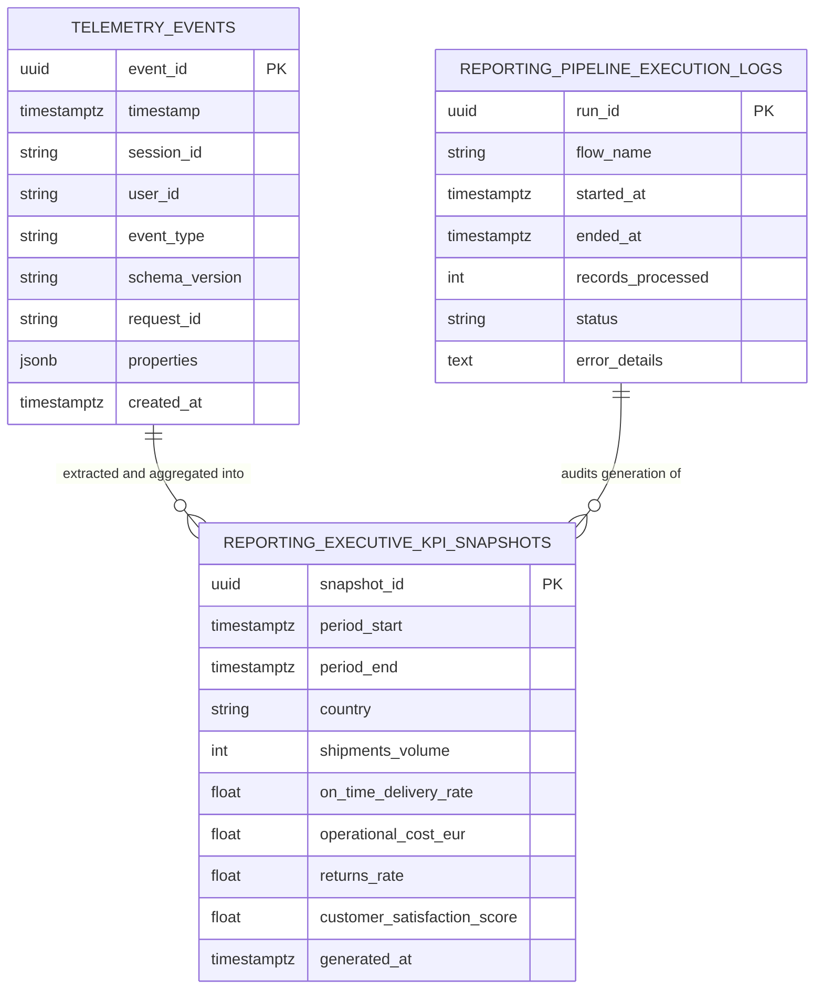
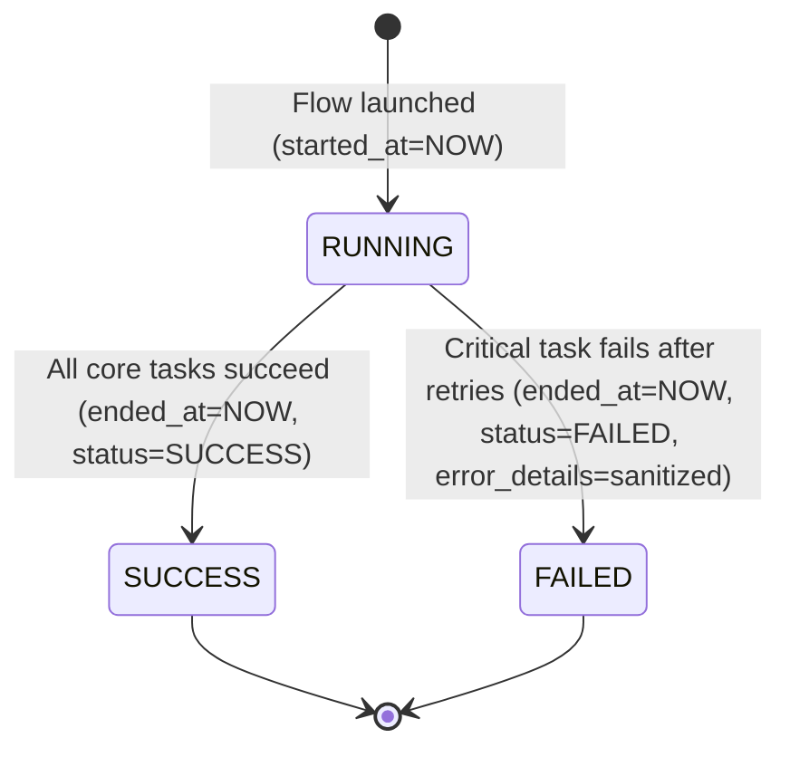

# Data Model: Resilient Business Performance Pipeline

**Feature**: `020-resilient-business-pipeline`  
**Date**: 2026-10-20  
**Status**: Completed  

---

## 1. Relational Schema Architecture

The pipeline persists data in the isolated `reporting` schema, decoupled from OLTP domain tables and the append-only `telemetry_events` table.



---

## 2. Entity Specifications

### 2.1 Entity: `reporting.executive_kpi_snapshots`

Represents weekly pre-aggregated business performance metrics for executive leadership.

| Field Name | Type (PostgreSQL) | SQLite Fallback | Constraints | Description |
| :--- | :--- | :--- | :--- | :--- |
| `snapshot_id` | `UUID` | `TEXT` | `PRIMARY KEY` | Unique identifier for the snapshot row. |
| `period_start` | `TIMESTAMPTZ` | `TEXT` | `NOT NULL` | UTC start timestamp of the weekly rollup period. |
| `period_end` | `TIMESTAMPTZ` | `TEXT` | `NOT NULL` | UTC end timestamp of the weekly rollup period. |
| `country` | `VARCHAR(10)` | `TEXT` | `NOT NULL, CHECK (country IN ('US', 'ES', 'GLOBAL'))` | Regional scope of the metrics slice. |
| `shipments_volume` | `INTEGER` | `INTEGER` | `NOT NULL, CHECK (shipments_volume >= 0)` | Total number of outbound packages fulfilled. |
| `on_time_delivery_rate` | `NUMERIC(5,4)` | `REAL` | `NOT NULL, CHECK (on_time_delivery_rate >= 0.0 AND on_time_delivery_rate <= 1.0)` | Ratio of deliveries completed within SLA transit windows. |
| `operational_cost_eur` | `NUMERIC(10,2)` | `REAL` | `NOT NULL, CHECK (operational_cost_eur >= 0.0)` | Total blended fulfillment and logistics cost in Euros (€). |
| `returns_rate` | `NUMERIC(5,2)` | `REAL` | `NOT NULL, CHECK (returns_rate >= 0.0 AND returns_rate <= 100.0)` | Returned packages as a percentage of total shipments. |
| `customer_satisfaction_score` | `NUMERIC(5,2)` | `REAL` | `NOT NULL, CHECK (customer_satisfaction_score >= 0.0 AND customer_satisfaction_score <= 100.0)` | Composite satisfaction score (CSAT/FCR) normalized to 0–100. |
| `generated_at` | `TIMESTAMPTZ` | `TEXT` | `NOT NULL, DEFAULT CURRENT_TIMESTAMP` | Timestamp when the snapshot was computed and persisted. |

#### Constraints & Indexes
- **Natural Composite Unique Key (Idempotency Guard)**:
  ```sql
  CONSTRAINT uq_kpi_snapshot_period_country UNIQUE (period_start, period_end, country);
  ```
- **Performance Indexes**:
  - `idx_kpi_snapshots_period`: `(period_start DESC, period_end DESC)`
  - `idx_kpi_snapshots_country`: `(country)`

---

### 2.2 Entity: `reporting.pipeline_execution_logs`

Captures execution audit telemetry for every pipeline invocation.

| Field Name | Type (PostgreSQL) | SQLite Fallback | Constraints | Description |
| :--- | :--- | :--- | :--- | :--- |
| `run_id` | `UUID` | `TEXT` | `PRIMARY KEY` | Unique execution run identifier correlating all task logs. |
| `flow_name` | `VARCHAR(100)` | `TEXT` | `NOT NULL` | Identifier of the pipeline flow (`executive_performance_pipeline_flow`). |
| `started_at` | `TIMESTAMPTZ` | `TEXT` | `NOT NULL` | UTC execution start timestamp. |
| `ended_at` | `TIMESTAMPTZ` | `TEXT` | `NULLABLE` | UTC execution termination timestamp. |
| `records_processed` | `INTEGER` | `INTEGER` | `NOT NULL, DEFAULT 0` | Total volume of raw source telemetry events processed. |
| `status` | `VARCHAR(20)` | `TEXT` | `NOT NULL, CHECK (status IN ('RUNNING', 'SUCCESS', 'FAILED'))` | Current lifecycle state of the pipeline run. |
| `error_details` | `TEXT` | `TEXT` | `NULLABLE` | Sanitized failure message or exception summary if the run failed. |

#### Lifecycle State Transitions



---

## 3. Presentation Layer Data Transfer Objects (DTOs)

These Pydantic models define the external HTTP contracts exposed by `services/reporting/`:

### 3.1 `PipelineStatusResponse`
- `latest_run`: `Optional[PipelineExecutionLogDTO]`
- `is_running`: `bool`
- `healthy`: `bool` (True if the latest run completed with `SUCCESS`)

### 3.2 `PipelineTriggerRequest`
- `period_start`: `Optional[datetime]` (defaults to 7 days prior to last Sunday)
- `period_end`: `Optional[datetime]` (defaults to last Sunday 23:59:59 UTC)

### 3.3 `PipelineTriggerResponse`
- `run_id`: `UUID`
- `status`: `str` (`"INITIATED"` or `"QUEUED"`)
- `message`: `str`

### 3.4 `ExecutiveKpisResponse`
- `count`: `int`
- `snapshots`: `List[ExecutiveKpiSnapshotDTO]`
