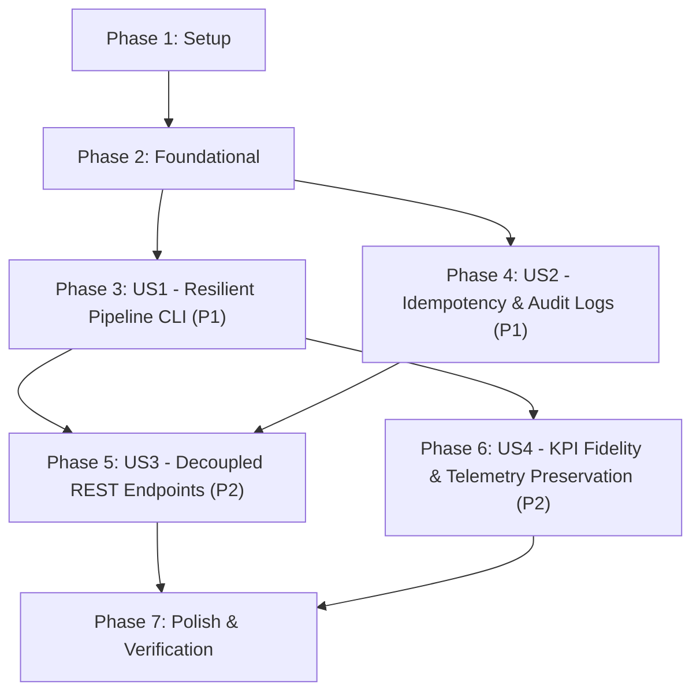

# Tasks: Implementing a Resilient Business Performance Pipeline

**Input**: Design documents from `/specs/020-resilient-business-pipeline/`
**Prerequisites**: [plan.md](file:///j:/GitHub/mr-stegmann-ai-engineering-company-project-monorepo/specs/020-resilient-business-pipeline/plan.md), [spec.md](file:///j:/GitHub/mr-stegmann-ai-engineering-company-project-monorepo/specs/020-resilient-business-pipeline/spec.md), [research.md](file:///j:/GitHub/mr-stegmann-ai-engineering-company-project-monorepo/specs/020-resilient-business-pipeline/research.md), [data-model.md](file:///j:/GitHub/mr-stegmann-ai-engineering-company-project-monorepo/specs/020-resilient-business-pipeline/data-model.md), [contracts/reporting-api.yaml](file:///j:/GitHub/mr-stegmann-ai-engineering-company-project-monorepo/specs/020-resilient-business-pipeline/contracts/reporting-api.yaml), [quickstart.md](file:///j:/GitHub/mr-stegmann-ai-engineering-company-project-monorepo/specs/020-resilient-business-pipeline/quickstart.md)

---

## Format: `[ID] [P?] [Story] Description with file path`

- **[P]**: Can run in parallel (different files, no dependencies on incomplete tasks)
- **[Story]**: Which user story this task belongs to (`[US1]`, `[US2]`, `[US3]`, `[US4]`)
- Every task includes an explicit, unambiguous file path

---

## Phase 1: Setup (Shared Infrastructure)

**Purpose**: Initialize directory structure, environment dependencies, and module packages

- [X] T001 Create project directories for pipelines, reporting service, and test suites in `data/pipelines/`, `services/reporting/domain/`, `services/reporting/presentation/`, `tests/pipelines/`, and `tests/reporting/`
- [X] T002 Verify and configure Python dependencies (Prefect 3.x, pandas, SQLModel, FastAPI, httpx, pytest-cov) in `services/api/requirements.txt`
- [X] T003 [P] Initialize Python package exports in `services/reporting/__init__.py`, `services/reporting/domain/__init__.py`, and `services/reporting/presentation/__init__.py`

---

## Phase 2: Foundational (Blocking Prerequisites)

**Purpose**: Database schema models, persistence helpers, Pydantic DTOs, and interface stubs that block user story implementation

**⚠️ CRITICAL**: No user story implementation work can begin until this phase is complete.

- [X] T004 Define reporting SQLModel and SQLAlchemy entities (`ExecutiveKpiSnapshot`, `PipelineExecutionLog`) with composite unique constraint `uq_kpi_snapshot_period_country` in `data/pipelines/models.py`
- [X] T005 [P] Implement database engine, session factory, and schema initialization helper for SQLite and PostgreSQL in `data/pipelines/models.py`
- [X] T006 [P] Implement Pydantic DTO models (`PipelineStatusResponse`, `PipelineTriggerRequest`, `PipelineTriggerResponse`, `ExecutiveKpiSnapshot`, `ExecutiveKpisResponse`, `ErrorResponse`) matching OpenAPI contract in `services/reporting/domain/schemas.py`
- [X] T007 Implement boundary interface function signatures and stubs (`get_pipeline_status`, `trigger_pipeline_run`, `get_executive_kpis`) in `data/pipelines/reporting_interface.py`

**Checkpoint**: Foundation ready — database models, DTOs, and interface stubs established. User story implementation can now begin.

---

## Phase 3: User Story 1 - Command-Line Execution of Resilient Multi-Stage Pipeline (Priority: P1) 🎯 MVP

**Goal**: Implement a command-line runnable production pipeline (`python data/pipelines/pipeline.py`) orchestrated with Prefect 3.x flows and tasks featuring external I/O retries, transformation result caching, and partial failure tolerance for non-critical steps.

**Independent Test**: Execute `python data/pipelines/pipeline.py` from repository root. Verify that extraction, transformation, load, and auxiliary tasks run sequentially, that transient external failures retry as configured, and that an injected failure in the auxiliary notification step allows the primary ETL process to finish with status `SUCCESS`.

### Tests for User Story 1

- [X] T008 [P] [US1] Implement unit and integration tests for extraction, vectorized transformation, and end-to-end flow execution in `tests/pipelines/test_pipeline_etl.py`
- [X] T009 [P] [US1] Implement resilience tests validating task retries, transformation cache hits, and non-critical task failure handling with `return_state=True` in `tests/pipelines/test_pipeline_resilience.py`

### Implementation for User Story 1

- [X] T010 [P] [US1] Implement extraction task `extract_telemetry_and_domain_data` with retries (`retries=3`, `retry_delay_seconds=10`), watermark bounds, and domain joins in `data/pipelines/pipeline.py`
- [X] T011 [P] [US1] Implement cache key generator `kpi_transformation_cache_key` and transformation task `transform_executive_kpis` with caching (`cache_expiration=timedelta(hours=24)`) in `data/pipelines/pipeline.py`
- [X] T012 [P] [US1] Implement non-critical auxiliary task `notify_pipeline_status` in `data/pipelines/pipeline.py`
- [X] T013 [US1] Implement primary Prefect flow `executive_performance_pipeline_flow` with state capture (`return_state=True`) on auxiliary task to prevent flow termination on auxiliary errors in `data/pipelines/pipeline.py`
- [X] T014 [US1] Implement CLI entry point (`if __name__ == "__main__":`) with argument parsing and exit code handling in `data/pipelines/pipeline.py`

**Checkpoint**: User Story 1 is functional and testable independently via CLI execution.

---

## Phase 4: User Story 2 - Idempotent Persistence & Execution Audit Tracking (Priority: P1)

**Goal**: Ensure pipeline executions persist aggregated KPIs into `reporting.executive_kpi_snapshots` with strict idempotency (composite unique key `(period_start, period_end, country)`) and record execution audit metadata into `reporting.pipeline_execution_logs` with atomic transaction rollback.

**Independent Test**: Run the pipeline twice consecutively across the same 7-day reporting period. Query the database to verify that record counts and values for `(period_start, period_end, country)` remain exactly 3 (US, ES, GLOBAL) with 0 duplicate rows, and that execution audit logs record all 6 mandatory metadata fields with rollback on error.

### Tests for User Story 2

- [X] T015 [P] [US2] Implement idempotency integration test verifying consecutive runs over identical windows produce zero duplicate snapshots in `tests/pipelines/test_pipeline_resilience.py`
- [X] T016 [P] [US2] Implement audit logging and atomic transaction rollback test verifying state recording and database rollback on failure in `tests/pipelines/test_pipeline_resilience.py`

### Implementation for User Story 2

- [X] T017 [US2] Implement idempotent upsert task `load_reporting_snapshots` using `ON CONFLICT (period_start, period_end, country) DO UPDATE` in `data/pipelines/pipeline.py`
- [X] T018 [US2] Implement atomic transaction context management with rollback on exceptions during snapshot persistence in `data/pipelines/pipeline.py`
- [X] T019 [US2] Implement execution audit lifecycle logging recording all 6 mandatory fields (`run_id`, `flow_name`, `started_at`, `ended_at`, `records_processed`, `status`, `error_details`) in `data/pipelines/pipeline.py`

**Checkpoint**: User Stories 1 and 2 operate together: pipeline runs from CLI, persists idempotently, and logs complete audit trails.

---

## Phase 5: User Story 3 - Decoupled Reporting Backend Endpoints (Priority: P2)

**Goal**: Expose decoupled FastAPI REST API endpoints (`GET /api/v1/reporting/status`, `POST /api/v1/reporting/trigger`, `GET /api/v1/reporting/kpis`) conforming to `reporting-api.yaml` and Constitution Principle I, delegating 100% of pipeline operations to `data/pipelines/reporting_interface.py`.

**Independent Test**: Send HTTP requests to `/status`, `/trigger`, and `/kpis`. Verify that status returns the latest run metadata, trigger initiates execution (returning `409 Conflict` if a run is already active), and KPI queries return pre-computed snapshots matching `reporting-api.yaml` with sub-100ms response times.

### Tests for User Story 3

- [X] T020 [P] [US3] Implement API route contract and validation tests for `/status`, `/trigger`, and `/kpis` in `tests/reporting/test_reporting_endpoints.py`
- [X] T021 [P] [US3] Implement concurrent trigger conflict test verifying `409 Conflict` when a pipeline run is already active in `tests/reporting/test_reporting_endpoints.py`

### Implementation for User Story 3

- [X] T022 [US3] Implement boundary interface functions (`get_pipeline_status`, `trigger_pipeline_run`, `get_executive_kpis`) in `data/pipelines/reporting_interface.py`
- [X] T023 [US3] Implement FastAPI route handlers with Pydantic validation, status codes, and error masking in `services/reporting/presentation/routes.py`
- [X] T024 [US3] Mount `/api/v1/reporting` router into the primary FastAPI application in `services/api/main.py`

**Checkpoint**: User Stories 1, 2, and 3 are complete: pipeline runs via CLI or HTTP trigger, and dashboards can query pre-computed KPIs via REST API.

---

## Phase 6: User Story 4 - Data Model Fidelity & Telemetry System Preservation (Priority: P2)

**Goal**: Guarantee 100% mathematical fidelity for the 5 executive KPIs across US (`US-LAX-01`), ES (`ES-ZAZ-01`), and GLOBAL scopes with zero-division guardrails, document operational schedules and CLI usage, and ensure existing telemetry services (`services/telemetry/analysis.py`, `telemetry_events`) remain completely untouched.

**Independent Test**: Verify calculated KPIs match exact formulas for volume, on-time delivery rate, operational cost in EUR, returns rate, and CSAT with zero-division edge cases handled. Verify `git diff` confirms zero alterations to `services/telemetry/analysis.py` and `telemetry_events`.

### Tests for User Story 4

- [X] T025 [P] [US4] Implement KPI mathematical precision and zero-division guardrail tests across US, ES, and GLOBAL scopes in `tests/pipelines/test_pipeline_etl.py`
- [X] T026 [P] [US4] Implement telemetry asset non-interference regression test asserting zero modifications to `services/telemetry/analysis.py` in `tests/pipelines/test_pipeline_etl.py`

### Implementation for User Story 4

- [X] T027 [US4] Implement zero-division guardrails (volume=0 defaults) and exact mathematical formulas for all 5 KPIs across US, ES, and GLOBAL in `data/pipelines/pipeline.py`
- [X] T028 [US4] Document intended execution schedule (weekly Mondays at 06:00 UTC) and direct CLI run commands in `data/pipelines/PIPELINE_DESIGN.md`

**Checkpoint**: All 4 user stories are fully implemented and verified against domain fidelity, resilience, and architectural preservation requirements.

---

## Phase 7: Polish & Cross-Cutting Concerns

**Purpose**: Operational documentation, end-to-end verification, and monorepo quality gates

- [X] T029 [P] Add file header documentation with execution schedule (Mondays 06:00 UTC) and CLI usage in `data/pipelines/pipeline.py`
- [X] T030 Execute complete test suite (`pytest tests/pipelines/ tests/reporting/`) and verify coverage in `tests/`
- [X] T031 Execute end-to-end quickstart validation scenarios from `specs/020-resilient-business-pipeline/quickstart.md`
- [X] T032 Verify static typing, linting, and monorepo integrity (`npm run typecheck` and `git diff` check) across all workspaces

---

## Dependencies & Execution Order

### Phase Dependencies

- **Phase 1 (Setup)**: No dependencies — can start immediately.
- **Phase 2 (Foundational)**: Depends on Phase 1 completion. **BLOCKS all user stories**.
- **Phase 3 (User Story 1)**: Depends on Phase 2. Delivers core CLI pipeline and resilient task orchestration (MVP).
- **Phase 4 (User Story 2)**: Depends on Phase 2 and integrates with US1 tasks in `data/pipelines/pipeline.py`.
- **Phase 5 (User Story 3)**: Depends on Phase 3 and Phase 4 (relies on pipeline flow and models for boundary interface).
- **Phase 6 (User Story 4)**: Depends on Phase 3 (refines calculations and documentation in `data/pipelines/pipeline.py` and `PIPELINE_DESIGN.md`).
- **Phase 7 (Polish)**: Depends on all user stories completing.

---

## Parallel Execution Opportunities

### Phase 1 (Setup)
- `T002` (dependency configuration) and `T003` (package init files) can execute in parallel.

### Phase 2 (Foundational)
- `T005` (persistence helpers) and `T006` (Pydantic DTOs) can execute in parallel once `T004` (entities) is drafted.

### Phase 3 (User Story 1)
- Test tasks `T008` (`test_pipeline_etl.py`) and `T009` (`test_pipeline_resilience.py`) can be authored in parallel before implementation.
- Implementation tasks `T010` (extract), `T011` (transform + cache), and `T012` (auxiliary notification) can be authored in parallel before assembling flow `T013`.

### Phase 4 (User Story 2)
- Test tasks `T015` and `T016` can run in parallel.
- `T017` (idempotent upsert) and `T019` (audit logging) can be developed in parallel before unifying transaction context `T018`.

### Phase 5 (User Story 3)
- Test tasks `T020` and `T021` can run in parallel.
- `T022` (reporting interface) and `T023` (FastAPI route handlers) can be developed concurrently before mounting router in `T024`.

### Phase 6 (User Story 4)
- Test tasks `T025` (mathematical precision) and `T026` (telemetry preservation) can run in parallel.

---

## Implementation Strategy

### MVP First (User Story 1 Only)

1. Complete **Phase 1: Setup** (T001–T003).
2. Complete **Phase 2: Foundational** (T004–T007).
3. Complete **Phase 3: User Story 1** (T008–T014).
4. **STOP and VALIDATE**: Run `python data/pipelines/pipeline.py` and verify extraction, transformation, and load run to completion with retries and caching.

### Incremental Delivery

1. **Increment 1 (MVP)**: CLI-executable resilient pipeline flow (US1).
2. **Increment 2**: Idempotent persistence with composite unique key and execution audit logging (US2).
3. **Increment 3**: Decoupled presentation endpoints `/status`, `/trigger`, and `/kpis` in `services/reporting/` (US3).
4. **Increment 4**: Full mathematical precision, zero-division safety, and operational documentation (US4).
5. **Increment 5**: End-to-end quickstart validation and typecheck verification (Polish).
