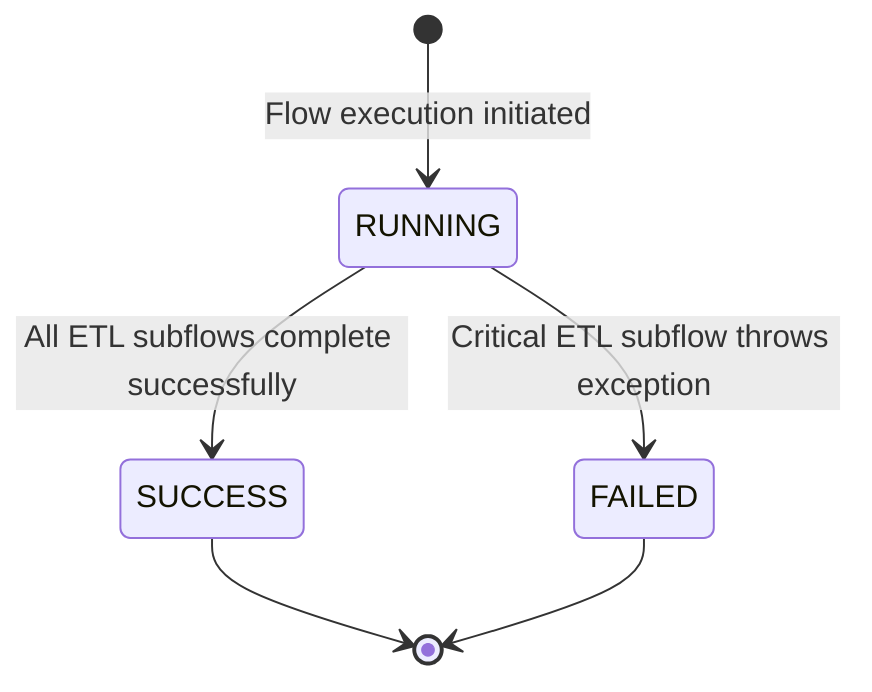
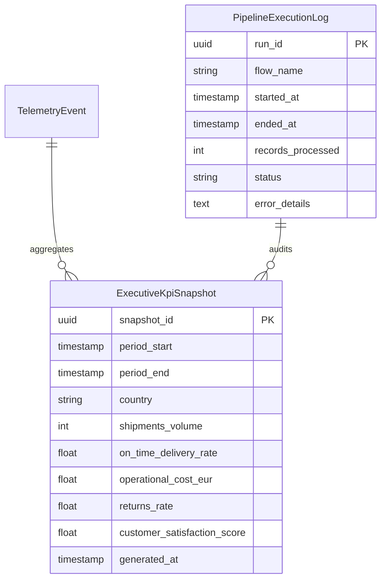

# Data Model: Pipeline Subflows and Tests

**Feature Branch**: `feature/021-pipeline-subflows-and-tests`  
**Date**: 2026-10-27  
**Status**: Completed  

---

## Overview

This document specifies the relational database schemas, in-memory pipeline data structures, and cross-cutting Data Transfer Objects (DTOs) utilized across the TrackFlow business performance pipeline and the executive reporting dashboard.

---

## 1. Database Entities (`reporting` schema)

### 1.1 `ExecutiveKpiSnapshot` (`executive_kpi_snapshots`)

Represents pre-aggregated weekly business performance metrics calculated across dual fulfillment hubs (`US-LAX-01` and `ES-ZAZ-01`) and consolidated globally.

| Field Name | Type | Nullable | Default | Description |
|---|---|---|---|---|
| `snapshot_id` | `UUID` (PK) | No | `uuid4()` | Unique identifier of the snapshot record. |
| `period_start` | `TIMESTAMP WITH TIME ZONE` | No | - | Beginning boundary of the reporting period (inclusive, UTC). |
| `period_end` | `TIMESTAMP WITH TIME ZONE` | No | - | Ending boundary of the reporting period (inclusive, UTC). |
| `country` | `VARCHAR(10)` | No | - | Regional hub scope: `'US'`, `'ES'`, or `'GLOBAL'`. |
| `shipments_volume` | `INTEGER` | No | `0` | Total outbound orders fulfilled during the period. Must be >= 0. |
| `on_time_delivery_rate` | `FLOAT` | No | `1.0` | Ratio of delivered orders within SLA transit windows (range: `0.0` to `1.0`). |
| `operational_cost_eur` | `FLOAT` | No | `0.0` | Total fulfillment and last-mile logistics expenditure in Euros. Must be >= 0.0. |
| `returns_rate` | `FLOAT` | No | `0.0` | Returned items as a percentage of total shipments (range: `0.0` to `100.0`). |
| `customer_satisfaction_score` | `FLOAT` | No | `100.0` | Composite satisfaction index (range: `0.0` to `100.0`). |
| `generated_at` | `TIMESTAMP WITH TIME ZONE` | No | `now(UTC)` | Timestamp when the snapshot was persisted. |

**Constraints & Indexes**:
- `uq_kpi_snapshot_period_country`: `UNIQUE (period_start, period_end, country)`
- `idx_kpi_snapshots_period`: `INDEX (period_start, period_end)`
- `idx_kpi_snapshots_country`: `INDEX (country)`

---

### 1.2 `PipelineExecutionLog` (`pipeline_execution_logs`)

Maintains an immutable audit log of each pipeline execution lifecycle for observability and executive dashboard status reporting.

| Field Name | Type | Nullable | Default | Description |
|---|---|---|---|---|
| `run_id` | `UUID` (PK) | No | `uuid4()` | Unique execution run identifier. |
| `flow_name` | `VARCHAR(100)` | No | `'executive_performance_pipeline_flow'` | Identifier of the executed flow. |
| `started_at` | `TIMESTAMP WITH TIME ZONE` | No | `now(UTC)` | Execution start timestamp in UTC. |
| `ended_at` | `TIMESTAMP WITH TIME ZONE` | Yes | `NULL` | Execution completion or failure timestamp in UTC. |
| `records_processed` | `INTEGER` | No | `0` | Total count of raw events processed during extraction. |
| `status` | `VARCHAR(20)` | No | `'RUNNING'` | Lifecycle state: `'RUNNING'`, `'SUCCESS'`, `'FAILED'`. |
| `error_details` | `TEXT` | Yes | `NULL` | Sanitized error summary if execution failed. |

**State Transitions**:


---

## 2. In-Memory Pipeline Data Structures

### 2.1 Extraction Output (`RawExtractionDataset`)

Output of `extract_fulfillment_and_telemetry_flow` and input to `transform_executive_performance_kpis_flow`. Passed as an explicit dictionary mapping entity keys to pandas DataFrames:

```python
{
    "orders": pd.DataFrame(columns=[
        "order_id",            # str: Unique order identifier
        "warehouse_code",      # str: Origin facility ('US-LAX-01' | 'ES-ZAZ-01')
        "total_cost_eur",      # float: Total fulfillment cost in EUR
        "destination_country", # str: Delivery destination
        "timestamp",           # str: ISO 8601 UTC timestamp
    ]),
    "tracking": pd.DataFrame(columns=[
        "tracking_number_hash", # str: Anonymized tracking hash
        "origin_warehouse",     # str: Origin facility
        "timestamp",            # str: Status timestamp
        "is_delivered",         # bool / float: Delivery confirmation flag
        "is_delivered_on_time", # float: 1.0 if within SLA, 0.0 if late
    ]),
    "returns": pd.DataFrame(columns=[
        "return_id",            # str: Return request identifier
        "warehouse_code",       # str: Processing hub
        "timestamp",            # str: Return event timestamp
    ]),
    "cx": pd.DataFrame(columns=[
        "ticket_id",                 # str: Support ticket identifier
        "warehouse_code",            # str: Associated fulfillment hub
        "csat_rating",               # float: Rating from 1.0 to 5.0
        "first_contact_resolution",  # float: 1.0 if resolved on first contact, 0.0 otherwise
        "timestamp",                 # str: Resolution timestamp
    ]),
}
```

---

### 2.2 Vectorized Regional Metric Dictionary (`TransformedKpiMetric`)

Output of `compute_regional_metrics` for each geographic scope (`'US'`, `'ES'`, `'GLOBAL'`):

```python
{
    "country": str,                        # 'US' | 'ES' | 'GLOBAL'
    "shipments_volume": int,               # >= 0
    "on_time_delivery_rate": float,        # 0.0 <= rate <= 1.0
    "operational_cost_eur": float,         # >= 0.0
    "returns_rate": float,                 # 0.0 <= rate <= 100.0
    "customer_satisfaction_score": float,  # 0.0 <= score <= 100.0
}
```

**Zero-Division & Neutral Fallback Rules**:
- When `shipments_volume == 0`:
  - `returns_rate = 0.0`
- When `tracking` records are empty or have 0 valid deliveries:
  - `on_time_delivery_rate = 1.0` (100% nominal default)
- When `cx` records are empty:
  - `customer_satisfaction_score = 100.0` (100% nominal default)
- When `orders` records are empty:
  - `operational_cost_eur = 0.0`

---

## 3. Data Transfer Objects (DTOs) & TypeScript Interfaces

### 3.1 Shared TypeScript Definitions (`@repo/shared-types`)

Published in `packages/shared/types/reporting.ts`:

```typescript
export type ReportingGeographicScope = 'US' | 'ES' | 'GLOBAL';

export interface ExecutiveKpiSnapshot {
  readonly snapshot_id: string;
  readonly period_start: string;
  readonly period_end: string;
  readonly country: ReportingGeographicScope;
  readonly shipments_volume: number;
  readonly on_time_delivery_rate: number;
  readonly operational_cost_eur: number;
  readonly returns_rate: number;
  readonly customer_satisfaction_score: number;
  readonly generated_at: string;
}

export interface ExecutiveKpisResponse {
  readonly count: number;
  readonly snapshots: readonly ExecutiveKpiSnapshot[];
}

export interface PipelineExecutionLog {
  readonly run_id: string;
  readonly flow_name: string;
  readonly started_at: string;
  readonly ended_at: string | null;
  readonly records_processed: number;
  readonly status: 'RUNNING' | 'SUCCESS' | 'FAILED';
  readonly error_details: string | null;
}

export interface PipelineStatusResponse {
  readonly latest_run: PipelineExecutionLog | null;
  readonly is_running: boolean;
  readonly healthy: boolean;
}

export interface ReportingQueryParams {
  readonly country?: ReportingGeographicScope | undefined;
  readonly start_date?: string | undefined;
  readonly end_date?: string | undefined;
}
```

---

## 4. Entity Relationships


