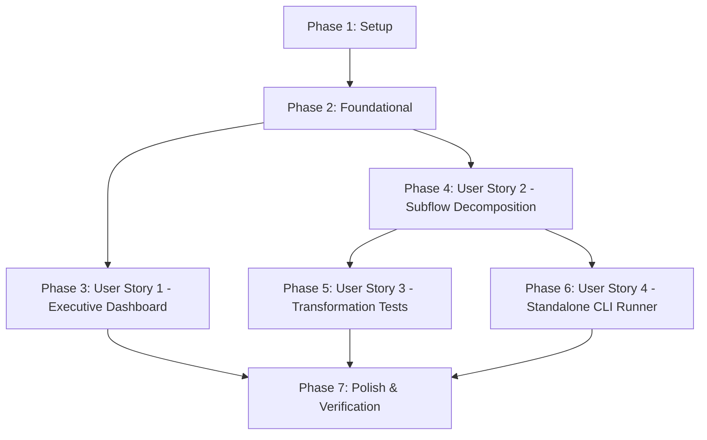

# Tasks: Pipeline Enhancement: Subflows and Tests

**Input**: Design documents from `/specs/021-pipeline-subflows-and-tests/`  
**Prerequisites**: [plan.md](file:///j:/GitHub/mr-stegmann-ai-engineering-company-project-monorepo/specs/021-pipeline-subflows-and-tests/plan.md), [spec.md](file:///j:/GitHub/mr-stegmann-ai-engineering-company-project-monorepo/specs/021-pipeline-subflows-and-tests/spec.md), [data-model.md](file:///j:/GitHub/mr-stegmann-ai-engineering-company-project-monorepo/specs/021-pipeline-subflows-and-tests/data-model.md), [research.md](file:///j:/GitHub/mr-stegmann-ai-engineering-company-project-monorepo/specs/021-pipeline-subflows-and-tests/research.md), [contracts/](file:///j:/GitHub/mr-stegmann-ai-engineering-company-project-monorepo/specs/021-pipeline-subflows-and-tests/contracts/), [quickstart.md](file:///j:/GitHub/mr-stegmann-ai-engineering-company-project-monorepo/specs/021-pipeline-subflows-and-tests/quickstart.md)

---

## Format: `- [ ] [ID] [P?] [Story] Description with file path`

- **[P]**: Can run in parallel (different files, no dependencies)
- **[Story]**: Which user story this task belongs to (`[US1]`, `[US2]`, `[US3]`, `[US4]`)
- Every task includes an explicit, unambiguous file path.

---

## Phase 1: Setup (Shared Infrastructure)

**Purpose**: Project initialization and environment validation

- [x] T001 Inspect and verify environment dependencies (Python 3.11+, Prefect 3.x, Node.js 18+) across data pipeline and backoffice workspace in package.json
- [x] T002 [P] Verify backend reporting endpoint routes and OpenAPI schema alignment in specs/021-pipeline-subflows-and-tests/contracts/reporting-api.yaml

---

## Phase 2: Foundational (Blocking Prerequisites)

**Purpose**: Core DTOs and database models that MUST be complete before ANY user story can proceed

**⚠️ CRITICAL**: No user story implementation can begin until this foundational phase is complete

- [x] T003 [P] Create shared TypeScript DTO interfaces in packages/shared/types/reporting.ts
- [x] T004 [P] Export reporting type definitions and DTOs from packages/shared/types/index.ts
- [x] T005 Validate database schema alignment and default values for ExecutiveKpiSnapshot and PipelineExecutionLog in data/pipelines/models.py

**Checkpoint**: Foundation ready — user story implementation can now begin in parallel or sequence.

---

## Phase 3: User Story 1 - Executive Dashboard for Business Performance Metrics (Priority: P1) 🎯 MVP

**Goal**: Deliver a dedicated, business-facing executive reporting dashboard within the backoffice web application (`/reporting`) consuming `GET /api/v1/reporting/kpis`, displaying all five core TrackFlow KPIs across hubs (US, ES, GLOBAL), reporting cadence period badges, loading skeletons, and error recovery.

**Independent Test**: Navigate to `http://localhost:3000/reporting` in `uis/backoffice/`. Verify that all five briefing KPIs render with non-technical business labels, the weekly reporting period badge displays, the hub selector switches between `GLOBAL`, `US`, and `ES`, loading skeletons eliminate CLS, and an accessible error alert banner displays with a retry button on failure.

### Implementation for User Story 1

- [x] T006 [P] [US1] Implement typed client-side fetcher fetchExecutiveKpis and fetchPipelineStatus in uis/backoffice/lib/reportingApi.ts
- [x] T007 [P] [US1] Add 'Reporting' navigation item with active route indicator to uis/backoffice/components/Header.tsx
- [x] T008 [US1] Create executive reporting dashboard page structure, header with weekly date window badge, and hub scope selector in uis/backoffice/app/reporting/page.tsx
- [x] T009 [US1] Implement 5 executive KPI metric cards with SLA badges and unit economics in uis/backoffice/app/reporting/page.tsx
- [x] T010 [US1] Implement loading skeleton placeholders matching card geometries and accessible error alert banner with retry action in uis/backoffice/app/reporting/page.tsx
- [x] T011 [US1] Verify strict TypeScript compliance and production build compilation for uis/backoffice/ via npm run typecheck in uis/backoffice/package.json

**Checkpoint**: User Story 1 is fully functional and delivers immediate business visibility as an MVP increment.

---

## Phase 4: User Story 2 - Modular Subflow Architecture Decomposition (Priority: P1)

**Goal**: Deconstruct the monolithic pipeline in `data/pipelines/pipeline.py` into at least three independent Prefect 3.x `@flow` subflows (`extract_fulfillment_and_telemetry_flow`, `transform_executive_performance_kpis_flow`, `load_executive_kpi_snapshots_flow`, and auxiliary `dispatch_pipeline_notifications_flow`), communicating strictly through explicit arguments and return values with zero mutable global state, orchestrated by `executive_performance_pipeline_flow`.

**Independent Test**: Execute each individual subflow independently in an automated runner or script. Verify extraction accepts date window and outputs typed dataset dictionary; transformation accepts raw datasets and outputs aggregated KPI snapshots; load accepts snapshots and idempotently persists with audit logging.

### Implementation for User Story 2

- [x] T012 [P] [US2] Implement extract_fulfillment_and_telemetry_flow subflow with retries and typed dictionary return in data/pipelines/pipeline.py
- [x] T013 [P] [US2] Implement transform_executive_performance_kpis_flow subflow accepting explicit dataset dictionary and returning regional snapshot list in data/pipelines/pipeline.py
- [x] T014 [US2] Implement load_executive_kpi_snapshots_flow subflow executing idempotent upsert and returning persisted count in data/pipelines/pipeline.py
- [x] T015 [US2] Implement auxiliary dispatch_pipeline_notifications_flow subflow for non-critical alerts in data/pipelines/pipeline.py
- [x] T016 [US2] Refactor master flow executive_performance_pipeline_flow to coordinate subflows sequentially, pass outputs explicitly, capture auxiliary state via return_state=True, and record audit lifecycle in data/pipelines/pipeline.py

**Checkpoint**: Modular subflow architecture complete and verifiable in Prefect state engine with clean stage isolation.

---

## Phase 5: User Story 3 - Isolated Transformation Unit Testing & Defensive Coverage (Priority: P2)

**Goal**: Implement a comprehensive unit test suite in `tests/pipelines/test_pipeline.py` validating transformation tasks in 100% memory isolation with zero live database or network calls, verifying zero-division guardrails, defensive malformed payload handling, and exact mathematical precision against briefing formulas.

**Independent Test**: Run `python -m pytest tests/pipelines/test_pipeline.py -v` in an environment disconnected from databases and network services. Verify that all tests pass with exit code `0` in < 2.0s without opening network sockets or database connections.

### Implementation for User Story 3

- [x] T017 [P] [US3] Create in-memory synthetic fixtures for orders, tracking, returns, and CX events in tests/pipelines/test_pipeline.py
- [x] T018 [P] [US3] Implement test_transformation_zero_division_guardrails testing neutral fallbacks on empty event DataFrames in tests/pipelines/test_pipeline.py
- [x] T019 [P] [US3] Implement test_transformation_malformed_and_missing_payloads testing defensive handling of nulls, invalid cost types, and out-of-range ratings in tests/pipelines/test_pipeline.py
- [x] T020 [US3] Implement test_transformation_exact_mathematical_precision validating all 5 KPIs against hand-calculated ground truth for US, ES, and GLOBAL in tests/pipelines/test_pipeline.py
- [x] T021 [US3] Execute test suite via pytest and verify 100% pass rate with zero DB or network dependencies in tests/pipelines/test_pipeline.py

**Checkpoint**: Transformation logic mathematically verified and resilient against corrupted telemetry payloads.

---

## Phase 6: User Story 4 - Preserved Standalone CLI Execution Compatibility (Priority: P2)

**Goal**: Preserve CLI execution compatibility for `python data/pipelines/pipeline.py` with default trailing 7-day calendar window and custom `--start-date` / `--end-date` arguments, ensuring zero modifications to `services/telemetry/analysis.py` or `telemetry_events`.

**Independent Test**: Execute `python data/pipelines/pipeline.py` with default parameters and with `--start-date` / `--end-date` flags; verify both complete the full ETL pipeline with exit code 0 and confirm zero git modifications to `services/telemetry/analysis.py`.

### Implementation for User Story 4

- [x] T022 [US4] Configure CLI argument parser and execution lifecycle handling in main() in data/pipelines/pipeline.py
- [x] T023 [US4] Validate standalone CLI execution with default calendar window via python data/pipelines/pipeline.py
- [x] T024 [US4] Validate standalone CLI execution with custom date range arguments via python data/pipelines/pipeline.py
- [x] T025 [P] [US4] Verify telemetry analysis assets in services/telemetry/analysis.py and telemetry_events table remain unmodified and intact

**Checkpoint**: CLI runner fully compatible with existing cron schedules, backfill scripts, and container entrypoints.

---

## Phase 7: Polish & Cross-Cutting Concerns

**Purpose**: Documentation, monorepo regression testing, and Core Web Vitals audit

- [x] T026 [P] Update data pipeline documentation reflecting subflow architecture and CLI usage in data/pipelines/README.md
- [x] T027 [P] Run existing integration test suite in tests/pipelines/test_pipeline_etl.py and resilience suite in tests/pipelines/test_pipeline_resilience.py
- [x] T028 Execute monorepo static typecheck and backoffice production build in uis/backoffice/package.json
- [x] T029 Run end-to-end verification walkthrough following specs/021-pipeline-subflows-and-tests/quickstart.md

---

## Dependencies & Execution Order

### Phase Dependencies

- **Setup (Phase 1)**: Can start immediately.
- **Foundational (Phase 2)**: Depends on Setup; blocks all user stories.
- **User Story 1 (P1 - Dashboard)**: Can proceed after Foundational (Phase 2) using mock or existing database data.
- **User Story 2 (P1 - Subflows)**: Can proceed after Foundational (Phase 2).
- **User Story 3 (P2 - Transformation Tests)**: Depends on transformation task extraction in Phase 4.
- **User Story 4 (P2 - CLI Runner)**: Depends on subflow completion in Phase 4.
- **Polish (Phase 7)**: Depends on all user stories being completed.

---

## Parallel Execution Opportunities

### Within Phases

- **Phase 1**: T001 and T002 can run in parallel.
- **Phase 2**: T003 and T004 can run in parallel with T005.
- **Phase 3 (US1)**:
  - T006 (`reportingApi.ts`) and T007 (`Header.tsx`) can run in parallel.
  - T008, T009, and T010 can be integrated in `page.tsx`.
- **Phase 4 (US2)**:
  - T012 (`extract` flow) and T013 (`transform` flow) can be authored in parallel.
- **Phase 5 (US3)**:
  - T017, T018, and T019 can be developed in parallel before final mathematical regression test T020.
- **Phase 7 (Polish)**:
  - T026 (`README.md`) and T027 (existing test suites) can run in parallel.

### Across User Stories

- Once Phase 2 (Foundational) is complete, **User Story 1 (Frontend Dashboard)** and **User Story 2 (Subflow Refactoring)** can proceed in parallel by independent engineers or work streams.

---

## Implementation Strategy

### MVP First (User Story 1 Only)

1. Complete **Phase 1: Setup** (T001 - T002).
2. Complete **Phase 2: Foundational** (T003 - T005).
3. Complete **Phase 3: User Story 1** (T006 - T011).
4. **STOP and VALIDATE**: Navigate to `http://localhost:3000/reporting` to verify KPI cards, date badge, and hub filtering.
5. Deploy/demo MVP to CEO Daniel Espinoza.

### Incremental Delivery

1. **Increment 1**: Deliver Executive Reporting Dashboard (`/reporting`) for immediate stakeholder visibility.
2. **Increment 2**: Decompose pipeline into Prefect 3.x subflows (`@flow`) for observability and modular lineage.
3. **Increment 3**: Establish zero-dependency in-memory transformation test suite (`test_pipeline.py`) for defensive robustness.
4. **Increment 4**: Validate CLI execution compatibility and verify telemetry asset preservation.
5. **Increment 5**: Monorepo verification, Core Web Vitals benchmark, and quickstart scenario sign-off.
