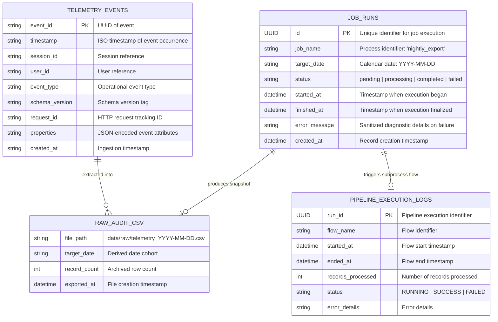
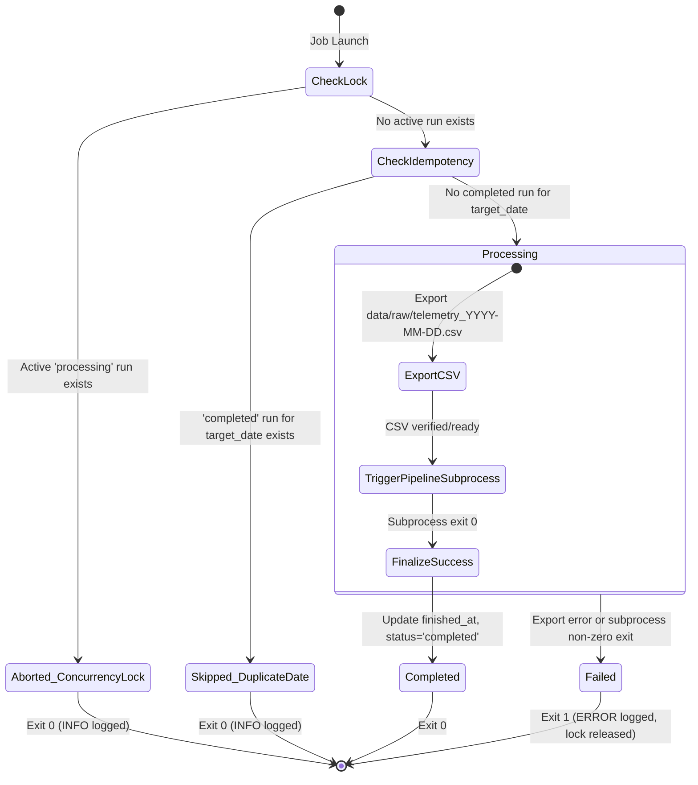

# Data Model: Automated Nightly Telemetry Export & Orchestration

**Feature**: `022-nightly-telemetry-export` | **Branch**: `022-nightly-telemetry-export`
**Created**: 2026-10-27

---

## 1. Architectural Overview & Storage Entities

This feature introduces a dedicated orchestration tracking table (`job_runs`) and an immutable point-in-time file archive (`data/raw/telemetry_YYYY-MM-DD.csv`). It reads operational telemetry events from the existing `telemetry_events` table in read-only mode and triggers the analytical pipeline storing into the `reporting` schema.

---

## 2. Entity Specifications

### 2.1 Entity: `job_runs` (SQLModel / Relational Table)

Tracks execution lifecycles, guarantees concurrency locking, and enforces per-day idempotency for background processes.

| Column | Type | Constraints / Attributes | Description |
|---|---|---|---|
| `id` | `UUID` | Primary Key, Indexed, Default: `uuid4()` | Unique execution run identifier |
| `job_name` | `VARCHAR(64)` | NOT NULL, Indexed | Canonical name of the job (e.g. `nightly_export`) |
| `target_date` | `VARCHAR(10)` | NOT NULL, Indexed | Operational cohort date in `YYYY-MM-DD` UTC format |
| `status` | `VARCHAR(20)` | NOT NULL, Indexed | Lifecycle state: `pending`, `processing`, `completed`, `failed` |
| `started_at` | `TIMESTAMP WITH TIME ZONE` | NOT NULL, Default: `now(UTC)` | Timestamp when job started processing |
| `finished_at` | `TIMESTAMP WITH TIME ZONE` | NULLABLE | Timestamp when job finalized (success or failure) |
| `error_message` | `VARCHAR(500)` | NULLABLE | Sanitized failure summary (credentials masked, max 500 chars) |
| `created_at` | `TIMESTAMP WITH TIME ZONE` | NOT NULL, Default: `now(UTC)` | Record creation timestamp |

#### Table Constraints & Indexes
- **Composite Index**: `idx_job_runs_name_target_date` on `(job_name, target_date)` for fast idempotency lookups.
- **Locking Index**: `idx_job_runs_name_status` on `(job_name, status)` for fast active lock checks.

---

### 2.2 Entity: Raw Audit Snapshot (`data/raw/telemetry_YYYY-MM-DD.csv`)

Point-in-time flat-file snapshot for compliance auditing, disaster recovery, and offline analytics.

| Field | Description | Source Mapping |
|---|---|---|
| `event_id` | Unique identifier for telemetry event | `telemetry_events.event_id` |
| `timestamp` | ISO UTC timestamp string | `telemetry_events.timestamp` |
| `session_id` | Session identifier | `telemetry_events.session_id` |
| `user_id` | Anonymized user identifier | `telemetry_events.user_id` |
| `event_type` | Event category | `telemetry_events.event_type` |
| `schema_version` | Event schema version | `telemetry_events.schema_version` |
| `request_id` | Trace correlation ID | `telemetry_events.request_id` |
| `properties` | Serialized JSON payload attributes | `telemetry_events.properties` |
| `created_at` | Event ingestion timestamp | `telemetry_events.created_at` |

#### File Retention & Immutability Rules
- **Location**: `data/raw/telemetry_YYYY-MM-DD.csv`
- **Immutability**: Once created, the file is never overwritten by subsequent runs for that target date.
- **Empty Dataset Rule**: If no events occurred on the target date, a CSV with header columns and 0 data rows is written.

---

## 3. Lifecycle State Transitions

The `job_runs` entity operates according to a strict state machine to prevent concurrency collisions and stranded locks.

### Transition Matrix

| Current State | Trigger Event | Next State | System Actions |
|---|---|---|---|
| `[None]` | Script started & active lock detected | `[None]` (Skip) | Log `INFO` cancellation; exit 0 without DB write. |
| `[None]` | Script started & completed target date detected | `[None]` (Skip) | Log `INFO` duplicate skip; exit 0 without DB write. |
| `[None]` | Script started, no active locks, date uncompleted | `processing` | Insert `job_runs` row with `status='processing'`, `started_at=now()`. |
| `processing` | CSV export & subprocess pipeline succeed | `completed` | Update `job_runs`: `status='completed'`, `finished_at=now()`. |
| `processing` | Unhandled exception or pipeline exit != 0 | `failed` | Update `job_runs`: `status='failed'`, `finished_at=now()`, `error_message=sanitized_msg`. |
