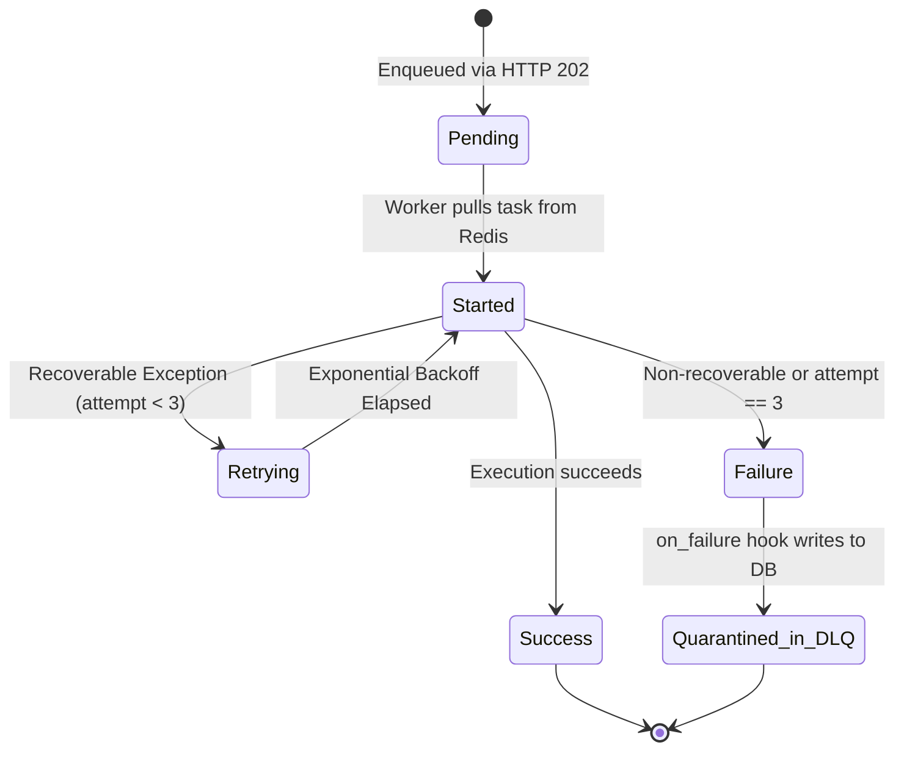

# Data Model: Queue Messages & Async Tasks

**Feature**: Queue Messages & Async Tasks via Celery and Redis  
**Branch**: `feature/redis-celery-async-queue-task` (`023-queue-async-tasks`)  
**Date**: 2026-11-05  

---

## 1. Domain Entities & Schemas

### 1.1 Task Message Envelope (Redis Celery Queue)
Represents the lightweight serialized message placed onto the Redis broker queue.

| Field | Type | Required | Description |
|---|---|---|---|
| `id` | `UUID (str)` | Yes | Unique Celery execution identifier (UUIDv4). |
| `task` | `str` | Yes | Qualified Python path of the Celery task function. |
| `args` | `List[Any]` | Yes | Positional arguments containing primitive types, identifiers, or storage paths. |
| `kwargs` | `Dict[str, Any]` | Yes | Keyword parameters containing filters, date ranges, or flags. |
| `retries` | `int` | Yes | Counter of execution attempts (0 to 3). Default `0`. |
| `eta` | `Optional[str]` | No | Scheduled execution timestamp (ISO 8601 UTC) for delayed retries. |
| `expires` | `Optional[int]` | No | Maximum time-to-live in seconds before the broker discards an unexecuted message. |

**Validation Rules**:
- **Payload Size Restriction**: The total serialized envelope size MUST NOT exceed 64 KB. Binary file data (e.g., CSV bytes) is strictly forbidden in `args` or `kwargs`; file inputs must use filesystem staging path references.
- **Serialization**: JSON serialization only (`task_serializer = "json"`). No pickle objects allowed.

---

### 1.2 Task Registration Metadata (Redis Ephemeral Key)
Represents the registration record stored in Redis under the key `task_meta:{task_id}` immediately upon queue submission. Used to disambiguate legitimate pending tasks from arbitrary invalid task IDs.

| Field | Type | Description |
|---|---|---|
| `task_id` | `str` | The task's unique identifier. |
| `task_name` | `str` | Short logical name of the task (e.g., `reporting.trigger`, `inventory.products`). |
| `status` | `str` | Initial status: `"pending"`. |
| `enqueued_at` | `str` | ISO 8601 UTC timestamp of submission. |
| `ttl` | `int` | Key expiration set to 86,400 seconds (24 hours). |

---

### 1.3 Task Status Descriptor (Celery Result Store & API DTO)
Represents the queryable state of an execution in the Celery result backend and returned by `GET /tasks/{task_id}`.

| Field | Type | Required | Description |
|---|---|---|---|
| `task_id` | `str` | Yes | Task UUID. |
| `status` | `TaskStatusEnum` | Yes | Current execution state (`pending`, `started`, `success`, `failure`). |
| `result` | `Optional[Any]` | No | Final computed payload when `status == "success"`. Otherwise `null`. |
| `error` | `Optional[str]` | No | Sanitized error diagnostic string when `status == "failure"`. Otherwise `null`. |
| `created_at` | `Optional[datetime]` | No | Submission timestamp (UTC). |
| `completed_at` | `Optional[datetime]` | No | Completion timestamp (UTC). |

**Status Enum Values**:
- `pending`: Enqueued in Redis broker; awaiting consumption by an available worker.
- `started`: Worker has acknowledged the task and begun execution.
- `success`: Execution completed successfully; output result is available in `result`.
- `failure`: Execution failed permanently after exhausting all retries; error diagnostic in `error`.

---

### 1.4 Dead Letter Queue (DLQ) Record (Relational Database)
Represents a persistent audit entry stored in the central relational database table `dead_letter_queue` when a task fails 3 consecutive times.

```sql
CREATE TABLE IF NOT EXISTS dead_letter_queue (
    id INTEGER PRIMARY KEY AUTOINCREMENT,
    task_id VARCHAR(64) NOT NULL,
    task_name VARCHAR(255) NOT NULL,
    attempt_number INTEGER NOT NULL DEFAULT 3,
    error_message TEXT NOT NULL,
    payload_reference TEXT NULL,
    failed_at TIMESTAMP NOT NULL DEFAULT CURRENT_TIMESTAMP
);
CREATE INDEX IF NOT EXISTS ix_dlq_task_id ON dead_letter_queue (task_id);
CREATE INDEX IF NOT EXISTS ix_dlq_failed_at ON dead_letter_queue (failed_at);
```

#### SQLModel Class (`services/api/infrastructure/queue/models.py`)
```python
from datetime import datetime, timezone
from typing import Optional
from sqlmodel import Field, SQLModel

class DeadLetterQueueRecord(SQLModel, table=True):
    __tablename__ = "dead_letter_queue"

    id: Optional[int] = Field(default=None, primary_key=True)
    task_id: str = Field(index=True, max_length=64, nullable=False)
    task_name: str = Field(max_length=255, nullable=False)
    attempt_number: int = Field(default=3, nullable=False)
    error_message: str = Field(nullable=False)
    payload_reference: Optional[str] = Field(default=None, nullable=True)
    failed_at: datetime = Field(
        default_factory=lambda: datetime.now(timezone.utc),
        nullable=False,
    )
```

**Validation & Integrity**:
- `attempt_number` must be `>= 1` (typically `3` on final exhaustion).
- `error_message` must be sanitized to scrub passwords, bearer tokens, and email addresses.
- `failed_at` is always recorded in UTC.

---

### 1.5 Asynchronous Task Acceptance DTO (`AsyncTaskAcceptedResponse`)
Returned with HTTP status 202 Accepted when a heavy operation is submitted.

```python
from datetime import datetime, timezone
from pydantic import BaseModel, ConfigDict, Field

class AsyncTaskAcceptedResponse(BaseModel):
    model_config = ConfigDict(from_attributes=True)

    task_id: str = Field(description="Unique tracking identifier for the enqueued task.")
    status: str = Field(default="pending", description="Initial lifecycle state ('pending').")
    message: str = Field(description="Human-readable acknowledgement.")
    poll_url: str = Field(description="Relative endpoint path to query task progress.")
    created_at: datetime = Field(
        default_factory=lambda: datetime.now(timezone.utc),
        description="UTC timestamp of submission."
    )
```

---

## 2. State Machine: Task Lifecycle Transitions



### State Invariants:
1. **Pending**: Exists in Redis queue; message is unacknowledged (`unacked`).
2. **Started**: Worker process is actively running the task function; state updated in Celery result backend.
3. **Retrying**: Task re-scheduled with exponential delay ($2^{\text{retry\_count}}$ seconds + jitter); attempt counter incremented.
4. **Success**: Output stored in Redis result store; worker sends `ACK` to broker.
5. **Failure**: Max retries reached; entry written to `dead_letter_queue` table; sanitized failure recorded in Redis result store; message acknowledged (`ACK`) so broker drops it.

