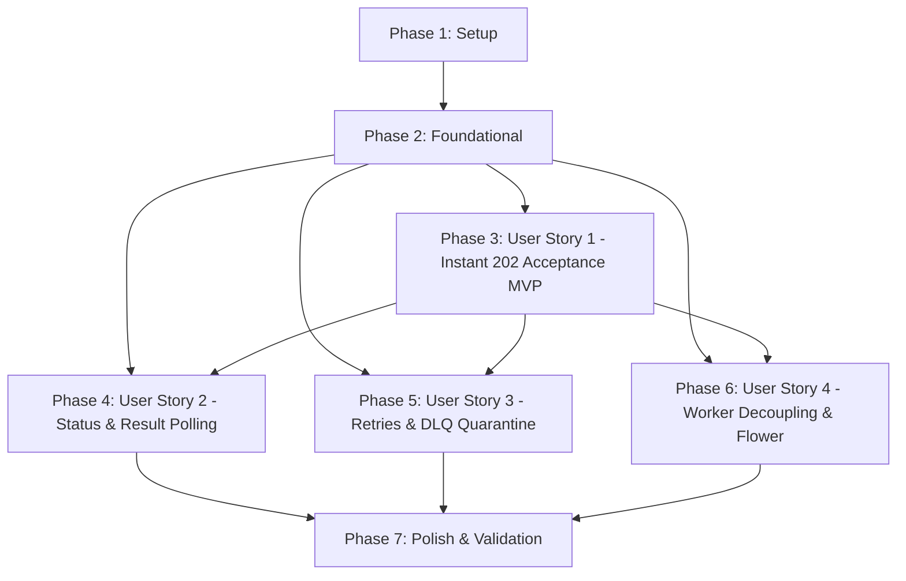

# Tasks: Queue Messages & Async Tasks via Celery and Redis

**Input**: Design documents from `specs/023-queue-async-tasks/` (`plan.md`, `spec.md`, `data-model.md`, `contracts/`, `research.md`, `quickstart.md`)

**Prerequisites**: `plan.md`, `spec.md`, `data-model.md`, `contracts/`, `research.md`, `quickstart.md`, `.specify/memory/constitution.md`

**Tests**: Test tasks are included per Monorepo Constitution Principle VI and feature testing specifications in `plan.md` and `quickstart.md`.

**Organization**: Tasks are grouped by user story to enable independent implementation and testing of each story.

## Format: `- [ ] [TaskID] [P?] [Story?] Description with exact file path`

- **[P]**: Can run in parallel (different files, no dependencies on incomplete tasks)
- **[Story]**: Which user story this task belongs to (e.g., `[US1]`, `[US2]`, `[US3]`, `[US4]`)
- Every task includes explicit file paths in its description

---

## Phase 1: Setup (Shared Infrastructure)

**Purpose**: Project initialization, dependency additions, directory creation, and container orchestration

- [X] T001 Add Celery, Redis, and Flower dependencies (`celery[redis]>=5.3.0`, `redis>=5.0.0`, `flower>=2.0.0`) to `services/api/requirements.txt`
- [X] T002 Create shared staging directory `data/staging/incidents/` and add ignore entry to `.gitignore`
- [X] T003 [P] Configure broker and queue environment variables (`REDIS_URL`, `CELERY_RESULT_BACKEND`, `FLOWER_BASIC_AUTH`) in `services/api/.env.example` and `services/api/.env`
- [X] T004 [P] Update `docker-compose.yml` to define `redis` (port 6379, noeviction, appendonly), `worker` (Celery worker process), and `flower` (port 5555) services on `trackflow-net`

---

## Phase 2: Foundational (Blocking Prerequisites)

**Purpose**: Core infrastructure that MUST be complete before ANY user story can be implemented

**⚠️ CRITICAL**: No user story work can begin until this foundational queue and persistence infrastructure is complete

- [X] T005 Initialize Celery application factory, Redis broker/backend configuration, and task serialization in `services/api/infrastructure/queue/celery_app.py`
- [X] T006 [P] Define `TaskStatusEnum`, `TaskStatusResponse`, and `AsyncTaskAcceptedResponse` Pydantic DTO models in `services/api/infrastructure/queue/schemas.py`
- [X] T007 [P] Define `DeadLetterQueueRecord` SQLModel entity and table metadata in `services/api/infrastructure/queue/models.py`
- [X] T008 [P] Implement PII, token, and secret sanitization helper (`sanitize_error_message`) in `services/api/infrastructure/queue/dlq.py`
- [X] T009 Implement `DeadLetterQueuePort` persistence adapter for SQLite/PostgreSQL in `services/api/infrastructure/queue/dlq.py`
- [X] T010 Implement `TrackFlowTask` custom base task class with 3x retry limit, exponential backoff, late ACK, and `on_failure` DLQ dispatch in `services/api/infrastructure/queue/custom_task.py`
- [X] T011 Register `dead_letter_queue` table creation in the database startup sequence in `services/api/infrastructure/persistence/sqlmodel/client.py`
- [X] T012 Export Celery application instance, base task, and queue models in `services/api/infrastructure/queue/__init__.py`

**Checkpoint**: Foundation ready - queue infrastructure and persistence primitives are fully available. User story implementation can now begin.

---

## Phase 3: User Story 1 - Asynchronous Offloading & Instant Task Acceptance (Priority: P1) 🎯 MVP

**Goal**: Decouple heavy endpoints (`POST /reporting/trigger`, `GET /inventory/products`, `GET /telemetry/report`, `POST /incidents/analyze`) so they immediately enqueue jobs to Redis and return HTTP 202 Accepted with a unique `task_id` in under 200ms.

**Independent Test**: Submit requests with valid parameters to all 4 offloaded endpoints and verify HTTP 202 status code and unique `task_id` response in under 200ms, while background worker processes execute the heavy workloads without blocking the web API.

### Tests for User Story 1

- [X] T013 [P] [US1] Create unit tests for Celery task functions (`trigger_pipeline_task`, `list_products_task`, `telemetry_report_task`, `analyze_incidents_task`) in `services/api/tests/test_celery_tasks.py`
- [X] T014 [P] [US1] Create integration contract tests verifying HTTP 202 Accepted and `task_id` response for all 4 offloaded endpoints in `services/api/tests/test_async_endpoints.py`

### Implementation for User Story 1

- [X] T015 [P] [US1] Implement background task handlers (`trigger_pipeline_task`, `list_products_task`, `telemetry_report_task`, `analyze_incidents_task`) wrapping business logic in `services/api/infrastructure/queue/tasks.py`
- [X] T016 [US1] Implement Redis task registration helper (`register_enqueued_task`) to store initial `task_meta:{task_id}` metadata upon dispatch in `services/api/infrastructure/queue/celery_app.py`
- [X] T017 [P] [US1] Convert `POST /reporting/trigger` to dispatch `trigger_pipeline_task` asynchronously and return HTTP 202 with `AsyncTaskAcceptedResponse` in `services/reporting/presentation/routes.py`
- [X] T018 [P] [US1] Convert `GET /inventory/products` to dispatch `list_products_task` asynchronously and return HTTP 202 with `AsyncTaskAcceptedResponse` in `services/api/presentation/api/v1/inventory.py`
- [X] T019 [P] [US1] Convert `GET /telemetry/report` to dispatch `telemetry_report_task` asynchronously and return HTTP 202 with `AsyncTaskAcceptedResponse` in `services/api/presentation/api/v1/telemetry.py`
- [X] T020 [US1] Convert `POST /incidents/analyze` to validate CSV, stage file to `data/staging/incidents/{task_id}.csv`, dispatch `analyze_incidents_task`, and return HTTP 202 in `services/api/presentation/api/v1/incidents.py`

**Checkpoint**: At this point, User Story 1 is fully functional. Heavy workloads return HTTP 202 instantly and enqueue to Celery/Redis without thread starvation.

---

## Phase 4: User Story 2 - Task Lifecycle Tracking & Result Retrieval (Priority: P2)

**Goal**: Expose `GET /tasks/{task_id}` allowing clients to track task progression (`pending`, `started`, `success`, `failure`), inspect computed results upon completion, and receive deterministic HTTP 404 for invalid/unknown IDs.

**Independent Test**: Query `GET /tasks/{task_id}` for an enqueued job across its lifecycle states (`pending` -> `started` -> `success`), verify result payload matches expected schema, and query a non-existent task ID to verify HTTP 404 Not Found response.

### Tests for User Story 2

- [X] T021 [P] [US2] Create unit and integration tests for `GET /tasks/{task_id}` lifecycle polling, state resolution, result retrieval, and 404 unknown ID rejection in `services/api/tests/test_tasks_api.py`

### Implementation for User Story 2

- [X] T022 [US2] Implement task inspection controller `GET /tasks/{task_id}` resolving Celery `AsyncResult` and Redis `task_meta` with error sanitization in `services/api/presentation/api/v1/tasks.py`
- [X] T023 [US2] Register and mount tasks router at `/api/v1/tasks` and `/tasks` in `services/api/main.py`

**Checkpoint**: User Stories 1 AND 2 work seamlessly together. Clients can enqueue heavy tasks and poll their status and results deterministically.

---

## Phase 5: User Story 3 - Resilient Retries & Dead Letter Queue Quarantine (Priority: P3)

**Goal**: Ensure transient failures automatically retry up to 3 times with exponential backoff ($2^{\text{retries}}$s) and unrecoverable tasks exceeding 3 attempts are quarantined in the `dead_letter_queue` database table with sanitized diagnostics.

**Independent Test**: Execute a failing task simulation, observe 3 retry attempts with exponential backoff intervals, and verify that upon the 3rd failure, an audit record is inserted into the `dead_letter_queue` table with task ID, attempt count (3), sanitized error message, and timestamp.

### Tests for User Story 3

- [X] T024 [P] [US3] Create integration tests simulating task failures, validating exponential backoff retry schedule, and asserting `dead_letter_queue` database record creation in `services/api/tests/test_celery_dlq.py`

### Implementation for User Story 3

- [X] T025 [US3] Wire `TrackFlowTask.on_failure` hook to sanitize error messages and persist `DeadLetterQueueRecord` using `DeadLetterQueuePort` before acknowledging message in `services/api/infrastructure/queue/custom_task.py`
- [X] T026 [US3] Add DLQ record query service and inspection methods (`list_records`, `get_record_by_task_id`) to `services/api/infrastructure/queue/dlq.py`

**Checkpoint**: User Stories 1, 2, and 3 are complete. Transient faults recover automatically; terminal errors are safely quarantined and auditable.

---

## Phase 6: User Story 4 - Decoupled Worker Execution & Queue Observability (Priority: P4)

**Goal**: Run Celery background workers in independent OS processes/containers isolated from the FastAPI web server, and provide real-time queue observability via Flower on port 5555.

**Independent Test**: Enqueue tasks, terminate or restart the FastAPI web server, and confirm that background workers continue pulling and completing tasks from the Redis broker. Access the Flower dashboard at `http://localhost:5555` and verify connected workers and task throughput.

### Tests for User Story 4

- [X] T027 [P] [US4] Create automated test script verifying broker message persistence and uninterrupted worker task execution across web server restarts in `services/api/tests/test_worker_decoupling.py`

### Implementation for User Story 4

- [X] T028 [US4] Configure Flower monitoring launch commands, port mapping (`5555:5555`), environment bindings, and health checks in `docker-compose.yml`
- [X] T029 [US4] Verify worker CLI entry point (`celery -A services.api.infrastructure.queue.celery_app worker`) and worker concurrency pool configuration in `services/api/infrastructure/queue/celery_app.py`

**Checkpoint**: Full queue architecture is running with independent process isolation and operational monitoring.

---

## Phase 7: Polish & Cross-Cutting Concerns

**Purpose**: System documentation, end-to-end quickstart validation, linting/typing verification, and regression prevention

- [X] T030 [P] Add asynchronous queue architectural documentation and operational guide in `docs/architecture/async-tasks-celery.md`
- [X] T031 [P] Execute and validate manual end-to-end validation scenarios documented in `specs/023-queue-async-tasks/quickstart.md`
- [X] T032 Verify static typing, explicit docstrings, and strict code hygiene across all new queue modules in `services/api/infrastructure/queue/`
- [X] T033 Execute full backend test suite (`pytest services/api/tests/`) to verify zero regressions across existing and new endpoints

---

## Dependencies & Execution Order

### Phase Dependencies

- **Setup (Phase 1)**: No prerequisites - can begin immediately.
- **Foundational (Phase 2)**: Depends on Phase 1 (dependencies and configuration). **BLOCKS** all user stories.
- **User Story 1 (Phase 3)**: Depends on Phase 2 (Celery application, schemas, base task). Core MVP!
- **User Story 2 (Phase 4)**: Depends on Phase 2 and integrates with User Story 1 task metadata.
- **User Story 3 (Phase 5)**: Depends on Phase 2 and User Story 1 (custom base task error handling and DLQ persistence).
- **User Story 4 (Phase 6)**: Depends on Phase 1 and Phase 2 (container definitions and worker configuration).
- **Polish (Phase 7)**: Depends on completion of all user story phases.

### User Story Dependencies



### Within Each User Story

- Test tasks are written first and expected to fail before implementation.
- Task models/schemas before services and task definitions.
- Task definitions in `services/api/infrastructure/queue/tasks.py` before route modifications.
- Presentation route conversion follows standard Pydantic response models.
- Independent verification checkpoint after each phase.

### Parallel Opportunities

- **Phase 1**: T003 (`.env` configuration) and T004 (`docker-compose.yml`) can execute in parallel.
- **Phase 2**: T006 (DTO schemas), T007 (SQLModel entity), and T008 (error sanitizer) can execute in parallel.
- **Phase 3**: 
  - Tests T013 and T014 can be written in parallel.
  - Route conversions T017 (`reporting`), T018 (`inventory`), T019 (`telemetry`) can execute in parallel once T015 and T016 complete.
- **Phase 4**: Test T021 can execute in parallel with early design validation.
- **Phase 5**: Test T024 can be authored in parallel with DLQ helper implementation.
- **Phase 7**: Documentation T030 and quickstart validation T031 can execute in parallel.

---

## Parallel Example: User Story 1

```bash
# Launch tests for User Story 1 together:
Task T013: "Create unit tests for Celery task functions in services/api/tests/test_celery_tasks.py"
Task T014: "Create integration contract tests verifying HTTP 202 in services/api/tests/test_async_endpoints.py"

# Concurrently convert presentation routes once task definitions are implemented:
Task T017: "Convert POST /reporting/trigger in services/reporting/presentation/routes.py"
Task T018: "Convert GET /inventory/products in services/api/presentation/api/v1/inventory.py"
Task T019: "Convert GET /telemetry/report in services/api/presentation/api/v1/telemetry.py"
```

---

## Implementation Strategy

### MVP First (User Story 1 Only)

1. Complete Phase 1: Setup (dependencies, directories, environment).
2. Complete Phase 2: Foundational (Celery app, DTOs, base task, DLQ model).
3. Complete Phase 3: User Story 1 (task definitions, route conversions to HTTP 202).
4. **STOP and VALIDATE**: Verify that all 4 endpoints return HTTP 202 in `< 200ms` and background workers process jobs.

### Incremental Delivery

1. **Increment 1 (MVP)**: Phase 1 + Phase 2 + Phase 3 → Asynchronous task dispatch operational.
2. **Increment 2**: Phase 4 → Lifecycle polling endpoint `GET /tasks/{task_id}` available to clients.
3. **Increment 3**: Phase 5 → 3x retry exponential backoff and DLQ quarantine active.
4. **Increment 4**: Phase 6 → Docker worker separation and Flower monitoring live.
5. **Increment 5**: Phase 7 → Full test suite passes, documentation updated.

---

## Notes

- All tasks follow strict checklist formatting (`- [ ] [TaskID] [P?] [Story?] Description with exact file path`).
- No task uses ambiguous descriptions or missing file paths.
- All code additions strictly comply with Monorepo Constitution Principles I through VI.

