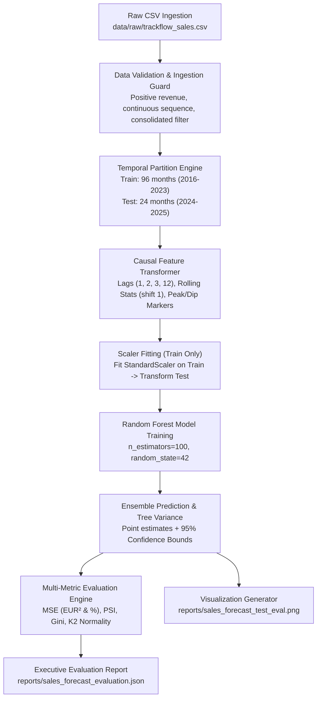

# Data Model: Sales Forecasting With a Regression Model

**Feature Branch**: `024-sales-forecasting-regression`  
**Date**: 2026-11-10  
**Status**: Completed  

---

## 1. Domain Entities & Schemas

### 1.1 RawSalesRecord
Represents a single monthly aggregated sales row ingested from `data/raw/trackflow_sales.csv`.

| Field Name | Type | Constraints | Description |
|---|---|---|---|
| `month` | `datetime.date` | Format `YYYY-MM-01`, sequential, no gaps | First day of reporting month |
| `revenue_eur` | `float` | Strict positive (`> 0.0`), non-null | Consolidated monthly revenue in EUR |
| `shipments_processed` | `int` | Strict positive (`> 0`), non-null | Count of shipments handled across all hubs |
| `avg_revenue_per_shipment_eur` | `float` | Strict positive (`> 0.0`), non-null | Average revenue generated per shipment |
| `market` | `str` | Must be `"consolidated"` (or `"us"`, `"spain"`) | Regional segment identifier |

**Validation Rules**:
- Reject or raise error if any `revenue_eur <= 0`.
- Reject if `month` sequence contains gaps between `2016-01-01` and `2025-12-01` (must have 120 continuous monthly rows).
- Filter out non-consolidated rows for primary regression model training.

---

### 1.2 TemporalPartition
Defines the chronological split isolating historical training data from holdout evaluation data.

| Field Name | Type | Value / Range | Description |
|---|---|---|---|
| `train_start` | `date` | `2016-01-01` | First month of training window |
| `train_end` | `date` | `2023-12-01` | Last month of training window (96 months) |
| `test_start` | `date` | `2024-01-01` | First month of unseen test window |
| `test_end` | `date` | `2025-12-01` | Last month of unseen test window (24 months) |
| `train_count` | `int` | Exactly 96 | Count of training records |
| `test_count` | `int` | Exactly 24 | Count of test records |
| `temporal_leak_detected` | `bool` | Must be `False` | Asserts `train_end < test_start` with 0 overlap |

---

### 1.3 CausalFeatureMatrix
The engineered feature set used by the tree ensemble regressor. All features are strictly causal with zero lookahead bias.

| Feature Name | Type | Derivation | Business Purpose |
|---|---|---|---|
| `month_num` | `int` (1–12) | `month.dt.month` | Calendar month index |
| `quarter` | `int` (1–4) | `month.dt.quarter` | Fiscal quarterly seasonality |
| `is_peak_season` | `int` (0 or 1) | `1 if month in (11, 12) else 0` | Black Friday & holiday surge marker (+25%–35%) |
| `is_february_dip` | `int` (0 or 1) | `1 if month == 2 else 0` | Post-holiday slowdown marker (-10%–15%) |
| `trend_index` | `int` | Monotonic counter ($0, 1, 2, \dots, N-1$) | Structural annual secular growth (6% ± 3%) |
| `lag_1` | `float` | $y_{t-1}$ (revenue shifted by 1 month) | Immediate prior month baseline |
| `lag_2` | `float` | $y_{t-2}$ (revenue shifted by 2 months) | 2-month prior momentum |
| `lag_3` | `float` | $y_{t-3}$ (revenue shifted by 3 months) | Quarterly prior momentum |
| `lag_12` | `float` | $y_{t-12}$ (revenue shifted by 12 months) | Annual year-over-year seasonal anchor |
| `rolling_mean_3` | `float` | Mean of $y_{t-3 \dots t-1}$ (`shift(1).rolling(3).mean()`) | Short-term 3-month trailing revenue trend |
| `rolling_mean_6` | `float` | Mean of $y_{t-6 \dots t-1}$ (`shift(1).rolling(6).mean()`) | Medium-term 6-month trailing revenue trend |
| `rolling_std_3` | `float` | Std dev of $y_{t-3 \dots t-1}$ (`shift(1).rolling(3).std()`) | Recent revenue volatility |

---

### 1.4 ModelEvaluationSummary
Comprehensive multi-metric report assessing model performance on the hold-out 24-month test set.

| Field Name | Type | Unit / Range | Interpretation Thresholds |
|---|---|---|---|
| `mse_eur2` | `float` | $\text{EUR}^2$ | Lower is better |
| `rmse_eur` | `float` | $\text{EUR}$ | Average error in euros |
| `nrmse_pct` | `float` | `%` | $\frac{\text{RMSE}}{\text{Mean}(y_{\text{test}})} \times 100\%$ |
| `psi_score` | `float` | $[0, \infty)$ | $<0.1$: Stable; $0.1–0.25$: Moderate drift; $\ge 0.25$: High drift |
| `psi_status` | `str` | Enum | `"STABLE"`, `"MODERATE_DRIFT"`, `"HIGH_DRIFT"` |
| `gini_coefficient` | `float` | $[-1.0, 1.0]$ | $>0.60$: Strong ranking separation between peak/low months |
| `k2_statistic` | `float` | $\ge 0.0$ | D'Agostino-Pearson omnibus test statistic |
| `k2_pvalue` | `float` | $[0.0, 1.0]$ | $p > 0.05 \implies$ Residuals normally distributed |
| `residuals_normal` | `bool` | True/False | True indicates statistically adequate residuals |
| `business_rationales` | `dict[str, str]` | Text | Stakeholder explanations (why low MSE alone is insufficient) |

---

### 1.5 ForecastPredictionPoint
Data structure capturing individual monthly prediction and uncertainty bounds for visualization and export.

| Field Name | Type | Description |
|---|---|---|
| `month` | `str` (`YYYY-MM-01`) | Date of forecasted month |
| `actual_revenue_eur` | `float` | Observed ground truth revenue in test set |
| `predicted_revenue_eur` | `float` | Ensemble mean prediction $\hat{y}_t$ |
| `lower_bound_eur` | `float` | $\hat{y}_t - 1.96 \cdot \sigma_t$ (95% lower prediction limit) |
| `upper_bound_eur` | `float` | $\hat{y}_t + 1.96 \cdot \sigma_t$ (95% upper prediction limit) |
| `residual_eur` | `float` | $y_t - \hat{y}_t$ (prediction error) |
| `tree_std_eur` | `float` | Standard deviation across ensemble tree predictions |

---

## 2. State & Data Flow Pipeline

