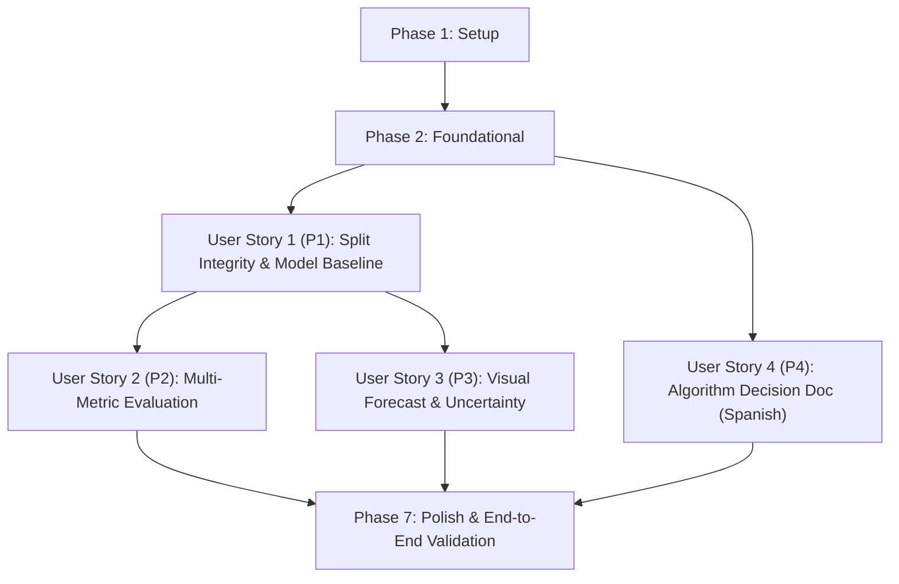

# Tasks: Sales Forecasting With a Regression Model

**Input**: Design documents from `/specs/024-sales-forecasting-regression/`  
**Prerequisites**: [plan.md](file:///J:/GitHub/mr-stegmann-ai-engineering-company-project-monorepo/specs/024-sales-forecasting-regression/plan.md), [spec.md](file:///J:/GitHub/mr-stegmann-ai-engineering-company-project-monorepo/specs/024-sales-forecasting-regression/spec.md), [research.md](file:///J:/GitHub/mr-stegmann-ai-engineering-company-project-monorepo/specs/024-sales-forecasting-regression/research.md), [data-model.md](file:///J:/GitHub/mr-stegmann-ai-engineering-company-project-monorepo/specs/024-sales-forecasting-regression/data-model.md), [contracts/](file:///J:/GitHub/mr-stegmann-ai-engineering-company-project-monorepo/specs/024-sales-forecasting-regression/contracts/)

## Format: `[ID] [P?] [Story] Description with file path`

- **[P]**: Can run in parallel (different files, no dependencies on incomplete tasks)
- **[Story]**: Which user story this task belongs to (`[US1]`, `[US2]`, `[US3]`, `[US4]`)
- Every task includes an explicit, actionable file path

---

## Phase 1: Setup (Shared Infrastructure)

**Purpose**: Project initialization, directory scaffolding, and environment dependency verification.

- [X] T001 Create pipeline and reporting directories in `data/pipelines/sales_forecast/` and `reports/` per implementation plan
- [X] T002 Verify and isolate Python runtime dependencies (`scikit-learn`, `scipy`, `pandas`, `numpy`, `matplotlib`, `pytest`) using `uv`

---

## Phase 2: Foundational (Blocking Prerequisites)

**Purpose**: Core data structures, domain models, and validation primitives that MUST be completed before any user story can proceed.

**⚠️ CRITICAL**: No user story implementation can begin until this foundational phase is complete.

- [X] T003 [P] Define pipeline domain types, schemas, and custom exceptions (`RawSalesRecord`, `TemporalPartition`, `DatasetValidationError`, `DataLeakageError`) in `data/pipelines/sales_forecast/dataset.py`
- [X] T004 [P] Initialize package exports and module interfaces in `data/pipelines/sales_forecast/__init__.py`
- [X] T005 Setup CLI argument parsing structure and exit code handling framework per contract in `scripts/train_sales_forecast.py`

**Checkpoint**: Foundation ready — User Story 1 (P1) implementation can now begin.

---

## Phase 3: User Story 1 - Time-Series Revenue Forecasting Baseline & Split Integrity (Priority: P1) 🎯 MVP

**Goal**: Deliver a strictly validated historical time-series split (96 training months 2016–2023 / 24 unseen test months 2024–2025) with zero lookahead leakage, causal feature engineering, train-isolated scaling, and a baseline Random Forest regression model.

**Independent Test**: Can be verified by executing dataset ingestion, partitioning, and causal feature scaling against `data/raw/trackflow_sales.csv`, asserting exactly 96 training rows, 24 test rows, zero temporal overlap, and zero scaler parameter leakage.

### Tests for User Story 1

> **NOTE: Write these tests FIRST, ensure they FAIL before implementation**

- [X] T006 [P] [US1] Implement unit tests for CSV ingestion, schema validation, and 8y/2y temporal boundary assertion in `tests/pipelines/test_sales_forecast.py`
- [X] T007 [P] [US1] Implement unit tests for causal feature lag construction, zero-lookahead verification, and train-only scaler isolation in `tests/pipelines/test_sales_forecast.py`

### Implementation for User Story 1

- [X] T008 [US1] Implement CSV ingestion, consolidated market filtering, positive revenue assertion, and 96/24 month chronological split in `data/pipelines/sales_forecast/dataset.py`
- [X] T009 [US1] Implement causal feature engineering (lags 1, 2, 3, 12, rolling mean/std shifted by 1, calendar month, quarter, secular trend, holiday/dip markers) and train-fitted scaler in `data/pipelines/sales_forecast/features.py`
- [X] T010 [US1] Implement Random Forest regressor training on the 96-month training split with fixed seed (`random_state=42`) and ensemble tree prediction extraction in `data/pipelines/sales_forecast/model.py`
- [X] T011 [US1] Wire dataset ingestion, causal feature engineering, and model training into baseline execution pipeline in `scripts/train_sales_forecast.py`

**Checkpoint**: User Story 1 is functional and independently testable as an MVP increment.

---

## Phase 4: User Story 2 - Stakeholder Multi-Metric Model Evaluation (Priority: P2)

**Goal**: Implement comprehensive multi-metric evaluation on the 24-month out-of-sample test set across MSE (in EUR² and % of average monthly revenue), Population Stability Index (PSI), Gini rank discrimination coefficient, and K2 residual normality test, exporting an executive JSON report conforming to schema.

**Independent Test**: Can be verified by running evaluation on the hold-out test set predictions, confirming all 4 metrics are computed without NaN values, documented with business interpretations, and validated against `specs/024-sales-forecasting-regression/contracts/evaluation-summary-schema.json`.

### Tests for User Story 2

> **NOTE: Write these tests FIRST, ensure they FAIL before implementation**

- [X] T012 [P] [US2] Implement unit tests for multi-metric evaluation calculations (MSE in EUR², NRMSE %, PSI, Gini, and K2 normality) in `tests/pipelines/test_sales_forecast.py`
- [X] T013 [P] [US2] Implement schema conformance test asserting generated evaluation payload satisfies `specs/024-sales-forecasting-regression/contracts/evaluation-summary-schema.json` in `tests/pipelines/test_sales_forecast.py`

### Implementation for User Story 2

- [X] T014 [US2] Implement Mean Squared Error (MSE), Root Mean Squared Error (RMSE), and Normalized RMSE as percentage of average revenue in `data/pipelines/sales_forecast/metrics.py`
- [X] T015 [P] [US2] Implement Population Stability Index (PSI) with quantile binning and stability status thresholds in `data/pipelines/sales_forecast/metrics.py`
- [X] T016 [P] [US2] Implement Gini coefficient calculation for seasonal rank-ordering discrimination in `data/pipelines/sales_forecast/metrics.py`
- [X] T017 [P] [US2] Implement K2 D'Agostino-Pearson residual normality test using `scipy.stats.normaltest` in `data/pipelines/sales_forecast/metrics.py`
- [X] T018 [US2] Implement structured JSON report exporter writing `reports/sales_forecast_evaluation.json` with business rationales conforming to schema in `data/pipelines/sales_forecast/metrics.py`
- [X] T019 [US2] Integrate multi-metric evaluation engine and formatted stdout summary table into `scripts/train_sales_forecast.py`

**Checkpoint**: User Stories 1 and 2 are fully integrated and independently verified.

---

## Phase 5: User Story 3 - Visual Revenue Forecast with Uncertainty & Variability Range (Priority: P3)

**Goal**: Generate high-resolution visual forecast artifact comparing actual test revenue against predicted revenue with a 95% uncertainty/variability envelope ($\pm 1.96\sigma$), highlighting seasonal surges (Nov–Dec) and dips (Feb).

**Independent Test**: Can be verified by running the visualizer module and asserting the generation of `reports/sales_forecast_test_eval.png` (300 DPI) containing actual line, predicted line, shaded confidence ribbon, and seasonal annotations across 2024–2025.

### Tests for User Story 3

- [X] T020 [P] [US3] Implement unit test for forecast visualization generation and output image verification in `tests/pipelines/test_sales_forecast.py`

### Implementation for User Story 3

- [X] T021 [US3] Implement forecast visualization generator rendering 2024–2025 actual revenue, predicted trajectory, and 95% uncertainty envelope ($\pm 1.96\sigma$) with seasonal peak/dip callouts in `data/pipelines/sales_forecast/visualizer.py`
- [X] T022 [US3] Integrate chart generation and PNG export to `reports/sales_forecast_test_eval.png` into CLI runner in `scripts/train_sales_forecast.py`

**Checkpoint**: User Stories 1, 2, and 3 are functional and deliver visual and structured artifacts.

---

## Phase 6: User Story 4 - Algorithmic Selection & Trade-Off Documentation (Priority: P4)

**Goal**: Deliver written justification in Spanish detailing the algorithm selection criteria (Random Forest vs. XGBoost) based on small sample size ($N=120$), stakeholder explainability, hyperparameter tuning risk, and native prediction variance.

**Independent Test**: Can be verified by checking existence and markdown contents of `docs/training-model-decission.md`, confirming full Spanish documentation of trade-off dimensions and justification for executive leadership.

### Implementation for User Story 4

- [X] T023 [US4] Author algorithm decision document in Spanish detailing trade-offs between Random Forest and XGBoost based on small dataset scale ($N=120$), explainability, and hyperparameter stability in `docs/training-model-decission.md`
- [X] T024 [US4] Add `--export-decision-doc` CLI option to verify or export decision documentation during pipeline execution in `scripts/train_sales_forecast.py`

**Checkpoint**: All user stories (US1 through US4) are complete and operational.

---

## Phase 7: Polish & Cross-Cutting Concerns

**Purpose**: Quality hardening, type validation, CLI contract compliance, and end-to-end verification.

- [X] T025 [P] Ensure strict PEP 484 type annotations and docstrings across all modules in `data/pipelines/sales_forecast/`
- [X] T026 Validate end-to-end CLI workflow and error exit codes per `specs/024-sales-forecasting-regression/contracts/cli-contract.md`
- [X] T027 Execute end-to-end verification suite following all steps in `specs/024-sales-forecasting-regression/quickstart.md`

---

## Dependencies & Execution Order

### Phase Dependencies

- **Setup (Phase 1)**: No dependencies — executes immediately.
- **Foundational (Phase 2)**: Depends on Setup (Phase 1) — **BLOCKS** all user stories.
- **User Story 1 (Phase 3)**: Depends on Foundational (Phase 2) — Core prerequisite for downstream evaluation and visualization.
- **User Story 2 (Phase 4)**: Depends on US1 (Phase 3) model outputs and test partition data.
- **User Story 3 (Phase 5)**: Depends on US1 (Phase 3) model predictions and ensemble variance.
- **User Story 4 (Phase 6)**: Can proceed in parallel with US2/US3 or after US1.
- **Polish (Phase 7)**: Depends on all user stories being complete.

### User Story Dependencies



### Within Each User Story

- Tests written first (red), then implementation (green).
- Data models and schema definitions before business service logic.
- Computation and metric engines before CLI orchestration and serialization.
- Complete story verification before declaring checkpoint cleared.

### Parallel Opportunities

- **Phase 2 (Foundational)**: T003 (`dataset.py` types) and T004 (`__init__.py`) can run in parallel.
- **Phase 3 (User Story 1)**: Tests T006 and T007 can be written in parallel.
- **Phase 4 (User Story 2)**:
  - Tests T012 and T013 can run in parallel.
  - Implementations T015 (PSI), T016 (Gini), and T017 (K2 test) can be developed in parallel once T014 (MSE/RMSE) is established.
- **Cross-Story Parallelism**: User Story 4 (T023) can proceed in parallel with User Story 2 and 3 once Foundational is complete.

---

## Parallel Example: User Story 2

```bash
# Launch test creation in parallel:
Task: "Implement unit tests for multi-metric evaluation calculations in tests/pipelines/test_sales_forecast.py"
Task: "Implement schema conformance test in tests/pipelines/test_sales_forecast.py"

# Launch metric implementations in parallel:
Task: "Implement Population Stability Index (PSI) in data/pipelines/sales_forecast/metrics.py"
Task: "Implement Gini coefficient calculation in data/pipelines/sales_forecast/metrics.py"
Task: "Implement K2 D'Agostino-Pearson normality test in data/pipelines/sales_forecast/metrics.py"
```

---

## Implementation Strategy

### MVP First (User Story 1 Only)

1. Complete Phase 1: Setup (T001, T002)
2. Complete Phase 2: Foundational (T003–T005)
3. Complete Phase 3: User Story 1 (T006–T011)
4. **STOP and VALIDATE**: Run `pytest tests/pipelines/test_sales_forecast.py` to verify 96/24 split integrity, 0% leakage, and basic inference.
5. Demonstrate working baseline model to stakeholders.

### Incremental Delivery

1. **Increment 1 (MVP)**: Setup + Foundation + US1 (Deterministic baseline model on leak-free 8y/2y split).
2. **Increment 2**: US2 (Multi-metric evaluation suite producing `reports/sales_forecast_evaluation.json`).
3. **Increment 3**: US3 (Visual forecast chart with 95% uncertainty envelope in `reports/sales_forecast_test_eval.png`).
4. **Increment 4**: US4 (Spanish decision document `docs/training-model-decission.md`).
5. **Increment 5**: Polish & end-to-end execution of `quickstart.md`.

---

## Notes

- All tasks follow the strict checklist format: `- [ ] [TaskID] [P?] [Story?] Description with file path`.
- All Python commands must use `uv run` to respect workspace isolation standards.
- Feature scaling must strictly fit on the 96-month training partition without test parameter exposure.
- Fixed seed (`random_state=42`) ensures 100% deterministic test and execution outputs.

