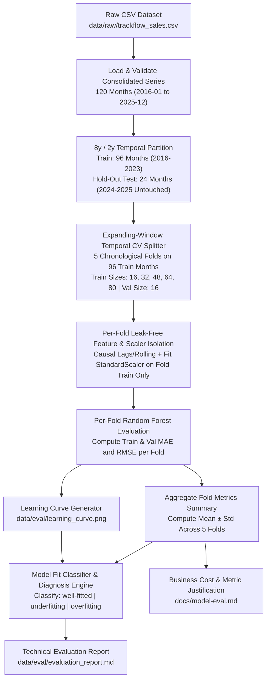

# Data Model: Regression Model Evaluation

**Feature Branch**: `025-regression-model-evaluation`  
**Date**: 2026-11-12  
**Status**: Completed  

---

## 1. Domain Entities & Schemas

### 1.1 TemporalCVFold
Represents a single chronological cross-validation split within the 96-month training window (`2016-01-01` to `2023-12-01`).

| Field Name | Type | Constraints | Description |
|---|---|---|---|
| `fold_index` | `int` | `1 <= fold_index <= n_splits` (`n_splits >= 5`) | 1-based sequential index of the temporal fold |
| `train_indices` | `tuple[int, ...]` | Strictly monotonic increasing, starts at `0` | Row indices of the expanding historical training window |
| `val_indices` | `tuple[int, ...]` | Strictly monotonic increasing, immediately follows `train_indices` | Row indices of the unseen chronological validation window |
| `train_start` | `datetime.date` | `2016-01-01` | First calendar month in the fold's training set |
| `train_end` | `datetime.date` | `< val_start` | Last calendar month in the fold's training set |
| `val_start` | `datetime.date` | `> train_end` | First calendar month in the fold's validation set |
| `val_end` | `datetime.date` | `<= 2023-12-01` | Last calendar month in the fold's validation set |
| `train_size` | `int` | `>= 12` (16, 32, 48, 64, 80 for 5 folds on 96 rows) | Number of historical months in the fold's training window |
| `val_size` | `int` | `>= 1` (16 for 5 folds on 96 rows) | Number of future months in the fold's validation window |

**Validation & Invariant Rules**:
- **Strict Chronological Precedence**: `max(train_indices) < min(val_indices)` and `train_end < val_start` MUST hold for every fold; violation raises `DataLeakageError`.
- **Zero Overlap & Zero Shuffling**: `set(train_indices).isdisjoint(set(val_indices))` and indices within both `train_indices` and `val_indices` must be strictly consecutive (`idx[i+1] - idx[i] == 1`).
- **Expanding Progression Across Folds**: For consecutive folds $k$ and $k+1$, `fold[k].train_end < fold[k+1].train_end` and `fold[k].val_start < fold[k+1].val_start`.
- **Hold-Out Test Isolation**: No index $\ge 96$ (`2024-01-01` to `2025-12-01`) may appear in any fold's `train_indices` or `val_indices`.

---

### 1.2 FoldMetricsRecord
Captures the regression error metrics computed on an individual temporal cross-validation fold after leak-free feature engineering and train-isolated scaling.

| Field Name | Type | Unit / Range | Description |
|---|---|---|---|
| `fold_index` | `int` | `1..K` | Fold identifier |
| `train_size` | `int` | Months (`> 0`) | Training sample count in this fold |
| `val_size` | `int` | Months (`> 0`) | Validation sample count in this fold |
| `train_window` | `str` | `YYYY-MM-DD to YYYY-MM-DD` | Date range of fold training subset |
| `val_window` | `str` | `YYYY-MM-DD to YYYY-MM-DD` | Date range of fold validation subset |
| `train_mae_eur` | `float` | `>= 0.0` EUR | Mean Absolute Error on the fold's training set |
| `val_mae_eur` | `float` | `>= 0.0` EUR | Mean Absolute Error on the fold's validation set |
| `train_rmse_eur` | `float` | `>= 0.0` EUR | Root Mean Squared Error on the fold's training set |
| `val_rmse_eur` | `float` | `>= 0.0` EUR | Root Mean Squared Error on the fold's validation set |
| `val_mean_revenue_eur` | `float` | `> 0.0` EUR | Mean actual revenue in the validation window |

---

### 1.3 TemporalCVSummary
Aggregates performance across all $K \ge 5$ chronological folds using `mean ± standard deviation` (`ddof=1`).

| Field Name | Type | Unit / Range | Description |
|---|---|---|---|
| `n_splits` | `int` | `>= 5` | Total number of chronological folds evaluated |
| `folds` | `list[FoldMetricsRecord]` | Length `n_splits` | Per-fold detailed metric breakdown |
| `train_mae_mean_eur` | `float` | EUR | Mean of training MAE across folds |
| `train_mae_std_eur` | `float` | EUR | Sample standard deviation of training MAE across folds |
| `val_mae_mean_eur` | `float` | EUR | Mean of validation MAE across folds |
| `val_mae_std_eur` | `float` | EUR | Sample standard deviation of validation MAE across folds |
| `train_rmse_mean_eur` | `float` | EUR | Mean of training RMSE across folds |
| `train_rmse_std_eur` | `float` | EUR | Sample standard deviation of training RMSE across folds |
| `val_rmse_mean_eur` | `float` | EUR | Mean of validation RMSE across folds |
| `val_rmse_std_eur` | `float` | EUR | Sample standard deviation of validation RMSE across folds |
| `formatted_train_mae` | `str` | `"€X,XXX.XX ± €Y,YYY.YY"` | Human-readable `mean ± std` string for Training MAE |
| `formatted_val_mae` | `str` | `"€X,XXX.XX ± €Y,YYY.YY"` | Human-readable `mean ± std` string for Validation MAE |
| `formatted_train_rmse` | `str` | `"€X,XXX.XX ± €Y,YYY.YY"` | Human-readable `mean ± std` string for Training RMSE |
| `formatted_val_rmse` | `str` | `"€X,XXX.XX ± €Y,YYY.YY"` | Human-readable `mean ± std` string for Validation RMSE |

---

### 1.4 LearningCurvePoint & LearningCurveArtifact
Represents the progression of training and validation errors as chronological training sample size increases, rendered to `data/eval/learning_curve.png`.

| Field Name | Type | Constraints | Description |
|---|---|---|---|
| `train_size` | `int` | Strictly increasing (`16, 32, 48, 64, 80`) | Number of chronological training months |
| `train_mae_eur` | `float` | `>= 0.0` EUR | In-sample training MAE at `train_size` |
| `val_mae_eur` | `float` | `>= 0.0` EUR | Out-of-sample validation MAE at `train_size` |
| `train_rmse_eur` | `float` | `>= 0.0` EUR | In-sample training RMSE at `train_size` |
| `val_rmse_eur` | `float` | `>= 0.0` EUR | Out-of-sample validation RMSE at `train_size` |
| `generalization_gap_rmse_eur` | `float` | `val_rmse_eur - train_rmse_eur` | Error gap between validation and training RMSE |
| `generalization_gap_ratio` | `float` | `val_rmse_eur / max(train_rmse_eur, 1e-6)` | Ratio of validation RMSE to training RMSE |

---

### 1.5 ModelFitDiagnosis
Formal engineering classification and staging promotion verdict written to `data/eval/evaluation_report.md`.

| Field Name | Type | Allowed Values / Format | Description |
|---|---|---|---|
| `fit_classification` | `Literal["well-fitted", "underfitting", "overfitting"]` | Exact enum string | Explicit model fit diagnosis |
| `primary_metric` | `Literal["RMSE", "MAE"]` | `"RMSE"` | Selected primary decision metric |
| `generalization_gap_ratio` | `float` | `> 0.0` | Ratio of validation error to training error (`val_rmse_mean / train_rmse_mean`) |
| `val_nrmse_pct` | `float` | `%` | Mean validation RMSE as a percentage of mean training revenue |
| `empirical_evidence` | `str` | Non-empty markdown text | Quantitative justification referencing `mean ± std` fold metrics and learning curve trajectory |
| `root_cause` | `str` | Non-empty markdown text | Specific architectural/statistical cause of the observed fit behavior |
| `corrective_action` | `str` | Non-empty markdown text | Concrete, actionable model change directly addressing `root_cause` |
| `staging_Readiness_decision` | `Literal["HOLD_REQUIRES_REMEDIATION", "PROMOTE_TO_STAGING", "CONDITIONAL_PROMOTION"]` | Enum verdict | Formal recommendation on promoting the baseline model to staging |

---

## 2. State & Data Flow Pipeline

