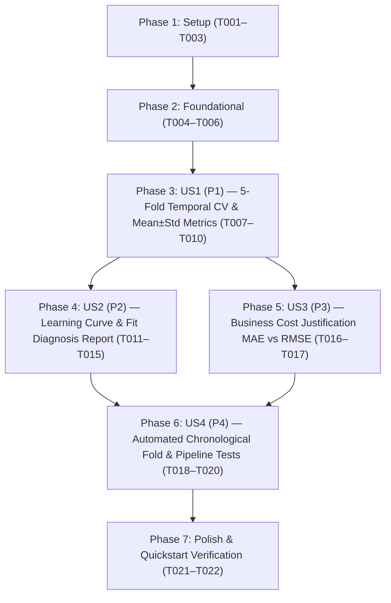

# Tasks: Regression Model Evaluation

**Input**: Design documents from `/specs/025-regression-model-evaluation/`  
**Prerequisites**: [plan.md](file:///J:/GitHub/mr-stegmann-ai-engineering-company-project-monorepo/specs/025-regression-model-evaluation/plan.md), [spec.md](file:///J:/GitHub/mr-stegmann-ai-engineering-company-project-monorepo/specs/025-regression-model-evaluation/spec.md), [research.md](file:///J:/GitHub/mr-stegmann-ai-engineering-company-project-monorepo/specs/025-regression-model-evaluation/research.md), [data-model.md](file:///J:/GitHub/mr-stegmann-ai-engineering-company-project-monorepo/specs/025-regression-model-evaluation/data-model.md), [contracts/](file:///J:/GitHub/mr-stegmann-ai-engineering-company-project-monorepo/specs/025-regression-model-evaluation/contracts/), [quickstart.md](file:///J:/GitHub/mr-stegmann-ai-engineering-company-project-monorepo/specs/025-regression-model-evaluation/quickstart.md)

**Tests**: Automated unit tests in `tests/pipelines/test_regression_evaluation.py` are explicitly required by `FR-009`, `SC-006`, and User Story 4.

**Organization**: Tasks are grouped by user story (`US1` through `US4`) to enable independent implementation, verification, and incremental delivery.

## Format: `[ID] [P?] [Story] Description with file path`

- **[P]**: Can run in parallel (different files, no dependencies on incomplete tasks)
- **[Story]**: Which user story this task belongs to (`[US1]`, `[US2]`, `[US3]`, `[US4]`)
- Every task includes an explicit, actionable file path

---

## Phase 1: Setup (Shared Infrastructure)

**Purpose**: Directory scaffolding, `uv` environment verification (`FR-010`), and npm convenience scripts.

- [X] T001 Create evaluation output directory `data/eval/` and verify baseline dataset existence at `data/raw/trackflow_sales.csv`
- [X] T002 Verify Python runtime dependencies (`scikit-learn`, `scipy`, `pandas`, `numpy`, `matplotlib`, `pytest`) exclusively via `uv` (`FR-010`) in `services/api/pyproject.toml`
- [X] T003 [P] Add `evaluate:sales-forecast` and `test:regression-eval` convenience scripts in `package.json`

---

## Phase 2: Foundational (Blocking Prerequisites)

**Purpose**: Core evaluation data models, MAE calculation primitives, and package exports that MUST be complete before user stories proceed.

**⚠️ CRITICAL**: No user story work can begin until this foundational phase is complete.

- [X] T004 [P] Implement Mean Absolute Error (`calculate_mae`) and fold metric helper functions in `data/pipelines/sales_forecast/metrics.py`
- [X] T005 [P] Define domain dataclasses (`TemporalCVFold`, `FoldMetricsRecord`, `TemporalCVSummary`, `LearningCurvePoint`, `ModelFitDiagnosis`) with strict type annotations in `data/pipelines/sales_forecast/evaluator.py`
- [X] T006 Scaffold CLI argument parser (`--data-path`, `--n-splits`, `--random-seed`, `--eval-dir`, `--docs-path`) and exit code handler (`0`, `1`, `2`, `3`) per `contracts/cli-contract.md` in `scripts/evaluate_sales_forecast.py`

**Checkpoint**: Foundation ready — User Story implementation can now proceed.

---

## Phase 3: User Story 1 - Multi-Fold Temporal Cross-Validation Without Leakage (Priority: P1) 🎯 MVP

**Goal**: Implement expanding-window chronological cross-validation across at least 5 sequential folds on the 8-year (96-month: `2016-01` to `2023-12`) consolidated training dataset while keeping the 24-month test set (`2024-01` to `2025-12`) untouched, isolating causal features and `StandardScaler` fitting per fold, and computing Training and Validation MAE and RMSE as `mean ± standard deviation`.

**Independent Test**: Run 5-fold temporal cross-validation on the 96-month training dataset via `scripts/evaluate_sales_forecast.py`, verifying that every fold preserves strict chronological precedence (`max(train_indices) < min(val_indices)`), isolates lag/rolling features and scaling within each fold's historical boundary, and outputs Training and Validation MAE and RMSE as `mean ± std` in `data/eval/cv_metrics.json`.

### Implementation for User Story 1

- [X] T007 [US1] Implement `create_temporal_cv_splits` in `data/pipelines/sales_forecast/evaluator.py` to generate $\ge 5$ expanding chronological folds (`train_size` = 16, 32, 48, 64, 80; `val_size` = 16) over the 96-month training partition with `DataLeakageError` guards against shuffling, overlap, or `< 5` splits
- [X] T008 [US1] Implement `evaluate_temporal_cv` in `data/pipelines/sales_forecast/evaluator.py` to execute per-fold leak-free causal feature engineering (`build_causal_feature_matrix` on visible slice `train_df.iloc[:val_end + 1]`), train-only `StandardScaler` fitting, `RandomForestRegressor(n_estimators=100, random_state=42)` training, and per-fold + cross-fold `mean ± std` (`ddof=1`) MAE and RMSE aggregation
- [X] T009 [US1] Implement `export_cv_metrics_json` in `data/pipelines/sales_forecast/evaluator.py` to serialize `data/eval/cv_metrics.json` conforming to `specs/025-regression-model-evaluation/contracts/evaluation-report-schema.json`
- [X] T010 [US1] Wire 5-fold temporal cross-validation execution and executive stdout summary table into `scripts/evaluate_sales_forecast.py`

**Checkpoint**: User Story 1 is functional and independently testable as an MVP increment.

---

## Phase 4: User Story 2 - Learning Curve Generation & Model Fit Diagnosis (Priority: P2)

**Goal**: Render a high-resolution learning curve chart (`data/eval/learning_curve.png`) across increasing chronological training sizes ($N = 16, 32, 48, 64, 80$ months) and generate a formal technical evaluation report (`data/eval/evaluation_report.md`) that explicitly classifies model fit (`well-fitted`, `underfitting`, or `overfitting`) backed by empirical `mean ± std` fold metrics, root-cause analysis, a concrete corrective action, and a staging promotion decision.

**Independent Test**: Execute the learning curve and fit diagnosis pipeline and inspect `data/eval/learning_curve.png` and `data/eval/evaluation_report.md` to confirm the visual plot displays Training and Validation MAE/RMSE trajectories across 5 sample sizes and the markdown report states an explicit fit classification (`overfitting`), quantitative generalization gap evidence, root-cause remediation (tree depth regularization + causal linear trend detrending), and staging recommendation (`HOLD_REQUIRES_REMEDIATION`).

### Implementation for User Story 2

- [X] T011 [P] [US2] Implement `compute_learning_curve` in `data/pipelines/sales_forecast/evaluator.py` to extract chronological training sizes (`16, 32, 48, 64, 80` months), in-sample vs. out-of-sample MAE/RMSE trajectories, and generalization gap ratios
- [X] T012 [P] [US2] Implement `render_learning_curve` in `data/pipelines/sales_forecast/visualizer.py` to plot Training vs. Validation MAE and RMSE curves across chronological training sample sizes and save a 300 DPI chart to `data/eval/learning_curve.png`
- [X] T013 [US2] Implement `classify_model_fit` in `data/pipelines/sales_forecast/evaluator.py` to evaluate the training-to-validation error ratio, fold standard deviation, and secular trend ceiling, returning a typed `ModelFitDiagnosis` (`well-fitted`, `underfitting`, or `overfitting`) with root-cause and corrective action
- [X] T014 [US2] Implement `generate_evaluation_report` in `data/pipelines/sales_forecast/evaluator.py` to write `data/eval/evaluation_report.md` containing the explicit fit classification, 5-fold `mean ± std` metric table, learning curve convergence analysis, targeted corrective action, and staging readiness verdict
- [X] T015 [US2] Integrate learning curve rendering (`data/eval/learning_curve.png`) and technical evaluation report generation (`data/eval/evaluation_report.md`) into `scripts/evaluate_sales_forecast.py`

**Checkpoint**: User Stories 1 and 2 are complete and produce `data/eval/learning_curve.png`, `data/eval/evaluation_report.md`, and `data/eval/cv_metrics.json`.

---

## Phase 5: User Story 3 - Business Cost Metric Justification: MAE vs. RMSE (Priority: P3)

**Goal**: Generate a comprehensive, domain-grounded business cost comparison of MAE vs. RMSE (`docs/model-eval.md`) reporting Training and Validation MAE and RMSE (`mean ± std`), analyzing the asymmetric operational cost of overestimating vs. underestimating monthly shipment revenue (`revenue_eur`, `shipments_processed`, `avg_revenue_per_shipment_eur`) for TrackFlow stakeholders Ana (Warehouse), Carlos (Carriers across the 60/40 Los Angeles and Zaragoza hubs), and Thomas (CEO), and justifying RMSE as the primary staging gate metric.

**Independent Test**: Inspect `docs/model-eval.md` to verify it records exact 5-fold Training and Validation MAE and RMSE (`mean ± std`), explicitly compares overestimation vs. underestimation business costs across seasonal surges (+25–35% Nov–Dec) and troughs (-10–15% Feb) for Ana, Carlos, and Thomas, and justifies the selection of RMSE over MAE.

### Implementation for User Story 3

- [X] T016 [US3] Implement `generate_business_metric_doc` in `data/pipelines/sales_forecast/evaluator.py` to generate `docs/model-eval.md` with empirical 5-fold Training & Validation MAE and RMSE tables, mathematical comparisons, stakeholder cost asymmetry analysis (Ana, Carlos, Thomas across Los Angeles 60% / Zaragoza 40% hubs), and primary metric justification
- [X] T017 [US3] Integrate `docs/model-eval.md` generation via `--docs-path` CLI option in `scripts/evaluate_sales_forecast.py` and execute the CLI to populate `docs/model-eval.md`, `data/eval/evaluation_report.md`, `data/eval/learning_curve.png`, and `data/eval/cv_metrics.json`

**Checkpoint**: User Stories 1, 2, and 3 are complete with all documentation and visual artifacts generated.

---

## Phase 6: User Story 4 - Automated Chronological Fold Integrity Verification (Priority: P4)

**Goal**: Provide a comprehensive automated `pytest` suite in `tests/pipelines/test_regression_evaluation.py` that verifies the temporal cross-validation splitter produces at least 5 folds, strictly enforces chronological ordering (`max(train_indices) < min(val_indices)`), prevents fold overlap or shuffling, isolates per-fold feature scaling and lag imputation from future data, and validates `mean ± std` metric math and generated artifacts.

**Independent Test**: Run `uv run --project services/api pytest tests/pipelines/ -v` and verify 100% of unit tests in `tests/pipelines/test_regression_evaluation.py` and `tests/pipelines/test_sales_forecast.py` pass deterministically.

### Tests for User Story 4

- [X] T018 [P] [US4] Implement `test_temporal_cv_fold_count_and_monotonic_ordering` and `test_temporal_cv_rejects_shuffled_or_insufficient_splits` in `tests/pipelines/test_regression_evaluation.py` to assert $\ge 5$ folds, strictly consecutive monotonic indices, `max(train_idx) < min(val_idx)`, zero overlap, hold-out test isolation, and `DataLeakageError` on invalid splits
- [X] T019 [P] [US4] Implement `test_per_fold_scaler_and_feature_isolation` in `tests/pipelines/test_regression_evaluation.py` to verify that mutating future fold revenue values does not alter earlier fold feature matrices or `StandardScaler` parameters
- [X] T020 [P] [US4] Implement `test_mae_and_rmse_mean_std_aggregation` and `test_learning_curve_and_reports_generation` in `tests/pipelines/test_regression_evaluation.py` to verify `mean ± std` calculations, `data/eval/learning_curve.png` creation, `data/eval/evaluation_report.md` fit classification, `docs/model-eval.md` domain coverage, and `data/eval/cv_metrics.json` schema compliance

**Checkpoint**: All user stories (`US1` through `US4`) are implemented and verified by automated unit tests.

---

## Phase 7: Polish & Cross-Cutting Concerns

**Purpose**: Package export hygiene, static type/build verification, and end-to-end quickstart validation.

- [X] T021 [P] Export new evaluation classes and functions (`TemporalCVFold`, `FoldMetricsRecord`, `TemporalCVSummary`, `LearningCurvePoint`, `ModelFitDiagnosis`, `calculate_mae`, `create_temporal_cv_splits`, `evaluate_temporal_cv`, `compute_learning_curve`, `classify_model_fit`, `render_learning_curve`, `generate_evaluation_report`, `generate_business_metric_doc`, `export_cv_metrics_json`) in `data/pipelines/sales_forecast/__init__.py`
- [X] T022 Run end-to-end validation per `specs/025-regression-model-evaluation/quickstart.md` (`uv run --project services/api pytest tests/pipelines/ -v`, CLI execution of `scripts/evaluate_sales_forecast.py`, and `npm run typecheck`) to confirm zero regressions across the monorepo

---

## Dependencies & Execution Order

### Phase Dependencies

- **Setup (Phase 1)**: No dependencies — can start immediately.
- **Foundational (Phase 2)**: Depends on Setup (Phase 1) — **BLOCKS** all user stories.
- **User Story 1 (Phase 3 - P1)**: Depends on Foundational (Phase 2) — Delivers core 5-fold temporal CV engine and `mean ± std` MAE/RMSE calculations.
- **User Story 2 (Phase 4 - P2)**: Depends on User Story 1 (Phase 3) fold metrics to plot the learning curve and diagnose model fit.
- **User Story 3 (Phase 5 - P3)**: Depends on User Story 1 (Phase 3) `mean ± std` MAE/RMSE outputs to populate `docs/model-eval.md` (can run in parallel with US2).
- **User Story 4 (Phase 6 - P4)**: Depends on User Story 1–3 components for full integration and artifact testing (chronological fold ordering tests T018–T019 can be run as soon as T007–T008 complete).
- **Polish (Phase 7)**: Depends on all user stories (`US1`–`US4`) being complete.

### User Story Dependency Graph



### Parallel Opportunities

- **Phase 2 (Foundational)**: `T004` (`metrics.py` MAE helper) and `T005` (`evaluator.py` dataclasses) target different files and can run in parallel.
- **Phase 4 (User Story 2)**: `T011` (`compute_learning_curve` in `evaluator.py`) and `T012` (`render_learning_curve` in `visualizer.py`) target different files and can run in parallel.
- **Cross-Story Parallelism (US2 & US3)**: Once `US1` (`T007`–`T010`) completes, `US2` (Learning Curve & Technical Report) and `US3` (`docs/model-eval.md` Business Justification) can be executed in parallel.
- **Phase 6 (User Story 4)**: Test tasks `T018`, `T019`, and `T020` cover orthogonal test functions and can be authored concurrently.

---

## Parallel Example: User Story 2 & User Story 4

```bash
# Phase 2 Foundational in parallel:
Task T004: "Implement Mean Absolute Error (calculate_mae) in data/pipelines/sales_forecast/metrics.py"
Task T005: "Define domain dataclasses in data/pipelines/sales_forecast/evaluator.py"

# Phase 4 User Story 2 in parallel:
Task T011: "Implement compute_learning_curve in data/pipelines/sales_forecast/evaluator.py"
Task T012: "Implement render_learning_curve in data/pipelines/sales_forecast/visualizer.py"

# Phase 6 User Story 4 test cases in parallel:
Task T018: "Implement test_temporal_cv_fold_count_and_monotonic_ordering in tests/pipelines/test_regression_evaluation.py"
Task T019: "Implement test_per_fold_scaler_and_feature_isolation in tests/pipelines/test_regression_evaluation.py"
Task T020: "Implement test_mae_and_rmse_mean_std_aggregation and test_learning_curve_and_reports_generation in tests/pipelines/test_regression_evaluation.py"
```

---

## Implementation Strategy

### MVP First (User Story 1 Only)

1. Complete **Phase 1: Setup** (`T001`–`T003`).
2. Complete **Phase 2: Foundational** (`T004`–`T006`).
3. Complete **Phase 3: User Story 1** (`T007`–`T010`).
4. **STOP and VALIDATE**: Run `uv run --project services/api python scripts/evaluate_sales_forecast.py` and verify 5 chronological folds execute with zero leakage and output Training and Validation MAE & RMSE as `mean ± std`.

### Incremental Delivery

1. **Increment 1 (MVP — US1)**: Leak-free 5-fold expanding temporal cross-validation with `mean ± std` MAE and RMSE (`data/eval/cv_metrics.json`).
2. **Increment 2 (US2)**: High-resolution learning curve (`data/eval/learning_curve.png`) and formal fit classification + corrective action report (`data/eval/evaluation_report.md`).
3. **Increment 3 (US3)**: Stakeholder business cost analysis of MAE vs. RMSE for Thomas, Ana, and Carlos (`docs/model-eval.md`).
4. **Increment 4 (US4 & Polish)**: Automated chronological fold integrity and artifact verification tests (`tests/pipelines/test_regression_evaluation.py`) + full `quickstart.md` validation.

---

## Notes

- All 22 tasks strictly adhere to `- [ ] [TaskID] [P?] [Story?] Description with file path`.
- All Python package management and script executions MUST use `uv` (`uv run --project services/api ...`, `FR-010`).
- The 24-month hold-out test set (`2024-01-01` to `2025-12-01`) remains strictly isolated during 5-fold cross-validation on the 96-month training partition (`2016-01-01` to `2023-12-01`).
