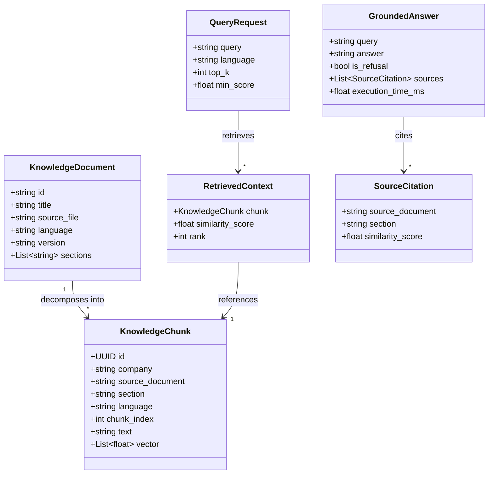

# Data Model: RAG & Knowledge Base

**Feature Branch**: `026-rag-knowledge-base`  
**Date**: 2026-11-16  
**Status**: Completed  

---

## 1. Domain Entities & Value Objects

The RAG & Knowledge Base domain is structured around five primary entities and value objects:



---

## 2. Entity Specifications

### 2.1. `KnowledgeDocument`
Represents a source operational policy or service specification markdown file.

- **Attributes**:
  - `id` (`str`): Unique canonical slug (e.g. `"sla-delivery"`, `"returns-policy"`, `"carrier-coverage"`, `"storage-pricing"`).
  - `title` (`str`): Human-readable document title (e.g. `"Delivery SLA"`).
  - `source_file` (`str`): Relative file path within the repository (e.g. `"docs/company-knowledge-base/trackflow-sla-delivery.en.md"`).
  - `language` (`str`): ISO 639-1 language code (e.g. `"en"` or `"es"`).
  - `version` (`str`): Semantic version or file timestamp.
  - `raw_content` (`str`): Raw markdown text content.

### 2.2. `KnowledgeChunk`
An atomic, self-contained semantic segment of a `KnowledgeDocument` containing a cohesive policy clause, pricing tier, or operational guideline.

- **Attributes**:
  - `id` (`UUID`): Deterministic UUID v5 generated via `uuid.uuid5(uuid.NAMESPACE_DNS, f"trackflow:{source_document}:{chunk_index}")`.
  - `company` (`str`): Always `"trackflow"`.
  - `source_document` (`str`): Canonical document slug (`"sla-delivery"`, `"returns-policy"`, `"carrier-coverage"`, `"storage-pricing"`).
  - `section` (`str`): Title or subtitle of the source section from which the chunk originated.
  - `language` (`str`): ISO 639-1 code (`"en"`).
  - `chunk_index` (`int`): 0-indexed position within the parent document ($0, 1, 2, \dots$).
  - `text` (`str`): Semantic body text used for embedding and context assembly.
  - `vector` (`Optional[List[float]]`): Dense 384-dimensional floating point representation.

- **Validation Rules**:
  - `chunk_index` must be non-negative integer ($\ge 0$).
  - `text` must not be empty or whitespace (minimum length 20 characters).
  - Each source document must generate at least 3 distinct chunks ($\text{count} \ge 3$).
  - No splitting of dependent clauses, bullet lists, or rate schedules.

### 2.3. `QueryRequest`
User inquiry submitted from frontline interfaces or API consumers.

- **Attributes**:
  - `query` (`str`): Plain text inquiry (e.g. `"What is TrackFlow's standard return window?"`).
  - `language` (`Optional[str]`): Preferred response language (defaults to `"en"`).
  - `top_k` (`int`): Maximum candidate chunks to retrieve (defaults to `3`, range $[1, 10]$).
  - `min_score` (`Optional[float]`): Minimum similarity score threshold (defaults to `0.62`).

- **Validation Rules**:
  - `query` cannot be empty or whitespace; stripped length must be between 3 and 1000 characters.
  - `top_k` must be between 1 and 10.
  - `min_score` must be between 0.0 and 1.0.

### 2.4. `RetrievedContext`
Represents a scored candidate chunk returned from semantic vector search.

- **Attributes**:
  - `chunk` (`KnowledgeChunk`): Retrieved chunk entity with metadata.
  - `similarity_score` (`float`): Cosine similarity score in range $[-1.0, 1.0]$.
  - `rank` (`int`): Ordinal position in retrieved results (1, 2, 3...).

- **Filtering Rules**:
  - Only candidates with $\text{similarity\_score} \ge \text{min\_score}$ are retained for generation.
  - Candidate list is sorted descending by `similarity_score`.

### 2.5. `GroundedAnswer`
The final synthesized response delivered to the caller.

- **Attributes**:
  - `query` (`str`): Echoed sanitized input query.
  - `answer` (`str`): Synthesized natural language answer adopting TrackFlow account manager voice.
  - `is_refusal` (`bool`): `True` if query fell below similarity threshold or lacked documented evidence; `False` if grounded answer generated.
  - `sources` (`List[SourceCitation]`): List of cited source documents and sections.
  - `execution_time_ms` (`float`): End-to-end processing latency in milliseconds.

- **Business Constraint Validations**:
  - Storage volume discount: If query discusses discounts above 50 m³, answer must state requirement for Commercial Director Miguel Torres's approval.
  - Peak season delivery: If query discusses peak periods (Black Friday, Christmas, January Sales), answer must state standard SLAs are not guaranteed and times extend up to 40%.
  - International returns: If query discusses cross-border returns, answer must state process is manual under Sofía Ramos.
  - Carrier exceptions: If query discusses carrier exceptions, answer must state Carlos Vega's approval is required.

---

## 3. Qdrant Collection Schema (`trackflow_knowledge`)

- **Collection Name**: `trackflow_knowledge`
- **Vectors Configuration**:
  ```json
  {
    "size": 384,
    "distance": "Cosine"
  }
  ```
- **Payload Schema**:
  ```json
  {
    "company": "trackflow",
    "source_document": "sla-delivery",
    "section": "Delivery SLA Commitments & Exceptions",
    "language": "en",
    "chunk_index": 0,
    "text": "TrackFlow manages last-mile delivery in the United States..."
  }
  ```
- **Payload Indexes**:
  - Keyword index on `company`
  - Keyword index on `source_document`
  - Keyword index on `language`

---

## 4. TypeScript DTO Mapping (`@repo/shared-types`)

```typescript
export interface KnowledgeSourceCitationDTO {
  sourceDocument: string;
  section: string;
  similarityScore: number;
}

export interface KnowledgeQueryRequestDTO {
  query: string;
  language?: string;
  topK?: number;
  minScore?: number;
}

export interface KnowledgeQueryResponseDTO {
  query: string;
  answer: string;
  isRefusal: boolean;
  sources: KnowledgeSourceCitationDTO[];
  executionTimeMs: number;
}

export interface KnowledgeHealthResponseDTO {
  status: "healthy" | "degraded" | "unhealthy";
  collectionName: string;
  indexedPointsCount: number;
  vectorDimensions: number;
}
```

---

## 5. Python Pydantic Schemas (`presentation/schemas/knowledge.py`)

```python
from typing import List, Optional
from pydantic import BaseModel, Field

class KnowledgeSourceCitationSchema(BaseModel):
    source_document: str = Field(..., description="Canonical source document slug")
    section: str = Field(..., description="Source section title")
    similarity_score: float = Field(..., ge=0.0, le=1.0, description="Cosine similarity score")

class KnowledgeQueryRequestSchema(BaseModel):
    query: str = Field(..., min_length=3, max_length=1000, description="Natural language inquiry")
    language: Optional[str] = Field(default="en", description="Target response language")
    top_k: int = Field(default=3, ge=1, le=10, description="Number of chunks to retrieve")
    min_score: Optional[float] = Field(default=0.62, ge=0.0, le=1.0, description="Minimum similarity threshold")

class KnowledgeQueryResponseSchema(BaseModel):
    query: str = Field(..., description="Echoed input query")
    answer: str = Field(..., description="Grounded synthesized response")
    is_refusal: bool = Field(..., description="Whether the inquiry was refused due to insufficient documentation")
    sources: List[KnowledgeSourceCitationSchema] = Field(default_factory=list, description="Citations used for answer")
    execution_time_ms: float = Field(..., description="Processing time in milliseconds")

class KnowledgeHealthResponseSchema(BaseModel):
    status: str = Field(..., description="Operational status: healthy, degraded, unhealthy")
    collection_name: str = Field(..., description="Active Qdrant collection name")
    indexed_points_count: int = Field(..., description="Total vectors indexed")
    vector_dimensions: int = Field(..., description="Vector dimensionality")
```
