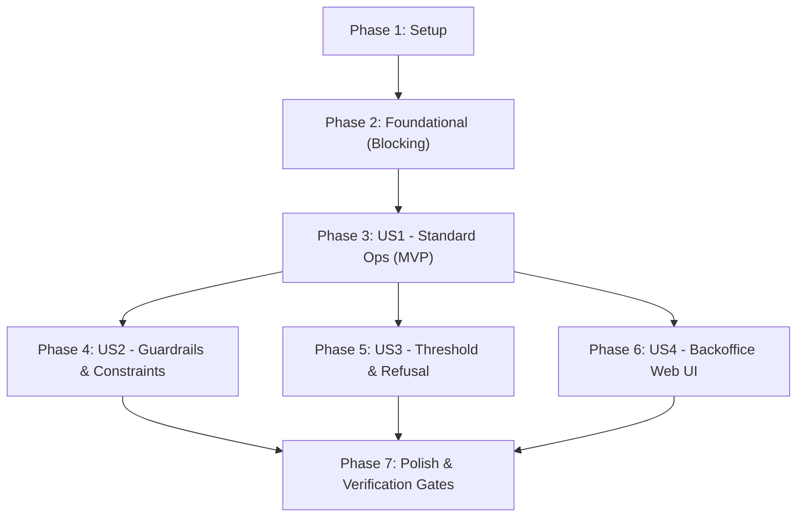

# Tasks: RAG & Knowledge Base

**Input**: Design documents from `/specs/026-rag-knowledge-base/`  
**Prerequisites**: [plan.md](file:///J:/GitHub/mr-stegmann-ai-engineering-company-project-monorepo/specs/026-rag-knowledge-base/plan.md), [spec.md](file:///J:/GitHub/mr-stegmann-ai-engineering-company-project-monorepo/specs/026-rag-knowledge-base/spec.md), [data-model.md](file:///J:/GitHub/mr-stegmann-ai-engineering-company-project-monorepo/specs/026-rag-knowledge-base/data-model.md), [research.md](file:///J:/GitHub/mr-stegmann-ai-engineering-company-project-monorepo/specs/026-rag-knowledge-base/research.md), [contracts/](file:///J:/GitHub/mr-stegmann-ai-engineering-company-project-monorepo/specs/026-rag-knowledge-base/contracts/)  
**Constitution**: Adheres strictly to Monorepo Constitution Principle VII (Vector Database & Qdrant SDK Governance) and Principles I–VI.

---

## Format: `[ID] [P?] [Story] Description`

- **[P]**: Can run in parallel (different files, no dependencies on uncompleted tasks)
- **[Story]**: User story identifier (`[US1]`, `[US2]`, `[US3]`, `[US4]`)
- Every task includes explicit target file paths

---

## Phase 1: Setup (Shared Infrastructure)

**Purpose**: Project initialization, dependency additions, shared contract types, and evaluation dataset setup.

- [X] T001 Add qdrant-client and fastembed dependencies in services/api/pyproject.toml
- [X] T002 [P] Create TypeScript DTO interfaces (KnowledgeQueryRequestDTO, KnowledgeQueryResponseDTO, KnowledgeSourceCitationDTO, KnowledgeHealthResponseDTO) in packages/shared/types/knowledge.ts
- [X] T003 [P] Re-export knowledge types in packages/shared/types/index.ts and verify build in packages/shared/
- [X] T004 [P] Create standardized evaluation dataset with 10 benchmark queries in data/eval/test-queries.json

---

## Phase 2: Foundational (Blocking Prerequisites)

**Purpose**: Core domain entities, storage ports, Qdrant vector adapter, semantic chunker, and API schemas that MUST be complete before ANY user story can proceed.

**⚠️ CRITICAL**: No user story implementation can begin until this foundational phase is complete.

- [X] T005 Create domain entities (KnowledgeDocument, KnowledgeChunk, QueryRequest, RetrievedContext, GroundedAnswer, SourceCitation) in services/api/domain/knowledge/entities.py
- [X] T006 [P] Define port interfaces (VectorStorePort, EmbeddingServicePort, LLMGenerationPort) in services/api/domain/knowledge/ports.py
- [X] T007 [P] Define domain exceptions (KnowledgeBaseUnavailableException, KnowledgeBaseException, IngestionException) in services/api/domain/knowledge/exceptions.py
- [X] T008 [P] Implement MarkdownSemanticChunker preserving tables and clauses (>=3 chunks per document, deterministic UUID v5) in services/api/application/services/chunking.py
- [X] T009 [P] Implement FastEmbedAdapter with bge-small-en-v1.5 and deterministic mock fallback in services/api/infrastructure/adapters/embedding_adapter.py
- [X] T010 Implement QdrantVectorStoreAdapter encapsulating qdrant-client for trackflow_knowledge collection with remote and in-memory support in services/api/infrastructure/adapters/qdrant_vector_store_adapter.py
- [X] T011 Implement idempotent document ingestion CLI script in scripts/ingest_knowledge_base.py
- [X] T012 [P] Define Pydantic request and response schemas in services/api/presentation/schemas/knowledge.py
- [X] T013 [P] Implement FastAPI dependency injection providers in services/api/presentation/dependencies.py

**Checkpoint**: Foundation ready — vector database adapter, embedding engine, chunking pipeline, and shared schemas are fully operational.

---

## Phase 3: User Story 1 - Commercial Inquiries on Standard Operations (Priority: P1) 🎯 MVP

**Goal**: Account managers and frontline staff can ask natural-language questions about standard warehouse, delivery, return, and storage policies and receive contractually accurate, grounded answers in TrackFlow sales persona with source document citations.

**Independent Test**: Submit operational queries (return window & shipping cost, storage pricing LA vs Zaragoza, Aragón carrier coverage) and verify responses contain exact figures (30-day window, $18 LA / €16 Zaragoza, SEUR for rural Aragón), appropriate tone, and source citations.

### Tests for User Story 1 ⚠️

- [X] T014 [P] [US1] Unit tests for MarkdownSemanticChunker in services/api/tests/unit/test_knowledge_chunking.py
- [X] T015 [P] [US1] Integration tests for QdrantVectorStoreAdapter in services/api/tests/integration/test_qdrant_adapter.py

### Implementation for User Story 1

- [X] T016 [US1] Implement GroundedGenerationAdapter adopting TrackFlow sales persona and generating grounded answers with source citations in services/api/infrastructure/adapters/grounded_generation_adapter.py
- [X] T017 [US1] Implement KnowledgeService orchestrating embedding, vector search, and answer generation in services/api/application/services/knowledge_service.py
- [X] T018 [US1] Implement FastAPI routes for POST /api/v1/knowledge/query and GET /api/v1/knowledge/health in services/api/presentation/api/v1/knowledge.py
- [X] T019 [US1] Mount knowledge router dual-paths (/api/v1/knowledge and /knowledge) in services/api/main.py
- [X] T020 [US1] Integration tests for knowledge query endpoints and standard operational policies in services/api/tests/integration/test_knowledge_routes.py

**Checkpoint**: User Story 1 (MVP) is fully functional — commercial teams can query standard policies and receive grounded answers with citations.

---

## Phase 4: User Story 2 - Enforcement of Business Constraints & Strict Policy Guardrails (Priority: P2)

**Goal**: Commercial and sales representatives are strictly prevented from promising unauthorized discounts, unachievable delivery SLAs during peak periods, or unsupported automated international workflows.

**Independent Test**: Query volume discounts (>50 m³), peak season delivery commitments (Black Friday / Christmas / January Sales), cross-border returns, and carrier selection overrides; verify answers strictly include mandated approval protocols (Miguel Torres, Carlos Vega), seasonal warnings (+40% timeline extension), and manual handling designations (Sofía Ramos).

### Tests for User Story 2 ⚠️

- [X] T021 [P] [US2] Unit tests for business guardrails and executive approval rules in services/api/tests/unit/test_knowledge_guardrails.py

### Implementation for User Story 2

- [X] T022 [US2] Implement business guardrail validation for storage volume discounts, peak season SLA extensions, international returns, and carrier overrides in services/api/application/services/guardrails.py
- [X] T023 [US2] Integrate guardrail validation into GroundedGenerationAdapter in services/api/infrastructure/adapters/grounded_generation_adapter.py and KnowledgeService in services/api/application/services/knowledge_service.py
- [X] T024 [US2] Add integration tests verifying Miguel Torres approval, peak season +40% warning, Sofía Ramos routing, and Carlos Vega exceptions in services/api/tests/integration/test_knowledge_routes.py

**Checkpoint**: User Story 2 complete — contractual guardrails and executive approval rules are rigorously enforced on all inquiries.

---

## Phase 5: User Story 3 - Confidence-Gated Retrieval & Refusal of Hallucination (Priority: P3)

**Goal**: Assistant enforces calibrated minimum similarity score threshold (`0.62`), declining to speculate or hallucinate when company documentation lacks relevant information and providing helpful fallback guidance.

**Independent Test**: Query out-of-scope or unmentioned topics (e.g. pharmaceutical refrigeration, hazardous materials, aircraft chartering) and verify response returns `is_refusal: true`, empty source list, and a polite refusal directing the user to operations leadership.

### Tests for User Story 3 ⚠️

- [X] T025 [P] [US3] Unit tests for minimum similarity score threshold (0.62) filtering and refusal generation in services/api/tests/unit/test_knowledge_service.py

### Implementation for User Story 3

- [X] T026 [US3] Implement calibrated score threshold filtering and standardized informational refusal response formatting in services/api/application/services/knowledge_service.py
- [X] T027 [US3] Implement RAG retrieval evaluation script calculating Recall@1, Recall@3, MRR, and negative probe refusals in scripts/evaluate_rag_retrieval.py
- [X] T028 [US3] Add integration test cases for out-of-scope refusal queries in services/api/tests/integration/test_knowledge_routes.py

**Checkpoint**: User Story 3 complete — confidence gating prevents hallucinations with zero false claims on ungrounded queries.

---

## Phase 6: User Story 4 - Frontline Interactive Query Interface (Priority: P4)

**Goal**: Frontline commercial and customer experience team members can access a clean, responsive, and accessible web interface in `uis/backoffice` to submit natural language questions, view active loading states, read formatted answers with citation badges, and recover gracefully from network errors.

**Independent Test**: Navigate to `/knowledge`, submit inquiries, observe loading skeleton during request, verify formatted markdown answer with clickable source tags, test client-side validation on empty inputs, and verify error alert with retry CTA upon service interruption.

### Tests for User Story 4 ⚠️

- [X] T029 [P] [US4] Component and integration tests for knowledge page and components in uis/backoffice/__tests__/knowledge.test.tsx

### Implementation for User Story 4

- [X] T030 [P] [US4] Implement KnowledgeQueryForm component with input validation in uis/backoffice/components/knowledge/KnowledgeQueryForm.tsx
- [X] T031 [P] [US4] Implement KnowledgeAnswerCard component with citation badges and status indicators in uis/backoffice/components/knowledge/KnowledgeAnswerCard.tsx
- [X] T032 [P] [US4] Implement KnowledgeStatusState component with loading skeleton and error retry CTA in uis/backoffice/components/knowledge/KnowledgeStatusState.tsx
- [X] T033 [US4] Implement frontline knowledge query page integrating form, answer card, and status states in uis/backoffice/app/knowledge/page.tsx
- [X] T034 [US4] Add Knowledge Base navigation link in uis/backoffice/components/Header.tsx

**Checkpoint**: User Story 4 complete — frontline commercial and operations users have full end-to-end access via the Backoffice web application.

---

## Phase 7: Polish & Cross-Cutting Concerns

**Purpose**: Performance benchmarking, automated verification gates, and quickstart end-to-end validation across the monorepo.

- [X] T035 [P] Execute automated evaluation suite scripts/evaluate_rag_retrieval.py and verify Recall@3 >= 80% benchmark
- [X] T036 [P] Validate quickstart end-to-end scenarios against specs/026-rag-knowledge-base/quickstart.md
- [X] T037 [P] Run static TypeScript type check across monorepo packages (npm run typecheck)
- [X] T038 Run backend pytest test suite in services/api

---

## Dependencies & Execution Order

### Phase Dependencies

- **Setup (Phase 1)**: No dependencies — can start immediately.
- **Foundational (Phase 2)**: Depends on Setup (T001–T004) — BLOCKS all user stories.
- **User Story 1 (Phase 3)**: Depends on Foundational completion (T005–T013).
- **User Story 2 (Phase 4)**: Depends on US1 completion (extends generation & service layer with guardrails).
- **User Story 3 (Phase 5)**: Depends on US1/US2 completion (activates threshold filtering & refusal logic).
- **User Story 4 (Phase 6)**: Depends on US1 backend endpoint completion and shared DTOs (T002, T018).
- **Polish (Phase 7)**: Depends on all user stories (Phases 3–6) being completed.

### User Story Dependencies



---

## Parallel Opportunities

### Phase 1 Parallel Execution
```bash
# Launch shared types and dataset creation together:
Task: "T002 [P] Create TypeScript DTO interfaces in packages/shared/types/knowledge.ts"
Task: "T003 [P] Re-export knowledge types in packages/shared/types/index.ts"
Task: "T004 [P] Create standardized evaluation dataset in data/eval/test-queries.json"
```

### Phase 2 Parallel Execution
```bash
# Launch independent domain contracts and adapters:
Task: "T006 [P] Define port interfaces in services/api/domain/knowledge/ports.py"
Task: "T007 [P] Define domain exceptions in services/api/domain/knowledge/exceptions.py"
Task: "T008 [P] Implement MarkdownSemanticChunker in services/api/application/services/chunking.py"
Task: "T009 [P] Implement FastEmbedAdapter in services/api/infrastructure/adapters/embedding_adapter.py"
Task: "T012 [P] Define Pydantic request and response schemas in services/api/presentation/schemas/knowledge.py"
Task: "T013 [P] Implement FastAPI dependency injection providers in services/api/presentation/dependencies.py"
```

### Phase 6 Parallel Execution
```bash
# Launch independent UI components simultaneously:
Task: "T030 [P] [US4] Implement KnowledgeQueryForm in uis/backoffice/components/knowledge/KnowledgeQueryForm.tsx"
Task: "T031 [P] [US4] Implement KnowledgeAnswerCard in uis/backoffice/components/knowledge/KnowledgeAnswerCard.tsx"
Task: "T032 [P] [US4] Implement KnowledgeStatusState in uis/backoffice/components/knowledge/KnowledgeStatusState.tsx"
```

---

## Implementation Strategy

### MVP First (User Story 1 Only)

1. Complete Phase 1: Setup (T001–T004).
2. Complete Phase 2: Foundational (T005–T013) — **CRITICAL BLOCKER**.
3. Complete Phase 3: User Story 1 (T014–T020).
4. **STOP and VALIDATE**: Test User Story 1 independently with `curl` or FastAPI Swagger UI. Confirm standard policy answers (return window, storage pricing, carrier coverage) return grounded answers with citations.
5. Deploy/demo if ready.

### Incremental Delivery

1. Setup + Foundational $\to$ Vector infrastructure & chunking ready.
2. User Story 1 $\to$ Grounded standard commercial queries operational (MVP).
3. User Story 2 $\to$ Executive approval & seasonal guardrails enforced.
4. User Story 3 $\to$ Calibrated threshold & hallucination refusal active.
5. User Story 4 $\to$ Frontline Backoffice UI available for daily operations.
6. Polish $\to$ Recall@3 benchmark verified, TypeScript checked, and full test suite passing.
