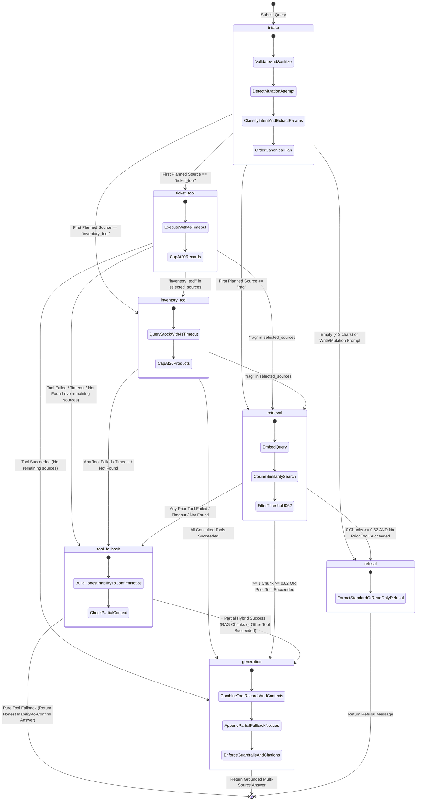
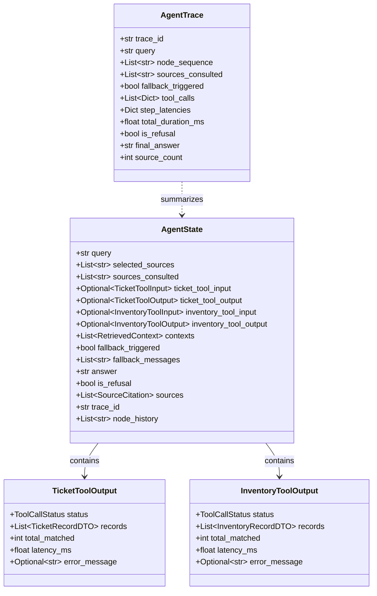

# Data Model: Support Agent with LangGraph — Explicit Reasoning & Operational Tools Outside the RAG

**Feature**: Support Agent with LangGraph — Explicit Reasoning & Operational Tools Outside the RAG  
**Branch**: `027-support-agent-langgraph`  
**Date**: 2026-11-18  
**Status**: Completed  

---

## 1. Domain Entities & Type Definitions

### 1.1 `AgentState` (Workflow State Contract)
Minimal dictionary state transferred between LangGraph nodes during a single execution run. Implemented as a Python `TypedDict`.

```python
class AgentState(TypedDict, total=False):
    query: str
    language: str
    top_k: int
    min_score: float
    selected_sources: List[str]
    sources_consulted: List[str]
    ticket_tool_input: Optional[TicketToolInput]
    ticket_tool_output: Optional[TicketToolOutput]
    inventory_tool_input: Optional[InventoryToolInput]
    inventory_tool_output: Optional[InventoryToolOutput]
    contexts: List[RetrievedContext]
    fallback_triggered: bool
    fallback_messages: List[str]
    answer: str
    is_refusal: bool
    sources: List[SourceCitation]
    trace_id: str
    node_history: List[str]
    step_latencies: Dict[str, float]
    node_outputs: Dict[str, Dict[str, Any]]
    error: Optional[str]
```

#### Fields & Validation Rules:
| Field | Type | Required | Default | Validation & Rules |
|---|---|---|---|---|
| `query` | `str` | Yes | - | Sanitized user question. Minimum 3 characters for valid routing; truncated to 500 characters max at intake. |
| `language` | `str` | No | `"en"` | Target ISO language code (`"en"`, `"es"`). |
| `top_k` | `int` | No | `3` | Max knowledge chunks to retrieve (`1 <= top_k <= 20`). |
| `min_score` | `float` | No | `0.62` | Calibrated cosine similarity threshold (`0.0 <= min_score <= 1.0`). |
| `selected_sources` | `List[str]` | No | `[]` | Autonomous routing plan emitted by `intake_node`. Subset of `["ticket_tool", "inventory_tool", "rag"]` in canonical execution order. |
| `sources_consulted` | `List[str]` | No | `[]` | Chronological list of data sources actually consulted (`"ticket_tool"`, `"inventory_tool"`, `"rag"`). |
| `ticket_tool_input` | `Optional[TicketToolInput]` | No | `None` | Typed query criteria extracted for `SupportTicketToolPort` when `"ticket_tool"` is selected. |
| `ticket_tool_output` | `Optional[TicketToolOutput]` | No | `None` | Typed output returned by `ticket_tool_node` (capped at 20 records + `total_matched`). |
| `inventory_tool_input` | `Optional[InventoryToolInput]` | No | `None` | Typed query criteria extracted for `InventoryStockToolPort` when `"inventory_tool"` is selected. |
| `inventory_tool_output` | `Optional[InventoryToolOutput]` | No | `None` | Typed output returned by `inventory_tool_node` (capped at 20 records + `total_matched`). |
| `contexts` | `List[RetrievedContext]` | No | `[]` | List of retrieved static knowledge chunks qualifying under `min_score`. Populated exclusively by `retrieval_node`. |
| `fallback_triggered` | `bool` | No | `False` | `True` when any invoked operational tool returned `not_found`, `timeout`, or `error` and routed through `tool_fallback_node`. |
| `fallback_messages` | `List[str]` | No | `[]` | Honest inability-to-confirm notices produced by `tool_fallback_node`. |
| `answer` | `str` | No | `""` | Final synthesized answer, hybrid partial answer, honest tool fallback message, or standardized refusal text. |
| `is_refusal` | `bool` | No | `False` | `True` when the inquiry was refused due to blank input, disallowed write/mutation attempt, or out-of-scope policy query with 0 qualifying chunks. |
| `sources` | `List[SourceCitation]` | No | `[]` | Provenance records citing static knowledge base documents, sections, and similarity scores. |
| `trace_id` | `str` | Yes | `UUID4` | Unique execution identifier used for checkpointing and telemetry correlation. |
| `node_history` | `List[str]` | Yes | `[]` | Ordered list of executed node names (e.g., `["intake", "ticket_tool", "retrieval", "generation"]`). |
| `step_latencies` | `Dict[str, float]` | No | `{}` | Execution duration in milliseconds keyed by node name. |
| `node_outputs` | `Dict[str, Dict[str, Any]]` | No | `{}` | Structured output summary produced by each executed node. |
| `error` | `Optional[str]` | No | `None` | User-safe sanitized error message if an unhandled node failure occurs. |

---

### 1.2 `TicketToolInput`, `TicketRecordDTO` & `TicketToolOutput` (Support Ticket Query Tool Contracts)
Typed read-only request and response contracts for querying live support incidents from the TrackFlow Incident Manager (FR-016, FR-017).

```python
ToolCallStatus = Literal["success", "not_found", "timeout", "error"]

@dataclass(frozen=True)
class TicketToolInput:
    ticket_id: Optional[str] = None
    status: Optional[str] = None
    category: Optional[str] = None
    origin: Optional[str] = None
    branch: Optional[str] = None
    limit: int = 20

@dataclass(frozen=True)
class TicketRecordDTO:
    id: str
    title: str
    description: str
    status: str
    category: str
    origin: str
    branch: str
    created_at: str
    updated_at: str

@dataclass(frozen=True)
class TicketToolOutput:
    status: ToolCallStatus
    records: List[TicketRecordDTO] = field(default_factory=list)
    total_matched: int = 0
    latency_ms: float = 0.0
    error_message: Optional[str] = None
    queried_criteria: Dict[str, Any] = field(default_factory=dict)
```

#### Validation Rules & Invariants:
- **Strictly Read-Only**: Supports only lookup by `ticket_id` or filtering by `status` (`open`, `in_progress`, `resolved`, `discarded`), `category` (`delay`, `damage`, `billing`, `stock`, `system`, `other`), `origin` (`customer`, `warehouse`, `carrier`, `partner`, `internal`), and `branch`.
- **20-Record Cap**: `len(records) <= 20` (ordered most recent `updated_at` / `created_at` first), while `total_matched` reports the full count of matching incidents prior to slicing.
- **Explicit Timeout**: Enforces a configurable numerical deadline (default `4.0` seconds). If exceeded, returns `status="timeout"` and a sanitized `error_message`.

---

### 1.3 `InventoryToolInput`, `InventoryRecordDTO` & `InventoryToolOutput` (Inventory Stock Query Tool Contracts)
Typed read-only request and response contracts for querying live warehouse product stock from the TrackFlow Inventory Manager (FR-018, FR-020).

```python
@dataclass(frozen=True)
class InventoryToolInput:
    product_id: Optional[int] = None
    sku: Optional[str] = None
    search_query: Optional[str] = None
    low_stock_only: bool = False
    limit: int = 20

@dataclass(frozen=True)
class InventoryRecordDTO:
    id: int
    sku: str
    name: str
    description: str
    stock: int
    min_threshold: int
    is_low_stock: bool
    warehouse_id: str = "central"

@dataclass(frozen=True)
class InventoryToolOutput:
    status: ToolCallStatus
    records: List[InventoryRecordDTO] = field(default_factory=list)
    total_matched: int = 0
    latency_ms: float = 0.0
    error_message: Optional[str] = None
    queried_criteria: Dict[str, Any] = field(default_factory=dict)
```

#### Validation Rules & Invariants:
- **Strictly Read-Only**: Queries live calculated stock projections (`current_stock = SUM(inbound) - SUM(outbound)`) via `InventoryService` without any mutation capability.
- **20-Record Cap**: `len(records) <= 20`, with `total_matched` reporting the total matching product count.
- **Explicit Timeout**: Enforces the `4.0` second numerical deadline; returns `status="timeout"` on deadline expiration and `status="not_found"` when no product matches.

---

### 1.4 `AgentTrace` (Execution Audit Record)
Structured audit model representing the post-execution trace of an agent run, queryable by engineers, evaluation suites, and administrative APIs (FR-008, FR-025).

```python
@dataclass(frozen=True)
class AgentTrace:
    trace_id: str
    query: str
    node_sequence: List[str]
    step_latencies: Dict[str, float]
    total_duration_ms: float
    is_refusal: bool
    final_answer: str
    source_count: int
    sources_consulted: List[str] = field(default_factory=list)
    fallback_triggered: bool = False
    tool_calls: List[Dict[str, Any]] = field(default_factory=list)
    node_outputs: Dict[str, Dict[str, Any]] = field(default_factory=dict)
    created_at: datetime = field(default_factory=lambda: datetime.now(timezone.utc))
    checkpoints: List[AgentCheckpoint] = field(default_factory=list)
```

#### Fields & Invariants:
- `trace_id`: UUID string identifying the run.
- `node_sequence`: Exact chronological order of visited LangGraph nodes.
- `sources_consulted`: Ordered list of data sources consulted during the run (`"ticket_tool"`, `"inventory_tool"`, `"rag"`).
- `fallback_triggered`: `True` if `tool_fallback` node was traversed.
- `tool_calls`: Ordered audit metadata for each tool invocation (`tool_name`, `status`, `total_matched`, `returned_count`, `latency_ms`).
- `step_latencies`: Positive latency in milliseconds for every visited node.

---

### 1.5 `AgentCheckpoint`, `RetrievedContext` & `SourceCitation`
```python
@dataclass(frozen=True)
class AgentCheckpoint:
    thread_id: str
    checkpoint_id: str
    parent_checkpoint_id: Optional[str]
    node: str
    state_delta: Dict[str, Any]
    timestamp: str
```
`RetrievedContext` and `SourceCitation` are reused directly from `domain.knowledge.entities`.

---

### 1.6 `EvaluationTestCase` (Eval Test Matrix Entity)
Used in `tests/pipelines/test_support_agent_evaluation.py` to assert topology, autonomous source routing, canonical execution order, grounding, and honest fallback recovery.

```python
@dataclass(frozen=True)
class EvaluationTestCase:
    test_id: str
    description: str
    query: str
    expected_node_sequence: List[str]
    expected_is_refusal: bool
    expected_sources_consulted: List[str] = field(default_factory=list)
    expected_fallback_triggered: bool = False
    prohibited_nodes: List[str] = field(default_factory=list)
    expected_text_contains: List[str] = field(default_factory=list)
    prohibited_text_contains: List[str] = field(default_factory=list)
    expected_sources_min: int = 0
```

---

## 2. State Machine & Node Transitions

### 2.1 State Transition Diagram



---

## 3. Transition Rules & Routing Matrix

| Source Node | Condition | Target Node | State Mutation / Delta |
|---|---|---|---|
| `START` | Incoming request | `intake` | Initializes `trace_id`, `selected_sources`, tool inputs, `node_history=["intake"]` |
| `intake` | `len(query) < 3` or mutation attempt | `refusal` | Sets `is_refusal=True`, routes to `refusal` |
| `intake` | `selected_sources[0] == "ticket_tool"` | `ticket_tool` | Populates `ticket_tool_input` |
| `intake` | `selected_sources[0] == "inventory_tool"` | `inventory_tool` | Populates `inventory_tool_input` |
| `intake` | `selected_sources[0] == "rag"` | `retrieval` | Proceeds to static vector retrieval |
| `ticket_tool` | `"inventory_tool" in selected_sources` | `inventory_tool` | Records `ticket_tool_output`, appends `"ticket_tool"` to `sources_consulted` |
| `ticket_tool` | `"rag" in selected_sources` (no inventory) | `retrieval` | Records `ticket_tool_output`, appends `"ticket_tool"` to `sources_consulted` |
| `ticket_tool` | No more sources & `status != "success"` | `tool_fallback` | Sets `fallback_triggered=True` |
| `ticket_tool` | No more sources & `status == "success"` | `generation` | Passes live incident records to synthesis |
| `inventory_tool` | `"rag" in selected_sources` | `retrieval` | Records `inventory_tool_output`, appends `"inventory_tool"` to `sources_consulted` |
| `inventory_tool` | No more sources & `fallback_triggered` | `tool_fallback` | Routes to honest tool fallback recovery |
| `inventory_tool` | No more sources & tool(s) succeeded | `generation` | Passes live inventory stock records to synthesis |
| `retrieval` | `fallback_triggered == True` | `tool_fallback` | Appends `"rag"` to `sources_consulted`, routes to record fallback notice before partial generation |
| `retrieval` | `len(contexts) > 0` or prior tool succeeded | `generation` | Appends `"rag"` to `sources_consulted`, passes `contexts` and tool outputs |
| `retrieval` | `len(contexts) == 0` and no tool succeeded | `refusal` | Out-of-scope policy inquiry routes to honest refusal |
| `tool_fallback` | `len(contexts) > 0` or any tool succeeded | `generation` | Populates `fallback_messages` for graceful partial answer synthesis |
| `tool_fallback` | No RAG contexts and no tool succeeded | `END` | Sets honest fallback `answer`, finishes run with zero fabrication |
| `generation` | Synthesis complete | `END` | Sets `answer`, `sources`, finishes run |
| `refusal` | Refusal text formatted | `END` | Sets `answer`, `is_refusal=True`, `sources=[]`, finishes run |

---

## 4. Entity Relationships & Monorepo Boundaries


