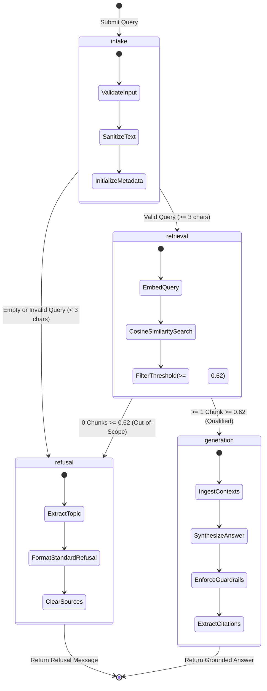
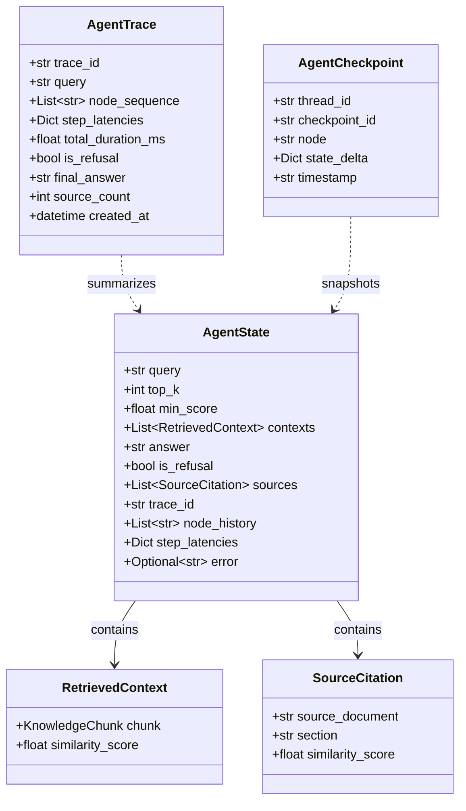

# Data Model: Support Agent with LangGraph

**Feature**: Support Agent with LangGraph  
**Branch**: `027-support-agent-langgraph`  
**Date**: 2026-11-17  
**Status**: Completed  

---

## 1. Domain Entities & Type Definitions

### 1.1 `AgentState` (Workflow State Contract)
Minimal dictionary state transferred between LangGraph nodes during a single execution run. Implemented as a Python `TypedDict`.

```python
class AgentState(TypedDict, total=False):
    query: str
    top_k: int
    min_score: float
    contexts: List[RetrievedContext]
    answer: str
    is_refusal: bool
    sources: List[SourceCitation]
    trace_id: str
    node_history: List[str]
    step_latencies: Dict[str, float]
    node_outputs: Dict[str, Dict[str, Any]]
    error: Optional[str]
```

#### Fields & Validation Rules:
| Field | Type | Required | Default | Validation & Rules |
|---|---|---|---|---|
| `query` | `str` | Yes | - | Sanitized user question. Minimum 1 character. Truncated to 500 characters max at intake. |
| `top_k` | `int` | No | `3` | Max documents to retrieve. Must be between 1 and 20. |
| `min_score` | `float` | No | `0.62` | Calibrated cosine similarity threshold (range 0.0 to 1.0). Chunks below this score are filtered out. |
| `contexts` | `List[RetrievedContext]` | No | `[]` | List of retrieved knowledge chunks qualifying under `min_score`. Populated exclusively by `retrieval_node`. |
| `answer` | `str` | No | `""` | Grounded answer or standardized refusal text. Populated by `generation_node` or `refusal_node`. |
| `is_refusal` | `bool` | No | `False` | Boolean indicating whether the inquiry was refused due to out-of-scope content or low similarity. |
| `sources` | `List[SourceCitation]` | No | `[]` | Provenance records citing source document, section, and similarity score. Populated during generation. |
| `trace_id` | `str` | Yes | `UUID4` | Unique execution identifier used for checkpointing and telemetry correlation. |
| `node_history` | `List[str]` | Yes | `[]` | Ordered list of executed node names (e.g., `["intake", "retrieval", "generation"]`). |
| `step_latencies` | `Dict[str, float]` | No | `{}` | Execution duration in milliseconds keyed by node name (e.g., `{"intake": 1.2, "retrieval": 18.4}`). |
| `node_outputs` | `Dict[str, Dict[str, Any]]` | No | `{}` | Structured output payload produced by each executed node. |
| `error` | `Optional[str]` | No | `None` | User-safe sanitized error message if an unhandled node failure occurs. |

---

### 1.2 `AgentTrace` (Execution Audit Record)
Structured audit model representing the post-execution trace of an agent run, queryable by engineers, evaluation suites, and administrative APIs.

```python
@dataclass(frozen=True)
class AgentTrace:
    trace_id: str
    query: str
    node_sequence: List[str]
    step_latencies: Dict[str, float]
    total_duration_ms: float
    is_refusal: bool
    final_answer: str
    source_count: int
    created_at: datetime
```

#### Fields & Invariants:
- `trace_id`: Deterministic or random UUID string identifying the run.
- `node_sequence`: Must record the exact chronological order of node visitations.
- `step_latencies`: Every visited node must have a corresponding positive latency measurement.
- `total_duration_ms`: Equal to the sum of step latencies plus graph transition overhead.
- `source_count`: Equals `len(sources)`. For refusals, `source_count == 0`.

---

### 1.3 `AgentCheckpoint` (State Snapshot)
State representation captured by the LangGraph checkpointer (`MemorySaver`) at each node boundary.

```python
@dataclass(frozen=True)
class AgentCheckpoint:
    thread_id: str
    checkpoint_id: str
    parent_checkpoint_id: Optional[str]
    node: str
    state_delta: Dict[str, Any]
    timestamp: str
```

- Keyed by `thread_id` (corresponds to `trace_id` in single-run inquiries).
- Allows step-by-step state inspection and regression replay during automated testing.

---

### 1.4 `RetrievedContext` & `SourceCitation` (Domain Projections)
Reused from `domain.knowledge.entities` to ensure domain isolation and backward compatibility.

```python
@dataclass(frozen=True)
class SourceCitation:
    source_document: str
    section: str
    similarity_score: float

@dataclass(frozen=True)
class RetrievedContext:
    chunk: KnowledgeChunk
    similarity_score: float
```

- `similarity_score`: Clamped to `[0.0, 1.0]`.
- `source_document`: Basename of verified knowledge file (e.g. `trackflow-returns-policy.en.md`).
- `section`: Heading title of the chunk.

---

### 1.5 `EvaluationTestCase` (Eval Test Matrix Entity)
Used in `tests/pipelines/test_support_agent_evaluation.py` to assert topology, routing, and grounding contracts.

```python
@dataclass(frozen=True)
class EvaluationTestCase:
    test_id: str
    description: str
    query: str
    expected_node_sequence: List[str]
    expected_is_refusal: bool
    prohibited_nodes: List[str]
    expected_text_contains: List[str]
    expected_sources_min: int
```

---

## 2. State Machine & Node Transitions

### 2.1 State Transition Diagram



---

## 3. Transition Rules & Routing Matrix

| Source Node | Condition | Target Node | State Mutation / Delta |
|---|---|---|---|
| `START` | Incoming request | `intake` | Initializes `trace_id`, `node_history=["intake"]`, `step_latencies` |
| `intake` | `len(query.strip()) < 3` or invalid | `refusal` | Appends `"refusal"` to `node_history`, sets refusal flag |
| `intake` | `len(query.strip()) >= 3` | `retrieval` | Sets sanitized `query`, appends `"retrieval"` to `node_history` |
| `retrieval` | `len(contexts) == 0` | `refusal` | Appends `"refusal"` to `node_history`, sets `is_refusal=True` |
| `retrieval` | `len(contexts) > 0` | `generation` | Appends `"generation"` to `node_history`, passes `contexts` |
| `generation` | Synthesis & guardrail check complete | `END` | Sets `answer`, `sources`, finishes run |
| `refusal` | Refusal text generated | `END` | Sets `answer`, `is_refusal=True`, `sources=[]`, finishes run |

---

## 4. Entity Relationships & Monorepo Boundaries


