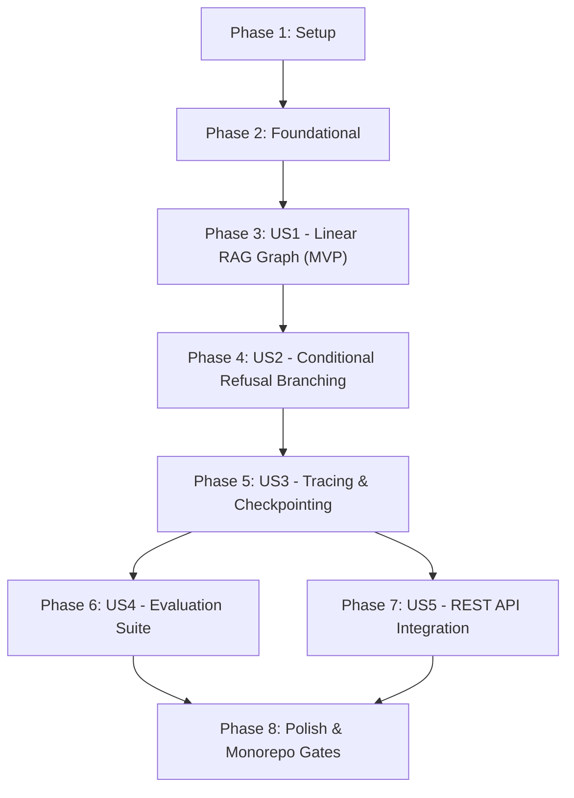

# Tasks: Support Agent with LangGraph

**Input**: Design documents from `/specs/027-support-agent-langgraph/` (`spec.md`, `plan.md`, `data-model.md`, `research.md`, `contracts/`, `quickstart.md`)  
**Prerequisites**: `plan.md` (required), `spec.md` (required for user stories), `data-model.md`, `contracts/`  
**Constitution**: Compliance with TrackFlow Constitution v1.1.0 (Principles I, II, III, IV, VI, VII)

---

## Phase 1: Setup (Shared Infrastructure)

**Purpose**: Environment preparation, core agent domain directory structure, and dependency initialization.

- [ ] T001 Initialize domain and application directories for agent workflow in `services/api/domain/agent/` and `services/api/application/services/`
- [ ] T002 Verify LangGraph and testing dependencies (`langgraph`, `langgraph-checkpoint`, `fastapi`, `pydantic`, `pytest`, `httpx`) in `services/api/pyproject.toml`

---

## Phase 2: Foundational (Blocking Prerequisites)

**Purpose**: Core domain models, state schemas, interfaces, and shared registries that MUST be complete before ANY user story can be implemented.

**⚠️ CRITICAL**: No user story work can begin until this phase is complete.

- [ ] T003 [P] Implement `AgentState` TypedDict and domain entity models in `services/api/domain/agent/entities.py`
- [ ] T004 [P] Implement agent domain exceptions (`GraphCompilationError`, `WorkflowExecutionError`, `StateValidationError`) in `services/api/domain/agent/exceptions.py`
- [ ] T005 [P] Define application and service port interfaces (`SupportAgentServicePort`, `TraceRegistryPort`) in `services/api/domain/agent/ports.py`
- [ ] T006 Expose domain agent contracts and models in `services/api/domain/agent/__init__.py`
- [ ] T007 Implement thread-safe in-memory `TraceRegistry` for queryable execution traces in `services/api/application/services/trace_registry.py`

**Checkpoint**: Foundation ready — domain contracts and shared telemetry storage established. User story implementation can now begin.

---

## Phase 3: User Story 1 - Explicit, Traceable Reasoning Flow for Customer Inquiries (Priority: P1) 🎯 MVP

**Goal**: Transform black-box RAG into an explicit, single-responsibility LangGraph state machine with distinct `intake`, `retrieval`, and `generation` nodes that produce grounded answers with citations.

**Independent Test**: Submit a standard customer query (e.g., TrackFlow's 30-day return policy) and verify that the workflow executes `intake` → `retrieval` → `generation`, passing minimal state and outputting a verified answer with source citations.

### Tests for User Story 1 ⚠️

- [ ] T008 [P] [US1] Unit test for single-responsibility nodes (`intake_node`, `retrieval_node`, `generation_node`) in `services/api/tests/unit/test_agent_workflow.py`
- [ ] T009 [P] [US1] Integration test for standard reasoning workflow execution in `services/api/tests/unit/test_agent_workflow.py`

### Implementation for User Story 1

- [ ] T010 [US1] Implement `intake_node` for input sanitization, length validation, and trace metadata initialization in `services/api/application/services/agent_workflow.py`
- [ ] T011 [US1] Implement `retrieval_node` reusing `VectorStorePort` and `EmbeddingServicePort` to populate `contexts` in `services/api/application/services/agent_workflow.py`
- [ ] T012 [US1] Implement `generation_node` consuming pre-retrieved `contexts`, invoking generation with guardrails, and extracting citations in `services/api/application/services/agent_workflow.py`
- [ ] T013 [US1] Assemble and compile the primary linear reasoning graph (`build_support_agent_graph`) in `services/api/application/services/agent_workflow.py`

**Checkpoint**: At this point, User Story 1 delivers a functional MVP with explicit, single-responsibility nodes for standard inquiries.

---

## Phase 4: User Story 2 - Conditional Branching and Honest Policy Refusal (Priority: P2)

**Goal**: Implement conditional routing edges that halt empty or whitespace queries early and route out-of-scope/low-similarity queries to an honest refusal node rather than ungrounded generation.

**Independent Test**: Submit an empty/whitespace query and verify early termination; submit an unindexed query (e.g., pharmaceutical refrigeration) and verify conditional routing to `refusal_node` with similarity < 0.62 without invoking generation.

### Tests for User Story 2 ⚠️

- [ ] T014 [P] [US2] Unit tests for conditional routing functions (`route_after_intake`, `route_after_retrieval`) in `services/api/tests/unit/test_agent_workflow.py`
- [ ] T015 [P] [US2] Unit test for `refusal_node` honest refusal formatting in `services/api/tests/unit/test_agent_workflow.py`

### Implementation for User Story 2

- [ ] T016 [US2] Implement `refusal_node` to format standardized honest refusal messages and set `is_refusal=True` in `services/api/application/services/agent_workflow.py`
- [ ] T017 [US2] Implement conditional edge `route_after_intake` to intercept blank/short queries before retrieval in `services/api/application/services/agent_workflow.py`
- [ ] T018 [US2] Implement conditional edge `route_after_retrieval` to enforce the 0.62 similarity threshold and branch to `refusal_node` when `len(contexts) == 0` in `services/api/application/services/agent_workflow.py`
- [ ] T019 [US2] Update graph compilation in `services/api/application/services/agent_workflow.py` to register conditional edges and build-time reachability validation

**Checkpoint**: Both User Story 1 and User Story 2 work independently — empty and out-of-scope inquiries are safely intercepted.

---

## Phase 5: User Story 3 - Queryable Execution Tracing and State Checkpointing (Priority: P3)

**Goal**: Persist point-in-time state snapshots via LangGraph checkpointer (`MemorySaver`) and record structured, queryable `AgentTrace` records with node sequences and step latencies.

**Independent Test**: Execute queries through the agent service and assert that `AgentTrace` contains the exact ordered node visitations, step execution durations, and that state checkpoints can be inspected by `thread_id`.

### Tests for User Story 3 ⚠️

- [ ] T020 [P] [US3] Unit test for execution tracing telemetry and step latency measurement in `services/api/tests/unit/test_agent_workflow.py`
- [ ] T021 [P] [US3] Unit test for state checkpointing and recovery with `MemorySaver` in `services/api/tests/unit/test_agent_workflow.py`

### Implementation for User Story 3

- [ ] T022 [US3] Integrate `MemorySaver` checkpointer and thread-scoped configuration into `build_support_agent_graph` in `services/api/application/services/agent_workflow.py`
- [ ] T023 [US3] Implement execution step timing and telemetry tracking inside workflow node transitions in `services/api/application/services/agent_workflow.py`
- [ ] T024 [US3] Implement `SupportAgentService` coordinating compiled graph invocation, trace construction, and trace persistence into `TraceRegistry` in `services/api/application/services/support_agent_service.py`

**Checkpoint**: State transitions are checkpointed per thread and execution runs produce queryable traces in `TraceRegistry`.

---

## Phase 6: User Story 4 - Automated Evaluation Suite and Knowledge Grounding Gates (Priority: P4)

**Goal**: Provide an automated evaluation test suite in `tests/pipelines/test_support_agent_evaluation.py` runnable via a single command, verifying trace topology, conditional edges, and factual answer grounding against TrackFlow policy documentation.

**Independent Test**: Run `pytest tests/pipelines/test_support_agent_evaluation.py` from repository root and verify that all 4 evaluation scenarios pass with 100% success rate while pre-existing pipeline tests continue passing.

### Implementation for User Story 4

- [ ] T025 [P] [US4] Define `EvaluationTestCase` entity and verification fixtures in `tests/pipelines/test_support_agent_evaluation.py`
- [ ] T026 [P] [US4] Implement Eval Scenario 1: Standard policy reasoning flow and node sequence verification (`["intake", "retrieval", "generation"]`) in `tests/pipelines/test_support_agent_evaluation.py`
- [ ] T027 [P] [US4] Implement Eval Scenario 2: Conditional refusal verification for unindexed/low-similarity queries (`["intake", "retrieval", "refusal"]`) in `tests/pipelines/test_support_agent_evaluation.py`
- [ ] T028 [P] [US4] Implement Eval Scenario 3: Input validation and early termination for empty queries in `tests/pipelines/test_support_agent_evaluation.py`
- [ ] T029 [P] [US4] Implement Eval Scenario 4: Factual knowledge grounding verification for return policy (30 days) and warehouse storage pricing (€18 Zaragoza, $25 Los Angeles) in `tests/pipelines/test_support_agent_evaluation.py`

**Checkpoint**: Automated evaluation gate validates workflow topology and factual policy grounding in CI/CD without regressions.

---

## Phase 7: User Story 5 - Zero-Leakage API Integration Endpoint (Priority: P5)

**Goal**: Expose the compiled agent workflow via defensive FastAPI REST endpoints adhering to Constitution Principles II & IV (explicit Pydantic schemas, `Depends` injection, non-blocking execution via `run_in_threadpool`, and zero raw stack trace leakage).

**Independent Test**: Dispatch HTTP requests to `POST /api/v1/agent/query` and `GET /api/v1/agent/trace/{trace_id}`; assert HTTP 200 with structured JSON on success and sanitized error responses (zero stack traces or internal file paths) upon synthetic faults.

### Tests for User Story 5 ⚠️

- [ ] T030 [P] [US5] Integration test for `POST /api/v1/agent/query` (success and refusal paths) in `services/api/tests/integration/test_agent_routes.py`
- [ ] T031 [P] [US5] Integration test for `GET /api/v1/agent/trace/{trace_id}` and `GET /api/v1/agent/health` in `services/api/tests/integration/test_agent_routes.py`
- [ ] T032 [P] [US5] Integration test for defensive error shielding and zero raw stack trace leakage under synthetic faults in `services/api/tests/integration/test_agent_routes.py`

### Implementation for User Story 5

- [ ] T033 [P] [US5] Define Pydantic request and response schemas (`AgentQueryRequestSchema`, `AgentQueryResponseSchema`, `AgentTraceResponseSchema`, `AgentHealthResponseSchema`) matching OpenAPI contract in `services/api/presentation/schemas/agent.py`
- [ ] T034 [US5] Configure FastAPI dependency providers `get_support_agent_service` and `get_trace_registry` using `Depends` in `services/api/presentation/dependencies.py`
- [ ] T035 [US5] Implement FastAPI route controllers (`POST /query`, `GET /trace/{trace_id}`, `GET /health`) with `run_in_threadpool` and defensive exception handling in `services/api/presentation/api/v1/agent.py`
- [ ] T036 [US5] Register the agent router in the main FastAPI application in `services/api/main.py`

**Checkpoint**: Full end-to-end integration complete — agent is accessible over HTTP REST with defensive error boundaries.

---

## Phase 8: Polish & Cross-Cutting Concerns

**Purpose**: End-to-end quickstart validation, documentation, performance verification, and full regression sweep across monorepo test gates.

- [ ] T037 [P] Execute end-to-end verification scenarios defined in `specs/027-support-agent-langgraph/quickstart.md`
- [ ] T038 Validate build-time graph compilation and fail-fast behavior on disconnected nodes in `services/api/tests/unit/test_agent_workflow.py`
- [ ] T039 [P] Run static type checking and linting across `services/api` to verify zero type errors and zero `any` usage
- [ ] T040 Run complete monorepo backend regression suite (`pytest services/api/` and `pytest tests/pipelines/`) to verify zero regressions

---

## Dependencies & Execution Order

### Phase Dependencies

- **Setup (Phase 1)**: No dependencies — can start immediately.
- **Foundational (Phase 2)**: Depends on Setup (Phase 1) — BLOCKS all user stories.
- **User Story 1 (Phase 3 - P1)**: Depends on Foundational (Phase 2). Delivers core RAG nodes and MVP.
- **User Story 2 (Phase 4 - P2)**: Depends on User Story 1 (Phase 3). Adds conditional branching and honest refusal.
- **User Story 3 (Phase 5 - P3)**: Depends on User Story 1 & 2. Adds checkpointing and queryable tracing.
- **User Story 4 (Phase 6 - P4)**: Depends on User Story 1, 2, and 3. Builds the automated evaluation suite against the traced workflow.
- **User Story 5 (Phase 7 - P5)**: Depends on User Story 1, 2, and 3. Exposes the traced workflow via HTTP REST.
- **Polish (Phase 8)**: Depends on all user stories (Phases 3–7) being complete.



---

## User Story Dependencies

- **User Story 1 (P1)**: Requires Phase 2 entities and ports. Does not depend on subsequent stories.
- **User Story 2 (P2)**: Builds upon `intake_node` and `retrieval_node` from US1, introducing conditional routing functions and `refusal_node`.
- **User Story 3 (P3)**: Wraps the compiled graph from US1/US2 with `MemorySaver` and populates `TraceRegistry`.
- **User Story 4 (P4)**: Evaluates the traced workflow from US1, US2, and US3. Can be written in parallel with US5.
- **User Story 5 (P5)**: Exposes the `SupportAgentService` and `TraceRegistry` from US3 over FastAPI HTTP. Can be developed in parallel with US4.

---

## Parallel Opportunities

- **Phase 2 (Foundational)**: `T003` (entities), `T004` (exceptions), and `T005` (ports) can run in parallel.
- **Phase 3 (User Story 1)**: `T008` and `T009` (unit/integration test skeletons) can run in parallel before implementation.
- **Phase 4 (User Story 2)**: `T014` and `T015` (unit tests for routing and refusal) can run in parallel.
- **Phase 5 (User Story 3)**: `T020` and `T021` (tracing and checkpointing unit tests) can run in parallel.
- **Phase 6 & 7 (User Stories 4 & 5)**: Once Phase 5 completes, User Story 4 (`T025`–`T029`) and User Story 5 (`T030`–`T036`) can proceed in parallel.
- **Phase 7 (User Story 5)**: `T030`, `T031`, `T032` (integration tests) and `T033` (schemas) can run in parallel.

---

## Parallel Execution Examples

### Parallel Example: User Story 1

```bash
# Launch test preparation for User Story 1:
Task T008: "Unit test for single-responsibility nodes in services/api/tests/unit/test_agent_workflow.py"
Task T009: "Integration test for standard reasoning workflow execution in services/api/tests/unit/test_agent_workflow.py"
```

### Parallel Example: User Story 2

```bash
# Launch test preparation for User Story 2:
Task T014: "Unit tests for conditional routing functions in services/api/tests/unit/test_agent_workflow.py"
Task T015: "Unit test for refusal_node honest refusal formatting in services/api/tests/unit/test_agent_workflow.py"
```

### Parallel Example: User Stories 4 and 5 (Multi-Developer / Parallel Agent)

```bash
# Developer / Agent A: Implement Automated Evaluation Suite (US4)
Task T025: "Define EvaluationTestCase entity and verification fixtures in tests/pipelines/test_support_agent_evaluation.py"
Task T026: "Implement Eval Scenario 1 in tests/pipelines/test_support_agent_evaluation.py"
Task T027: "Implement Eval Scenario 2 in tests/pipelines/test_support_agent_evaluation.py"

# Developer / Agent B: Implement REST API Endpoints (US5)
Task T033: "Define Pydantic request and response schemas in services/api/presentation/schemas/agent.py"
Task T034: "Configure FastAPI dependency providers in services/api/presentation/dependencies.py"
Task T035: "Implement FastAPI route controllers in services/api/presentation/api/v1/agent.py"
```

---

## Implementation Strategy

### MVP First (User Story 1 Only)

1. Complete Phase 1 (Setup) and Phase 2 (Foundational prerequisites).
2. Complete Phase 3 (User Story 1: explicit nodes, linear graph compilation).
3. **STOP and VALIDATE**: Test User Story 1 independently with `pytest services/api/tests/unit/test_agent_workflow.py`.
4. Demonstrate explicit node sequencing for standard queries.

### Incremental Delivery

1. **Increment 1 (MVP)**: Phase 1 + 2 + 3 → Explicit single-responsibility RAG state machine working.
2. **Increment 2 (Governance & Safety)**: Phase 4 (US2) → Conditional routing, 0.62 similarity gating, and honest refusal.
3. **Increment 3 (Observability)**: Phase 5 (US3) → State checkpointing with `MemorySaver` and queryable `AgentTrace`.
4. **Increment 4 (Quality Assurance)**: Phase 6 (US4) → Monorepo evaluation suite in `tests/pipelines/` passing in a single command.
5. **Increment 5 (Public Integration)**: Phase 7 (US5) → Defensive FastAPI endpoints shielding raw stack traces.
6. **Increment 6 (Release Hardening)**: Phase 8 → Monorepo regression tests, type checks, and quickstart validation.
