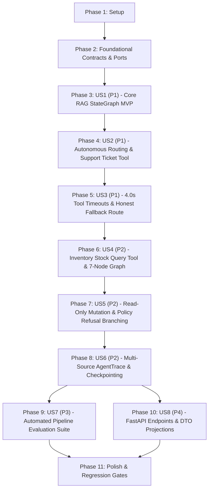

# Tasks: Support Agent with LangGraph — Explicit Reasoning & Operational Tools Outside the RAG

**Input**: Design documents from `/specs/027-support-agent-langgraph/` (`spec.md`, `plan.md`, `data-model.md`, `research.md`, `contracts/`, `quickstart.md`)  
**Prerequisites**: `plan.md` (required), `spec.md` (required for user stories), `data-model.md`, `research.md`, `contracts/agent-api.yaml`, `contracts/agent-state.json`, `contracts/tools-schema.json`, `quickstart.md`  
**Tests**: Included as explicitly required by `spec.md` (FR-009–FR-012, FR-026–FR-027, SC-004, SC-007) and `plan.md`.  
**Constitution**: Compliance with TrackFlow Monorepo Constitution v1.1.0 (Principles I–VII).

## Format: `[ID] [P?] [Story] Description`

- **[P]**: Can run in parallel (different files, no dependencies on incomplete tasks)
- **[Story]**: Which user story this task belongs to (`[US1]` through `[US8]`)
- All tasks include exact file paths

---

## Phase 1: Setup (Shared Infrastructure)

**Purpose**: Environment preparation, package structure verification, and runtime configuration for LangGraph and operational tool timeouts/transport.

- [ ] T001 Verify Python >= 3.14 and LangGraph/testing dependencies (`langgraph`, `langgraph-checkpoint`, `fastapi`, `pydantic`, `tinydb`, `sqlmodel`, `pytest`, `httpx`) in `services/api/pyproject.toml`
- [ ] T002 [P] Ensure agent domain, application, infrastructure adapter, and test package directories exist in `services/api/domain/agent/`, `services/api/application/services/`, `services/api/infrastructure/adapters/`, and `services/api/tests/`
- [ ] T003 [P] Add operational tool configuration settings (`AGENT_TOOL_TIMEOUT_SECONDS=4.0` default within `3.0`–`5.0`s, optional `AGENT_API_BASE_URL`, and optional `AGENT_INTERNAL_API_TOKEN`) to runtime configuration in `services/api/domain/knowledge/entities.py`

---

## Phase 2: Foundational (Blocking Prerequisites)

**Purpose**: Core domain entities, expanded minimal `AgentState` schema, typed read-only tool input/output contracts, domain exceptions, port interfaces, and trace registry that MUST be complete before user stories can be implemented.

**⚠️ CRITICAL**: No user story work can begin until this phase is complete.

- [ ] T004 [P] Define expanded minimal `AgentState` TypedDict (`selected_sources`, `sources_consulted`, `ticket_tool_input`, `ticket_tool_output`, `inventory_tool_input`, `inventory_tool_output`, `fallback_triggered`, `fallback_messages`, `contexts`, `answer`, `is_refusal`, `sources`, `trace_id`, `node_history`, `step_latencies`, `node_outputs`, `error`) in `services/api/domain/agent/entities.py`
- [ ] T005 [P] Define frozen domain dataclasses for read-only operational tool contracts (`ToolCallStatus`, `TicketToolInput`, `TicketRecordDTO`, `TicketToolOutput`, `InventoryToolInput`, `InventoryRecordDTO`, `InventoryToolOutput`) and expanded `AgentTrace` / `AgentQueryResult` models in `services/api/domain/agent/entities.py`
- [ ] T006 [P] Implement agent domain exceptions (`AgentDomainException`, `GraphCompilationError`, `WorkflowExecutionError`, `StateValidationError`, `TraceNotFoundError`, `ToolExecutionTimeoutError`) in `services/api/domain/agent/exceptions.py`
- [ ] T007 [P] Define abstract port interfaces (`SupportTicketToolPort`, `InventoryStockToolPort`, `TraceRegistryPort`, `SupportAgentServicePort`) in `services/api/domain/agent/ports.py`
- [ ] T008 Export all agent domain entities, tool contracts, exceptions, and ports in `services/api/domain/agent/__init__.py`
- [ ] T009 Implement thread-safe in-memory `TraceRegistry` supporting multi-source `AgentTrace` persistence and lookup in `services/api/application/services/trace_registry.py`

**Checkpoint**: Foundation ready — minimal `AgentState`, read-only tool contracts, ports, exceptions, and `TraceRegistry` are in place.

---

## Phase 3: User Story 1 - Explicit, Traceable Reasoning Flow for Customer Inquiries (Priority: P1) 🎯 MVP

**Goal**: Process customer policy inquiries through an explicit compiled LangGraph state machine with single-responsibility `intake`, `retrieval`, and `generation` nodes that reuse existing RAG services without duplicating vector search logic and produce grounded responses with source citations.

**Independent Test**: Submit a standard operational policy question (e.g., `"What is TrackFlow's standard return window?"` or storage rates in Zaragoza and Los Angeles) and verify that the workflow executes `intake` → `retrieval` → `generation`, producing an accurate grounded response with citations and recording each distinct stage.

### Tests for User Story 1 ⚠️

- [ ] T010 [P] [US1] Add unit tests for single-responsibility `intake_node`, `retrieval_node`, `generation_node`, and build-time graph compilation validation in `services/api/tests/unit/test_agent_workflow.py`

### Implementation for User Story 1

- [ ] T011 [US1] Implement `sanitize_agent_query` and base `intake_node` input validation, length bounding (`3..500` chars), and trace state initialization in `services/api/application/services/agent_workflow.py`
- [ ] T012 [US1] Implement `retrieval_node` and `create_retrieval_node` reusing `retrieve()` from `data.pipelines.rag_pipeline` (`VectorStorePort` and `EmbeddingServicePort`) and recording `"rag"` in `sources_consulted` in `services/api/application/services/agent_workflow.py`
- [ ] T013 [US1] Implement `generation_node` and `create_generation_node` consuming pre-retrieved `contexts` and structured tool outputs without re-invoking retrieval or external services in `services/api/application/services/agent_workflow.py`
- [ ] T014 [US1] Implement `compile_and_validate_graph` to enforce build-time node registration, BFS reachability from `START`, and dead-end detection before compiling the `StateGraph` in `services/api/application/services/agent_workflow.py`

**Checkpoint**: User Story 1 delivers an explicit, single-responsibility compiled state graph for grounded policy inquiries.

---

## Phase 4: User Story 2 - Autonomous Routing & Live Support Ticket Queries Outside the Knowledge Base (Priority: P1)

**Goal**: Equip the support agent with a dedicated, strictly read-only Support Ticket Query Tool (`ticket_tool`) reading live incident records from TrackFlow's Incident Manager (capped at 20 most-recent records plus `total_matched`) and autonomous intake routing that distinguishes static policy questions, live ticket queries, and hybrid inquiries (`ticket_tool` → `rag`).

**Independent Test**: Submit a natural-language question asking for the status/details of an existing incident ticket (`INC-001`) or filtered incidents (`status`, `category`, `origin`, `branch`) without user source hints, and verify that the agent autonomously routes to `ticket_tool`, reads live data from `IncidentService`, and synthesizes an accurate answer (including hybrid `ticket_tool` → `retrieval` → `generation` queries).

### Tests for User Story 2 ⚠️

- [ ] T015 [P] [US2] Add unit tests for `IncidentSupportTicketToolAdapter` covering exact ticket ID lookup, filter queries (`status`, `category`, `origin`, `branch`), 20-record cap with `total_matched`, and strict read-only contract in `services/api/tests/unit/test_operational_tools.py`
- [ ] T016 [P] [US2] Add unit tests for autonomous ticket intent classification (`classify_and_plan_query`), `ticket_tool_node`, and hybrid canonical ordering (`ticket_tool` → `retrieval` → `generation`) in `services/api/tests/unit/test_agent_workflow.py`

### Implementation for User Story 2

- [ ] T017 [P] [US2] Implement `IncidentSupportTicketToolAdapter` (`SupportTicketToolPort`) reading live incident records from `IncidentService` (with optional `AGENT_API_BASE_URL` / `AGENT_INTERNAL_API_TOKEN` HTTP support) and enforcing the 20-record most-recent slice plus `total_matched` in `services/api/infrastructure/adapters/support_ticket_tool_adapter.py`
- [ ] T018 [US2] Implement autonomous intent classifier and parameter extractor (`classify_and_plan_query`) in `intake_node` to detect ticket inquiries, extract `TicketToolInput`, and order `selected_sources` canonically (`["ticket_tool", "inventory_tool", "rag"]`) in `services/api/application/services/agent_workflow.py`
- [ ] T019 [US2] Implement `ticket_tool_node` and `create_ticket_tool_node` invoking `SupportTicketToolPort.query_tickets`, appending `"ticket_tool"` to `sources_consulted`, and recording structured `node_outputs["ticket_tool"]` in `services/api/application/services/agent_workflow.py`
- [ ] T020 [US2] Update `generation_node` to synthesize grounded answers from live `ticket_tool_output` records alone or combined with static `contexts` in hybrid inquiries in `services/api/application/services/agent_workflow.py`

**Checkpoint**: User Story 2 enables autonomous live support ticket lookups and hybrid ticket + policy synthesis against real Incident Manager data.

---

## Phase 5: User Story 3 - Explicit Tool Timeouts and Honest Error Recovery Fallback Routes (Priority: P1)

**Goal**: Enforce an explicit numerical timeout (default `4.0` seconds) on every operational tool call and transition to a dedicated `tool_fallback` node whenever a tool times out, encounters a service/transport error, or returns `not_found`, producing honest inability-to-confirm responses with zero fabricated data (and graceful partial answers when `rag` succeeds in a hybrid query).

**Independent Test**: Query a non-existent ticket ID (`INC-999999`) and simulate a tool timeout (`> 4.0`s) or service exception; verify execution completes within the timeout bound, routes through `tool_fallback`, sets `fallback_triggered=True`, and replies honestly without hallucinating statuses or dates.

### Tests for User Story 3 ⚠️

- [ ] T021 [P] [US3] Add unit tests for `4.0`s numerical timeout enforcement (`status="timeout"`), service error handling (`status="error"`), and missing record handling (`status="not_found"`) in `services/api/tests/unit/test_operational_tools.py`
- [ ] T022 [P] [US3] Add unit tests for `tool_fallback_node`, `route_after_ticket_tool`, `route_after_tool_fallback`, pure tool fallback termination, and hybrid graceful partial answers in `services/api/tests/unit/test_agent_workflow.py`

### Implementation for User Story 3

- [ ] T023 [P] [US3] Enforce bounded numerical timeout execution (default `4.0`s via `ThreadPoolExecutor` / `httpx.Timeout`) and sanitized error capture inside `IncidentSupportTicketToolAdapter` in `services/api/infrastructure/adapters/support_ticket_tool_adapter.py`
- [ ] T024 [US3] Implement `tool_fallback_node` to record `"tool_fallback"` in `node_history`, construct honest non-hallucinating inability-to-confirm messages (`fallback_messages`), and set `answer` when no partial context exists in `services/api/application/services/agent_workflow.py`
- [ ] T025 [US3] Implement conditional routing edges `route_after_ticket_tool`, `route_after_retrieval`, and `route_after_tool_fallback` to route degraded/missing tool lookups through `tool_fallback` and support graceful partial hybrid synthesis in `services/api/application/services/agent_workflow.py`

**Checkpoint**: All P1 stories (US1, US2, US3) are complete — operational tool calls are bounded by explicit numerical timeouts and recover honestly via `tool_fallback`.

---

## Phase 6: User Story 4 - Live Inventory Stock Query via Single-Responsibility Tool (Priority: P2)

**Goal**: Provide a standalone, strictly read-only Inventory Stock Query Tool (`inventory_tool`) separate from `ticket_tool` that queries live product stock projections (`id`, `sku`, `name`, `description`, `stock`, `min_threshold`, `is_low_stock`) from TrackFlow's Inventory Manager (`InventoryService`), enforcing the 20-record cap, `4.0`s timeout, and `tool_fallback` routing.

**Independent Test**: Ask the agent for current stock availability of an existing SKU (`TF-1001`) and a non-existent SKU (`TF-9999`); confirm the agent autonomously invokes `inventory_tool` (never `ticket_tool`), reports authentic stock levels and thresholds, and routes to `tool_fallback` on missing SKU or timeout.

### Tests for User Story 4 ⚠️

- [ ] T026 [P] [US4] Add unit tests for `InventoryStockQueryToolAdapter` covering SKU/product ID lookup, search/low-stock filtering, 20-record cap with `total_matched`, `4.0`s timeout enforcement, and read-only compliance in `services/api/tests/unit/test_operational_tools.py`
- [ ] T027 [P] [US4] Add unit tests for autonomous inventory intent routing, `inventory_tool_node`, `route_after_inventory_tool`, and multi-tool canonical sequencing (`ticket_tool` → `inventory_tool` → `retrieval`) in `services/api/tests/unit/test_agent_workflow.py`

### Implementation for User Story 4

- [ ] T028 [P] [US4] Implement `InventoryStockQueryToolAdapter` (`InventoryStockToolPort`) reading live product stock from `InventoryService` (with `4.0`s timeout and 20-record cap + `total_matched`) in `services/api/infrastructure/adapters/inventory_stock_tool_adapter.py`
- [ ] T029 [US4] Extend `classify_and_plan_query` in `intake_node` to detect SKU/product stock inquiries and populate `InventoryToolInput` while preserving canonical source order in `services/api/application/services/agent_workflow.py`
- [ ] T030 [US4] Implement `inventory_tool_node`, `create_inventory_tool_node`, and `route_after_inventory_tool`, and extend `tool_fallback_node` and `generation_node` to handle `inventory_tool_output` in `services/api/application/services/agent_workflow.py`
- [ ] T031 [US4] Update `REQUIRED_WORKFLOW_NODES` (`intake`, `ticket_tool`, `inventory_tool`, `retrieval`, `tool_fallback`, `generation`, `refusal`) and wire all 7 nodes and 5 conditional edges in `build_support_agent_graph` in `services/api/application/services/agent_workflow.py`

**Checkpoint**: Both single-responsibility operational tools (`ticket_tool` and `inventory_tool`) and the full 7-node topology are integrated and independently verifiable.

---

## Phase 7: User Story 5 - Conditional Branching and Honest Policy Refusal (Priority: P2)

**Goal**: Intercept empty/whitespace queries and disallowed write/mutation prompt attempts at `intake` (`intake` → `refusal`), and route out-of-scope policy queries with zero chunks meeting the `0.62` similarity threshold to `refusal_node` (`intake` → `retrieval` → `refusal`).

**Independent Test**: Submit a whitespace-only query, a write/mutation prompt (e.g., `"Close ticket INC-001"` or `"Update stock for SKU TF-1001 to 500"`), and an unindexed policy query (e.g., pharmaceutical refrigeration); verify early termination or refusal without invoking LLM generation.

### Tests for User Story 5 ⚠️

- [ ] T032 [P] [US5] Add unit tests for empty-query early termination, write/mutation guardrail refusal at intake, and `< 0.62` similarity policy refusal in `services/api/tests/unit/test_agent_workflow.py`

### Implementation for User Story 5

- [ ] T033 [US5] Implement write/mutation intent detection guardrail in `intake_node` to refuse prompts attempting to create, update, close, or delete tickets or modify inventory stock in `services/api/application/services/agent_workflow.py`
- [ ] T034 [US5] Update `refusal_node`, `route_after_intake`, and `route_after_retrieval` to format standardized policy refusals and read-only mutation refusal notices with `is_refusal=True` in `services/api/application/services/agent_workflow.py`

**Checkpoint**: Empty queries, write-mutation attempts, and unindexed policy queries are deterministically refused.

---

## Phase 8: User Story 6 - Queryable Multi-Source Execution Tracing and State Checkpointing (Priority: P2)

**Goal**: Record structured, queryable `AgentTrace` audit records for every execution run capturing `node_sequence`, `sources_consulted` in chronological order, `fallback_triggered`, `tool_calls` summaries, per-step latencies, `node_outputs`, and `MemorySaver` state checkpoints via `SupportAgentService`.

**Independent Test**: Execute policy-only, ticket-tool-only, inventory-tool-only, hybrid, and tool-fallback runs through `SupportAgentService`, retrieve each trace via `get_trace(trace_id)` and `get_checkpoints(thread_id)`, and assert accurate multi-source provenance and checkpoint snapshots.

### Tests for User Story 6 ⚠️

- [ ] T035 [P] [US6] Add unit tests for multi-source `AgentTrace` recording (`sources_consulted`, `fallback_triggered`, `tool_calls`, `step_latencies`) and `MemorySaver` checkpoint inspection in `services/api/tests/unit/test_agent_workflow.py`

### Implementation for User Story 6

- [ ] T036 [US6] Update `SupportAgentService` to wire `SupportTicketToolPort` and `InventoryStockToolPort` into `build_support_agent_graph`, initialize expanded `AgentState` fields, and populate `sources_consulted`, `fallback_triggered`, and `tool_calls` in `AgentTrace` and `AgentQueryResult` in `services/api/application/services/support_agent_service.py`
- [ ] T037 [US6] Update `SupportAgentService.get_checkpoints` to include `sources_consulted` and `fallback_triggered` in checkpoint state deltas in `services/api/application/services/support_agent_service.py`

**Checkpoint**: Every agent run emits a complete multi-source `AgentTrace` and thread-scoped checkpoints.

---

## Phase 9: User Story 7 - Automated Evaluation Suite for Routing, Grounding, and Fallback Gates (Priority: P3)

**Goal**: Expand the automated pipeline evaluation suite in `tests/pipelines/test_support_agent_evaluation.py` (runnable via a single `pytest` command) to validate Part 1 RAG policy grounding (`EVAL-001`–`EVAL-004`) alongside Part 2 autonomous tool vs RAG routing, live inventory queries, missing-record/timeout fallback honesty, and canonical hybrid execution (`EVAL-005`–`EVAL-009`).

**Independent Test**: Run `uv run --project services/api pytest tests/pipelines/test_support_agent_evaluation.py -v` and verify 100% pass rate across all Part 1 and Part 2 evaluation scenarios.

### Implementation for User Story 7

- [ ] T038 [US7] Expand `EvaluationTestCase` and deterministic test fixtures in `tests/pipelines/test_support_agent_evaluation.py` to seed real TinyDB incident records (`INC-001`) and SQLModel inventory records (`TF-1001`) into `SupportAgentService`
- [ ] T039 [US7] Implement `EVAL-005` (`test_eval_autonomous_ticket_tool_routing`) and `EVAL-006` (`test_eval_autonomous_rag_vs_tool_separation`) verifying autonomous source selection between `ticket_tool` and `rag` in `tests/pipelines/test_support_agent_evaluation.py`
- [ ] T040 [US7] Implement `EVAL-007` (`test_eval_autonomous_inventory_tool_routing`) verifying autonomous `inventory_tool` routing and stock threshold reporting in `tests/pipelines/test_support_agent_evaluation.py`
- [ ] T041 [US7] Implement `EVAL-008` (`test_eval_tool_fallback_on_missing_ticket_or_unavailable_service`) verifying `tool_fallback` traversal and honest non-hallucinating responses on missing ticket (`INC-999999`) and simulated tool timeout/error in `tests/pipelines/test_support_agent_evaluation.py`
- [ ] T042 [US7] Implement `EVAL-009` (`test_eval_hybrid_multi_source_canonical_order_and_partial_fallback`) verifying canonical execution order (`ticket_tool` → `retrieval` → `generation`) and graceful partial answers when a tool lookup fails in a hybrid query in `tests/pipelines/test_support_agent_evaluation.py`

**Checkpoint**: Automated pipeline evaluation suite verifies all Part 1 and Part 2 routing, grounding, and fallback gates in a single command.

---

## Phase 10: User Story 8 - Zero-Leakage API Integration Endpoint (Priority: P4)

**Goal**: Expose the multi-source compiled agent workflow via FastAPI REST endpoints (`POST /api/v1/agent/query` + `/agent/query`, `GET /api/v1/agent/trace/{trace_id}`, `GET /api/v1/agent/health`) with backward-compatible Pydantic DTOs (`sources_consulted`, `fallback_triggered`, `tool_calls`), `Depends` injection, non-blocking `run_in_threadpool` execution, and sanitized error responses.

**Independent Test**: Dispatch HTTP requests for policy queries, live ticket queries, missing ticket fallback queries, and synthetic internal errors to `/api/v1/agent/query` and `/api/v1/agent/trace/{trace_id}`; verify HTTP 200 with full multi-source metadata and HTTP 500 with zero raw stack traces on unhandled faults.

### Tests for User Story 8 ⚠️

- [ ] T043 [P] [US8] Add integration tests for `POST /api/v1/agent/query`, `GET /api/v1/agent/trace/{trace_id}`, and `GET /api/v1/agent/health` covering live tool routing, honest fallback responses, 7-node health reporting, and zero stack trace leakage in `services/api/tests/integration/test_agent_routes.py`

### Implementation for User Story 8

- [ ] T044 [P] [US8] Update Pydantic schemas (`ToolCallTraceSchema`, `AgentQueryResponseSchema`, `AgentTraceResponseSchema`) with `fallback_triggered`, `sources_consulted`, and `tool_calls` fields matching `contracts/agent-api.yaml` in `services/api/presentation/schemas/agent.py`
- [ ] T045 [US8] Add FastAPI dependency providers `get_support_ticket_tool_dep` and `get_inventory_stock_tool_dep` and wire them into `get_support_agent_service` in `services/api/presentation/dependencies.py`
- [ ] T046 [US8] Update FastAPI route handlers (`query_support_agent`, `get_agent_trace`, `get_agent_health`) to project `fallback_triggered`, `sources_consulted`, and `tool_calls` with `run_in_threadpool` and defensive exception shielding in `services/api/presentation/api/v1/agent.py`
- [ ] T047 [US8] Verify agent router registration at both `/api/v1/agent` and `/agent` prefixes in `services/api/main.py`

**Checkpoint**: All 8 user stories are complete and exposed through backward-compatible, zero-leakage REST API endpoints.

---

## Phase 11: Polish & Cross-Cutting Concerns

**Purpose**: Quickstart scenario validation, contract conformance checks, static analysis, and full monorepo regression verification.

- [ ] T048 [P] Validate OpenAPI and JSON Schema contracts (`contracts/agent-api.yaml`, `contracts/agent-state.json`, `contracts/tools-schema.json`) against implemented domain entities and Pydantic schemas in `specs/027-support-agent-langgraph/contracts/`
- [ ] T049 Execute all quickstart validation commands and verification gates defined in `specs/027-support-agent-langgraph/quickstart.md`
- [ ] T050 Run complete backend and pipeline regression test suites (`uv run --project services/api pytest services/api/ tests/pipelines/ -v`) to confirm 100% pass rate and zero regressions

---

## Dependencies & Execution Order

### Phase Dependencies

- **Setup (Phase 1)**: No dependencies — can start immediately.
- **Foundational (Phase 2)**: Depends on Setup (Phase 1) — BLOCKS all user stories (`T004`–`T009`).
- **User Story 1 (Phase 3 - P1 🎯 MVP)**: Depends on Foundational (Phase 2). Establishes the core compiled graph (`intake`, `retrieval`, `generation`) and build-time validation.
- **User Story 2 (Phase 4 - P1)**: Depends on User Story 1 (Phase 3). Adds `IncidentSupportTicketToolAdapter`, autonomous intent routing at `intake`, and `ticket_tool` node.
- **User Story 3 (Phase 5 - P1)**: Depends on User Story 2 (Phase 4). Adds `4.0`s timeout enforcement, `tool_fallback` node, and fallback/partial-hybrid routing edges.
- **User Story 4 (Phase 6 - P2)**: Depends on User Story 3 (Phase 5). Adds `InventoryStockQueryToolAdapter`, `inventory_tool` node, and completes the 7-node topology.
- **User Story 5 (Phase 7 - P2)**: Depends on User Story 1 & 4. Completes conditional refusal branching for empty queries, write-mutation attempts, and low-similarity policy queries.
- **User Story 6 (Phase 8 - P2)**: Depends on User Story 4 & 5. Wires operational tools into `SupportAgentService` and records multi-source `AgentTrace` and checkpoints.
- **User Story 7 (Phase 9 - P3)**: Depends on User Story 6 (Phase 8). Expands `tests/pipelines/test_support_agent_evaluation.py` with Part 2 routing, fallback, and hybrid evaluation gates.
- **User Story 8 (Phase 10 - P4)**: Depends on User Story 6 (Phase 8). Can run in parallel with User Story 7 (Phase 9). Updates FastAPI schemas, DI providers, and route controllers.
- **Polish (Phase 11)**: Depends on all user stories (Phases 3–10) being complete.



---

## User Story Dependencies & Independent Testability

| User Story | Priority | Depends On | Independent Test Criteria |
|---|---|---|---|
| **US1**: Explicit Reasoning Flow | P1 (MVP) | Phase 2 | Policy query (`"What is TrackFlow's standard return window?"`) traverses `intake` → `retrieval` → `generation` with citations. |
| **US2**: Support Ticket Tool & Routing | P1 | US1 | Natural-language ticket query (`INC-001`) autonomously routes `intake` → `ticket_tool` → `generation` using live `IncidentService` data. |
| **US3**: Tool Timeouts & Fallback | P1 | US2 | Missing ticket (`INC-999999`) or simulated `> 4.0`s timeout traverses `tool_fallback` and returns an honest inability-to-confirm notice. |
| **US4**: Inventory Stock Tool | P2 | US3 | SKU query (`TF-1001`) autonomously routes `intake` → `inventory_tool` → `generation` using live `InventoryService` stock data. |
| **US5**: Conditional Refusal | P2 | US1, US4 | Blank query or write-mutation prompt halts at `intake` → `refusal`; unindexed topic (`< 0.62`) routes `intake` → `retrieval` → `refusal`. |
| **US6**: Multi-Source Tracing | P2 | US4, US5 | `get_trace(trace_id)` returns ordered `node_sequence`, `sources_consulted`, `fallback_triggered`, `tool_calls`, and `checkpoints`. |
| **US7**: Evaluation Suite | P3 | US6 | Single command `pytest tests/pipelines/test_support_agent_evaluation.py` passes `EVAL-001` through `EVAL-009`. |
| **US8**: API Integration Endpoint | P4 | US6 | `POST /api/v1/agent/query` and `GET /api/v1/agent/trace/{id}` return HTTP 200 with tool/trace metadata and shield HTTP 500 stack traces. |

---

## Parallel Opportunities & Examples

### Phase 2 (Foundational) Parallel Example

```bash
# Run foundational domain contract tasks in parallel across separate files:
Task T004/T005: "Define expanded AgentState and tool dataclasses in services/api/domain/agent/entities.py"
Task T006: "Implement agent domain exceptions in services/api/domain/agent/exceptions.py"
Task T007: "Define SupportTicketToolPort and InventoryStockToolPort in services/api/domain/agent/ports.py"
```

### User Story 2 & 3 Parallel Example

```bash
# Develop adapter and unit test suites in parallel:
Task T015: "Add unit tests for IncidentSupportTicketToolAdapter in services/api/tests/unit/test_operational_tools.py"
Task T017: "Implement IncidentSupportTicketToolAdapter in services/api/infrastructure/adapters/support_ticket_tool_adapter.py"
```

### User Story 4 Parallel Example

```bash
# Develop InventoryStockQueryToolAdapter and unit tests in parallel:
Task T026: "Add unit tests for InventoryStockQueryToolAdapter in services/api/tests/unit/test_operational_tools.py"
Task T028: "Implement InventoryStockQueryToolAdapter in services/api/infrastructure/adapters/inventory_stock_tool_adapter.py"
```

### User Story 7 & User Story 8 Parallel Example (Post-Phase 8)

```bash
# Developer / Agent A: Expand Monorepo Evaluation Suite (US7)
Task T038-T042: "Implement EVAL-005 through EVAL-009 in tests/pipelines/test_support_agent_evaluation.py"

# Developer / Agent B: Update FastAPI Presentation Layer & Integration Tests (US8)
Task T043: "Add route integration tests in services/api/tests/integration/test_agent_routes.py"
Task T044: "Update Pydantic DTO schemas in services/api/presentation/schemas/agent.py"
Task T045: "Wire tool dependencies in services/api/presentation/dependencies.py"
Task T046: "Update route handlers in services/api/presentation/api/v1/agent.py"
```

---

## Implementation Strategy

### MVP First (P1 Core: User Stories 1, 2, and 3)

1. Complete **Phase 1: Setup** (`T001`–`T003`) and **Phase 2: Foundational** (`T004`–`T009`).
2. Complete **Phase 3: User Story 1** (`T010`–`T014`) to validate the explicit RAG state machine (`intake` → `retrieval` → `generation`).
3. Complete **Phase 4: User Story 2** (`T015`–`T020`) to enable autonomous live support ticket queries outside the knowledge base.
4. Complete **Phase 5: User Story 3** (`T021`–`T025`) to enforce the `4.0`s tool timeout and honest `tool_fallback` recovery.
5. **STOP and VALIDATE**: Run `uv run --project services/api pytest services/api/tests/unit/test_operational_tools.py services/api/tests/unit/test_agent_workflow.py -v`.

### Incremental Delivery

1. **Increment 1 (Foundation + US1)**: Explicit compiled LangGraph state machine for static policy RAG.
2. **Increment 2 (US2 + US3)**: Real-time `ticket_tool` integration with `IncidentService`, autonomous routing, `4.0`s timeouts, and honest `tool_fallback` recovery.
3. **Increment 3 (US4 + US5)**: Real-time `inventory_tool` integration with `InventoryService`, full 7-node graph compilation, and read-only mutation/policy refusal guardrails.
4. **Increment 4 (US6)**: End-to-end multi-source `AgentTrace` auditability (`sources_consulted`, `tool_calls`, `fallback_triggered`) and `MemorySaver` state checkpoints.
5. **Increment 5 (US7 + US8)**: Automated pipeline evaluation suite (`EVAL-001`–`EVAL-009`) and FastAPI REST endpoint exposure with zero-leakage error boundaries.
6. **Increment 6 (Polish)**: Contract validation and full monorepo regression verification.
