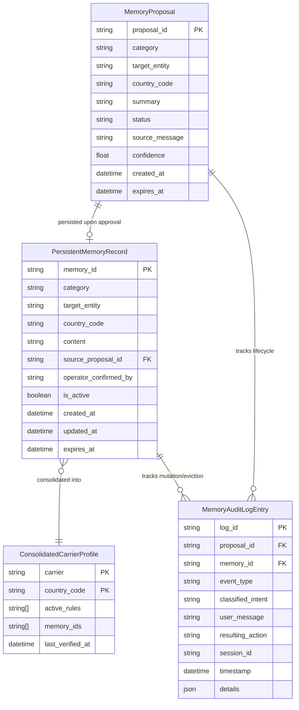
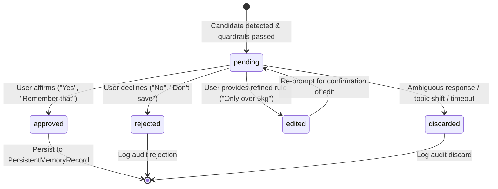

# Data Model: Agent Memory & Self-Improvement (Part 1 of 2)

**Feature**: `029-agent-memory-self-improvement`  
**Date**: 2026-11-21  
**Status**: Draft  

---

## 1. Domain Entities & Value Objects



---

## 2. Entity Specifications

### 2.1 MemoryProposal
Represents an in-flight, unconfirmed memory candidate produced during single-turn evaluation.

| Field | Type | Required | Description | Validation / Constraints |
|---|---|---|---|---|
| `proposal_id` | `str` (UUID) | Yes | Unique proposal identifier | Valid UUIDv4 |
| `category` | `MemoryCategory` | Yes | Category of candidate knowledge | `carrier_rule`, `incident_context`, `b2b_preference` |
| `target_entity` | `str` | Yes | Subject of rule (e.g. carrier name, client ID) | 1..100 chars, alphanumeric + hyphens/spaces |
| `country_code` | `Optional[str]` | No | ISO country code if region-specific | 2 chars uppercase (e.g., `"ES"`, `"US"`) |
| `summary` | `str` | Yes | Normalized rule summary proposed to operator | 5..300 chars, stripped |
| `status` | `ProposalStatus` | Yes | In-flight lifecycle state | `pending`, `approved`, `rejected`, `edited`, `discarded` |
| `source_message` | `str` | Yes | User snippet originating the candidate | Max 500 chars, sanitized |
| `confidence` | `float` | Yes | Self-evaluation confidence score | 0.0 .. 1.0 (threshold ≥ 0.75 for proposing) |
| `created_at` | `datetime` | Yes | UTC timestamp of proposal generation | ISO 8601 UTC |
| `expires_at` | `Optional[datetime]` | No | Auto-discard timeout if unaddressed | Default 15 minutes or turn-scoped |

#### State Transitions for MemoryProposal


---

### 2.2 PersistentMemoryRecord
Represents an approved, committed piece of operational memory in persistent storage.

| Field | Type | Required | Description | Validation / Constraints |
|---|---|---|---|---|
| `memory_id` | `str` (UUID) | Yes | Unique memory record identifier | Valid UUIDv4 |
| `category` | `MemoryCategory` | Yes | Functional knowledge category | `carrier_rule`, `incident_context`, `b2b_preference` |
| `target_entity` | `str` | Yes | Normalized target (e.g., `"SEUR"`, `"Zaragoza"`) | Normalized uppercase/titlecase |
| `country_code` | `Optional[str]` | No | Operating country code | e.g. `"ES"`, `"US"` |
| `content` | `str` | Yes | Verified operational rule content | 5..500 chars |
| `source_proposal_id` | `Optional[str]` | No | Link to originating proposal | UUIDv4 |
| `operator_confirmed_by`| `Optional[str]` | No | User/operator ID who confirmed | e.g. `"operator_zaragoza_1"` |
| `is_active` | `bool` | Yes | Whether the memory is active | Defaults to `True` |
| `created_at` | `datetime` | Yes | UTC timestamp of initial storage | ISO 8601 UTC |
| `updated_at` | `datetime` | Yes | UTC timestamp of last update/merge | ISO 8601 UTC |
| `expires_at` | `Optional[datetime]` | No | Expiration/TTL cutoff timestamp | Incident contexts default 14 days; carrier rules None |

---

### 2.3 ConsolidatedCarrierProfile
Aggregated domain view representing the unified operational rules for a carrier in a specific country.

| Field | Type | Required | Description | Validation / Constraints |
|---|---|---|---|---|
| `carrier` | `str` | Yes | Carrier identifier | e.g. `"SEUR"`, `"FedEx"`, `"GLS"` |
| `country_code` | `str` | Yes | Country ISO code | `"ES"` or `"US"` |
| `active_rules` | `List[str]` | Yes | Deduplicated list of active constraints | Max 20 items, max 250 chars per item |
| `memory_ids` | `List[str]` | Yes | Underlying persistent memory IDs | List of UUIDs |
| `last_verified_at` | `datetime` | Yes | Timestamp of most recent rule addition | ISO 8601 UTC |

---

### 2.4 MemoryAuditLogEntry
Immutable, append-only audit trail capturing every proposal decision, classification, and persistent storage change.

| Field | Type | Required | Description | Validation / Constraints |
|---|---|---|---|---|
| `log_id` | `str` (UUID) | Yes | Unique audit record identifier | Valid UUIDv4 |
| `proposal_id` | `Optional[str]` | No | Associated proposal UUID | Valid UUIDv4 |
| `memory_id` | `Optional[str]` | No | Associated memory UUID if committed | Valid UUIDv4 |
| `event_type` | `str` | Yes | Lifecycle event category | `proposed`, `approved`, `rejected`, `edited`, `discarded`, `evicted` |
| `classified_intent` | `Optional[str]` | No | Result of intent classification | `approve`, `reject`, `edit`, `unrelated_or_ambiguous` |
| `user_message` | `str` | Yes | Operator message triggering the event | Sanitized, zero PII |
| `resulting_action` | `str` | Yes | Concrete system action taken | `proposal_created`, `memory_persisted`, `proposal_discarded`, `proposal_edited`, `memory_evicted` |
| `session_id` | `Optional[str]` | No | Session or thread ID | Optional string |
| `timestamp` | `datetime` | Yes | UTC timestamp of event | ISO 8601 UTC |
| `details` | `Dict[str, Any]` | No | Structured metadata (guardrail checks, latencies) | JSON-serializable dictionary |

---

### 2.5 Supporting Value Objects

#### UserIntentClassification
```python
@dataclass(frozen=True)
class UserIntentClassification:
    intent: Literal["approve", "reject", "edit", "unrelated_or_ambiguous"]
    confidence: float
    refined_rule: Optional[str] = None
    residual_query: Optional[str] = None
```

#### MemoryGuardrailVerdict
```python
@dataclass(frozen=True)
class MemoryGuardrailVerdict:
    allowed: bool
    violation_code: Optional[str] = None  # e.g. "SENSITIVE_LOCATION", "ONE_OFF_COMPLAINT", "CONTRACT_NEGOTIATION", "POLICY_OVERRIDE"
    reason: Optional[str] = None
```

---

## 3. Storage Separation & Isolation Invariant

- **Qdrant Vector Database**: Strictly contains company reference knowledge (`trackflow_knowledge`). Read-only during agent query execution. Zero memory tables or points added here.
- **Agent Memory Persistence**: Located in dedicated `services/api/infrastructure/persistence/tinydb/` (`agent_memory.json` / `memory_audit_logs.json`) or separate database table.
- Invariant: `assert not any(op.target == "trackflow_knowledge" for op in memory_service.operations)`
