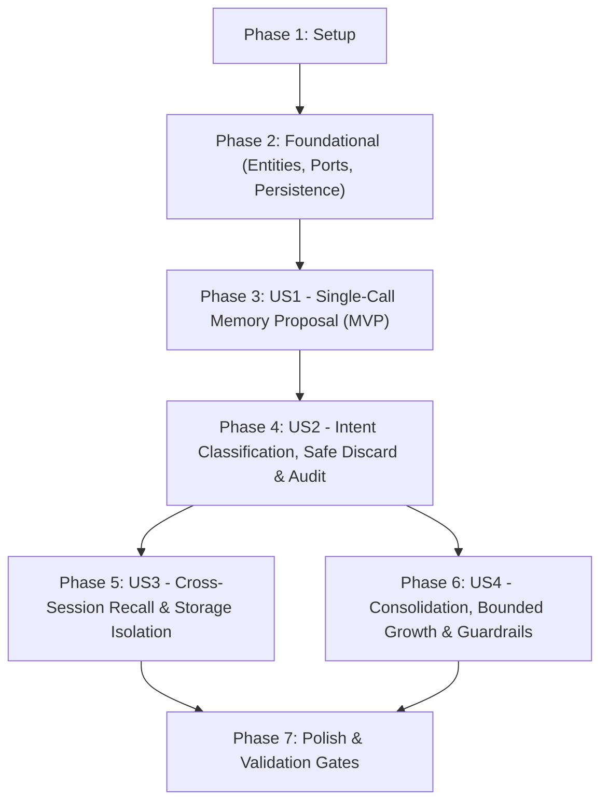

# Tasks: Agent Memory & Self-Improvement (Part 1 of 2)

**Input**: Design documents from `/specs/029-agent-memory-self-improvement/` (`spec.md`, `plan.md`, `data-model.md`, `research.md`, `contracts/`, `quickstart.md`)  
**Prerequisites**: `spec.md` (required for user stories), `plan.md` (required for architecture & tech stack), `data-model.md`, `contracts/`, `research.md`  
**Constitution Governance**: Monorepo Constitution Principles I (Hexagonal Boundaries), II (FastAPI Contract Serialization & Non-Blocking Async), IV (Defensive Error Handling & Zero PII Leaks), VI (Test-First Verification), and VII (Strict Vector Database / Qdrant Read-Only Isolation).

---

## Format: `[ID] [P?] [Story] Description`

- **[P]**: Can run in parallel (different files, no blocking dependencies on incomplete tasks)
- **[Story]**: Which user story this task belongs to (`[US1]`, `[US2]`, `[US3]`, `[US4]`)
- Exact file paths included in every task description.

---

## Phase 1: Setup (Shared Infrastructure)

**Purpose**: Project initialization, dependency verification, and repository structure preparation.

- [X] T001 Verify backend dependency setup and install required packages (`tinydb>=4.9.0`, `pydantic>=2.13.5`) via `uv` in `services/api/pyproject.toml`
- [X] T002 [P] Create initial directory structure for agent memory persistence in `services/api/infrastructure/persistence/tinydb/`

---

## Phase 2: Foundational (Blocking Prerequisites)

**Purpose**: Core domain entities, exceptions, abstract ports, and persistence adapters that MUST be complete before ANY user story can be implemented.

**⚠️ CRITICAL**: No user story work can begin until this phase is complete.

- [X] T003 Define memory domain entities and value objects (`MemoryCategory`, `ProposalStatus`, `MemoryProposal`, `PersistentMemoryRecord`, `ConsolidatedCarrierProfile`, `MemoryAuditLogEntry`) in `services/api/domain/agent/entities.py`
- [X] T004 [P] Define memory domain exceptions (`MemoryNotFoundError`, `MemoryGuardrailViolationError`, `MemoryStorageError`) in `services/api/domain/agent/exceptions.py`
- [X] T005 [P] Define domain ports (`AgentMemoryRepositoryPort`, `MemoryAuditLogRepositoryPort`, `MemoryGuardrailPort`, `UserIntentClassifierPort`) in `services/api/domain/agent/ports.py`
- [X] T006 Implement dedicated TinyDB memory repository adapter (`TinyDBAgentMemoryRepository`) adhering to `AgentMemoryRepositoryPort` in `services/api/infrastructure/persistence/tinydb/agent_memory_repository.py`
- [X] T007 [P] Implement dedicated TinyDB audit log repository adapter (`TinyDBMemoryAuditLogRepository`) adhering to `MemoryAuditLogRepositoryPort` in `services/api/infrastructure/persistence/tinydb/memory_audit_log_repository.py`
- [X] T008 [P] Define presentation schemas and DTOs for proposals, carrier profiles, audit entries, and feedback in `services/api/presentation/schemas/agent.py`
- [X] T009 Register memory repository and port providers in FastAPI dependency injection container in `services/api/presentation/dependencies.py`

**Checkpoint**: Foundation ready — domain models, ports, persistence adapters, and schemas are verified and ready for user story implementation.

---

## Phase 3: User Story 1 - Single-Call Memory Proposal on Operator Corrections (Priority: P1) 🎯 MVP

**Goal**: Enable the support agent to evaluate conversational turns, detect operational corrections (carrier routes, recurring incidents, B2B preferences), and propose saving context within the same turn (< 100ms overhead, zero secondary LLMs) while deferring persistence until confirmation.

**Independent Test**: Submit a carrier route correction for Zaragoza ("SEUR no longer covers the rural Zaragoza zone; local carriers must be used starting this month") and verify that the assistant returns a helpful conversational response, appends an explicit memory proposal prompt, emits a structured `memory_proposal` in the response DTO, and leaves persistent storage unmodified (record count = 0).

### Tests for User Story 1

> **NOTE: Write these tests FIRST, ensure they FAIL before implementation**

- [X] T010 [P] [US1] Unit test candidate detection, extraction heuristics, and structured single-call generation schemas in `services/api/tests/unit/test_memory_proposal_extractor.py`
- [X] T011 [P] [US1] Integration test for single-call candidate proposal generation and non-memorable query dismissal in `services/api/tests/integration/test_agent_memory_lifecycle.py`

### Implementation for User Story 1

- [X] T012 [US1] Implement candidate extraction and proposal generation logic in `services/api/application/services/memory_service.py`
- [X] T013 [US1] Integrate single-call generation and candidate proposal attachment into `generation_node` within `services/api/application/services/agent_workflow.py`
- [X] T014 [US1] Update `SupportAgentService` to coordinate proposal lifecycle without persisting unconfirmed proposals in `services/api/application/services/support_agent_service.py`
- [X] T015 [US1] Update query response endpoint to include `memory_proposal` payload in `services/api/presentation/api/v1/agent.py`

**Checkpoint**: At this point, User Story 1 is fully functional and independently testable as an MVP increment.

---

## Phase 4: User Story 2 - Explicit Intent Classification, Safe Defaults & Auditable Lifecycle (Priority: P1)

**Goal**: Classify follow-up user responses into explicit outcomes (`approve`, `reject`, `edit`, `unrelated_or_ambiguous`), default safely to discarding proposals on ambiguity or topic shifts, enforce a single-proposal queue, support same-turn residual query processing, and record every event in an immutable audit log.

**Independent Test**: Stage an active memory proposal, respond with an ambiguous message or topic switch (e.g. "Can you check inventory for SKU-401?"), and verify that the proposal is discarded, persistent memory storage remains unmodified, an audit log entry is recorded with `event_type="discarded"`, and the residual inventory question is answered in the same turn.

### Tests for User Story 2

> **NOTE: Write these tests FIRST, ensure they FAIL before implementation**

- [X] T016 [P] [US2] Unit test explicit intent classification (`approve`, `reject`, `edit`, `unrelated_or_ambiguous`) and safe default discard in `services/api/tests/unit/test_intent_classification.py`
- [X] T017 [P] [US2] Contract and unit test immutable audit logging transitions in `services/api/tests/contract/test_memory_audit_log.py`
- [X] T018 [P] [US2] Integration test proposal confirmation, rejection, edit, and same-turn multi-intent query continuation in `services/api/tests/integration/test_agent_memory_lifecycle.py`

### Implementation for User Story 2

- [X] T019 [US2] Implement `UserIntentClassifier` in `services/api/application/services/memory_service.py`
- [X] T020 [US2] Implement single active proposal queue enforcement (FR-012) in `services/api/application/services/memory_service.py`
- [X] T021 [US2] Integrate intent evaluation and proposal resolution (`approve`, `reject`, `edit`, `discard`) into `intake_node` within `services/api/application/services/agent_workflow.py`
- [X] T022 [US2] Implement multi-intent turn continuation (FR-015: resolve proposal and process residual operational query in same turn) in `services/api/application/services/agent_workflow.py`
- [X] T023 [US2] Wire immutable lifecycle audit logging (`proposed`, `approved`, `rejected`, `edited`, `discarded`) via `MemoryAuditLogRepositoryPort` in `services/api/application/services/support_agent_service.py`
- [X] T024 [US2] Implement proposal feedback/action REST endpoint (`POST /agent/proposals/{proposal_id}/feedback`) in `services/api/presentation/api/v1/agent.py`

**Checkpoint**: At this point, User Stories 1 AND 2 are complete, robust against false approvals, and fully auditable.

---

## Phase 5: User Story 3 - Cross-Session Memory Recall with Strict Storage Isolation (Priority: P1)

**Goal**: Automatically recall confirmed operational carrier rules, incident contexts, and client preferences in future sessions without querying company static documentation collections, keeping Qdrant static knowledge (`trackflow_knowledge`) 100% read-only.

**Independent Test**: Complete an approved memory cycle for a Zaragoza carrier rule, start a brand-new session (`thread_id="session_new_2"`), query carrier selection for rural Zaragoza, and verify the agent recommends local alternatives using recalled memory without executing any write operations against Qdrant collections.

### Tests for User Story 3

> **NOTE: Write these tests FIRST, ensure they FAIL before implementation**

- [X] T025 [P] [US3] Integration test verifying strict storage isolation (zero writes to Qdrant vector collections during memory lifecycle) in `services/api/tests/integration/test_memory_storage_isolation.py`
- [X] T026 [P] [US3] Integration test verifying cross-session memory recall and prompt integration in `services/api/tests/integration/test_agent_memory_lifecycle.py`

### Implementation for User Story 3

- [X] T027 [US3] Implement memory search and recall extraction methods in `services/api/application/services/memory_service.py`
- [X] T028 [US3] Add memory recall retrieval step to agent workflow state and system prompt generation in `services/api/application/services/agent_workflow.py`
- [X] T029 [US3] Ensure memory recall citations and contextual sources are exposed in response DTO in `services/api/presentation/api/v1/agent.py`
- [X] T030 [US3] Validate and enforce strict read-only guarantees on static Qdrant knowledge access within `services/api/application/services/support_agent_service.py`

**Checkpoint**: At this point, User Stories 1, 2, and 3 provide a complete cross-session operational memory loop with zero vector store pollution.

---

## Phase 6: User Story 4 - Memory Consolidation, Bounded Growth & Anti-Poisoning Protection (Priority: P2)

**Goal**: Consolidate memory records by carrier and country, enforce bounded growth policies (max 20 constraints per profile, 14-day incident TTL), and apply strict anti-poisoning guardrails against sensitive customer locations and warehouse floor security data.

**Independent Test**: Submit duplicate carrier notes and verify they consolidate into a unified profile (`max 20 rules`). Submit input with sensitive end-consumer B2C physical addresses or internal warehouse floor routes, and verify that guardrails reject candidate creation with zero sensitive data persisted.

### Tests for User Story 4

> **NOTE: Write these tests FIRST, ensure they FAIL before implementation**

- [X] T031 [P] [US4] Unit test anti-poisoning guardrails and sensitive data rejection (B2C addresses, warehouse paths, unverified contracts) in `services/api/tests/unit/test_memory_guardrails.py`
- [X] T032 [P] [US4] Unit test carrier-country memory consolidation, deduplication, and TTL expiration logic in `services/api/tests/unit/test_memory_consolidation.py`

### Implementation for User Story 4

- [X] T033 [US4] Implement sensitive data filtering and anti-poisoning guardrails (`MemoryGuardrailValidator`) in `services/api/application/services/memory_guardrails.py`
- [X] T034 [US4] Integrate guardrail validation into candidate evaluation pipeline in `services/api/application/services/memory_service.py`
- [X] T035 [US4] Implement carrier-country profile consolidation logic (grouping by carrier + country, max 20 constraints) in `services/api/application/services/memory_service.py`
- [X] T036 [US4] Implement TTL eviction routine (14-day default for incident contexts) in `services/api/application/services/memory_service.py`
- [X] T037 [US4] Implement carrier profile and audit log inspection REST endpoints (`GET /memory/carriers/{carrier}/{country_code}`, `GET /memory/audit-logs`) in `services/api/presentation/api/v1/memory.py`

**Checkpoint**: All user stories are complete, consolidated, protected against poisoning, and bounded against memory growth.

---

## Phase 7: Polish & Cross-Cutting Concerns

**Purpose**: Verification against quickstart scenarios, code cleanup, and documentation alignment.

- [X] T038 [P] Execute and validate all scenarios from `specs/029-agent-memory-self-improvement/quickstart.md`
- [X] T039 [P] Update OpenAPI specifications and route documentation in `specs/029-agent-memory-self-improvement/contracts/agent-memory-api.yaml`
- [X] T040 Verify monorepo quality gates, static type compliance, and zero test regressions across `services/api/tests/`

---

## Dependencies & Execution Order

### Phase Dependencies

- **Setup (Phase 1)**: No dependencies — executes immediately.
- **Foundational (Phase 2)**: Depends on Phase 1 — BLOCKS all user stories.
- **User Story 1 (Phase 3)**: Depends on Phase 2 — MVP delivery.
- **User Story 2 (Phase 4)**: Depends on Phase 2 & Phase 3 (evaluates follow-up to US1 proposals).
- **User Story 3 (Phase 5)**: Depends on Phase 2 & Phase 4 (recalls persisted memories created by US2).
- **User Story 4 (Phase 6)**: Depends on Phase 2 & Phase 4 (consolidates and safeguards persisted memories).
- **Polish (Phase 7)**: Depends on all user stories being complete.

### User Story Dependencies



### Within Each User Story

1. Tests MUST be written first and fail prior to implementation.
2. Domain entities and ports before services.
3. Services before endpoints and workflow nodes.
4. Story complete and validated before advancing to dependent stories.

---

## Parallel Opportunities

- **Phase 1**: T001 and T002 can run in parallel.
- **Phase 2**: T004, T005, T007, T008 can run in parallel once T003 begins.
- **Phase 3 (US1)**: Tests T010 and T011 can run in parallel.
- **Phase 4 (US2)**: Tests T016, T017, and T018 can run in parallel.
- **Phase 5 (US3)**: Tests T025 and T026 can run in parallel.
- **Phase 6 (US4)**: Tests T031 and T032 can run in parallel.
- **Phase 7**: T038 and T039 can run in parallel.

---

## Parallel Example: User Story 1

```bash
# Launch test tasks for User Story 1 in parallel:
Task: "Unit test candidate detection in services/api/tests/unit/test_memory_proposal_extractor.py"
Task: "Integration test for single-call candidate proposal in services/api/tests/integration/test_agent_memory_lifecycle.py"
```

## Parallel Example: User Story 4

```bash
# Launch test tasks for User Story 4 in parallel:
Task: "Unit test anti-poisoning guardrails in services/api/tests/unit/test_memory_guardrails.py"
Task: "Unit test carrier-country memory consolidation in services/api/tests/unit/test_memory_consolidation.py"
```

---

## Implementation Strategy

### MVP First (User Story 1 Only)

1. Complete Phase 1: Setup.
2. Complete Phase 2: Foundational.
3. Complete Phase 3: User Story 1 (Single-Call Proposal Generation).
4. **STOP and VALIDATE**: Verify route corrections generate proposals with deferred persistence.

### Incremental Delivery

1. Setup + Foundational → Foundation verified.
2. Add US1 → Single-call candidate proposals functioning (MVP).
3. Add US2 → Intent classification, safe default discard, and immutable audit logging.
4. Add US3 → Cross-session memory recall and strict Qdrant read-only storage isolation.
5. Add US4 → Anti-poisoning guardrails and carrier-country profile consolidation.
6. Polish → Quickstart scenario validation and static type analysis gates.
