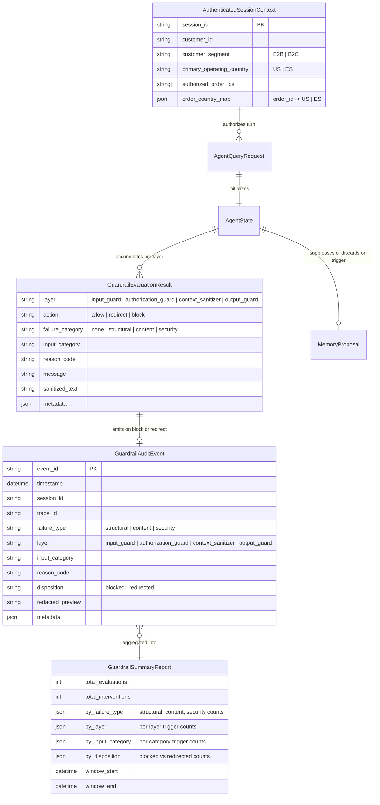
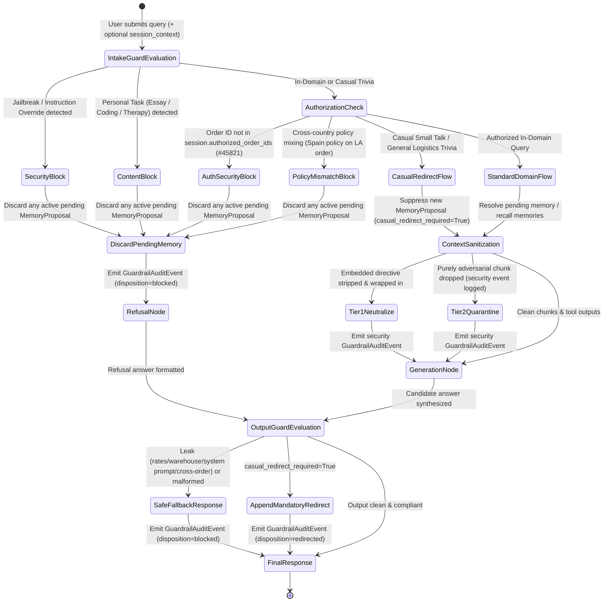

# Data Model: Agent Harnessing & Guardrails (Part 2 of 2)

**Feature**: `030-agent-guardrails` (`feature/agent-guardrails`)  
**Date**: 2026-11-21  
**Status**: Completed  

---

## 1. Entity Relationship Diagram



---

## 2. Domain Type Aliases & Enumerations

Defined in `services/api/domain/agent/entities.py`:

```python
GuardrailLayer = Literal[
    "input_guard",
    "authorization_guard",
    "context_sanitizer",
    "output_guard",
]

GuardrailAction = Literal["allow", "redirect", "block"]

GuardrailFailureCategory = Literal["none", "structural", "content", "security"]

GuardrailFailureType = Literal["structural", "content", "security"]

GuardrailDisposition = Literal["blocked", "redirected"]

GuardrailInputCategory = Literal[
    "in_domain",
    "casual_trivia",
    "personal_task",
    "jailbreak_attempt",
    "unauthorized_order",
    "policy_mismatch",
    "restricted_data_leak",
    "external_injection",
    "malformed_output",
]

CustomerSegment = Literal["B2B", "B2C"]

OperatingCountry = Literal["US", "ES"]
```

---

## 3. Entity Specifications

### 3.1 AuthenticatedSessionContext
Represents the caller's verified identity, operational jurisdiction, and authorized order scope for a conversation turn (FR-007, FR-008).

| Field | Type | Required | Description | Validation / Constraints |
|---|---|---|---|---|
| `session_id` | `str` | Yes | Unique session or thread identifier | Non-empty string, 1..128 chars |
| `customer_id` | `str` | Yes | Authenticated customer or brand account ID | Non-empty string, 1..128 chars |
| `customer_segment` | `CustomerSegment` | Yes | Customer business classification | `"B2B"` or `"B2C"` (default `"B2C"`) |
| `primary_operating_country` | `OperatingCountry` | Yes | Default operating country for session | `"US"` or `"ES"` (default `"US"`) |
| `authorized_order_ids` | `Tuple[str, ...]` | Yes | List of order/tracking IDs owned by this session | Normalized uppercase/digits without leading `#` |
| `order_country_map` | `Dict[str, OperatingCountry]` | No | Authoritative per-order country mapping (`order_id -> "US" \| "ES"`) | Keys normalized to match `authorized_order_ids` |

**Helper Methods**:
- `is_order_authorized(order_id: str) -> bool`: Normalizes `order_id` (stripping leading `#`, whitespace, and case-folding) and checks membership in `authorized_order_ids`.
- `resolve_order_country(order_id: Optional[str], explicit_location_country: Optional[OperatingCountry] = None) -> OperatingCountry`: Resolves authoritative country from `order_country_map[normalized_id]`, then `explicit_location_country`, falling back to `primary_operating_country`.

---

### 3.2 GuardrailEvaluationResult
Represents the deterministic decision produced by an input, authorization, context-sanitization, or output guardrail layer (FR-003).

| Field | Type | Required | Description | Validation / Constraints |
|---|---|---|---|---|
| `layer` | `GuardrailLayer` | Yes | Guardrail layer that produced the decision | `input_guard`, `authorization_guard`, `context_sanitizer`, `output_guard` |
| `action` | `GuardrailAction` | Yes | Enforcement action taken | `allow`, `redirect`, `block` |
| `failure_category` | `GuardrailFailureCategory` | Yes | Failure classification (`none` when `action == "allow"` without trigger) | `none`, `structural`, `content`, `security` |
| `input_category` | `GuardrailInputCategory` | Yes | Semantic classification of the input/content | e.g., `in_domain`, `casual_trivia`, `personal_task`, `jailbreak_attempt`, `unauthorized_order`, `policy_mismatch`, `restricted_data_leak`, `external_injection`, `malformed_output` |
| `reason_code` | `str` | Yes | Machine-readable rule identifier | e.g., `DIRECT_INSTRUCTION_OVERRIDE`, `ROLEPLAY_JAILBREAK`, `PERSONAL_TASK_ESSAY`, `CASUAL_TRIVIA_REDIRECT`, `UNAUTHORIZED_ORDER_ACCESS`, `CROSS_COUNTRY_POLICY_MIXING`, `RAG_DIRECTIVE_STRIPPED`, `RAG_CHUNK_QUARANTINED`, `RESTRICTED_CARRIER_RATE_LEAK`, `WAREHOUSE_SECURITY_LEAK`, `SYSTEM_PROMPT_LEAK` |
| `message` | `Optional[str]` | No | Refusal message, fallback response, or mandatory redirect clause | Bilingual-aware user-safe message |
| `sanitized_text` | `Optional[str]` | No | Cleaned/wrapped text (used by `context_sanitizer` and `output_guard`) | Passive-delimited or redacted text |
| `resolved_country` | `Optional[OperatingCountry]` | No | Authoritative jurisdiction (`"US"` or `"ES"`) when resolved | `"US"` or `"ES"` |
| `metadata` | `Dict[str, Any]` | No | Additional structured context | JSON-serializable dictionary |

---

### 3.3 GuardrailAuditEvent
Represents an immutable, structured observability record logged whenever a guardrail blocks or redirects a turn or external chunk (FR-011).

| Field | Type | Required | Description | Validation / Constraints |
|---|---|---|---|---|
| `event_id` | `str` (UUID) | Yes | Unique audit event identifier | Valid UUIDv4 |
| `timestamp` | `datetime` | Yes | UTC timestamp of the intervention | ISO 8601 UTC |
| `session_id` | `str` | Yes | Session or thread identifier | Non-empty string |
| `trace_id` | `Optional[str]` | No | Correlated LangGraph execution trace UUID | UUIDv4 string |
| `failure_type` | `GuardrailFailureType` | Yes | Primary failure classification | `structural`, `content`, or `security` |
| `layer` | `GuardrailLayer` | Yes | Specific guardrail layer triggered | `input_guard`, `authorization_guard`, `context_sanitizer`, `output_guard` |
| `input_category` | `GuardrailInputCategory` | Yes | Specific violation or routing category | See `GuardrailInputCategory` |
| `reason_code` | `str` | Yes | Machine-readable trigger rule code | Uppercase snake_case identifier |
| `disposition` | `GuardrailDisposition` | Yes | Enforcement outcome | `blocked` or `redirected` |
| `redacted_preview` | `str` | Yes | Sanitized preview snippet | Max 200 chars; PII, carrier rates, warehouse routes, unauthorized order details, and system prompt fragments masked |
| `metadata` | `Dict[str, Any]` | No | Additional non-sensitive classification metadata | JSON-serializable dictionary |

---

### 3.4 GuardrailSummaryReport
Aggregated observability metric view returned by `GET /api/v1/agent/guardrails/summary` and the CLI summary helper (FR-012).

| Field | Type | Required | Description | Validation / Constraints |
|---|---|---|---|---|
| `total_evaluations` | `int` | Yes | Total turns/items evaluated across guardrail layers | $\ge 0$ |
| `total_interventions` | `int` | Yes | Total guardrail blocks and mandatory redirections recorded | $\ge 0$ |
| `by_failure_type` | `Dict[str, int]` | Yes | Trigger counts keyed by `"structural"`, `"content"`, `"security"` | Always contains all 3 keys (default `0`) |
| `by_layer` | `Dict[str, int]` | Yes | Trigger counts keyed by `"input_guard"`, `"authorization_guard"`, `"context_sanitizer"`, `"output_guard"` | Always contains all 4 keys (default `0`) |
| `by_input_category` | `Dict[str, int]` | Yes | Trigger counts keyed by `GuardrailInputCategory` | Dictionary of category counts |
| `by_disposition` | `Dict[str, int]` | Yes | Trigger counts keyed by `"blocked"` and `"redirected"` | Always contains both keys (default `0`) |
| `window_start` | `Optional[datetime]` | No | Timestamp of earliest recorded event in scope | ISO 8601 UTC or `None` |
| `window_end` | `Optional[datetime]` | No | Timestamp of latest recorded event in scope | ISO 8601 UTC or `None` |
| `recent_events` | `List[GuardrailAuditEvent]` | Yes | Up to 50 most recent `GuardrailAuditEvent` records | Ordered newest first |

---

## 4. Guardrail State Transitions & Memory Interaction



---

## 5. Extended `AgentState` Contract

`AgentState` in `services/api/domain/agent/entities.py` is extended with the following optional fields while maintaining full backward compatibility with existing nodes:

```python
class AgentState(TypedDict, total=False):
    # ... existing fields from Milestone 7 & Milestone 8 Part 1 ...
    session_context: Optional[AuthenticatedSessionContext]
    resolved_country: Optional[OperatingCountry]
    guardrail_action: Optional[GuardrailAction]
    guardrail_failure_category: Optional[GuardrailFailureCategory]
    guardrail_reason_code: Optional[str]
    guardrail_message: Optional[str]
    casual_redirect_required: bool
    guardrail_events: List[GuardrailAuditEvent]
```
