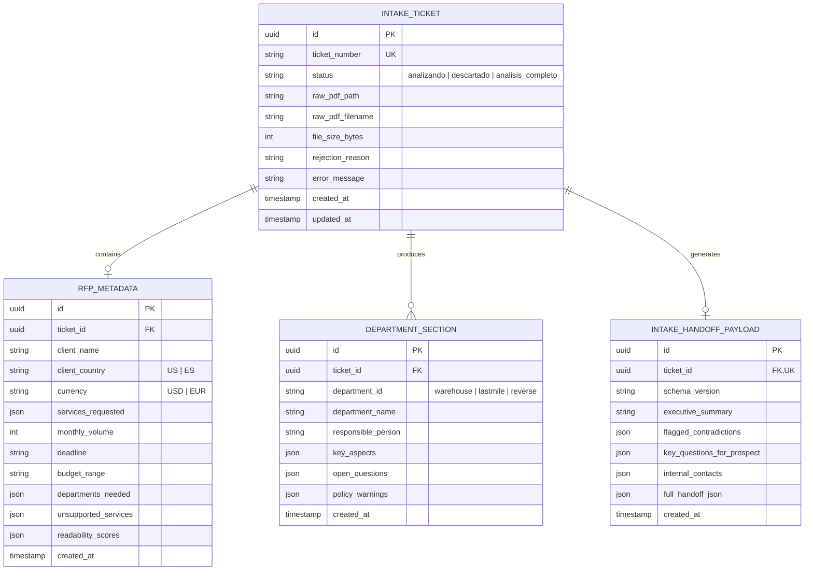
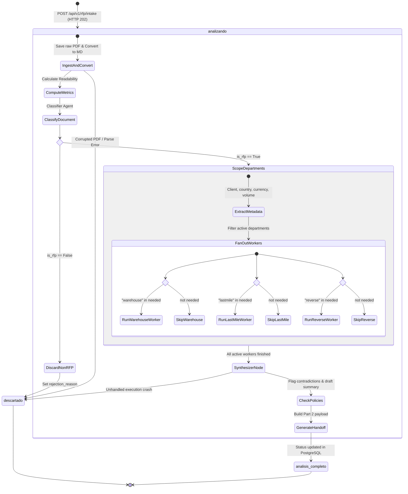

# Data Model: RFP Intake & Agentic Analysis Pipeline (Part 1 of 3)

**Feature Branch**: `031-rfp-intake`  
**Date**: 2026-11-21  
**Status**: Completed  
**Spec Reference**: `specs/031-rfp-intake/spec.md`

---

## Entity Relationship Diagram



---

## 1. Domain Entities & Value Objects

### 1.1 `IntakeTicket`
Represents the root lifecycle of an ingested RFP proposal document.

| Field | Type | Required | Description | Constraints / Validation |
|---|---|---|---|---|
| `id` | `UUID` | Yes | Unique identifier of the ticket | RFC 4122 UUID v4 |
| `ticket_number` | `str` | Yes | Human-readable identifier | Pattern: `^RFP-\d{4}-\d{3,}$` (e.g. `RFP-2026-001`) |
| `status` | `TicketStatus` | Yes | Current processing status | `analizando`, `descartado`, `analisis_completo` |
| `raw_pdf_path` | `str` | Yes | Relative or absolute path in `data/raw/` | Must exist on disk upon creation |
| `raw_pdf_filename` | `str` | Yes | Original uploaded file name | Max 255 chars, `.pdf` extension |
| `file_size_bytes` | `int` | Yes | Size of uploaded file in bytes | `> 0` and `<= 25 * 1024 * 1024` (25MB limit) |
| `rejection_reason` | `Optional[str]` | No | Explanation if rejected by classifier | Populated when `status == descartado` |
| `error_message` | `Optional[str]` | No | Diagnostic error if pipeline crashed | Sanitized string, no raw stack traces exposed to client |
| `created_at` | `datetime` | Yes | Timestamp when upload was accepted | UTC timezone |
| `updated_at` | `datetime` | Yes | Timestamp of last status change | UTC timezone |

**Status Aliases & Mapping**:
- `analizando` ↔ `analyzing`
- `descartado` ↔ `discarded`
- `analisis_completo` ↔ `intake_complete`

---

### 1.2 `RFPMetadata`
Extracted high-level commercial parameters and readability scores.

| Field | Type | Required | Description | Constraints / Validation |
|---|---|---|---|---|
| `id` | `UUID` | Yes | Primary key | UUID v4 |
| `ticket_id` | `UUID` | Yes | Foreign key to `IntakeTicket` | Foreign Key, Unique |
| `client_name` | `str` | Yes | Name of prospective client organization | Non-empty string |
| `client_country` | `Literal["US", "ES"]` | Yes | Country where services will operate | Strictly `US` or `ES` per briefing |
| `currency` | `Literal["USD", "EUR"]` | Yes | Operating currency | `USD` if US, `EUR` if ES |
| `services_requested` | `List[str]` | Yes | List of requested logistics services | e.g. `["warehousing", "reverse_logistics"]` |
| `monthly_volume` | `Optional[int]` | No | Expected monthly order volume | Must be `> 0` if present, `None` if unspecified |
| `deadline` | `Optional[str]` | No | Proposal submission deadline | ISO string or descriptive deadline |
| `budget_range` | `Optional[str]` | No | Client budget indication | e.g. "$10k-$15k/month" or `None` |
| `departments_needed` | `List[str]` | Yes | Fulfillment departments required | Subset of `["warehouse", "lastmile", "reverse"]` |
| `unsupported_services` | `List[str]` | Yes | Requested services not covered by TrackFlow | e.g. `["cold_storage", "customs_clearance"]` |
| `readability_scores` | `ReadabilityScores` | Yes | Embedded metrics | Object with `reading_ease`, `grade_level`, etc. |
| `created_at` | `datetime` | Yes | Extraction timestamp | UTC timezone |

**ReadabilityScores Value Object**:
```python
class ReadabilityScores(BaseModel):
    flesch_reading_ease: float  # e.g. 54.2
    flesch_kincaid_grade: float  # e.g. 10.4
    reading_level_label: str  # e.g. "Difficult", "Standard", "Easy"
    word_count: int  # e.g. 1250
    sentence_count: int  # e.g. 68
```

---

### 1.3 `DepartmentSection`
Structured domain evaluation produced by a department worker.

| Field | Type | Required | Description | Constraints / Validation |
|---|---|---|---|---|
| `id` | `UUID` | Yes | Primary key | UUID v4 |
| `ticket_id` | `UUID` | Yes | Foreign key to `IntakeTicket` | Foreign Key |
| `department_id` | `Literal["warehouse", "lastmile", "reverse"]` | Yes | Department identifier | Enum |
| `department_name` | `str` | Yes | Full department title | e.g. "Operaciones de Almacén" |
| `responsible_person` | `str` | Yes | Department lead name | `Ana Whitfield`, `Carlos Vega`, or `Sofía Ramos` |
| `key_aspects` | `Dict[str, Any]` | Yes | Operational parameters & cost drivers | Strongly typed JSON schema |
| `open_questions` | `List[str]` | Yes | Unspecified or missing operational data | Zero-hallucination list |
| `policy_warnings` | `List[str]` | Yes | Operational policy caveats | Specific department rules |
| `created_at` | `datetime` | Yes | Evaluation timestamp | UTC timezone |

**Department Key Aspects Structure**:
- **Warehouse (`warehouse`)**:
  - `pallet_storage_required`: Optional[int]
  - `sku_count`: Optional[int]
  - `special_handling`: List[str] (e.g., fragile, cosmetics, temperature)
  - `warehouse_location_preference`: "Los Ángeles" | "Zaragoza" | "Ambos"
  - `onboarding_complexity`: "Baja" | "Media" | "Alta"
- **Last Mile (`lastmile`)**:
  - `carrier_strategy`: "TrackFlow Network" | "Client Managed" | "Hybrid"
  - `delivery_sla_requested`: Optional[str] (e.g., "24-48h", "3-5 días")
  - `geographic_scope`: "Domestic US" | "Domestic ES" | "Cross-Border"
  - `special_delivery_requirements`: List[str]
- **Reverse Logistics (`reverse`)**:
  - `return_window_days`: Optional[int] (TrackFlow standard is 30 days)
  - `estimated_return_rate`: Optional[float] (e.g., 0.20 for 20%)
  - `inspection_required`: bool
  - `disposition_flow`: List[str] (reventa, reacondicionamiento, descarte)

---

### 1.4 `IntakeHandoffPayload`
The canonical, immutable handoff payload passed to Part 2 (Proposal Generation).

| Field | Type | Required | Description | Constraints / Validation |
|---|---|---|---|---|
| `id` | `UUID` | Yes | Primary key | UUID v4 |
| `ticket_id` | `UUID` | Yes | Foreign key to `IntakeTicket` | Foreign Key, Unique |
| `schema_version` | `str` | Yes | Handoff schema version | Semantic version (e.g. `1.0.0`) |
| `executive_summary` | `str` | Yes | Consolidated commercial synthesis for Sales | Markdown text |
| `flagged_contradictions` | `List[str]` | Yes | Cross-department or policy conflicts | Empty list if no conflicts |
| `key_questions_for_prospect` | `List[str]` | Yes | Consolidated client clarification questions | Deduplicated list |
| `internal_contacts` | `List[InternalContact]` | Yes | Recommended internal contacts | Name, role, email |
| `full_handoff_json` | `Dict[str, Any]` | Yes | Complete serialized bundle for Part 2 | Complies with handoff JSON Schema |
| `created_at` | `datetime` | Yes | Synthesis timestamp | UTC timezone |

---

## 2. State Machine & Transitions



### Transition Invariants
1. **Initial State**: All uploaded tickets start in `analizando` with HTTP 202 response.
2. **Terminal Discard**: If classified as non-RFP or if unrecoverable conversion failure occurs, status transitions to `descartado`. Pipeline stops immediately; no worker nodes execute.
3. **Department Scoping**: Only departments matching `departments_needed` execute.
4. **Zero Orphan State**: All unhandled exceptions in the background thread catch inside a global boundary and set status to `descartado` with an error message, preventing tickets from hanging in `analizando`.
5. **Terminal Success**: Status transitions to `analisis_completo` only after all active workers complete, the synthesizer compiles the executive summary, and the handoff payload is committed to database.
