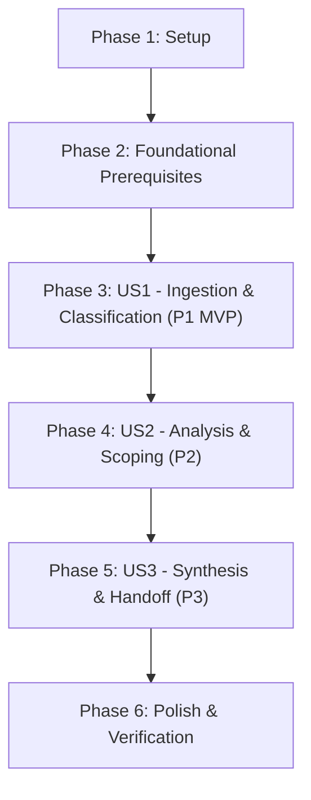

# Tasks: RFP Intake & Agentic Analysis Pipeline (Part 1 of 3)

**Input**: Design documents from `specs/031-rfp-intake/`  
**Prerequisites**: [plan.md](file:///j:/GitHub/mr-stegmann-ai-engineering-company-project-monorepo/specs/031-rfp-intake/plan.md), [spec.md](file:///j:/GitHub/mr-stegmann-ai-engineering-company-project-monorepo/specs/031-rfp-intake/spec.md), [research.md](file:///j:/GitHub/mr-stegmann-ai-engineering-company-project-monorepo/specs/031-rfp-intake/research.md), [data-model.md](file:///j:/GitHub/mr-stegmann-ai-engineering-company-project-monorepo/specs/031-rfp-intake/data-model.md), [contracts/](file:///j:/GitHub/mr-stegmann-ai-engineering-company-project-monorepo/specs/031-rfp-intake/contracts/)

---

## Phase 1: Setup (Shared Infrastructure)

**Purpose**: Project initialization, dependency verification, and shared type definitions.

- [X] T001 Configure backend dependencies (`langgraph`, `pypdf`, `textstat`) in `services/api/pyproject.toml`
- [X] T002 [P] Create persistent raw document storage directory in `data/raw/.gitkeep`
- [X] T003 [P] Define shared TypeScript interfaces and DTOs for RFP intake, metadata, and handoff in `packages/shared/types/rfp.ts`
- [X] T004 Export shared RFP types in `packages/shared/types/index.ts`

---

## Phase 2: Foundational (Blocking Prerequisites)

**Purpose**: Core domain entities, persistence adapters, and base contracts that MUST be complete before ANY user story can be implemented.

**⚠️ CRITICAL**: No user story work can begin until this phase is complete.

- [X] T005 [P] Implement RFP domain entities, value objects, and TicketStatus enum in `services/api/domain/rfp/entities.py`
- [X] T006 [P] Implement custom domain exceptions (`NonRFPError`, `DocumentParseError`, `TicketNotFoundError`) in `services/api/domain/rfp/exceptions.py`
- [X] T007 [P] Define domain repository and adapter ports (`IntakeTicketRepositoryPort`, `DocumentConverterPort`, `ReadabilityCalculatorPort`) in `services/api/domain/rfp/ports.py`
- [X] T008 [P] Implement `PdfToMarkdownAdapter` using `pypdf` with markdown formatting in `services/api/infrastructure/adapters/pdf_to_markdown_adapter.py`
- [X] T009 [P] Implement `TextstatReadabilityAdapter` for Flesch Reading Ease and Grade Level in `services/api/infrastructure/adapters/textstat_readability.py`
- [X] T010 Implement SQLModel database table schemas for tickets, metadata, department sections, and handoff payloads in `services/api/infrastructure/persistence/sqlmodel/models.py`
- [X] T011 Implement `SQLModelIntakeTicketRepository` adapting `IntakeTicketRepositoryPort` in `services/api/infrastructure/persistence/sqlmodel/rfp_repository.py`
- [X] T012 [P] Implement Pydantic REST API request and response schemas matching OpenAPI contract in `services/api/presentation/schemas/rfp.py`

**Checkpoint**: Foundation ready - user story implementation can now begin.

---

## Phase 3: User Story 1 - Asynchronous Ingestion & Document Validity Screening (Priority: P1) 🎯 MVP

**Goal**: Ingest PDF proposals via API and UI, immediately return HTTP 202 with ticket ID, convert to Markdown, compute readability metrics, screen with Classifier Agent, and cleanly discard non-RFPs (such as vendor pitches or spam) with logged reasons.

**Independent Test**: Upload `trackflow-request-3.pdf` via CLI or UI: returns immediate HTTP 202, transitions to `analizando`, and terminates at Classifier Agent with final status `descartado` and an explicit rejection reason logged in ticket record.

### Tests for User Story 1 ⚠️

> **NOTE: Write these tests FIRST, ensure they FAIL before implementation**

- [X] T013 [P] [US1] Unit test for PDF conversion and readability metric calculation in `services/api/tests/unit/test_rfp_converter_and_readability.py`
- [X] T014 [P] [US1] Unit test for Classifier Agent screening valid RFPs vs non-RFPs in `services/api/tests/unit/agent/test_rfp_classifier.py`
- [X] T015 [P] [US1] Integration test for asynchronous ingestion endpoint and status polling in `services/api/tests/integration/test_rfp_intake_api.py`

### Implementation for User Story 1

- [X] T016 [US1] Implement Classifier Agent for RFP validity determination and rejection reasons in `services/api/application/agent/rfp_classifier_agent.py`
- [X] T017 [US1] Implement LangGraph state initialization, conversion, and classification pipeline in `services/api/application/agent/rfp_intake_pipeline.py`
- [X] T018 [US1] Implement FastAPI routes for `POST /api/v1/rfp/intake` (HTTP 202) and `GET /api/v1/rfp/tickets` in `services/api/presentation/api/v1/rfp.py`
- [X] T019 [US1] Register RFP intake router with dependency injection in `services/api/main.py`
- [X] T020 [P] [US1] Implement `TicketStatusBadge` UI component in `uis/backoffice/components/rfp/TicketStatusBadge.tsx`
- [X] T021 [P] [US1] Implement drag-and-drop `RFPUploadForm` component in `uis/backoffice/components/rfp/RFPUploadForm.tsx`
- [X] T022 [US1] Implement RFP intake dashboard and ticket polling view in `uis/backoffice/app/rfp/page.tsx`

**Checkpoint**: At this point, User Story 1 is fully functional and delivers an end-to-end MVP.

---

## Phase 4: User Story 2 - Automated RFP Analysis, Metadata Extraction & Department Scoping (Priority: P2)

**Goal**: Extract standardized commercial metadata (`client_name`, `client_country`, `currency`, `monthly_volume`, `deadline`) and scope execution strictly to needed departments (`warehouse`, `lastmile`, `reverse`). Workers evaluate domain requirements with zero fabrication, capturing unknowns in `open_questions`.

**Independent Test**: Process `trackflow-request-1.pdf` (ModaViva Spain): verify country is Spain (`ES`), currency is `EUR`, scopes only `warehouse` and `reverse` (bypassing `lastmile`), and captures missing pallet count in `open_questions`.

### Tests for User Story 2 ⚠️

- [X] T023 [P] [US2] Unit test for Orchestrator Agent metadata extraction and department scoping in `services/api/tests/unit/agent/test_rfp_orchestrator.py`
- [X] T024 [P] [US2] Unit test for Warehouse, Last Mile, and Reverse Logistics workers zero-hallucination guardrail in `services/api/tests/unit/agent/test_rfp_department_workers.py`

### Implementation for User Story 2

- [X] T025 [US2] Implement Orchestrator Agent for commercial metadata extraction and department scoping in `services/api/application/agent/rfp_orchestrator_agent.py`
- [X] T026 [P] [US2] Implement Warehouse, Last Mile, and Reverse Logistics department workers with open questions capture in `services/api/application/agent/rfp_department_workers.py`
- [X] T027 [US2] Wire conditional department worker fan-out into LangGraph pipeline in `services/api/application/agent/rfp_intake_pipeline.py`
- [X] T028 [US2] Persist extracted RFPMetadata and DepartmentSections via SQLModel repository in `services/api/infrastructure/persistence/sqlmodel/rfp_repository.py`
- [X] T029 [P] [US2] Implement `ReadabilityMetricCard` UI gauge component in `uis/backoffice/components/rfp/ReadabilityMetricCard.tsx`
- [X] T030 [P] [US2] Implement `DepartmentKeyAspectsCard` tabs component in `uis/backoffice/components/rfp/DepartmentKeyAspectsCard.tsx`

**Checkpoint**: At this point, User Stories 1 AND 2 work independently with full department analysis.

---

## Phase 5: User Story 3 - Synthesis Report & Part 2 Handoff Generation (Priority: P3)

**Goal**: Synthesizer Agent aggregates findings, checks against TrackFlow company policies (`trackflow-returns-policy.es.md`, `trackflow-sla-delivery.es.md`, `trackflow-storage-pricing.es.md`), flags contradictions, compiles an executive briefing for Sales, updates status to `analisis_completo`, and persists Part 2 handoff payload.

**Independent Test**: Query completed ticket `/api/v1/rfp/tickets/{ticket_id}/handoff`: verify status `analisis_completo`, all active department key aspects persisted, synthesis summary populated, and handoff payload conforms to schema.

### Tests for User Story 3 ⚠️

- [X] T031 [P] [US3] Unit test for Synthesizer Agent policy evaluation, contradiction flagging, and sales briefing in `services/api/tests/unit/agent/test_rfp_synthesizer.py`
- [X] T032 [P] [US3] Integration test for canonical Part 2 handoff payload endpoint in `services/api/tests/integration/test_rfp_handoff_api.py`

### Implementation for User Story 3

- [X] T033 [US3] Implement Synthesizer Agent evaluating TrackFlow company policies and drafting executive synthesis in `services/api/application/agent/rfp_synthesizer_agent.py`
- [X] T034 [US3] Implement handoff generation, persistence, and ticket transition to `analisis_completo` in `services/api/application/agent/rfp_intake_pipeline.py`
- [X] T035 [US3] Implement `GET /api/v1/rfp/tickets/{ticket_id}/handoff` endpoint in `services/api/presentation/api/v1/rfp.py`
- [X] T036 [P] [US3] Implement `HandoffJsonViewer` preview component in `uis/backoffice/components/rfp/HandoffJsonViewer.tsx`
- [X] T037 [US3] Implement ticket analysis detail page with executive briefing, open questions, and handoff preview in `uis/backoffice/app/rfp/[id]/page.tsx`

**Checkpoint**: All user stories are now independently functional and the Part 2 handoff payload is available.

---

## Phase 6: Polish & Cross-Cutting Concerns

**Purpose**: System-wide test suite verification, build health, type integrity, and documentation.

- [X] T038 [P] Implement frontend component and integration tests in `uis/backoffice/__tests__/rfp.test.tsx`
- [X] T039 Run and validate end-to-end validation scenarios per quickstart.md (`trackflow-request-1.pdf`, `trackflow-request-2.pdf`, `trackflow-request-3.pdf`)
- [X] T040 Verify static typing across workspace packages with `npm run typecheck`
- [X] T041 Execute complete backend test suite with `pytest` in `services/api/`
- [X] T042 Verify documentation consistency across `specs/031-rfp-intake/` and update monorepo navigation

---

## Dependencies & Execution Order

### Phase Dependencies



- **Setup (Phase 1)**: No dependencies - can start immediately.
- **Foundational (Phase 2)**: Depends on Setup completion - BLOCKS all user stories.
- **User Story 1 (Phase 3)**: Depends on Foundational completion. Delivers working MVP.
- **User Story 2 (Phase 4)**: Depends on User Story 1 (builds on classification & pipeline graph).
- **User Story 3 (Phase 5)**: Depends on User Story 2 (requires department worker outputs to synthesize).
- **Polish (Phase 6)**: Depends on all user stories being complete.

---

## Parallel Execution Examples

### User Story 1
```bash
# Tests (write first, in parallel):
Task T013: Unit test for PDF conversion in services/api/tests/unit/test_rfp_converter_and_readability.py
Task T014: Unit test for Classifier Agent in services/api/tests/unit/agent/test_rfp_classifier.py
Task T015: Integration test for intake endpoint in services/api/tests/integration/test_rfp_intake_api.py

# Frontend components (in parallel with backend route):
Task T020: Implement TicketStatusBadge in uis/backoffice/components/rfp/TicketStatusBadge.tsx
Task T021: Implement RFPUploadForm in uis/backoffice/components/rfp/RFPUploadForm.tsx
```

### User Story 2
```bash
# Tests (write first, in parallel):
Task T023: Unit test for Orchestrator Agent in services/api/tests/unit/agent/test_rfp_orchestrator.py
Task T024: Unit test for Department Workers in services/api/tests/unit/agent/test_rfp_department_workers.py

# Frontend components (in parallel with backend agent logic):
Task T029: Implement ReadabilityMetricCard in uis/backoffice/components/rfp/ReadabilityMetricCard.tsx
Task T030: Implement DepartmentKeyAspectsCard in uis/backoffice/components/rfp/DepartmentKeyAspectsCard.tsx
```

### User Story 3
```bash
# Tests (write first, in parallel):
Task T031: Unit test for Synthesizer Agent in services/api/tests/unit/agent/test_rfp_synthesizer.py
Task T032: Integration test for handoff endpoint in services/api/tests/integration/test_rfp_handoff_api.py

# Frontend drawer component (in parallel with backend synthesizer node):
Task T036: Implement HandoffJsonViewer in uis/backoffice/components/rfp/HandoffJsonViewer.tsx
```

---

## Implementation Strategy

### MVP First (User Story 1 Only)
1. Complete Phase 1: Setup (`pyproject.toml`, `data/raw/`, shared types).
2. Complete Phase 2: Foundational (Entities, ports, adapters, SQLModel tables, Pydantic schemas).
3. Complete Phase 3: User Story 1 (Classifier agent, upload endpoint returning HTTP 202, dashboard dropzone).
4. **STOP and VALIDATE**: Run `trackflow-request-3.pdf` test. Verify non-RFP rejection to `descartado`.

### Incremental Delivery
1. **Foundation Increment**: Setup + Core domain & adapters ready.
2. **MVP Increment (US1)**: Async intake + MarkItDown + Readability + Classifier Agent + Backoffice Dashboard.
3. **Operational Increment (US2)**: Orchestrator scoping + Warehouse, Last Mile, Reverse workers with zero hallucination.
4. **Commercial Increment (US3)**: Synthesizer policy checks + Executive briefing + Part 2 handoff payload.
5. **Hardening**: Monorepo typecheck + full pytest suite + quickstart verification.
