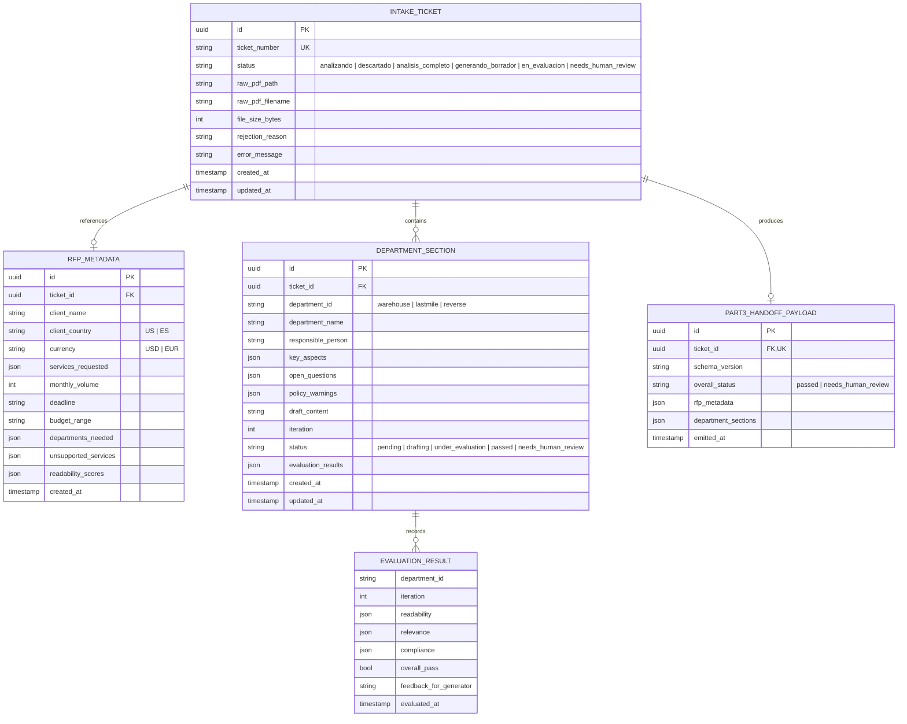
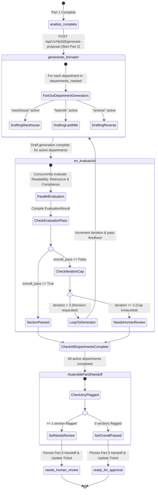

# Data Model: RFP Response Generation & Department Drafting Pipeline (Part 2 of 3)

**Feature Branch**: `feature/rfp-response-generation`  
**Date**: 2026-11-22  
**Status**: Completed  
**Spec Reference**: `specs/032-rfp-response-generation/spec.md`  

---

## Entity Relationship Diagram



---

## 1. Domain Entities & Value Objects

### 1.1 Extended `IntakeTicket`

Represents the root aggregate across Part 1 and Part 2 lifecycle states.

| Field | Type | Required | Description | Constraints / Validation |
|---|---|---|---|---|
| `id` | `UUID` | Yes | Unique identifier of the ticket | RFC 4122 UUID v4 |
| `ticket_number` | `str` | Yes | Human-readable identifier | Pattern: `^RFP-\d{4}-\d{3,}$` (e.g. `RFP-2026-001`) |
| `status` | `TicketStatus` | Yes | Current processing status | Includes Part 2 statuses: `generando_borrador`, `en_evaluación`, `needs_human_review` |
| `raw_pdf_path` | `str` | Yes | Path in `data/raw/` | Must exist on disk |
| `rejection_reason` | `Optional[str]` | No | Explanation if rejected by classifier | Populated when `status == descartado` |
| `error_message` | `Optional[str]` | No | Diagnostic error if pipeline crashed | Sanitized string, no raw stack traces exposed to client |
| `created_at` | `datetime` | Yes | Timestamp when upload was accepted | UTC timezone |
| `updated_at` | `datetime` | Yes | Timestamp of last status change | UTC timezone |

**Extended TicketStatus Enum**:
```python
class TicketStatus(str, Enum):
    ANALIZANDO = "analizando"
    DESCARTADO = "descartado"
    ANALISIS_COMPLETO = "analisis_completo"
    # Part 2 additions
    DRAFTING = "generando_borrador"
    UNDER_EVALUATION = "en_evaluación"
    NEEDS_HUMAN_REVIEW = "needs_human_review"
```

---

### 1.2 Extended `DepartmentSection`

Represents the operational evaluation (from Part 1) and its generated proposal section drafts and evaluation iterations (Part 2).

| Field | Type | Required | Description | Constraints / Validation |
|---|---|---|---|---|
| `id` | `UUID` | Yes | Primary key | UUID v4 |
| `ticket_id` | `UUID` | Yes | Foreign key to `IntakeTicket` | Foreign Key |
| `department_id` | `Literal["warehouse", "lastmile", "reverse"]` | Yes | Department identifier | Enum |
| `department_name` | `str` | Yes | Full department title | e.g. "Operaciones de Almacén" |
| `responsible_person` | `str` | Yes | Department lead name | `Ana Whitfield`, `Carlos Vega`, or `Sofía Ramos` |
| `key_aspects` | `Dict[str, Any]` | Yes | Operational parameters & cost drivers (Part 1) | Strongly typed JSON schema |
| `open_questions` | `List[str]` | Yes | Unspecified or missing operational data (Part 1) | Zero-hallucination list |
| `policy_warnings` | `List[str]` | Yes | Operational policy caveats (Part 1) | Specific department rules |
| `draft_content` | `Optional[str]` | No | Generated proposal section Markdown text | Populated during Part 2 drafting |
| `iteration` | `int` | Yes | Current iteration counter | `0` (not drafted) to `3` (max attempt) |
| `status` | `str` | Yes | Section lifecycle status | `pending`, `drafting`, `under_evaluation`, `passed`, `needs_human_review` |
| `evaluation_results` | `List[Dict[str, Any]]` | Yes | Audit log of all `EvaluationResult` objects | List of serialized `EvaluationResult` dicts |
| `created_at` | `datetime` | Yes | Evaluation timestamp | UTC timezone |
| `updated_at` | `datetime` | Yes | Last update timestamp | UTC timezone |

---

### 1.3 `EvaluationResult` (Value Object)

The immutable structured evaluation outcome emitted by the parallel evaluators for a department draft iteration.

```python
class ReadabilityEvaluation(BaseModel):
    pass_status: bool
    score: float  # Flesch Reading Ease score
    details: str

class RelevanceEvaluation(BaseModel):
    pass_status: bool
    missing_aspects: List[str]

class ComplianceEvaluation(BaseModel):
    pass_status: bool
    rule_ids: List[str]  # e.g. ["RULE-CURRENCY", "RULE-RETURNS-TIME"]
    violations: List[str]  # Human-readable diagnostic reasons

class EvaluationResult(BaseModel):
    department_id: Literal["warehouse", "lastmile", "reverse"]
    iteration: int
    readability: ReadabilityEvaluation
    relevance: RelevanceEvaluation
    compliance: ComplianceEvaluation
    overall_pass: bool
    feedback_for_generator: str
    evaluated_at: datetime
```

**Compliance Rules Enforced**:
1. `RULE-CURRENCY`: Price quoted in USD for US (`client_country == "US"`) or EUR for Spain (`client_country == "ES"`).
2. `RULE-SLA`: On-time delivery SLA (%) committed in proposal.
3. `RULE-RETURNS-TIME`: No returns processing promised under 48 hours.
4. `RULE-DISCOUNT-TIERS`: Volume discount table included.
5. `RULE-CARRIER-RATES`: Negotiated carrier rates never revealed (only final client prices).

---

### 1.4 `Part3HandoffPayload`

The canonical package emitted upon completion of proposal generation, ready for human approvals in Part 3.

| Field | Type | Required | Description | Constraints / Validation |
|---|---|---|---|---|
| `id` | `UUID` | Yes | Primary key | UUID v4 |
| `ticket_id` | `UUID` | Yes | Foreign key to `IntakeTicket` | Foreign Key, Unique |
| `schema_version` | `str` | Yes | Handoff schema version | Semantic version (e.g. `2.0.0`) |
| `overall_status` | `Literal["passed", "needs_human_review"]` | Yes | Handoff status flag | `passed` if all active sections passed; `needs_human_review` if any section reached iteration cap |
| `rfp_metadata` | `Dict[str, Any]` | Yes | RFP metadata snapshot | Client, country, currency, volume, etc. |
| `department_sections` | `Dict[str, Any]` | Yes | Map of department_id to section draft bundle | Contains `draft_content`, latest `evaluation_result`, `status`, and `iterations` |
| `emitted_at` | `datetime` | Yes | Emission timestamp | UTC timezone |

---

## 2. State Machine & Lifecycle Transitions



### Transition Invariants
1. **Entry Invariant**: Generation can only be triggered for tickets in `analisis_completo` status with an existing `RFPMetadata` record.
2. **Independent Department Iteration**: A department that passes on iteration 1 does not re-draft or evaluate while another department iterates.
3. **Iteration Cap Invariant**: Total generation attempts per department cannot exceed 3 (initial attempt + max 2 revisions).
4. **Zero Discard Invariant**: Failing evaluation after 3 attempts does NOT transition ticket to `descartado`; it transitions section and ticket to `needs_human_review`.
5. **Audit Invariant**: 100% of generated drafts and intermediate `EvaluationResult` objects are persisted in PostgreSQL.
