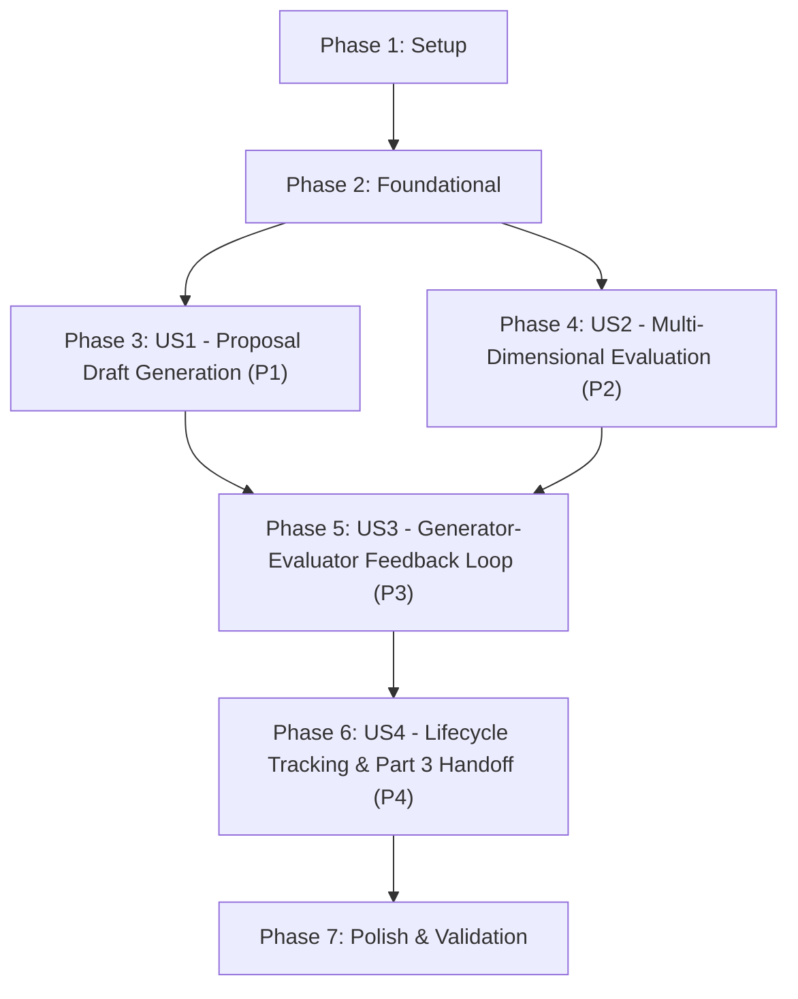

# Tasks: RFP Response Generation & Department Drafting Pipeline (Part 2 of 3)

**Input**: Design documents from `specs/032-rfp-response-generation/`
- Spec: [specs/032-rfp-response-generation/spec.md](file:///j:/GitHub/mr-stegmann-ai-engineering-company-project-monorepo/specs/032-rfp-response-generation/spec.md)
- Plan: [specs/032-rfp-response-generation/plan.md](file:///j:/GitHub/mr-stegmann-ai-engineering-company-project-monorepo/specs/032-rfp-response-generation/plan.md)
- Data Model: [specs/032-rfp-response-generation/data-model.md](file:///j:/GitHub/mr-stegmann-ai-engineering-company-project-monorepo/specs/032-rfp-response-generation/data-model.md)
- Contracts: [specs/032-rfp-response-generation/contracts/](file:///j:/GitHub/mr-stegmann-ai-engineering-company-project-monorepo/specs/032-rfp-response-generation/contracts/)
- Quickstart: [specs/032-rfp-response-generation/quickstart.md](file:///j:/GitHub/mr-stegmann-ai-engineering-company-project-monorepo/specs/032-rfp-response-generation/quickstart.md)

**Constitution Reference**: [TrackFlow Monorepo Constitution v1.1.0](file:///j:/GitHub/mr-stegmann-ai-engineering-company-project-monorepo/.specify/memory/constitution.md)

## Format: `[ID] [P?] [Story] Description`

- **[P]**: Can run in parallel (different files, no dependencies)
- **[Story]**: Which user story this task belongs to (`[US1]`, `[US2]`, `[US3]`, `[US4]`)
- Include exact file paths in descriptions

---

## Phase 1: Setup (Shared Infrastructure)

**Purpose**: Project initialization, directory structure, and dependency setup

- [ ] T001 Create pipeline directory structure in data/pipelines/rfp_response_generation/ and test suites in tests/pipelines/
- [ ] T002 [P] Configure and verify pipeline dependencies (textstat, sqlmodel, langgraph, pydantic) in services/api/requirements.txt
- [ ] T003 [P] Extend shared TypeScript contracts with Part 2 types and handoff schemas in packages/shared/types/rfp.ts

---

## Phase 2: Foundational (Blocking Prerequisites)

**Purpose**: Core domain entities, persistence schema evolution, and baseline repository ports required by all user stories

**⚠️ CRITICAL**: No user story work can begin until this phase is complete

- [ ] T004 Extend domain entities and value objects (TicketStatus enum, ReadabilityEvaluation, RelevanceEvaluation, ComplianceEvaluation, EvaluationResult, Part3HandoffPayload) in services/api/domain/rfp/entities.py
- [ ] T005 [P] Define deterministic compliance rule definitions and error codes for briefing rules in data/pipelines/rfp_response_generation/compliance_rules.py
- [ ] T006 [P] Extend SQLModel database tables (DepartmentSectionTable draft columns, Part3HandoffPayloadTable) in services/api/infrastructure/persistence/sqlmodel/models.py
- [ ] T007 Extend IntakeTicketRepositoryPort and SQLModel repository implementation for draft updates, evaluation logging, and Part 3 handoff persistence in services/api/domain/rfp/ports.py and services/api/infrastructure/persistence/sqlmodel/rfp_repository.py
- [ ] T008 [P] Update Pydantic presentation request/response schemas matching OpenAPI contract in services/api/presentation/schemas/rfp.py

**Checkpoint**: Core foundation ready - user story implementation can begin

---

## Phase 3: User Story 1 - Per-Department Proposal Section Draft Generation (Priority: P1) 🎯 MVP

**Goal**: Ingest validated Part 1 handoff payload from PostgreSQL, transition ticket status to `drafting` (`generando_borrador`), and trigger dedicated department generator agents (`warehouse`, `lastmile`, `reverse`) producing specialized proposal draft sections tailored to client country and currency without re-parsing raw PDFs.

**Independent Test**: Provide a mock Part 1 handoff payload (e.g. ModaViva Spain with `warehouse` and `reverse` active) and verify that separated generator agents emit distinct section drafts covering storage, costs, and return turnaround in EUR without re-reading raw PDFs.

### Tests for User Story 1 ⚠️

- [ ] T009 [P] [US1] Unit tests for department generator agents in tests/pipelines/test_rfp_generators.py
- [ ] T010 [P] [US1] Unit tests for knowledge retrieval and currency formatting in services/api/tests/unit/agent/test_rfp_generator_agents.py

### Implementation for User Story 1

- [ ] T011 [P] [US1] Implement Warehouse proposal generator agent (Ana Whitfield) in services/api/application/agent/rfp_generator_agents.py
- [ ] T012 [P] [US1] Implement LastMile proposal generator agent (Carlos Vega) in services/api/application/agent/rfp_generator_agents.py
- [ ] T013 [P] [US1] Implement Reverse Logistics proposal generator agent (Sofía Ramos) in services/api/application/agent/rfp_generator_agents.py
- [ ] T014 [US1] Implement vector knowledge retrieval helper with graceful fallback to briefing standards in services/api/application/agent/rfp_generator_agents.py
- [ ] T015 [US1] Implement ticket intake handoff ingestion and initial status transition to generando_borrador in services/api/application/agent/rfp_response_service.py

**Checkpoint**: At this point, User Story 1 should be fully functional and testable independently (MVP)

---

## Phase 4: User Story 2 - Multi-Dimensional Parallel Evaluation & Structured EvaluationResult (Priority: P2)

**Goal**: Concurrently evaluate generated department drafts across Readability (via `textstat`), Relevance (coverage of Part 1 `key_aspects`), and Compliance (strict deterministic checking of the 5 briefing rules), emitting structured `EvaluationResult`.

**Independent Test**: Feed a non-compliant draft (promising 24-hour return processing or missing volume discounts) to the evaluator; verify `compliance.pass == false`, `RULE-RETURNS-TIME` cited, and actionable revision instructions emitted.

### Tests for User Story 2 ⚠️

- [ ] T016 [P] [US2] Unit tests for readability evaluation in tests/pipelines/test_rfp_evaluators.py
- [ ] T017 [P] [US2] Unit tests for compliance rules engine and 5 briefing rules in tests/pipelines/test_compliance_rules.py
- [ ] T018 [P] [US2] Focused test for compliance-failure fixture (returns turnaround < 48h, currency mismatch, missing SLA) in tests/pipelines/test_rfp_compliance_failures.py

### Implementation for User Story 2

- [ ] T019 [P] [US2] Implement deterministic readability scorer using textstat in data/pipelines/rfp_response_generation/evaluator.py
- [ ] T020 [P] [US2] Implement relevance checker against Part 1 key_aspects in data/pipelines/rfp_response_generation/evaluator.py
- [ ] T021 [P] [US2] Implement the 5 briefing compliance rule validators (RULE-CURRENCY, RULE-SLA, RULE-RETURNS-TIME, RULE-DISCOUNT-TIERS, RULE-CARRIER-RATES) in data/pipelines/rfp_response_generation/compliance_rules.py
- [ ] T022 [US2] Implement parallel multi-dimensional evaluator coordinator emitting structured EvaluationResult in data/pipelines/rfp_response_generation/evaluator.py
- [ ] T023 [US2] Implement wrapper evaluation agent coordinating readability, relevance, and compliance in services/api/application/agent/rfp_evaluator_agent.py

**Checkpoint**: At this point, User Stories 1 and 2 work independently

---

## Phase 5: User Story 3 - Generator–Evaluator Feedback Loop & Iteration Cap (Priority: P3)

**Goal**: Orchestrate the automated generator–evaluator feedback loop where failing drafts receive `feedback_for_generator` and are revised by their department generator up to an iteration cap of 2 revisions (max 3 total attempts). If still failing, gracefully escalate section and ticket to `needs_human_review` without discarding the ticket.

**Independent Test**: Run generator-evaluator test fixture configured with 3 attempts; verify loop terminates on attempt 3, marks section and ticket as `needs_human_review`, and retains latest draft and `EvaluationResult`.

### Tests for User Story 3 ⚠️

- [ ] T024 [P] [US3] Unit tests for generator–evaluator revision loop with feedback injection in tests/pipelines/test_rfp_feedback_loop.py
- [ ] T025 [P] [US3] Unit and integration tests for iteration cap exhaustion (3 attempts) escalating to needs_human_review in tests/pipelines/test_rfp_iteration_cap.py

### Implementation for User Story 3

- [ ] T026 [US3] Implement isolated generator–evaluator feedback loop per active department in data/pipelines/rfp_response_generation/pipeline.py
- [ ] T027 [US3] Implement iteration counter tracking and cap enforcement (max 3 total attempts) in data/pipelines/rfp_response_generation/pipeline.py
- [ ] T028 [US3] Implement graceful escalation logic marking section and ticket as needs_human_review upon cap exhaustion in data/pipelines/rfp_response_generation/pipeline.py

**Checkpoint**: Generator-evaluator feedback loop and bounded iteration caps work reliably

---

## Phase 6: User Story 4 - Pipeline Lifecycle State Tracking & Part 3 Handoff Packaging (Priority: P4)

**Goal**: Track pipeline lifecycle states in PostgreSQL (`drafting`, `under_evaluation`, `needs_human_review`), assemble the immutable Part 3 handoff payload containing each department's draft content, structured `EvaluationResult`, and status flags, and expose via FastAPI endpoints.

**Independent Test**: Query PostgreSQL and API endpoints following pipeline completion; verify ticket status, section records, and compiled Part 3 handoff payload matching `part3-handoff.schema.json`.

### Tests for User Story 4 ⚠️

- [ ] T029 [P] [US4] Contract tests for generation API endpoints in services/api/tests/integration/test_rfp_generation_api.py
- [ ] T030 [P] [US4] Integration tests for Part 3 handoff payload compilation and schema validation in tests/pipelines/test_rfp_handoff_packaging.py

### Implementation for User Story 4

- [ ] T031 [US4] Implement end-to-end pipeline orchestrator joining all active department loops in data/pipelines/rfp_response_generation/pipeline.py
- [ ] T032 [US4] Implement Part 3 handoff payload compiler matching part3-handoff.schema.json in data/pipelines/rfp_response_generation/pipeline.py
- [ ] T033 [US4] Implement state persistence and audit log updates in services/api/application/agent/rfp_response_service.py
- [ ] T034 [US4] Implement FastAPI presentation endpoints (POST /generate-proposal, GET /sections, GET /part3-handoff) in services/api/presentation/api/v1/rfp.py

**Checkpoint**: All user stories fully integrated and functional

---

## Phase 7: Polish & Cross-Cutting Concerns

**Purpose**: Verification against quickstart guide, full test suite execution, TypeScript typing, and architectural Constitution checks

- [ ] T035 [P] Run and validate quickstart scenarios in specs/032-rfp-response-generation/quickstart.md
- [ ] T036 [P] Run full backend pipeline and API test suite (pytest tests/pipelines/ and pytest services/api/tests/unit/agent/)
- [ ] T037 [P] Run TypeScript compiler check (npm run typecheck) across workspace to verify zero any and type safety in packages/shared/types/rfp.ts
- [ ] T038 Verify Constitution compliance (Principle I service boundaries, Principle II API compatibility, Principle IV error sanitization, Principle VII vector governance)

---

## Dependencies & Execution Order

### Phase Dependencies

- **Setup (Phase 1)**: No dependencies - can start immediately.
- **Foundational (Phase 2)**: Depends on Setup (Phase 1) - **BLOCKS** all user stories.
- **User Story 1 (Phase 3 - P1)**: Depends on Foundational (Phase 2). Can proceed independently as MVP.
- **User Story 2 (Phase 4 - P2)**: Depends on Foundational (Phase 2). Can develop evaluators in parallel with generators, but evaluates drafts produced by US1.
- **User Story 3 (Phase 5 - P3)**: Depends on US1 (generators) and US2 (evaluators) to wire the revision loop.
- **User Story 4 (Phase 6 - P4)**: Depends on US1, US2, and US3 to assemble final handoff and persist completed ticket state.
- **Polish (Phase 7)**: Depends on completion of all user stories.

### User Story Dependencies



### Parallel Opportunities

- **Phase 1 (Setup)**: T002 and T003 can execute in parallel.
- **Phase 2 (Foundational)**: T005, T006, and T008 can execute in parallel once T004 is initiated.
- **Phase 3 (US1)**:
  - T009 and T010 (tests) can run in parallel.
  - T011, T012, and T013 (department generators) can be authored in parallel.
- **Phase 4 (US2)**:
  - T016, T017, and T018 (evaluator tests) can run in parallel.
  - T019, T020, and T021 (readability, relevance, compliance evaluators) can be developed in parallel.
- **Phase 5 (US3)**:
  - T024 and T025 (loop and cap tests) can run in parallel.
- **Phase 6 (US4)**:
  - T029 and T030 (API and handoff contract tests) can run in parallel.
- **Phase 7 (Polish)**:
  - T035, T036, and T037 can run in parallel.

---

## Parallel Example: User Story 1

```bash
# Launch test creation for User Story 1 together:
Task: "Unit tests for department generator agents in tests/pipelines/test_rfp_generators.py"
Task: "Unit tests for knowledge retrieval and currency formatting in services/api/tests/unit/agent/test_rfp_generator_agents.py"

# Launch department generators in parallel:
Task: "Implement Warehouse proposal generator agent (Ana Whitfield) in services/api/application/agent/rfp_generator_agents.py"
Task: "Implement LastMile proposal generator agent (Carlos Vega) in services/api/application/agent/rfp_generator_agents.py"
Task: "Implement Reverse Logistics proposal generator agent (Sofía Ramos) in services/api/application/agent/rfp_generator_agents.py"
```

---

## Parallel Example: User Story 2

```bash
# Launch evaluation dimension components in parallel:
Task: "Implement deterministic readability scorer using textstat in data/pipelines/rfp_response_generation/evaluator.py"
Task: "Implement relevance checker against Part 1 key_aspects in data/pipelines/rfp_response_generation/evaluator.py"
Task: "Implement the 5 briefing compliance rule validators in data/pipelines/rfp_response_generation/compliance_rules.py"
```

---

## Implementation Strategy

### MVP First (User Story 1 Only)

1. Complete **Phase 1: Setup** (T001 - T003).
2. Complete **Phase 2: Foundational** (T004 - T008) - unlocks domain models and schema.
3. Complete **Phase 3: User Story 1** (T009 - T015).
4. **STOP and VALIDATE**: Verify that generator agents produce initial drafts for active departments (`warehouse`, `lastmile`, `reverse`) tailored to country/currency without re-reading PDFs.
5. Demonstrate standalone proposal drafting capability.

### Incremental Delivery

1. **Increment 1 (MVP)**: Setup + Foundational + User Story 1 $\rightarrow$ Department proposal draft generation operational.
2. **Increment 2**: Add User Story 2 $\rightarrow$ Multi-dimensional evaluation engine (readability, relevance, compliance) validating drafts.
3. **Increment 3**: Add User Story 3 $\rightarrow$ Closed generator–evaluator loop refining failing sections up to the 3-attempt limit with graceful `needs_human_review` escalation.
4. **Increment 4**: Add User Story 4 $\rightarrow$ State persistence in PostgreSQL, FastAPI endpoint exposure (`POST /generate-proposal`, `GET /sections`, `GET /part3-handoff`), and Part 3 handoff packaging.
5. **Increment 5**: Polish & Cross-Cutting $\rightarrow$ Quickstart scenario validation, full test suite execution, and Constitution checks.

---

## Notes

- All tasks strictly follow checklist format: `- [ ] [TaskID] [P?] [Story?] Description with file path`.
- Setup, Foundational, and Polish tasks have NO `[Story]` marker as required by task formatting rules.
- User story tasks carry their explicit `[Story]` identifier (`[US1]`, `[US2]`, `[US3]`, `[US4]`).
- Tests are included for all phases in alignment with Spec FR-017, AC-7, and Constitution Principle VI (Test-First Development).
- Every task includes explicit file paths.
- All tasks are sized for independent LLM completion without context loss.
