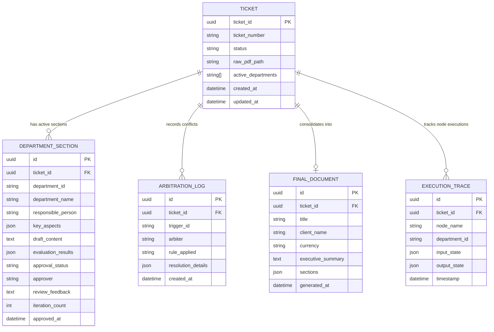
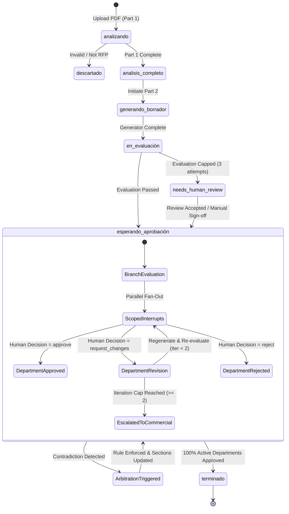
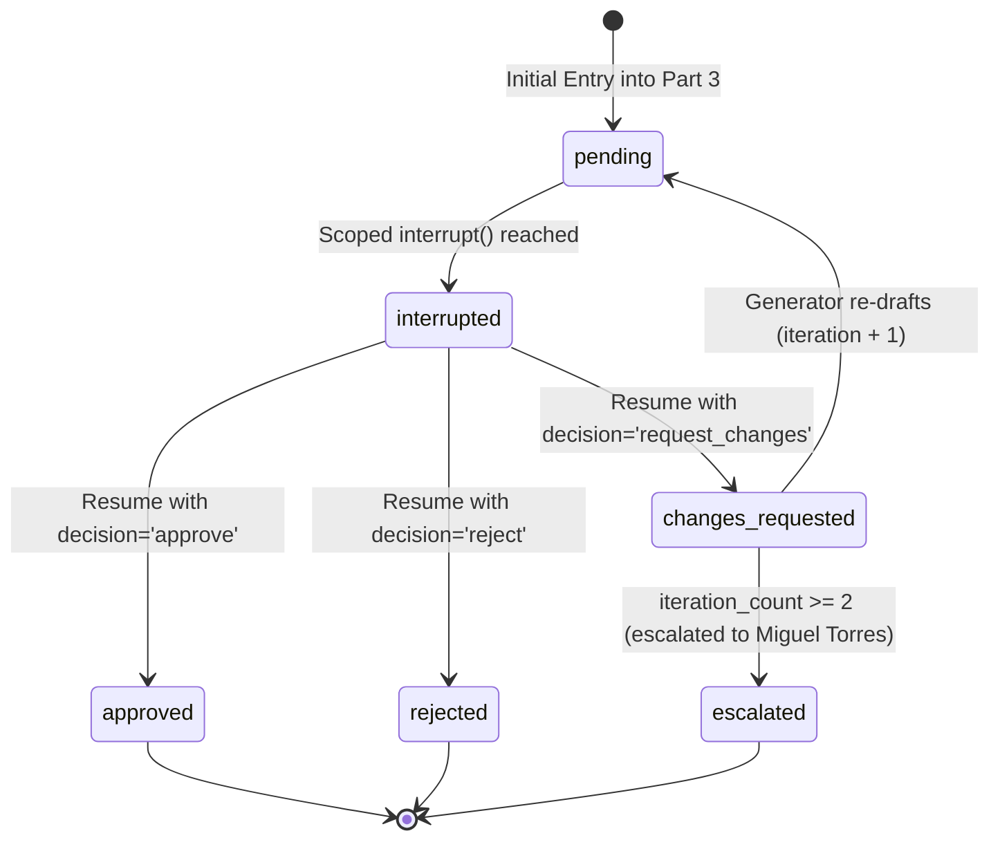

# Domain Data Model & State Machine: RFP Approval, Arbitration & Document Synthesis (Part 3 of 3)

**Branch**: `033-rfp-approval-completion` | **Date**: 2026-11-22 | **Spec**: [specs/033-rfp-approval-completion/spec.md](file:///j:/GitHub/mr-stegmann-ai-engineering-company-project-monorepo/specs/033-rfp-approval-completion/spec.md)

---

## 1. Domain Entities & Relationships

---

## 2. Entity Specifications & Field Constraints

### 2.1 Ticket (`IntakeTicket`)
Represents the top-level RFP intake and commercial proposal lifecycle.

| Field | Type | Nullable | Description / Constraints |
|---|---|---|---|
| `ticket_id` | `UUID` | No | Primary Key. |
| `ticket_number` | `str` | No | Unique human-readable ticket reference (e.g. `RFP-2026-001`). |
| `status` | `TicketStatus` | No | Lifecycle status: `analizando`, `descartado`, `analisis_completo`, `generando_borrador`, `en_evaluación`, `needs_human_review`, `esperando_aprobación`, `terminado`. |
| `raw_pdf_path` | `str` | No | Path to uploaded PDF in storage (`data/raw/`). |
| `active_departments`| `List[str]` | No | List of required departments (`warehouse`, `lastmile`, `reverse`). |
| `created_at` | `datetime` | No | UTC timestamp when created. |
| `updated_at` | `datetime` | No | UTC timestamp when last updated. |

### 2.2 DepartmentSection (`DepartmentSectionTable`)
Captures department-specific proposal text, operational parameters, and human review status.

| Field | Type | Nullable | Description / Constraints |
|---|---|---|---|
| `id` | `UUID` | No | Primary Key. |
| `ticket_id` | `UUID` | No | Foreign Key referencing `Ticket.ticket_id`. |
| `department_id` | `str` | No | One of `warehouse`, `lastmile`, `reverse`. |
| `department_name` | `str` | No | Display name (e.g. "Warehouse Operations"). |
| `responsible_person`| `str` | No | Named lead: `Ana Whitfield`, `Carlos Vega`, `Sofía Ramos`. |
| `key_aspects` | `Dict[str, Any]` | No | JSON structured operational parameters from Part 1. |
| `draft_content` | `str` | Yes | Markdown section content generated in Part 2 or revised in Part 3. |
| `evaluation_results`| `Dict[str, Any]` | Yes | Structured readability, relevance, and compliance scores. |
| `approval_status` | `str` | No | `pending`, `approved`, `rejected`, `changes_requested`. |
| `approver` | `str` | Yes | Name of human approver recording the decision. |
| `review_feedback` | `str` | Yes | Required revision instructions if `changes_requested`. |
| `iteration_count` | `int` | No | Revision loop counter (0..2 revisions, max 3 attempts). Default: `0`. |
| `approved_at` | `datetime` | Yes | UTC timestamp when approval was granted. |

### 2.3 ArbitrationLog (`ArbitrationLogTable`)
Audit log recording every deterministic conflict detected and resolved by the arbitration node.

| Field | Type | Nullable | Description / Constraints |
|---|---|---|---|
| `id` | `UUID` | No | Primary Key. |
| `ticket_id` | `UUID` | No | Foreign Key referencing `Ticket.ticket_id`. |
| `trigger_id` | `str` | No | One of `volume-vs-capacity`, `returns-sla-breach`, `currency-mismatch`. |
| `arbiter` | `str` | No | Named arbiter: `Miguel Torres` (Commercial Director) or `Sofía Ramos` (Reverse Logistics Lead). |
| `rule_applied` | `str` | No | Description of deterministic business rule enforced. |
| `resolution_details`| `Dict[str, Any]`| No | Before/after state snapshot and corrective actions taken. |
| `created_at` | `datetime` | No | UTC timestamp of arbitration execution. |

### 2.4 FinalDocument (`FinalDocumentTable`)
Consolidated, client-ready commercial proposal generated automatically upon 100% department approval.

| Field | Type | Nullable | Description / Constraints |
|---|---|---|---|
| `id` | `UUID` | No | Primary Key. |
| `ticket_id` | `UUID` | No | Foreign Key referencing `Ticket.ticket_id` (Unique). |
| `title` | `str` | No | Commercial proposal title (e.g. "Propuesta Logística Integral - ModaViva"). |
| `client_name` | `str` | No | Name of prospective client. |
| `currency` | `str` | No | Operating currency: `EUR` (Spain) or `USD` (United States). |
| `executive_summary` | `str` | No | High-level synthesis tailored for client executive leadership. |
| `sections` | `Dict[str, Any]` | No | JSON map of approved department sections and operational commitments. |
| `generated_at` | `datetime` | No | UTC timestamp of document compilation. |

### 2.5 ExecutionTraceEntry (Graph State Trace)
In-memory audit entry recorded by each LangGraph node for execution traceability.

| Field | Type | Nullable | Description / Constraints |
|---|---|---|---|
| `node_name` | `str` | No | Canonical graph node name (e.g. `arbitration_node`, `approval_node`). |
| `department_id` | `str` | Yes | Department scope if node is on a parallel branch. |
| `input_state` | `Dict[str, Any]` | No | Serialized summary of input state. |
| `output_state` | `Dict[str, Any]` | No | Serialized summary of node outputs. |
| `timestamp` | `datetime` | No | UTC execution timestamp. |

---

## 3. State Machine & Transitions

### 3.1 Ticket Lifecycle State Machine

### 3.2 Department Branch Approval State Transitions

---

## 4. Conflict Arbitration Rules Matrix

| Trigger ID | Trigger Condition | Arbiter | Action / Resolution Rule | Post-Resolution Edge |
|---|---|---|---|---|
| `volume-vs-capacity` | `metadata.monthly_volume > warehouse_capacity` | **Miguel Torres** | Cap proposal volume at warehouse capacity; force `lastmile` section to adjust volume and pricing downward. | Route `lastmile` to re-drafting. |
| `returns-sla-breach` | Section draft promises return turnaround $< 48$ hours | **Sofía Ramos** (or **Miguel Torres** if in non-reverse section) | Enforce `request_changes` on offending section; rewrite SLA $\ge 48$ hours. Block synthesis until compliant. | Route offending section to revision. |
| `currency-mismatch` | Inconsistent currencies across sections, or currency $\ne$ country canonical currency (`ES` $\rightarrow$ `EUR`, `US` $\rightarrow$ `USD`) | **Miguel Torres** | Rewrite currency symbols and price figures to match country currency. | Route section to revision or auto-fix. |
