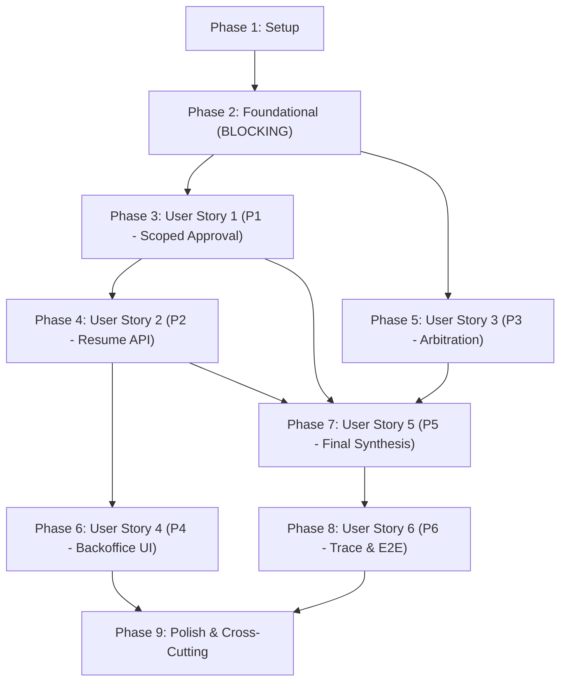

# Tasks: RFP Approval, Arbitration & Document Synthesis (Part 3 of 3)

**Input**: Design documents from `specs/033-rfp-approval-completion/` (`spec.md`, `plan.md`, `data-model.md`, `research.md`, `contracts/`, `quickstart.md`)

**Prerequisites**: `plan.md` (required), `spec.md` (required for user stories), `data-model.md`, `research.md`, `contracts/`, `quickstart.md`

**Tests**: Test tasks are included per `spec.md` Section 4 (AC-4.1, AC-4.2) and Constitution Principle VI (Test-First Development).

**Organization**: Tasks are grouped by user story (US1 through US6) in strict priority order to enable independent implementation, testing, and delivery.

---

## Format: `[ID] [P?] [Story] Description`

- **[P]**: Can run in parallel (different files, no dependencies)
- **[Story]**: Which user story this task belongs to (e.g. `[US1]`, `[US2]`, `[US3]`, `[US4]`, `[US5]`, `[US6]`)
- Include exact file paths in descriptions

---

## Phase 1: Setup (Shared Infrastructure)

**Purpose**: Project initialization and basic structure for Part 3 pipeline modules and test harnesses.

- [ ] T001 Create pipeline directory structure and export stubs in `data/pipelines/rfp_approval_completion/__init__.py`
- [ ] T002 [P] Configure LangGraph checkpointer test utilities and SQLite fixtures in `tests/pipelines/conftest.py`

---

## Phase 2: Foundational (Blocking Prerequisites)

**Purpose**: Core data models, schema updates, shared types, and repository abstractions that MUST be complete before ANY user story can begin.

**⚠️ CRITICAL**: No user story implementation can begin until this phase is complete.

- [ ] T003 [P] Extend domain entities and enums (`TicketStatus.WAITING_FOR_APPROVAL`, `TicketStatus.TERMINADO`, `ApprovalStatus`, `ArbitrationLog`, `FinalDocument`) in `services/api/domain/rfp/entities.py`
- [ ] T004 [P] Update domain repository port definitions for arbitration logs and final documents in `services/api/domain/rfp/ports.py`
- [ ] T005 [P] Create SQLModel database tables (`ArbitrationLogTable`, `FinalDocumentTable`) and extend `DepartmentSectionTable` in `services/api/infrastructure/persistence/sqlmodel/models.py`
- [ ] T006 Implement repository persistence methods for approval state, arbitration logs, and final documents in `services/api/infrastructure/persistence/sqlmodel/rfp_repository.py`
- [ ] T007 [P] Update shared TypeScript domain contracts and DTOs in `packages/shared/types/rfp.ts`
- [ ] T008 [P] Define LangGraph Part 3 state schema TypedDict and checkpointer thread configuration in `data/pipelines/rfp_approval_completion/state.py`

**Checkpoint**: Foundation ready — user story implementation can now begin in parallel or sequentially.

---

## Phase 3: User Story 1 - Scoped Human Approval & Parallel Branch Independence (Priority: P1) 🎯 MVP

**Goal**: Establish independent, scoped human-review checkpoints for each active operational department (`warehouse`, `lastmile`, `reverse`) using namespaced thread checkpointers, so any lead can review and approve without blocking or waiting for other departments.

**Independent Test**: Execute `pytest tests/pipelines/test_rfp_approval_interrupts.py`: initialize a multi-department ticket with `warehouse` and `lastmile`, trigger the approval milestone, verify both branches enter scoped interrupts, approve `lastmile` (Carlos Vega), and verify that `lastmile` advances to `approved` while `warehouse` remains safely paused in interrupted state.

### Tests for User Story 1 ⚠️

- [ ] T009 [P] [US1] Unit test for scoped interrupts and parallel branch independence in `tests/pipelines/test_rfp_approval_interrupts.py`
- [ ] T010 [P] [US1] Integration test for checkpointer thread namespacing (`rfp-{ticket_id}:{department}`) in `tests/pipelines/test_rfp_approval_interrupts.py`

### Implementation for User Story 1

- [ ] T011 [US1] Implement department approval branch nodes and scoped `interrupt()` calls in `data/pipelines/rfp_approval_completion/pipeline.py`
- [ ] T012 [US1] Implement application service orchestration for branch execution and thread checkpointer isolation in `services/api/application/agent/rfp_approval_service.py`
- [ ] T013 [US1] Add lifecycle status transition to `waiting_for_approval` upon entering review milestone in `services/api/application/agent/rfp_approval_service.py`

**Checkpoint**: At this point, User Story 1 is functional: branches pause in scoped interrupts, persist state, and operate without cross-branch blocking.

---

## Phase 4: User Story 2 - Explicit Resume Entrypoint & Input Validation (Priority: P2)

**Goal**: Provide an explicit `resume` HTTP REST endpoint that validates human decisions (`approve`, `reject`, `request_changes` with mandatory revision notes) and resumes the paused graph from the exact interrupted state without restarting upstream stages.

**Independent Test**: Execute `pytest tests/pipelines/test_rfp_approval_interrupts.py`: verify that invalid decision payloads (empty feedback on `request_changes`, invalid enums) return HTTP 422 / 400; verify that valid `approve` or `request_changes` payload resumes the graph, updates `DepartmentSectionTable`, and preserves Part 1/2 metadata.

### Tests for User Story 2 ⚠️

- [ ] T014 [P] [US2] Contract and unit tests for resume input validation and decision routing in `tests/pipelines/test_rfp_approval_interrupts.py`
- [ ] T015 [P] [US2] Integration test for resuming paused branch via `Command(resume=...)` without re-running upstream nodes in `tests/pipelines/test_rfp_approval_interrupts.py`

### Implementation for User Story 2

- [ ] T016 [P] [US2] Implement Pydantic request and response schemas (`ResumeDecisionRequest`, `ResumeDecisionResponse`) in `services/api/presentation/schemas/rfp.py`
- [ ] T017 [US2] Implement resume validation, branch re-entry, and iteration counter logic in `services/api/application/agent/rfp_approval_service.py`
- [ ] T018 [US2] Implement `/api/v1/rfp/tickets/{ticket_id}/resume-approval` endpoint with FastAPI `Depends` in `services/api/presentation/api/v1/rfp.py`

**Checkpoint**: At this point, User Stories 1 AND 2 are complete: human reviewers can resume interrupted branches via validated REST API calls.

---

## Phase 5: User Story 3 - Structured Conflict Detection & Deterministic Arbitration Node (Priority: P3)

**Goal**: Detect structured cross-department contradictions (`volume-vs-capacity`, `returns-sla-breach`, `currency-mismatch`) and resolve them deterministically via briefing rules and named arbiters (Miguel Torres, Sofía Ramos) with a hard iteration cap (max 2 revisions).

**Independent Test**: Execute `pytest tests/pipelines/test_rfp_arbitration.py`: feed structured states with capacity mismatches, <48h return promises, and currency discrepancies; verify that rules are enforced deterministically without stochastic LLM voting, records are saved to `ArbitrationLogTable`, and iteration counts exceeding 2 escalate gracefully.

### Tests for User Story 3 ⚠️

- [ ] T019 [P] [US3] Unit tests for `volume-vs-capacity` conflict arbitration under Miguel Torres in `tests/pipelines/test_rfp_arbitration.py`
- [ ] T020 [P] [US3] Unit tests for `returns-sla-breach` conflict arbitration under Sofía Ramos in `tests/pipelines/test_rfp_arbitration.py`
- [ ] T021 [P] [US3] Unit tests for `currency-mismatch` conflict arbitration and canonical currency rewriting in `tests/pipelines/test_rfp_arbitration.py`
- [ ] T022 [P] [US3] Unit tests for revision iteration cap (2 revisions / 3 total attempts) and commercial escalation in `tests/pipelines/test_rfp_arbitration.py`

### Implementation for User Story 3

- [ ] T023 [US3] Implement deterministic conflict evaluation rules and resolution handlers in `data/pipelines/rfp_approval_completion/arbitration.py`
- [ ] T024 [US3] Implement application agent wrapper for conflict evaluation and escalation logging in `services/api/application/agent/rfp_arbitration_agent.py`
- [ ] T025 [US3] Integrate arbitration node, conditional edges, and iteration cap routing into `data/pipelines/rfp_approval_completion/pipeline.py`
- [ ] T026 [P] [US3] Implement Pydantic schemas (`ArbitrationLogResponse`, `ArbitrationLogListResponse`) in `services/api/presentation/schemas/rfp.py`
- [ ] T027 [US3] Implement `/api/v1/rfp/tickets/{ticket_id}/arbitration-logs` endpoint with FastAPI `Depends` in `services/api/presentation/api/v1/rfp.py`

**Checkpoint**: At this point, User Story 3 is complete: cross-department contradictions resolve deterministically according to corporate policy with full audit logging.

---

## Phase 6: User Story 4 - Backoffice UI Department Approval Extension (Priority: P4)

**Goal**: Provide an intuitive web interface in `uis/backoffice` displaying scoped approval cards for each operational department lead (Ana Whitfield, Carlos Vega, Sofía Ramos), enabling one-click approvals, rejections, and structured change requests.

**Independent Test**: Execute `npm --prefix uis/backoffice test DepartmentApprovalPanel`: mount the approval panel for a ticket in `waiting_for_approval`, verify display of department lead badges and draft content, verify submission of valid `approve` payload, and verify modal enforcement of non-empty feedback for `request_changes`.

### Tests for User Story 4 ⚠️

- [ ] T028 [P] [US4] Component test for `DepartmentApprovalPanel` rendering and approve action in `uis/backoffice/__tests__/DepartmentApprovalPanel.test.tsx`
- [ ] T029 [P] [US4] Component test for revision feedback validation on `request_changes` in `uis/backoffice/__tests__/DepartmentApprovalPanel.test.tsx`
- [ ] T030 [P] [US4] Component test for `ArbitrationLogViewer` audit timeline rendering in `uis/backoffice/__tests__/ArbitrationLogViewer.test.tsx`

### Implementation for User Story 4

- [ ] T031 [P] [US4] Implement `DepartmentApprovalPanel.tsx` with lead cards (Ana, Carlos, Sofía) and action handlers in `uis/backoffice/components/rfp/DepartmentApprovalPanel.tsx`
- [ ] T032 [P] [US4] Implement `ArbitrationLogViewer.tsx` displaying conflict audit entries in `uis/backoffice/components/rfp/ArbitrationLogViewer.tsx`
- [ ] T033 [US4] Integrate `DepartmentApprovalPanel` and `ArbitrationLogViewer` into ticket detail page in `uis/backoffice/app/rfp/[id]/page.tsx`

**Checkpoint**: At this point, User Story 4 is complete: department leads have a dedicated web interface to inspect and sign off on proposals.

---

## Phase 7: User Story 5 - Automatic Final Document Synthesis & Ticket Lifecycle Completion (Priority: P5)

**Goal**: Consolidate all approved department sections into a complete, client-ready proposal document (`FinalDocument`) with canonical currency binding once and only once 100% of active departments have approved, transitioning ticket status to `done` (`terminado`).

**Independent Test**: Execute `pytest tests/pipelines/test_rfp_final_synthesis.py`: verify that tickets with partially approved departments remain in `waiting_for_approval`; verify that when the final active department records approval, `FinalSynthesisNode` executes automatically, persists `FinalDocumentTable`, and updates ticket status to `done`.

### Tests for User Story 5 ⚠️

- [ ] T034 [P] [US5] Unit test for synthesis gate condition (100% approved vs partially approved) in `tests/pipelines/test_rfp_final_synthesis.py`
- [ ] T035 [P] [US5] Unit test for `FinalDocument` compilation, executive summary, and currency binding in `tests/pipelines/test_rfp_final_synthesis.py`
- [ ] T036 [P] [US5] Integration test for ticket status transition to `terminado` and Part 1/2 field preservation in `tests/pipelines/test_rfp_final_synthesis.py`

### Implementation for User Story 5

- [ ] T037 [US5] Implement proposal document consolidation, currency binding, and summary synthesis in `data/pipelines/rfp_approval_completion/synthesis.py`
- [ ] T038 [US5] Wire final synthesis conditional edge, node invocation, and ticket completion transition in `data/pipelines/rfp_approval_completion/pipeline.py`
- [ ] T039 [P] [US5] Implement Pydantic schema `FinalDocumentResponse` in `services/api/presentation/schemas/rfp.py`
- [ ] T040 [US5] Implement `/api/v1/rfp/tickets/{ticket_id}/final-document` endpoint with FastAPI `Depends` in `services/api/presentation/api/v1/rfp.py`
- [ ] T041 [P] [US5] Implement `FinalDocumentViewer.tsx` in `uis/backoffice/components/rfp/FinalDocumentViewer.tsx` and integrate into `uis/backoffice/app/rfp/[id]/page.tsx`

**Checkpoint**: At this point, User Story 5 is complete: proposals synthesize automatically upon complete sign-off, concluding the ticket lifecycle.

---

## Phase 8: User Story 6 - Execution Traceability & Comprehensive E2E Verification (Priority: P6)

**Goal**: Record structured execution traces for every graph node in state, backed by an automated continuous integration test driving Parts 1, 2, and 3 from PDF ingestion to final document completion with zero data loss.

**Independent Test**: Execute `pytest tests/pipelines/test_rfp_e2e_complete.py`: run the continuous pipeline against sample fixture PDFs with simulated approvals, verifying complete state continuity, audit logging, and correct status transitions.

### Tests for User Story 6 ⚠️

- [ ] T042 [P] [US6] Unit test for execution trace recording (`node_name`, inputs, outputs, timestamps) in `tests/pipelines/test_rfp_final_synthesis.py`
- [ ] T043 [US6] Automated continuous end-to-end integration test driving Parts 1, 2, and 3 in `tests/pipelines/test_rfp_e2e_complete.py`

### Implementation for User Story 6

- [ ] T044 [US6] Implement structured execution tracing hook and state updater in `data/pipelines/rfp_approval_completion/state.py`
- [ ] T045 [US6] Wrap all pipeline nodes with execution trace logging in `data/pipelines/rfp_approval_completion/pipeline.py`

**Checkpoint**: All user stories (US1 through US6) are independently functional, verifiable, and traced.

---

## Phase 9: Polish & Cross-Cutting Concerns

**Purpose**: Monorepo static verification, Constitution compliance, and end-to-end regression validation across all layers.

- [ ] T046 [P] Run static TypeScript typecheck across monorepo packages (`npm run typecheck`) to ensure zero type errors
- [ ] T047 [P] Run Python linting and formatting across `data/pipelines/` and `services/api/` (`ruff check .` or `flake8`)
- [ ] T048 Execute full validation suite per `specs/033-rfp-approval-completion/quickstart.md`
- [ ] T049 Verify OpenAPI contract parity between `specs/033-rfp-approval-completion/contracts/rfp-approval-api.yaml` and FastAPI routes in `services/api/presentation/api/v1/rfp.py`

---

## Dependencies & Execution Order

### Phase Dependencies



- **Setup (Phase 1)**: No dependencies — can start immediately.
- **Foundational (Phase 2)**: Depends on Phase 1 — BLOCKS all user stories.
- **User Story 1 (Phase 3)**: Depends on Foundational completion.
- **User Story 2 (Phase 4)**: Depends on User Story 1 (needs paused branch to resume).
- **User Story 3 (Phase 5)**: Depends on Foundational completion (can be developed in parallel with US1/US2).
- **User Story 4 (Phase 6)**: Depends on User Story 2 (consumes resume endpoints).
- **User Story 5 (Phase 7)**: Depends on User Stories 1, 2, and 3 (requires approved sections to synthesize).
- **User Story 6 (Phase 8)**: Depends on User Story 5 (validates continuous pipeline completion).
- **Polish (Phase 9)**: Depends on all user stories being complete.

---

## Parallel Opportunities

### Parallel Opportunities Within Phases

- **Phase 1 (Setup)**: T001 and T002 can run in parallel.
- **Phase 2 (Foundational)**:
  - T003 (`entities.py`), T004 (`ports.py`), T005 (`models.py`), T007 (`rfp.ts`), and T008 (`state.py`) can all run in parallel.
  - T006 (`rfp_repository.py`) runs after T004 and T005.
- **Phase 3 (User Story 1)**:
  - Tests T009 and T010 can be written in parallel before implementation.
- **Phase 4 (User Story 2)**:
  - Tests T014 and T015 can run in parallel.
  - T016 (`schemas/rfp.py`) can run in parallel with tests.
- **Phase 5 (User Story 3)**:
  - Tests T019, T020, T021, and T022 can all run in parallel.
  - Schema T026 can run in parallel with pipeline arbitration engine T023.
- **Phase 6 (User Story 4)**:
  - Tests T028, T029, and T030 can all run in parallel.
  - Components T031 (`DepartmentApprovalPanel.tsx`) and T032 (`ArbitrationLogViewer.tsx`) can be developed in parallel.
- **Phase 7 (User Story 5)**:
  - Tests T034, T035, and T036 can run in parallel.
  - Schemas T039 and component T041 can run in parallel with synthesis engine T037.
- **Phase 9 (Polish)**:
  - Static type check T046 and linting T047 can run in parallel.

---

## Parallel Example: User Story 3 (Arbitration)

```bash
# Launch all arbitration unit tests together:
Task: T019 [P] [US3] "Unit tests for volume-vs-capacity conflict arbitration in tests/pipelines/test_rfp_arbitration.py"
Task: T020 [P] [US3] "Unit tests for returns-sla-breach conflict arbitration in tests/pipelines/test_rfp_arbitration.py"
Task: T021 [P] [US3] "Unit tests for currency-mismatch conflict arbitration in tests/pipelines/test_rfp_arbitration.py"
Task: T022 [P] [US3] "Unit tests for revision iteration cap in tests/pipelines/test_rfp_arbitration.py"
```

---

## Implementation Strategy

### MVP First (User Story 1 Only)

1. Complete **Phase 1: Setup** (T001 - T002).
2. Complete **Phase 2: Foundational** (T003 - T008).
3. Complete **Phase 3: User Story 1** (T009 - T013).
4. **STOP and VALIDATE**: Run `pytest tests/pipelines/test_rfp_approval_interrupts.py` to verify scoped interrupts and branch independence.

### Incremental Delivery

1. **Sprint 1 (MVP)**: Setup + Foundation + US1 (Scoped Interrupts).
2. **Sprint 2 (Resume & Arbitration)**: US2 (Resume API) + US3 (Deterministic Conflict Arbitration).
3. **Sprint 3 (UI & Completion)**: US4 (Backoffice UI Panel) + US5 (Automatic Document Synthesis).
4. **Sprint 4 (Traceability & Release)**: US6 (E2E Verification) + Phase 9 (Polish & Quality Gates).
