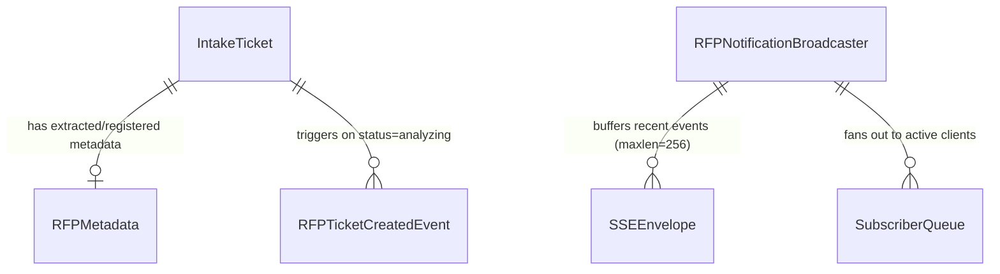
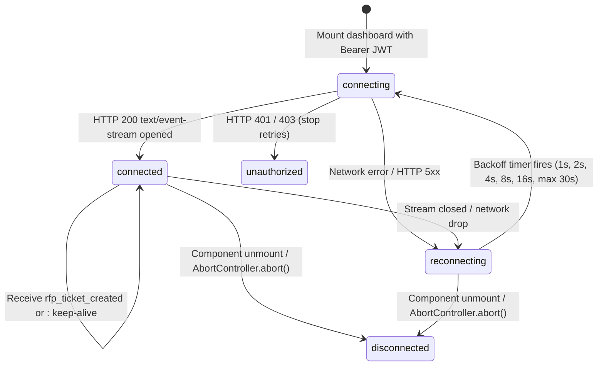

# Phase 1 Data Model: Real-Time RFP Ticket Notifications (SSE Part 1)

**Feature Branch**: `034-sse-rfp-notifications`  
**Date**: 2026-11-24  
**Specification**: [spec.md](./spec.md)  
**Research**: [research.md](./research.md)

---

## 1. Domain Entities & Value Objects

### 1.1 `RFPTicketCreatedEvent` (Real-Time Notification Payload)

Represents the canonical `rfp_ticket_created` Server-Sent Events (SSE) payload pushed when a new RFP ticket enters the system with initial `analyzing` status. Conforms strictly to Section 2 and Section 3 of `docs/real-time-notification/trackflow-BRIEFING.es.md`.

| Field | Type | Required | Constraints / Validation Rules | Example |
|---|---|---|---|---|
| `ticket_id` | `string` | Yes | Non-empty unique ticket identifier (supports briefing display IDs like `tkt_0225` or UUID string). Used as primary deduplication key on client and server. | `"tkt_0225"` |
| `rfp_id` | `string` | Yes | Non-empty linked RFP identifier (e.g. `rfp_0071` or ticket reference number). | `"rfp_0071"` |
| `client_name` | `string` | Yes | Prospective client organization name (`min_length=1`). | `"Northline Apparel"` |
| `client_country` | `"US" \| "ES"` | Yes | Client operating country per TrackFlow briefing (`US` or `ES`). | `"US"` |
| `services_requested` | `string[]` | Yes | Non-empty list of requested logistics services (e.g. `["warehouse", "lastmile", "reverse"]`). | `["warehouse", "lastmile"]` |
| `status` | `"analyzing"` | Yes | Initial RFP ticket status at notification time. Always `"analyzing"` for `rfp_ticket_created`. | `"analyzing"` |
| `created_at` | `string` (ISO-8601 UTC) | Yes | UTC timestamp when the ticket was registered (`YYYY-MM-DDTHH:MM:SSZ`). | `"2026-07-24T14:32:00Z"` |

> **Wire-Level Constraint (FR-003)**: The JSON serialized into the SSE `data:` line MUST be a flat JSON object containing the fields above directly—never wrapped inside `{"event": "...", "data": {...}}`.

---

### 1.2 `SSEEnvelope` (Server-Side In-Memory Ring Buffer Frame)

Represents a sequenced SSE event frame stored in the bounded server ring buffer (`maxlen=256`) for `Last-Event-ID` replay and live subscriber delivery.

| Field | Type | Required | Description |
|---|---|---|---|
| `event_id` | `int` | Yes | Monotonically increasing sequence number (`1, 2, 3, ...`) formatted as `id: <event_id>` on the SSE wire. |
| `event_name` | `string` | Yes | SSE event type name (`"rfp_ticket_created"`). Extensible for future event types. |
| `ticket_id` | `string` | Yes | Deduplication key corresponding to `payload.ticket_id`. |
| `payload` | `RFPTicketCreatedEvent` | Yes | Validated flat notification payload dictionary. |
| `emitted_at` | `datetime` | Yes | Server UTC timestamp when the event was published to the broadcaster. |

**SSE Wire Serialization**:
```text
id: 1
event: rfp_ticket_created
data: {"ticket_id": "tkt_0225", "rfp_id": "rfp_0071", "client_name": "Northline Apparel", "client_country": "US", "services_requested": ["warehouse", "lastmile"], "status": "analyzing", "created_at": "2026-07-24T14:32:00Z"}

```

---

### 1.3 `CreateRFPTicketRequest` & Extended `IntakeTicketSummary`

Supports deterministic, non-LLM ticket registration (`POST /api/v1/rfp/tickets`) and enriches `GET /api/v1/rfp/tickets` summary items so missed-ticket reconciliation returns all briefing fields required by the dashboard.

#### `CreateRFPTicketRequest` (`POST /api/v1/rfp/tickets`)

| Field | Type | Required | Default | Description |
|---|---|---|---|---|
| `ticket_id` | `string \| null` | No | Auto-generated UUID / `tkt_XXXX` | Optional custom ticket identifier (e.g. `"tkt_0225"`) or UUID. |
| `rfp_id` | `string \| null` | No | Auto-generated `rfp_XXXX` | Optional linked RFP reference identifier (e.g. `"rfp_0071"`). |
| `client_name` | `string` | Yes | — | Prospective client organization name (`min_length=1`). |
| `client_country` | `"US" \| "ES"` | Yes | — | Operating country (`"US"` or `"ES"`). |
| `services_requested` | `string[]` | Yes | — | Requested logistics services (`min_items=1`, e.g. `["warehouse", "lastmile"]`). |
| `monthly_volume` | `int \| null` | No | `null` | Expected monthly order volume. |
| `deadline` | `string \| null` | No | `null` | Proposal submission deadline. |
| `budget_range` | `string \| null` | No | `null` | Client budget expectation. |

#### Extended `IntakeTicketSummary` (in `GET /api/v1/rfp/tickets`)

Preserves 100% backward compatibility with existing fields (`ticket_id`, `ticket_number`, `status`, `raw_pdf_filename`, `client_name`, `rejection_reason`, `created_at`, `updated_at`) and adds optional briefing fields populated from `RFPMetadata`:
- `rfp_id: Optional[str]` (derived from `ticket_number` / metadata reference, e.g. `"rfp_0071"` or `"RFP-2026-..."`)
- `client_country: Optional[Literal["US", "ES"]]`
- `services_requested: List[str]` (defaults to `[]`)

---

### 1.4 Frontend Real-Time State Model (`uis/backoffice`)

Used by the `useRFPNotifications` hook and `RFPIntakePage` in `uis/backoffice`:

| Type / Interface | Location | Fields | Purpose |
|---|---|---|---|
| `RFPTicketCreatedEventDTO` | `packages/shared/types/rfp.ts` | `ticket_id`, `rfp_id`, `client_name`, `client_country`, `services_requested`, `status`, `created_at` | Shared strict TypeScript contract for `rfp_ticket_created` SSE events. |
| `CreateRFPTicketRequestDTO` | `packages/shared/types/rfp.ts` | `ticket_id?`, `rfp_id?`, `client_name`, `client_country`, `services_requested`, `monthly_volume?`, `deadline?`, `budget_range?` | Shared strict TypeScript contract for `POST /api/v1/rfp/tickets`. |
| `SSEConnectionStatus` | `packages/shared/types/rfp.ts` | `"connecting" \| "connected" \| "reconnecting" \| "disconnected" \| "unauthorized"` | Tracks live SSE stream health, backoff status, and auth rejection in the UI. |

---

## 2. Entity Relationships & Data Flow



---

## 3. State Transitions

### 3.1 Ticket Notification Lifecycle

1. **Ticket Registered (`status = analyzing` / `analizando`)**:
   - Triggered either via `POST /api/v1/rfp/tickets` (direct non-LLM registration) or in `RFPIntakePipeline._node_orchestrate` immediately after the document is classified as a valid RFP and `RFPMetadata` is saved while the ticket status is still `analizando`.
2. **Event Deduplication & Publication**:
   - `RFPNotificationBroadcaster.publish_ticket_created(event)` checks if `event.ticket_id` was already broadcast in the current history window; if not, assigns the next monotonic `event_id`, appends the `SSEEnvelope` to the ring buffer, and pushes it to every active subscriber's `asyncio.Queue`.
3. **Client Receipt & Visual Highlight**:
   - Connected dashboards receive `event: rfp_ticket_created`, check their deduplicated `ticket_id` set, prepend the new ticket to the dashboard table/feed without reloading the page, and mark `isNewRealtimeArrival = true` so the row/banner renders with a visual `"Nuevo en tiempo real"` badge.

### 3.2 Client SSE Connection State Machine


