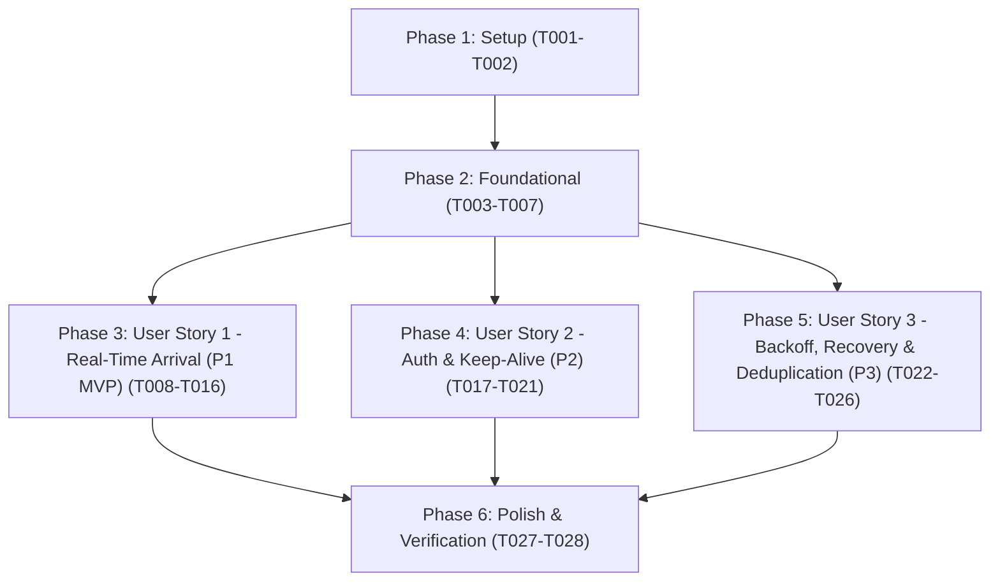

# Tasks: Real-Time RFP Ticket Notifications (SSE Part 1 of 2)

**Input**: Design documents from `/specs/034-sse-rfp-notifications/`  
**Prerequisites**: [plan.md](./plan.md) (required), [spec.md](./spec.md) (required for user stories), [research.md](./research.md), [data-model.md](./data-model.md), [contracts/](./contracts/), [quickstart.md](./quickstart.md)

**Tests**: Automated tests (`pytest` and `jest`) are explicitly required by **FR-014**, **SC-001 through SC-006**, and **Constitution Principle VI** (Test-First Development & Deterministic Verification Gates). Test tasks are included within each user story phase prior to or alongside implementation.

**Organization**: Tasks are grouped by user story (`US1` → `US2` → `US3`) to enable independent implementation, verification, and incremental delivery of each story.

## Format: `[ID] [P?] [Story] Description`

- **[P]**: Can run in parallel (different files, no dependencies on incomplete tasks)
- **[Story]**: Which user story this task belongs to (`[US1]`, `[US2]`, `[US3]`)
- Exact repository-relative file paths are included in every task description

---

## Phase 1: Setup (Shared Infrastructure & Contracts)

**Purpose**: Initialize the backend messaging package directory and define shared TypeScript DTOs in `@repo/shared-types` so backend and frontend layers share a single source of truth for `rfp_ticket_created` SSE payloads.

- [ ] T001 Create messaging infrastructure package directory and exports stub in `services/api/infrastructure/messaging/__init__.py`
- [ ] T002 [P] Extend shared RFP TypeScript contracts with `RFPTicketCreatedEventDTO`, `CreateRFPTicketRequestDTO`, `SSEConnectionStatus`, and enriched `IntakeTicketSummaryDTO` fields (`rfp_id`, `client_country`, `services_requested`, `isNewRealtimeArrival`) in `packages/shared/types/rfp.ts`

---

## Phase 2: Foundational (Blocking Prerequisites)

**Purpose**: Core domain entities, broadcaster port, in-memory pub/sub ring-buffer adapter, FastAPI dependency provider, and Pydantic schemas required before any user story endpoint or UI consumer can be wired.

**⚠️ CRITICAL**: No user story work can begin until this phase is complete.

- [ ] T003 Define `RFPTicketCreatedEvent` and `SSEEnvelope` domain value objects with W3C SSE wire serialization (`id:`, `event: rfp_ticket_created`, flat JSON `data:`) in `services/api/domain/rfp/entities.py`
- [ ] T004 [P] Define abstract `RFPNotificationBroadcasterPort` interface (`subscribe`, `unsubscribe`, `publish_ticket_created`, `get_missed_events`, `format_keep_alive`) in `services/api/domain/rfp/ports.py`
- [ ] T005 Implement thread-safe and async-safe `RFPNotificationBroadcaster` adapter with per-client `asyncio.Queue` fan-out, monotonic sequence IDs, bounded replay ring buffer (`collections.deque(maxlen=256)`), and `ticket_id` deduplication in `services/api/infrastructure/messaging/rfp_notification_broadcaster.py`
- [ ] T006 [P] Add `CreateRFPTicketRequest` and `RFPTicketCreatedEventSchema` Pydantic models and enrich `IntakeTicketSummary` with optional `rfp_id`, `client_country`, and `services_requested` fields in `services/api/presentation/schemas/rfp.py`
- [ ] T007 Register singleton `get_rfp_notification_broadcaster_dep` dependency provider in `services/api/presentation/dependencies.py` and export `RFPNotificationBroadcaster` in `services/api/infrastructure/messaging/__init__.py`

**Checkpoint**: Foundation ready — domain contracts, SSE broadcaster engine, Pydantic schemas, and dependency injection are in place. User story implementation can now proceed.

---

## Phase 3: User Story 1 - Real-Time New RFP Ticket Arrival on Commercial Dashboard (Priority: P1) 🎯 MVP

**Goal**: Deliver end-to-end real-time `rfp_ticket_created` notifications from backend ticket creation (both direct non-LLM `POST /api/v1/rfp/tickets` and `RFPIntakePipeline._node_orchestrate`) over `GET /api/v1/rfp/notifications/stream` to connected backoffice commercial users, prepending newly arrived tickets in real time with a visual highlight badge and zero page reloads or LLM invocations.

**Independent Test**: Connect an authenticated client to `GET /api/v1/rfp/notifications/stream` (or open `/rfp` in `uis/backoffice`), register a new ticket with status `analyzing` via `POST /api/v1/rfp/tickets`, and verify that `event: rfp_ticket_created` with flat JSON (`ticket_id`, `rfp_id`, `client_name`, `client_country`, `services_requested`, `status: "analyzing"`, `created_at`) arrives within `< 2s` and renders on the dashboard with a visual `"Nuevo en tiempo real"` indicator without reloading the page.

### Tests for User Story 1 ⚠️

> **NOTE: Write these tests FIRST and verify they fail before completing implementation**

- [ ] T008 [P] [US1] Add backend tests for SSE stream headers (`Content-Type: text/event-stream`, `Cache-Control: no-cache`, `Connection: keep-alive`, `X-Accel-Buffering: no`), named `event: rfp_ticket_created` wire framing, flat JSON schema compliance, non-LLM `POST /api/v1/rfp/tickets` broadcast, intake pipeline broadcast, and multi-client concurrent fan-out in `services/api/tests/test_rfp_sse_notifications.py`
- [ ] T009 [P] [US1] Add frontend unit tests for W3C SSE frame line-buffered parsing (`id:`, `event: rfp_ticket_created`, flat `data:` JSON) and real-time ticket prepend transformation in `uis/backoffice/__tests__/rfpNotifications.test.ts`

### Implementation for User Story 1

- [ ] T010 [US1] Implement `POST /api/v1/rfp/tickets` (and legacy `/rfp/tickets`) non-LLM ticket registration endpoint persisting `IntakeTicket` (`status = analizando`) + `RFPMetadata` and broadcasting `rfp_ticket_created` with `status: "analyzing"` in `services/api/presentation/api/v1/rfp.py`
- [ ] T011 [US1] Implement `GET /api/v1/rfp/notifications/stream` and compatibility alias `GET /api/v1/rfp/events` (plus legacy mounts `/rfp/notifications/stream` and `/rfp/events`) returning `StreamingResponse(..., media_type="text/event-stream")` with SSE cache/proxy headers in `services/api/presentation/api/v1/rfp.py`
- [ ] T012 [US1] Emit `rfp_ticket_created` notification via `RFPNotificationBroadcaster` inside `RFPIntakePipeline._node_orchestrate` once a document is classified as a valid RFP (`is_rfp = True`) and its metadata is saved in `analyzing` status in `data/pipelines/rfp_intake/rfp_intake_pipeline.py`
- [ ] T013 [P] [US1] Implement authenticated `fetch()` + `ReadableStream` SSE client (`connectRFPNotificationStream`), W3C SSE frame parser (`parseSSEChunk`), and event-to-ticket mapper (`mapRFPEventToTicketSummary`) in `uis/backoffice/lib/rfpNotificationsClient.ts`
- [ ] T014 [US1] Implement `useRFPNotifications` React hook managing the SSE stream lifecycle, live `rfp_ticket_created` arrivals, and newly arrived ticket highlight state (`realtimeTicketIds`, `latestArrival`, `dismissLatestArrival`) in `uis/backoffice/hooks/useRFPNotifications.ts`
- [ ] T015 [P] [US1] Create `RFPRealtimeNotificationBanner` component displaying the live SSE connection badge, newly arrived RFP toast/banner (`ticket_id`, `rfp_id`, `client_name`, `client_country`, `services_requested`, `status: "analyzing"`), and dismiss action in `uis/backoffice/components/rfp/RFPRealtimeNotificationBanner.tsx`
- [ ] T016 [US1] Integrate `useRFPNotifications` and `RFPRealtimeNotificationBanner` into `RFPIntakePage`, replacing manual refresh/3s list-discovery polling with real-time SSE prepend and rendering `"Nuevo en tiempo real"` badges, `rfp_id`, `client_country`, and `services_requested` tags in `uis/backoffice/app/rfp/page.tsx`

**Checkpoint**: User Story 1 (MVP) is complete and independently testable — registering an RFP ticket broadcasts `event: rfp_ticket_created` to all connected commercial users and immediately renders on `/rfp` with visual distinction.

---

## Phase 4: User Story 2 - Authenticated Stream Access & Idle Connection Stability (Priority: P2)

**Goal**: Enforce backoffice Bearer JWT authentication on the SSE notification stream (`401 Unauthorized` / `403 Forbidden` before opening any stream) with zero JWT exposure in URLs, and emit periodic `: keep-alive` comment frames every 15 seconds (configurable for tests) plus clean subscriber teardown on disconnect.

**Independent Test**: Request `GET /api/v1/rfp/notifications/stream` without a token or with an invalid JWT and verify an immediate `401 Unauthorized` JSON response with zero SSE events emitted; connect with a valid Bearer JWT and `heartbeat_interval=0.2` during an idle period and verify `: keep-alive` comment frames arrive periodically and the subscriber queue is removed cleanly upon disconnect.

### Tests for User Story 2 ⚠️

- [ ] T017 [P] [US2] Add backend tests for unauthenticated (`401`), invalid/expired JWT (`401`), inactive user (`403`) rejection on `/api/v1/rfp/notifications/stream` and `/api/v1/rfp/events`, periodic `: keep-alive` comment emission during idle intervals, and subscriber queue cleanup on client disconnect in `services/api/tests/test_rfp_sse_notifications.py`
- [ ] T018 [P] [US2] Add frontend unit tests verifying `Authorization: Bearer <token>` header transmission (with zero token leakage in the request URL), `: keep-alive` comment frame handling without false event triggers, and immediate halt with `"unauthorized"` status on HTTP `401`/`403` in `uis/backoffice/__tests__/rfpNotifications.test.ts`

### Implementation for User Story 2

- [ ] T019 [US2] Enforce `Depends(get_current_user)` authentication guard, idle `asyncio.wait_for(..., timeout=heartbeat_interval)` `: keep-alive\n\n` comment emission (default `15.0s`), and `try/finally` subscriber cleanup on `GET /api/v1/rfp/notifications/stream` and `GET /api/v1/rfp/events` in `services/api/presentation/api/v1/rfp.py`
- [ ] T020 [US2] Handle `: keep-alive` comment frames and HTTP `401`/`403` authentication rejection (`SSEAuthError` transitioning `connectionStatus` to `"unauthorized"` without scheduling retries) in `uis/backoffice/lib/rfpNotificationsClient.ts` and `uis/backoffice/hooks/useRFPNotifications.ts`
- [ ] T021 [US2] Render clear connection and authentication error indicators (`"Tiempo Real Activo (SSE)"`, `"Reconectando..."`, `"Sesión expirada / No autorizado"`) in `uis/backoffice/components/rfp/RFPRealtimeNotificationBanner.tsx`

**Checkpoint**: User Stories 1 AND 2 are both complete and independently verified — unauthorized stream attempts are rejected immediately, JWTs never appear in URLs, and idle connections remain stable via `: keep-alive` heartbeats.

---

## Phase 5: User Story 3 - Automatic Reconnection, Missed-Ticket Recovery & Deduplication (Priority: P3)

**Goal**: Automatically reconnect interrupted SSE streams using exponential backoff (`1s, 2s, 4s, 8s, 16s`, capped at `30s`), recover 100% of RFP tickets registered while disconnected via hybrid `Last-Event-ID` ring-buffer replay and `GET /api/v1/rfp/tickets` REST reconciliation, and strictly deduplicate tickets by `ticket_id` across initial load, live events, and recovery.

**Independent Test**: Simulate an SSE disconnect while registering new RFP tickets; verify the client computes exponential backoff (`1s, 2s, 4s, 8s, 16s, 30s`), reconnects with `Last-Event-ID` to replay buffered events, reconciles against `GET /api/v1/rfp/tickets`, and renders each unique `ticket_id` exactly once with zero duplicates.

### Tests for User Story 3 ⚠️

- [ ] T022 [P] [US3] Add backend tests for monotonic SSE `id:` assignment, `Last-Event-ID` header and `last_event_id` query parameter ring-buffer replay (`id > last_event_id`), broadcaster `ticket_id` deduplication, and enriched `GET /api/v1/rfp/tickets` reconciliation fields (`rfp_id`, `client_country`, `services_requested`) in `services/api/tests/test_rfp_sse_notifications.py`
- [ ] T023 [P] [US3] Add frontend unit tests for exponential backoff schedule (`calculateReconnectBackoffMs`: `1s, 2s, 4s, 8s, 16s, 30s` cap), `Last-Event-ID` header propagation on reconnect, REST fallback reconciliation (`GET /api/v1/rfp/tickets`), and `mergeAndDeduplicateTickets` by `ticket_id` across overlapping live + replayed + reconciled records in `uis/backoffice/__tests__/rfpNotifications.test.ts`

### Implementation for User Story 3

- [ ] T024 [US3] Implement `Last-Event-ID` header and `last_event_id` query parameter parsing and missed-event replay from `RFPNotificationBroadcaster.get_missed_events()` before live queue streaming, and enrich `GET /api/v1/rfp/tickets` summaries with `rfp_id`, `client_country`, and `services_requested` from `RFPMetadata` in `services/api/presentation/api/v1/rfp.py`
- [ ] T025 [P] [US3] Implement `calculateReconnectBackoffMs(attempt)` (`min(1000 * 2^attempt, 30000)`) and deterministic `mergeAndDeduplicateTickets` utility keyed by `ticket_id` in `uis/backoffice/lib/rfpNotificationsClient.ts`
- [ ] T026 [US3] Implement automatic exponential backoff reconnection timer, `Last-Event-ID` tracking across reconnects, post-reconnect `GET /api/v1/rfp/tickets` fallback reconciliation, and `ticket_id` deduplication in `uis/backoffice/hooks/useRFPNotifications.ts`

**Checkpoint**: All three user stories (`US1`, `US2`, `US3`) are independently functional and covered by automated backend and frontend tests.

---

## Phase 6: Polish & Cross-Cutting Concerns

**Purpose**: Architectural deliverable documentation required by the briefing (Section 5) and full monorepo verification gates.

- [ ] T027 [P] Author `docs/real-time-notification/ARCHITECTURE_NOTES.md` documenting: (1) concurrency & fan-out scaling from 2 to 50+ simultaneous sales users (`asyncio.Queue` in-memory vs. multi-worker Redis Pub/Sub + Streams via `RFPNotificationBroadcasterPort`), (2) hybrid missed-ticket recovery (`Last-Event-ID` ring buffer + REST reconciliation) and `ticket_id` deduplication, and (3) why SSE was chosen over WebSockets for Part 1
- [ ] T028 Execute full verification suite (`pytest services/api/tests/test_rfp_sse_notifications.py`, `npm --prefix uis/backoffice test -- rfpNotifications`, `npm run typecheck`, and `npm --prefix uis/backoffice run build`) per `specs/034-sse-rfp-notifications/quickstart.md`

---

## Dependencies & Execution Order

### Phase Dependencies



- **Phase 1 (Setup)**: No dependencies — can start immediately.
- **Phase 2 (Foundational)**: Depends on Phase 1 — **BLOCKS** all user stories (`US1`, `US2`, `US3`).
- **Phase 3 (`US1` - P1 MVP)**: Depends on Phase 2. Delivers live SSE broadcast and dashboard arrival.
- **Phase 4 (`US2` - P2)**: Depends on Phase 2 (and extends the stream route/client from `US1`). Can be tested independently for `401`/`403` rejection and `: keep-alive` heartbeats.
- **Phase 5 (`US3` - P3)**: Depends on Phase 2 (and extends the stream route/client from `US1`/`US2`). Can be tested independently for backoff schedule, `Last-Event-ID` replay, REST reconciliation, and `ticket_id` deduplication.
- **Phase 6 (Polish)**: Depends on completion of `US1`, `US2`, and `US3`.

### Within Each User Story

1. Automated tests (`pytest` / `jest`) are authored first to codify the wire format, auth, heartbeat, backoff, and deduplication contracts.
2. Backend endpoints and pipeline emission (`services/api/`, `data/pipelines/`) before or in parallel with frontend client utilities (`uis/backoffice/lib/`).
3. Frontend hook (`useRFPNotifications.ts`) and banner component (`RFPRealtimeNotificationBanner.tsx`) before dashboard page integration (`uis/backoffice/app/rfp/page.tsx`).

### Parallel Opportunities

- **Phase 1**: `T001` (Python package stub) and `T002` (TypeScript shared DTOs) touch independent workspaces and can run in parallel.
- **Phase 2**: `T003` (`entities.py`), `T004` (`ports.py`), and `T006` (`schemas/rfp.py`) modify separate files and can run in parallel before `T005` (`rfp_notification_broadcaster.py`) and `T007` (`dependencies.py`).
- **Phase 3 (`US1`)**:
  - `T008` (backend pytest suite) and `T009` (frontend Jest suite) can run in parallel.
  - Backend tasks (`T010`, `T011`, `T012`) can run in parallel with frontend tasks (`T013`, `T015`).
- **Phase 4 (`US2`)**: `T017` (backend auth/heartbeat tests) and `T018` (frontend auth/heartbeat tests) can run in parallel.
- **Phase 5 (`US3`)**: `T022` (backend replay/dedup tests), `T023` (frontend backoff/recovery/dedup tests), and `T025` (frontend backoff/dedup utilities) can run in parallel.
- **Phase 6**: `T027` (`ARCHITECTURE_NOTES.md`) can be written in parallel with final test verification preparation before `T028`.

---

## Parallel Execution Examples

### User Story 1 (`US1`)

```bash
# 1. Author backend and frontend US1 tests in parallel:
Task T008: "Add backend tests for SSE stream headers, event: rfp_ticket_created wire framing, POST /api/v1/rfp/tickets, and fan-out in services/api/tests/test_rfp_sse_notifications.py"
Task T009: "Add frontend unit tests for W3C SSE frame parsing and real-time ticket prepend in uis/backoffice/__tests__/rfpNotifications.test.ts"

# 2. Build backend trigger/stream and frontend SSE client/banner in parallel:
Task T012: "Emit rfp_ticket_created notification in data/pipelines/rfp_intake/rfp_intake_pipeline.py"
Task T013: "Implement authenticated fetch() + ReadableStream SSE client in uis/backoffice/lib/rfpNotificationsClient.ts"
Task T015: "Create RFPRealtimeNotificationBanner component in uis/backoffice/components/rfp/RFPRealtimeNotificationBanner.tsx"
```

### User Story 2 (`US2`)

```bash
# Author backend and frontend US2 authentication & heartbeat tests in parallel:
Task T017: "Add backend tests for 401/403 rejection, : keep-alive heartbeats, and disconnect cleanup in services/api/tests/test_rfp_sse_notifications.py"
Task T018: "Add frontend unit tests for Authorization header, : keep-alive handling, and 401 halt in uis/backoffice/__tests__/rfpNotifications.test.ts"
```

### User Story 3 (`US3`)

```bash
# Author backend replay tests, frontend backoff/dedup tests, and client utilities in parallel:
Task T022: "Add backend tests for Last-Event-ID replay and enriched GET /api/v1/rfp/tickets in services/api/tests/test_rfp_sse_notifications.py"
Task T023: "Add frontend unit tests for exponential backoff, hybrid recovery, and ticket_id deduplication in uis/backoffice/__tests__/rfpNotifications.test.ts"
Task T025: "Implement calculateReconnectBackoffMs and mergeAndDeduplicateTickets in uis/backoffice/lib/rfpNotificationsClient.ts"
```

---

## Implementation Strategy

### MVP First (User Story 1 Only)

1. Complete **Phase 1: Setup** (`T001`–`T002`).
2. Complete **Phase 2: Foundational** (`T003`–`T007`).
3. Complete **Phase 3: User Story 1** (`T008`–`T016`).
4. **STOP and VALIDATE**: Verify live `event: rfp_ticket_created` streaming from `POST /api/v1/rfp/tickets` to the backoffice `/rfp` dashboard with visual `"Nuevo en tiempo real"` highlighting and zero page reloads.

### Incremental Delivery

1. **Setup + Foundational** → Core SSE domain, bounded ring-buffer broadcaster, and shared TypeScript DTOs ready.
2. **Add User Story 1 (P1)** → Live `rfp_ticket_created` notifications on `/rfp` dashboard (MVP).
3. **Add User Story 2 (P2)** → Hardened Bearer JWT stream protection (`401`/`403`) and 15-second `: keep-alive` heartbeats for corporate proxies.
4. **Add User Story 3 (P3)** → Automatic exponential backoff (`1s..30s`), hybrid `Last-Event-ID` + REST missed-ticket recovery, and strict `ticket_id` deduplication.
5. **Complete Phase 6 (Polish)** → Architectural analysis (`docs/real-time-notification/ARCHITECTURE_NOTES.md`) and full monorepo quality gates (`pytest`, `jest`, `typecheck`, `build`).
