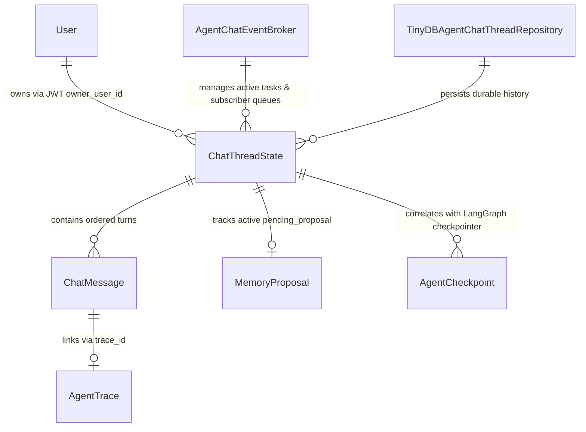
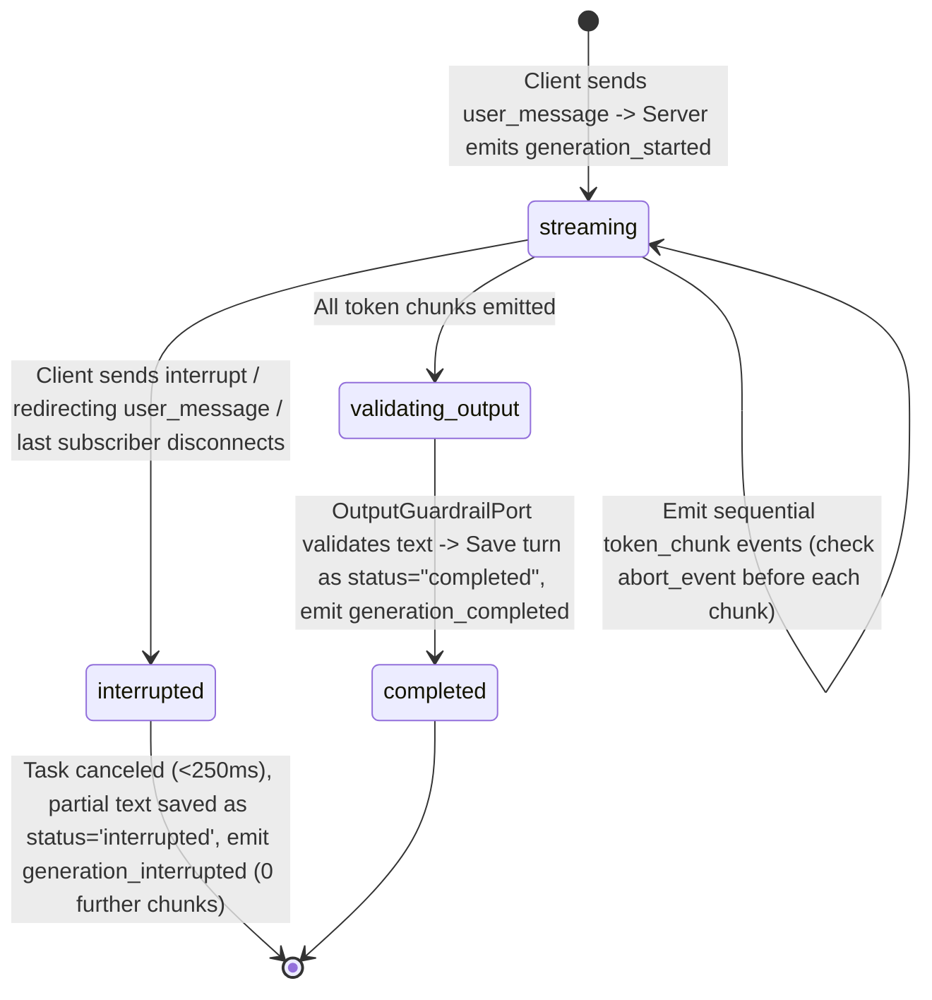
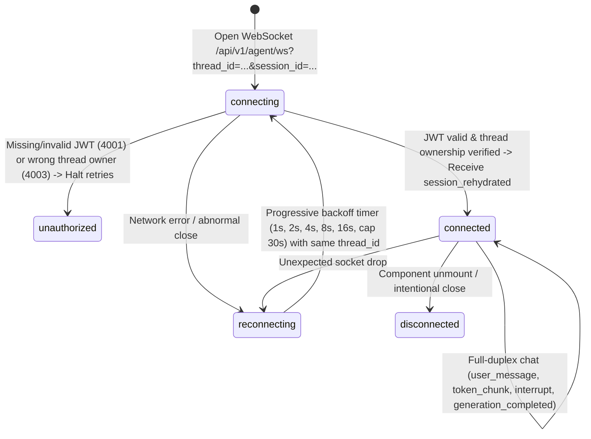

# Phase 1 Data Model: Real-Time Bidirectional WebSocket Streaming Chat with True Generation Abort (Part 2)

**Feature Branch**: `035-websocket-streaming-chat`  
**Date**: 2026-11-24  
**Specification**: [spec.md](./spec.md)  
**Research**: [research.md](./research.md)

---

## 1. Domain Entities & Value Objects

### 1.1 `ChatThreadState` (Conversation Thread Aggregate)

Represents a persistent, multi-turn TrackFlow support agent conversation bound to an authenticated operator and a LangGraph `thread_id` / `session_id` (FR-003, FR-012).

| Field | Type | Required | Constraints / Validation Rules | Example |
|---|---|---|---|---|
| `thread_id` | `string` | Yes | Non-empty unique thread identifier (`1..128` chars) used as LangGraph `configurable.thread_id` and pub/sub broker channel key. | `"thr_support_001"` |
| `session_id` | `string` | Yes | Non-empty session identifier (`1..128` chars) correlated with `AuthenticatedSessionContext.session_id`. Defaults to `thread_id` if omitted. | `"sess_support_001"` |
| `owner_user_id` | `string` | Yes | Authenticated backoffice operator's user ID from JWT `sub` claim. Enforces strict per-operator thread ownership (Clarification 5). | `"usr_admin_01"` |
| `owner_email` | `string` | No | Authenticated operator's email for audit attribution (never logged in plaintext). | `"operator@trackflow.com"` |
| `messages` | `ChatMessage[]` | Yes | Chronologically ordered list of user and assistant turns (including `completed` and `interrupted` partial turns). | `[...]` |
| `pending_proposal` | `MemoryProposal \| null` | No | Active unconfirmed `MemoryProposal` on this thread, if any (FR-013). | `null` |
| `session_context` | `AuthenticatedSessionContext \| null` | No | Optional session context for order ownership and US/ES jurisdiction checks. | `{"session_id": "sess_support_001", ...}` |
| `latest_checkpoint_id` | `string \| null` | No | Most recent LangGraph checkpointer snapshot ID for this `thread_id`. | `"1ef9a2c0-..."` |
| `latest_sequence_id` | `int` | Yes | Monotonically increasing per-thread event sequence counter (`>= 0`). | `14` |
| `created_at` | `string` (ISO-8601 UTC) | Yes | UTC creation timestamp of the thread. | `"2026-11-24T21:00:00Z"` |
| `updated_at` | `string` (ISO-8601 UTC) | Yes | UTC timestamp of most recent turn update or interruption. | `"2026-11-24T21:05:12Z"` |

---

### 1.2 `ChatMessage` (Conversation Turn Entity)

Represents a single user or assistant turn within a `ChatThreadState` timeline (FR-006..FR-010, FR-012).

| Field | Type | Required | Constraints / Validation Rules | Example |
|---|---|---|---|---|
| `turn_id` | `string` | Yes | Unique turn identifier (`UUID` or client-supplied idempotency ID). Alias `message_id` supported in DTO serialization. | `"turn_9f81c2"` |
| `thread_id` | `string` | Yes | Parent conversation `thread_id`. | `"thr_support_001"` |
| `session_id` | `string` | Yes | Parent `session_id`. | `"sess_support_001"` |
| `role` | `"user" \| "assistant"` | Yes | Author role of the turn. | `"assistant"` |
| `content` | `string` | Yes | Full text (for `user` or `completed` assistant turns) or accumulated partial text up to the instant of abort (for `interrupted` assistant turns). | `"Under TrackFlow's standard return policy..."` |
| `status` | `"streaming" \| "completed" \| "interrupted" \| "error"` | Yes | Lifecycle state of the turn. User turns are immediately `"completed"`; aborted assistant turns are permanently marked `"interrupted"`. | `"interrupted"` |
| `parent_user_turn_id` | `string \| null` | No | For assistant turns, references the triggering user `turn_id`. | `"turn_9f81c1"` |
| `interrupted_reason` | `"client_interrupt" \| "redirect_new_message" \| "client_disconnect" \| null` | No | Populated when `status == "interrupted"`. | `"client_interrupt"` |
| `is_refusal` | `bool` | Yes | Whether the turn resulted in a policy, mutation, or guardrail refusal. Defaults to `false`. | `false` |
| `fallback_triggered` | `bool` | Yes | Whether an operational tool degraded/timed out and traversed `tool_fallback`. Defaults to `false`. | `false` |
| `trace_id` | `string \| null` | No | Correlated `AgentTrace.trace_id` in `TraceRegistryPort`. | `"4b2d8e1a-..."` |
| `node_sequence` | `string[]` | Yes | Ordered LangGraph nodes executed for this turn. | `["intake", "retrieval", "generation"]` |
| `execution_time_ms` | `float` | Yes | Turn execution duration in milliseconds (`>= 0.0`). | `142.5` |
| `sources` | `SourceCitation[]` | Yes | Grounded corporate policy citations (`source_document`, `section`, `similarity_score`). | `[{"source_document": "returns-policy", ...}]` |
| `sources_consulted` | `string[]` | Yes | Data sources consulted (`"ticket_tool"`, `"inventory_tool"`, `"rag"`, `"agent_memory"`). | `["rag"]` |
| `tool_calls` | `ToolCallTrace[]` | Yes | Summary of read-only operational tool calls executed during the turn. | `[]` |
| `memory_proposal` | `MemoryProposal \| null` | No | Candidate operational memory proposed during this turn, if any. | `null` |
| `recalled_memories` | `string[]` | Yes | Confirmed cross-session rules recalled and applied in this turn. | `[]` |
| `guardrail_interventions` | `GuardrailAuditEvent[]` | Yes | Sanitized guardrail audit records triggered during this turn. | `[]` |
| `resolved_country` | `"US" \| "ES" \| null` | No | Authoritative operating jurisdiction resolved for the turn. | `"US"` |
| `created_at` | `string` (ISO-8601 UTC) | Yes | UTC timestamp when the turn started. | `"2026-11-24T21:05:10Z"` |
| `updated_at` | `string` (ISO-8601 UTC) | Yes | UTC timestamp when the turn completed or was interrupted. | `"2026-11-24T21:05:12Z"` |

---

### 1.3 `AgentChatStreamEvent` (Structured Server-to-Client Pub/Sub & WebSocket Envelope)

Published by the agent streaming producer to `AgentChatEventBrokerPort` and forwarded as JSON frames to subscribed WebSocket clients (FR-004, FR-005). Strictly aligned with TrackFlow's support agent domain conventions (zero RFP `Ticket` SSE fields).

| `event` Discriminator | Purpose | Payload Fields |
|---|---|---|
| `"session_rehydrated"` | Emitted upon authenticated WebSocket binding or explicit `rehydrate` frame. | `event`, `thread_id`, `session_id`, `sequence_id`, `timestamp`, `messages: ChatMessage[]`, `pending_proposal: MemoryProposal \| null`, `checkpoint_count: int`, `latest_checkpoint_id: str \| null` |
| `"generation_started"` | Emitted when an assistant turn starts executing. | `event`, `thread_id`, `session_id`, `turn_id`, `user_turn_id`, `query`, `sequence_id`, `timestamp` |
| `"token_chunk"` | Emitted incrementally for each generated token/word chunk in real time. | `event`, `thread_id`, `session_id`, `turn_id`, `chunk_index: int`, `delta: str`, `accumulated_content: str`, `sequence_id`, `timestamp` |
| `"generation_interrupted"` | Emitted immediately upon cooperative task cancellation (interrupt, redirect, or last-client disconnect). | `event`, `thread_id`, `session_id`, `turn_id`, `partial_content: str`, `status: "interrupted"`, `reason: "client_interrupt" \| "redirect_new_message" \| "client_disconnect"`, `sequence_id`, `timestamp` |
| `"generation_completed"` | Emitted after all `token_chunk` events and post-stream output guardrail validation succeed. | `event`, `thread_id`, `session_id`, `turn_id`, `query`, `content: str`, `status: "completed"`, `is_refusal: bool`, `fallback_triggered: bool`, `trace_id: str`, `node_sequence: str[]`, `execution_time_ms: float`, `sources: SourceCitation[]`, `sources_consulted: str[]`, `tool_calls: ToolCallTrace[]`, `memory_proposal: MemoryProposal \| null`, `recalled_memories: str[]`, `guardrail_interventions: GuardrailAuditEvent[]`, `resolved_country: "US" \| "ES" \| null`, `sequence_id`, `timestamp` |
| `"error"` | Emitted on validation or sanitized workflow errors without exposing raw stack traces. | `event`, `thread_id`, `session_id`, `turn_id: str \| null`, `error_code: str`, `detail: str`, `sequence_id`, `timestamp` |
| `"pong"` | Emitted in response to a client `"ping"` heartbeat frame. | `event`, `thread_id`, `session_id`, `sequence_id`, `timestamp` |

---

### 1.4 `AgentChatClientCommand` (Structured Client-to-Server WebSocket Frame)

Sent by the client over the bidirectional WebSocket channel while idle or while the server is actively streaming `token_chunk` events (FR-001, FR-005, FR-008).

| `event` Discriminator | Purpose | Payload Fields |
|---|---|---|
| `"authenticate"` | Optional first-frame JWT authentication if `?token=` was not passed in the WebSocket handshake URL. | `event: "authenticate"`, `token: str`, `thread_id?: str`, `session_id?: str` |
| `"user_message"` | Submits a user inquiry (or mid-stream redirecting inquiry). Automatically aborts any active streaming turn on the thread first. | `event: "user_message"`, `query: str`, `turn_id?: str`, `language?: "en" \| "es"`, `top_k?: int`, `min_score?: float`, `session_context?: AuthenticatedSessionContext` |
| `"interrupt"` | Requests immediate server-side cancellation of the active streaming assistant turn on the bound `thread_id`. | `event: "interrupt"`, `turn_id?: str`, `reason?: str` |
| `"rehydrate"` | Requests an immediate `session_rehydrated` snapshot from thread history/checkpoints. | `event: "rehydrate"`, `last_sequence_id?: int` |
| `"ping"` | Client heartbeat keep-alive frame. | `event: "ping"`, `timestamp?: str` |

---

## 2. Entity Relationships & Pub/Sub Architecture

---

## 3. State Transitions

### 3.1 Assistant Turn Lifecycle (Streaming, True Abort & Completion)

### 3.2 WebSocket Session & Reconnection Rehydration State Machine

