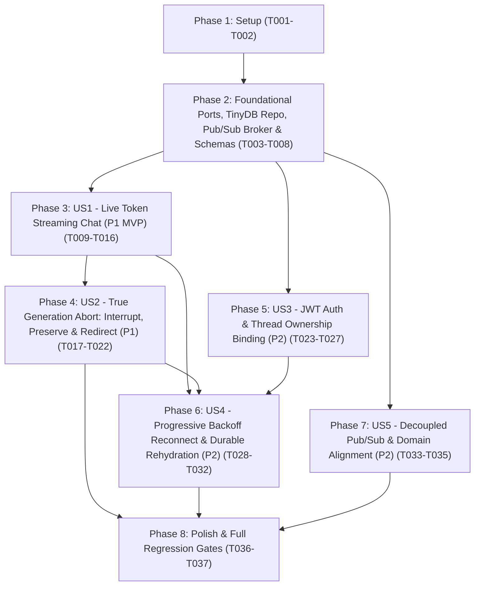

---

description: "Task list for Real-Time Bidirectional WebSocket Streaming Chat with True Generation Abort (Part 2 of 2)"
---

# Tasks: Real-Time Bidirectional WebSocket Streaming Chat with True Generation Abort

**Input**: Design documents from `/specs/035-websocket-streaming-chat/`

**Prerequisites**: [plan.md](file:///j:/GitHub/mr-stegmann-ai-engineering-company-project-monorepo/specs/035-websocket-streaming-chat/plan.md) (required), [spec.md](file:///j:/GitHub/mr-stegmann-ai-engineering-company-project-monorepo/specs/035-websocket-streaming-chat/spec.md) (required for user stories), [research.md](file:///j:/GitHub/mr-stegmann-ai-engineering-company-project-monorepo/specs/035-websocket-streaming-chat/research.md), [data-model.md](file:///j:/GitHub/mr-stegmann-ai-engineering-company-project-monorepo/specs/035-websocket-streaming-chat/data-model.md), [contracts/](file:///j:/GitHub/mr-stegmann-ai-engineering-company-project-monorepo/specs/035-websocket-streaming-chat/contracts/)

**Tests**: Automated unit and integration tests (`pytest` and `jest`) are included to satisfy the deterministic verification gates in `plan.md`, `quickstart.md`, and Constitution Principle VI.

**Organization**: Tasks are grouped by user story (`US1` through `US5`) to enable independent implementation and verification of each story increment.

## Format: `[ID] [P?] [Story] Description`

- **[P]**: Can run in parallel (different files, no dependencies on incomplete tasks)
- **[Story]**: Which user story this task belongs to (`[US1]`, `[US2]`, `[US3]`, `[US4]`, `[US5]`)
- Exact file paths are included in every task description

## Path Conventions

- **Shared TypeScript Contracts**: `packages/shared/types/`
- **Backend FastAPI Service**: `services/api/domain/`, `services/api/application/`, `services/api/infrastructure/`, `services/api/presentation/`, `services/api/tests/`
- **Backoffice Next.js Application**: `uis/backoffice/app/`, `uis/backoffice/components/`, `uis/backoffice/hooks/`, `uis/backoffice/lib/`, `uis/backoffice/__tests__/`

---

## Phase 1: Setup (Shared Infrastructure & Type Contracts)

**Purpose**: Shared TypeScript DTO contracts across `@repo/shared-types` and initial module scaffolding for the WebSocket chat broker, TinyDB thread persistence adapter, and backoffice chat client.

- [ ] T001 [P] Extend shared TypeScript contracts with Support Agent WebSocket chat DTOs (`ChatTurnRole`, `ChatTurnStatus`, `ChatInterruptedReason`, `WebSocketChatConnectionStatus`, `ChatMessageDTO`, `ChatThreadHistoryResponseDTO`, discriminated `AgentChatStreamEventDTO` union, discriminated `AgentChatClientCommandDTO` union, and `AgentQueryResponseDTO`) in `packages/shared/types/knowledge.ts`
- [ ] T002 [P] Export all new Support Agent WebSocket chat DTOs from the `@repo/shared-types` package entrypoint in `packages/shared/index.ts`

---

## Phase 2: Foundational (Blocking Prerequisites)

**Purpose**: Core domain entities, repository and pub/sub ports, durable TinyDB thread history adapter, in-process pub/sub broker, Pydantic schemas, and dependency injection providers that MUST be complete before user story implementation begins.

**⚠️ CRITICAL**: No user story work can begin until this phase is complete.

- [ ] T003 Define `ChatTurnRole`, `ChatTurnStatus`, `ChatInterruptedReason`, `ChatMessage`, `ChatThreadState`, and `AgentChatStreamEvent` domain value objects and entities in `services/api/domain/agent/entities.py`
- [ ] T004 Define abstract `AgentChatThreadRepositoryPort` and `AgentChatEventBrokerPort` interfaces in `services/api/domain/agent/ports.py`
- [ ] T005 [P] Implement thread-safe `TinyDBAgentChatThreadRepository` adapter (`get_thread`, `save_thread`, `append_or_update_message`, `list_threads_by_owner`, `clear`) in `services/api/infrastructure/adapters/tinydb_chat_thread_repository.py`
- [ ] T006 [P] Implement async-safe and thread-safe `AgentChatEventBroker` (`subscribe`, `unsubscribe`, `publish`, `register_generation_task`, `abort_active_generation`, `is_generating`, `get_subscriber_count`) in `services/api/infrastructure/messaging/agent_chat_event_broker.py`
- [ ] T007 [P] Define Pydantic request/response and discriminated WebSocket frame schemas (`ChatMessageSchema`, `ChatThreadHistoryResponseSchema`, `ServerSessionRehydratedEventSchema`, `ServerGenerationStartedEventSchema`, `ServerTokenChunkEventSchema`, `ServerGenerationInterruptedEventSchema`, `ServerGenerationCompletedEventSchema`, `ServerErrorEventSchema`, `ServerPongEventSchema`, and client command schemas) in `services/api/presentation/schemas/agent.py`
- [ ] T008 Register singleton and FastAPI `Depends` providers (`get_agent_chat_thread_repository_dep`, `get_agent_chat_event_broker_dep`) and wire them into `get_support_agent_service_dep` in `services/api/presentation/dependencies.py`

**Checkpoint**: Foundation ready — domain ports, TinyDB persistence adapter, pub/sub broker, schemas, and DI providers are in place for user story implementation.

---

## Phase 3: User Story 1 - Live Token Streaming in Bidirectional Support Agent Chat (Priority: P1) 🎯 MVP

**Goal**: Enable backoffice operators in `/knowledge` to submit natural-language questions over a bidirectional WebSocket channel and see the assistant's response stream and render token-by-token in real time (`generation_started` → sequential `token_chunk` events → `generation_completed` with grounded citations, consulted sources, operational tool traces, memory proposals, and guardrail decisions) while keeping existing agent logic intact.

**Independent Test**: Open the `/knowledge` Support Agent chat view as an authenticated user (or connect via `TestClient.websocket_connect`), submit a multi-token inquiry, and verify that sequential `token_chunk` events arrive and render progressively in the active assistant message bubble prior to `generation_completed`.

### Tests for User Story 1

- [ ] T009 [P] [US1] Add backend integration tests for sequential `token_chunk` streaming, pre-stream input/auth guardrails, post-stream Layer 4 output guardrail validation, and `generation_completed` metadata (`sources`, `sources_consulted`, `tool_calls`, `memory_proposal`, `guardrail_interventions`, `trace_id`) in `services/api/tests/test_websocket_streaming_chat.py`
- [ ] T010 [P] [US1] Add frontend unit tests for `token_chunk` frame parsing, progressive token accumulation in the active assistant bubble, and transition to `completed` with citations and tool badges in `uis/backoffice/__tests__/supportAgentChat.test.ts`

### Implementation for User Story 1

- [ ] T011 [US1] Implement asynchronous `stream_query` execution in `SupportAgentService` (running pre-stream Layer 1–3 intake/tools/RAG retrieval, tokenizing and publishing sequential `token_chunk` events to `AgentChatEventBrokerPort`, running Layer 4 `OutputGuardrailPort.validate_output` prior to `generation_completed`, and persisting user and completed assistant turns in `AgentChatThreadRepositoryPort`) in `services/api/application/services/support_agent_service.py`
- [ ] T012 [US1] Implement bidirectional WebSocket endpoint `/ws` (`/api/v1/agent/ws` and `/agent/ws`) with concurrent client-reader and broker-subscriber-writer coroutines handling `user_message` and `ping` frames in `services/api/presentation/api/v1/agent.py`
- [ ] T013 [P] [US1] Implement typed WebSocket frame parser, client command serializer, and live token chunk reducer (`applyStreamEventToMessages`) in `uis/backoffice/lib/supportAgentChatClient.ts`
- [ ] T014 [US1] Implement `useSupportAgentChat` React hook managing WebSocket connection lifecycle, `sendMessage`, progressive `token_chunk` state updates, and optional synchronous fallback mode (`POST /api/v1/agent/query`) in `uis/backoffice/hooks/useSupportAgentChat.ts`
- [ ] T015 [US1] Create `SupportAgentChatPanel` component rendering the conversation timeline, live streaming assistant bubble, source citation cards, consulted source badges, operational tool call summaries, guardrail badges, and memory proposal confirmation controls in `uis/backoffice/components/knowledge/SupportAgentChatPanel.tsx`
- [ ] T016 [US1] Upgrade `/knowledge` page to integrate `SupportAgentChatPanel` and real-time WebSocket streaming mode alongside the existing synchronous policy query interface in `uis/backoffice/app/knowledge/page.tsx`

**Checkpoint**: User Story 1 is functional and independently verifiable — operators can send messages over WebSocket and observe live token-by-token rendering and full completion metadata.

---

## Phase 4: User Story 2 - True Generation Abort: Interrupt, Preserve & Redirect Mid-Response (Priority: P1)

**Goal**: Allow operators to interrupt an actively streaming assistant response or submit a redirecting message mid-stream, triggering true server-side cooperative task cancellation (`< 250ms`, zero trailing `token_chunk` events), persisting and displaying the partial assistant message with `status="interrupted"`, and immediately starting the new redirected assistant turn.

**Independent Test**: Start a multi-token response over `/api/v1/agent/ws`, send `{"event": "interrupt"}` or a new `{"event": "user_message", ...}` after the first few `token_chunk` events, and verify that: (a) the server aborts the task within `< 250ms`, emits `generation_interrupted`, and emits `0` further `token_chunk` events for the original turn, (b) the partial response remains visible with an `interrupted` badge, and (c) any redirecting message immediately starts streaming a new assistant turn.

### Tests for User Story 2

- [ ] T017 [P] [US2] Add backend tests for mid-stream `interrupt` (`reason="client_interrupt"`), mid-stream redirecting `user_message` (`reason="redirect_new_message"`), last-subscriber disconnect abort (`reason="client_disconnect"`), `< 250ms` abort latency, zero trailing `token_chunk` events, and idempotent no-op `interrupt` when idle in `services/api/tests/test_websocket_streaming_chat.py`
- [ ] T018 [P] [US2] Add frontend unit tests for mid-response interrupt button click, preservation of partial text with `status: "interrupted"` badge, and mid-stream redirection with a new user prompt in `uis/backoffice/__tests__/supportAgentChat.test.ts`

### Implementation for User Story 2

- [ ] T019 [US2] Add cooperative cancellation checkpoints (`abort_event.is_set()` and `asyncio.CancelledError` handling) before every `token_chunk` emission in `SupportAgentService.stream_query`, persisting partial accumulated text with `status="interrupted"` and `interrupted_reason` and publishing `generation_interrupted` with zero subsequent chunks in `services/api/application/services/support_agent_service.py`
- [ ] T020 [US2] Handle client `interrupt` frames, automatic pre-turn abort on mid-stream redirecting `user_message` frames, and automatic abort when the last active WebSocket subscriber for a `thread_id` disconnects mid-generation in `services/api/presentation/api/v1/agent.py`
- [ ] T021 [US2] Add `interruptGeneration` action and mid-stream redirection support (allowing `sendMessage` while `isStreaming` is true without clearing partial assistant content) in `uis/backoffice/hooks/useSupportAgentChat.ts`
- [ ] T022 [US2] Add interactive **"Interrupt / Stop"** button during active streaming, permanent **"Interrupted"** status badge on preserved partial assistant turns, and enabled input submission during streaming for instant redirection in `uis/backoffice/components/knowledge/SupportAgentChatPanel.tsx`

**Checkpoint**: User Stories 1 and 2 are complete — full-duplex streaming and true server-side generation abort, partial preservation, and mid-stream redirection work end to end.

---

## Phase 5: User Story 3 - Backoffice JWT Authentication & Session / Thread Binding (Priority: P2)

**Goal**: Enforce backoffice HS256 JWT authentication on every WebSocket connection (via `?token=` query parameter, `Authorization: Bearer` header, or first-frame `authenticate` command) and bind every conversation `thread_id` to the authenticated user's identity (`owner_user_id`), rejecting unauthenticated clients (`4001`) and cross-user thread access (`4003` / HTTP `403`).

**Independent Test**: Attempt to connect to `/api/v1/agent/ws` without a token, with an invalid/expired token, and as User B targeting User A's `thread_id`, confirming immediate WebSocket rejection (`4001` and `4003` respectively) before any chat events are emitted.

### Tests for User Story 3

- [ ] T023 [P] [US3] Add backend security tests for missing JWT (`4001`), malformed/expired JWT (`4001`), valid `?token=` handshake auth, valid first-frame `authenticate` auth, and cross-operator thread ownership rejection (`4003` on WebSocket and HTTP `403` on `GET /api/v1/agent/threads/{thread_id}/history`) in `services/api/tests/test_websocket_streaming_chat.py`
- [ ] T024 [P] [US3] Add frontend unit tests verifying JWT token attachment from backoffice auth storage and immediate halt of reconnection retries on close codes `4001` and `4003` (`unauthorized` status) in `uis/backoffice/__tests__/supportAgentChat.test.ts`

### Implementation for User Story 3

- [ ] T025 [US3] Implement WebSocket JWT authentication helper (`_authenticate_websocket_connection` supporting `?token=`, `Authorization` header, and first-frame `authenticate` message) and per-user thread ownership verification (`owner_user_id` check raising close code `4001` or `4003`) in `services/api/presentation/api/v1/agent.py`
- [ ] T026 [US3] Enforce `owner_user_id` binding and ownership validation in `SupportAgentService.get_or_create_thread_state` and `SupportAgentService.get_thread_history` in `services/api/application/services/support_agent_service.py`
- [ ] T027 [US3] Configure `supportAgentChatClient.ts` and `useSupportAgentChat.ts` to read the backoffice JWT token (`getToken()`), bind explicit `thread_id` and `session_id` query parameters on WebSocket connection, and transition to `unauthorized` without retrying on `4001`/`4003` close codes in `uis/backoffice/lib/supportAgentChatClient.ts` and `uis/backoffice/hooks/useSupportAgentChat.ts`

**Checkpoint**: User Story 3 is complete — all WebSocket and thread history endpoints enforce strict JWT authentication and per-operator thread ownership isolation.

---

## Phase 6: User Story 4 - Automatic Reconnection with Progressive Backoff & Thread Rehydration (Priority: P2)

**Goal**: Automatically reconnect unexpected WebSocket drops using progressive exponential backoff (`1s, 2s, 4s, 8s, 16s`, capped at `30s`) with the same `thread_id` and `session_id`, and rehydrate the full conversation timeline (`user`, `completed`, and `interrupted` turns plus pending `MemoryProposal`) from durable TinyDB and checkpointer state without duplicate or lost messages.

**Independent Test**: Execute a multi-turn conversation (including a completed turn and an interrupted partial turn), disconnect or simulate a server restart, reconnect with the same `thread_id`, and verify that `session_rehydrated` and `GET /api/v1/agent/threads/{thread_id}/history` restore all turns in order with zero duplicates.

### Tests for User Story 4

- [ ] T028 [P] [US4] Add backend tests for `session_rehydrated` event on connect/reconnect, client `rehydrate` command, `GET /api/v1/agent/threads/{thread_id}/history` (and `/agent/threads/{thread_id}/history`), and durable thread history survival across broker reset / simulated server restart via `TinyDBAgentChatThreadRepository` in `services/api/tests/test_websocket_streaming_chat.py`
- [ ] T029 [P] [US4] Add frontend unit tests for progressive exponential backoff calculation (`1000, 2000, 4000, 8000, 16000, 30000` ms), automatic reconnect timers, and turn deduplication by `turn_id` upon `session_rehydrated` in `uis/backoffice/__tests__/supportAgentChat.test.ts`

### Implementation for User Story 4

- [ ] T030 [US4] Implement durable thread rehydration in `SupportAgentService.rehydrate_thread` (merging in-memory broker state, `TinyDBAgentChatThreadRepository` persisted messages, LangGraph checkpoint metadata, and active `MemoryProposal`) and expose `GET /threads/{thread_id}/history` (`response_model=ChatThreadHistoryResponseSchema`) in `services/api/application/services/support_agent_service.py` and `services/api/presentation/api/v1/agent.py`
- [ ] T031 [US4] Implement deterministic exponential backoff calculator (`calculateReconnectBackoffMs`: `1s, 2s, 4s, 8s, 16s, cap 30s`) and idempotent turn history merger (`mergeRehydratedMessages` deduplicating by `turn_id`) in `uis/backoffice/lib/supportAgentChatClient.ts`
- [ ] T032 [US4] Integrate automatic progressive-backoff reconnection timer, REST history fallback reconciliation (`GET /api/v1/agent/threads/{thread_id}/history`), and manual reconnect / thread reset controls in `uis/backoffice/hooks/useSupportAgentChat.ts` and `uis/backoffice/components/knowledge/SupportAgentChatPanel.tsx`

**Checkpoint**: User Story 4 is complete — transient socket drops and server restarts automatically recover and rehydrate full thread state with zero lost or duplicated turns.

---

## Phase 7: User Story 5 - Decoupled Pub/Sub Event Bus & Domain Context Alignment (Priority: P2)

**Goal**: Verify and harden the decoupled producer/consumer pub/sub architecture (`AgentChatEventBrokerPort`) in isolation from the WebSocket transport, ensuring multi-subscriber delivery, clean queue cleanup on disconnect, zero zombie tasks, and strict TrackFlow Support Agent domain field alignment with zero leakage of Part 1's RFP `Ticket` SSE schema (`rfp_ticket_created`, `rfp_id`, `services_requested`).

**Independent Test**: Run isolated unit and contract tests against `AgentChatEventBroker` and all serialized WebSocket event frames to verify multi-subscriber fan-out, queue cleanup, and 100% absence of prohibited Part 1 RFP SSE fields.

### Tests for User Story 5

- [ ] T033 [P] [US5] Add unit and contract tests for `AgentChatEventBroker` pub/sub isolation (multi-subscriber fan-out, monotonic `sequence_id`, queue cleanup on unsubscribe) and strict schema inspection asserting zero Part 1 RFP SSE fields (`rfp_ticket_created`, `rfp_id`, `services_requested`) across all emitted chat events in `services/api/tests/test_websocket_streaming_chat.py`
- [ ] T034 [P] [US5] Add frontend contract tests verifying strict domain field alignment (`session_id`, `thread_id`, `trace_id`, `turn_id`, `sources`, `sources_consulted`, `tool_calls`, `memory_proposal`, `guardrail_interventions`, `resolved_country`) and rejection of unknown/RFP event types in `uis/backoffice/__tests__/supportAgentChat.test.ts`

### Implementation for User Story 5

- [ ] T035 [US5] Harden `AgentChatEventBroker` and `SupportAgentService` event publishing envelopes to enforce strict Pydantic schema serialization, monotonic per-thread `sequence_id` ordering, and automatic idle thread subscriber cleanup in `services/api/infrastructure/messaging/agent_chat_event_broker.py` and `services/api/application/services/support_agent_service.py`

**Checkpoint**: All five user stories (`US1`–`US5`) are complete and independently verified.

---

## Phase 8: Polish & Cross-Cutting Concerns

**Purpose**: End-to-end regression verification, strict TypeScript & build integrity validation, and quickstart audit across the monorepo.

- [ ] T036 [P] Execute full backend test suites (`pytest services/api/tests/test_websocket_streaming_chat.py services/api/tests/test_support_agent*.py services/api/tests/test_agent_*.py`) to verify zero regressions across existing LangGraph workflow, operational tools, persistent memory, and guardrails
- [ ] T037 [P] Execute frontend Jest test suite (`npm --prefix uis/backoffice test -- supportAgentChat`) and monorepo static TypeScript validation (`npm run typecheck`) to verify zero `any` types and strict compiler compliance

---

## Dependencies & Execution Order

### Phase Dependencies

- **Phase 1 (Setup)**: No dependencies — can start immediately (`T001`, `T002` in parallel).
- **Phase 2 (Foundational)**: Depends on Phase 1 for shared contract alignment — **BLOCKS all user stories (`US1`–`US5`)**.
  - Within Phase 2: `T003` → `T004` → (`T005`, `T006`, `T007` in parallel) → `T008`.
- **Phase 3 (US1 - Live Token Streaming, P1 🎯 MVP)**: Depends on Phase 2 completion.
- **Phase 4 (US2 - True Generation Abort, P1)**: Depends on Phase 2 and extends the streaming pipeline from Phase 3 (`US1`).
- **Phase 5 (US3 - Backoffice JWT Auth & Thread Binding, P2)**: Depends on Phase 2; can be implemented in parallel with or immediately after `US1`/`US2`.
- **Phase 6 (US4 - Reconnect with Progressive Backoff & Thread Rehydration, P2)**: Depends on Phase 2 and integrates with the WebSocket endpoint (`US1`/`US3`) and persisted interrupted turns (`US2`).
- **Phase 7 (US5 - Decoupled Pub/Sub & Domain Alignment, P2)**: Depends on Phase 2 (`T006`, `T007`) and validates all streaming events across `US1`–`US4`.
- **Phase 8 (Polish & Verification)**: Depends on Phases 3–7 completion.

### User Story Dependency Graph



---

## Parallel Execution Examples

### Foundational Phase (Phase 2)

```bash
# Once T003 (Domain Entities) and T004 (Domain Ports) are complete, run in parallel:
Task T005: "Implement TinyDBAgentChatThreadRepository in services/api/infrastructure/adapters/tinydb_chat_thread_repository.py"
Task T006: "Implement AgentChatEventBroker in services/api/infrastructure/messaging/agent_chat_event_broker.py"
Task T007: "Define Pydantic WebSocket event & thread history schemas in services/api/presentation/schemas/agent.py"
```

### User Story 1 (Live Token Streaming MVP)

```bash
# Launch backend and frontend tests in parallel:
Task T009: "Add backend integration tests for sequential token_chunk streaming in services/api/tests/test_websocket_streaming_chat.py"
Task T010: "Add frontend unit tests for token_chunk parsing and progressive rendering in uis/backoffice/__tests__/supportAgentChat.test.ts"

# Launch backend streaming service and frontend WebSocket client utilities in parallel:
Task T011: "Implement SupportAgentService.stream_query in services/api/application/services/support_agent_service.py"
Task T013: "Implement typed WebSocket frame parser and token chunk reducer in uis/backoffice/lib/supportAgentChatClient.ts"
```

### User Story 2 (True Generation Abort)

```bash
# Launch backend and frontend abort tests in parallel:
Task T017: "Add backend tests for mid-stream interrupt, redirect, and disconnect abort (<250ms, 0 trailing chunks) in services/api/tests/test_websocket_streaming_chat.py"
Task T018: "Add frontend unit tests for interrupt button, partial preservation, and mid-stream redirect in uis/backoffice/__tests__/supportAgentChat.test.ts"
```

### User Story 4 (Reconnect & Thread Rehydration)

```bash
# Launch backend rehydration endpoint and frontend backoff/deduplication utilities in parallel:
Task T030: "Implement SupportAgentService.rehydrate_thread and GET /threads/{thread_id}/history in services/api/presentation/api/v1/agent.py"
Task T031: "Implement calculateReconnectBackoffMs and mergeRehydratedMessages in uis/backoffice/lib/supportAgentChatClient.ts"
```

---

## Implementation Strategy

### MVP First (User Story 1 + User Story 2 Core P1 Capabilities)

1. Complete **Phase 1: Setup** (`T001`–`T002`) and **Phase 2: Foundational** (`T003`–`T008`).
2. Complete **Phase 3: User Story 1** (`T009`–`T016`) to deliver real-time bidirectional `token_chunk` streaming and live rendering in `/knowledge`.
3. **Validate MVP Increment 1**: Confirm live token-by-token streaming and `generation_completed` metadata cards work end to end.
4. Complete **Phase 4: User Story 2** (`T017`–`T022`) to deliver true server-side cooperative task cancellation (`< 250ms`, zero trailing chunks), preserved `interrupted` partial turns, and mid-stream redirection.

### Incremental Delivery

1. **Foundation (`T001`–`T008`)** → Shared DTOs, domain ports, durable TinyDB thread repository, and async pub/sub event broker ready.
2. **P1 Streaming & True Abort (`T009`–`T022`)** → Full-duplex token streaming, mid-response interrupt, partial turn preservation, and instant redirection live in `/knowledge`.
3. **P2 Security & Resilience (`T023`–`T035`)** → Backoffice JWT handshake/first-frame auth (`4001`), per-operator thread ownership isolation (`4003`), progressive exponential backoff (`1s..30s`), durable TinyDB rehydration (`session_rehydrated` + `GET /api/v1/agent/threads/{thread_id}/history`), and pub/sub domain contract verification.
4. **Polish (`T036`–`T037`)** → Full `pytest`, `jest`, and `npm run typecheck` regression verification.
