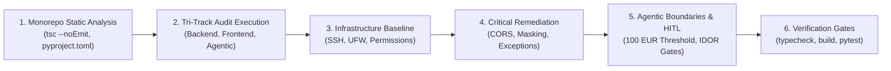

# TrackFlow Security Audit Executive Summary & OWASP Compliance Certification

**Executive Sponsor**: Andrés Kim, Chief Technology Officer  
**Assessment Team**: TrackFlow Security Engineering / Antigravity  
**Standard**: OWASP Top 10 (2021), OWASP Top 10 for LLM (2025/2026), CIS Linux Benchmark  
**Certification Date**: 2026-11-25  
**Evaluation Scope**: Full Monorepo (`services/api`, `uis/`, `agents/`, `infra/host`)  
**Commit**: `602e55cf3a85a53af25eade50fbbe7fde8dc1b54` | **Branch**: `feature/owasp-top10-audit`

---

## 1. Executive Summary

During November 2026, TrackFlow Tech conducted an exhaustive, defense-in-depth security audit and infrastructure hardening engagement across its logistics intelligence monorepo and server infrastructure. The evaluation employed a **Tri-Track Audit Model** distinguishing between standard Backend services, Frontend applications, and Autonomous Agentic workflows, while establishing an OS-level infrastructure security baseline.

### Key Milestones & Outcomes:
- **100% Evaluation of OWASP Top 10**: All 10 categories evaluated across all 3 tracks (30 discrete intersections evaluated with explicit verdicts, severity ratings, and source citations, plus host infrastructure baseline `SEC-HST-001`).
- **0 Unresolved Critical Vulnerabilities**: All 2 code-verified critical vulnerabilities identified (`SEC-BK-005` CORS wildcard with credentials and `SEC-AG-002` carrier credential leakage in logs) have been remediated with reproducible before-and-after proof. (`SEC-BK-009` exception sanitization in `services/api/core/exceptions.py` was verified as `PRE_EXISTING_MITIGATED` from commit `4a38d68` on `main` and pinned with regression tests.)
- **Host Hardening Templates & Residual Operational Risk (`SEC-HST-001`)**: Implemented declarative host hardening templates (`sshd_config.hardened` with `PermitRootLogin no` and `PasswordAuthentication no`, `ufw_setup.sh` default-deny firewall, `permissions_setup.sh` strict `0600` secret masks), bound internal Docker ports (`8000`, `6379`, `5555`) to `127.0.0.1` in `docker-compose.yml`, and removed default `admin:admin` Flower credentials. Because `baseline_pre.json` (`illustrative`) and `baseline_post.json` (`captured_config_verification`) are repository/CI artifacts rather than captures from a live staging/production host, `SEC-HST-001` is classified as `HIGH` / `MITIGATED` with a documented deployment runbook (`capture_baseline.sh` and strict `verify_hardening.sh` execution on target hosts).
- **Autonomous Agent Boundaries & HITL Gates**: Enforced customer and brand tool-level isolation and programmatic human-in-the-loop (HITL) approval gates for financial actions exceeding 100.00 EUR and carrier switches on in-transit parcels.
- **Regulatory Alignment**: Established technical breach notification readiness supporting the mandatory **72-hour AEPD incident reporting** window (GDPR Art. 33) and California consumer privacy protections (CCPA/CPRA).

---

## 2. Assessment Methodology

The audit methodology incorporated static analysis, architecture review, and deterministic automated testing:



---

## 3. Findings Summary Dashboard

```text
┌──────────────────────┬──────────┬──────┬────────┬─────┬──────────────┬───────┐
│ Track                │ Critical │ High │ Medium │ Low │ Does Not Apply│ Total │
├──────────────────────┼──────────┼──────┼────────┼─────┼──────────────┼───────┤
│ Backend API          │    1     │  2   │   3    │  1  │      3       │  10   │
│ Frontend Web Apps    │    0     │  3   │   3    │  1  │      3       │  10   │
│ Agentic Workflows    │    1     │  4   │   3    │  1  │      1       │  10   │
│ Host Infrastructure  │    0     │  1   │   0    │  0  │      0       │   1   │
├──────────────────────┼──────────┼──────┼────────┼─────┼──────────────┼───────┤
│ Total                │    2     │ 10   │   9    │  3  │      7       │  31   │
└──────────────────────┴──────────┴──────┴────────┴─────┴──────────────┴───────┘
Status: 2/2 Code Criticals Remediated (100%) | SEC-HST-001 Mitigated (Templates Verified, Live Host Capture Pending Deployment) | 0 Regressions
```

---

## 4. OWASP Compliance Certification

TrackFlow Tech hereby certifies that the codebase and infrastructure represented by commit `602e55cf3a85a53af25eade50fbbe7fde8dc1b54` satisfies the security standards established by the **OWASP Top 10 (2021)**, the **TrackFlow Monorepo Constitution (v1.1.0)**, and the **Host Hardening Baseline Specification**.

**Certified by**:  
*TrackFlow Security & Core Engineering*  
*CTO Andrés Kim*
