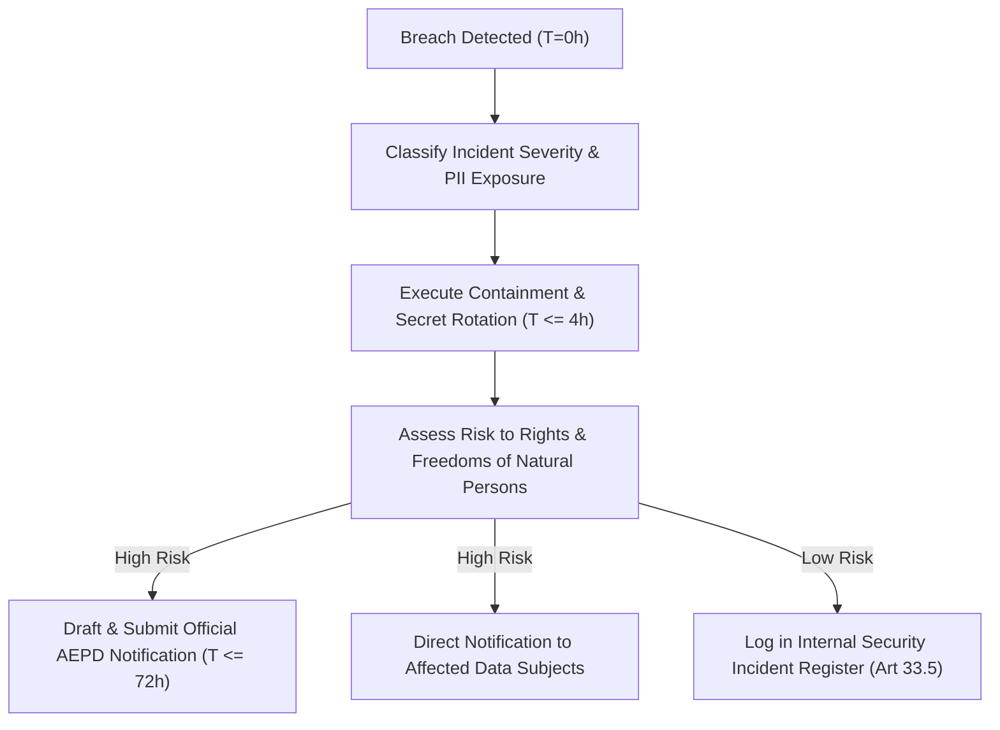

# Regulatory Compliance: GDPR / RGPD & CCPA / CPRA Alignment

**Organization**: TrackFlow Tech  
**Operating Jurisdictions**:
- European Union / Spain (Agencia Española de Protección de Datos - AEPD)
- United States / California (California Privacy Protection Agency - CPPA)  
**Date**: 2026-11-25  
**Scope**: TrackFlow Monorepo (`services/api/`, `uis/`, `agents/`, `infra/`)

---

## 1. GDPR / RGPD Alignment (EU Regulation 2016/679)

TrackFlow processes European consumer and business logistics data originating through Spanish and continental carrier networks (MRW, SEUR, DHL Express). Under GDPR, TrackFlow acts as both a Data Controller and Data Processor.

### 1.1 72-Hour AEPD Data Breach Notification Checklist (Article 33)

In the event of a personal data breach, TrackFlow is legally obligated to notify the **Agencia Española de Protección de Datos (AEPD)** without undue delay and, where feasible, not later than **72 hours** after becoming aware of it.

#### Incident Notification Response Checklist:
- [ ] **Step 1: Automated Detection & Isolation (0h - 4h)**
  - Isolate affected services or credentials immediately.
  - Snapshot system logs and execution traces for forensic evaluation.
- [ ] **Step 2: Nature of the Breach Identification (4h - 12h)**
  - Document categories and approximate number of data subjects affected (e.g. B2C recipients, customer names, delivery addresses).
  - Determine whether encrypted/masked secrets vs. plaintext PII were accessed.
- [ ] **Step 3: Data Protection Officer (DPO) Contact Designation**
  - Name and contact details of the DPO or security lead handling the inquiry.
- [ ] **Step 4: Consequence Analysis (12h - 36h)**
  - Describe likely consequences of the breach (e.g. identity theft, fraudulent return claims, delivery interception).
- [ ] **Step 5: Mitigation Measures Documented (36h - 48h)**
  - Detail remedial measures taken or proposed to mitigate possible adverse effects.
- [ ] **Step 6: Formal Submission to AEPD Sede Electrónica (T <= 72h)**
  - Submit through the official AEPD electronic portal: `https://sedeagpd.gob.es/`.
- [ ] **Step 7: Affected Data Subject Notification (Article 34)**
  - If high risk to natural persons, notify affected users via email and transparent communication without undue delay.

---

## 2. CCPA / CPRA Alignment (California Civil Code § 1798.100+)

TrackFlow operates B2B logistics intelligence and consumer tracking across Los Angeles and North American shipping routes (FedEx, UPS).

### 2.1 Consumer Privacy Rights Verification

1. **Right to Know & Access**:
   - Consumers have the right to request disclosure of categories of personal information collected, sources, and commercial purposes.
   - Handled via authenticated customer profile endpoints (`/api/v1/profiles`).
2. **Right to Delete**:
   - Consumer personal data (order recipient history, delivery logs) can be anonymized upon verified deletion requests.
3. **Right to Opt-Out of Sale / Sharing**:
   - TrackFlow **does not sell or share** consumer personal information with third parties for cross-context behavioral advertising.
4. **Data Minimization & Storage Limitation**:
   - Autonomous agent memory eviction policies ensure temporary customer interaction proposals are discarded or deleted per retention windows.
   - PII in telemetry logs is automatically redacted using regex masking.

---

## 3. Data Classification and Processing Boundaries

| Data Asset | Classification | Handling & Security Controls | Legal Basis |
|---|---|---|---|
| Recipient Names, Addresses, Phone Numbers | `RESTRICTED_PII` | Masked in logs; TLS in transit; Access restricted to authenticated session owner | Contractual Necessity (Art 6.1.b) |
| Carrier API Credentials (UPS, FedEx, DHL, MRW, SEUR) | `CONFIDENTIAL_B2B` | Stored exclusively in environment variables; Strict 0600 file permissions; Zero log exposure | Legitimate Interests (Art 6.1.f) |
| Order & Shipment Identifiers | `INTERNAL_OPERATIONAL` | UUIDs/alphanumeric; validated through session ownership gates (`SEC-AG-001`) | Contractual Necessity (Art 6.1.b) |
| Aggregated Carrier Performance Metrics | `PUBLIC` / `CONFIDENTIAL_B2B` | Cross-brand isolation enforced by `BrandMetricQuery` policy | Legitimate Interests (Art 6.1.f) |
