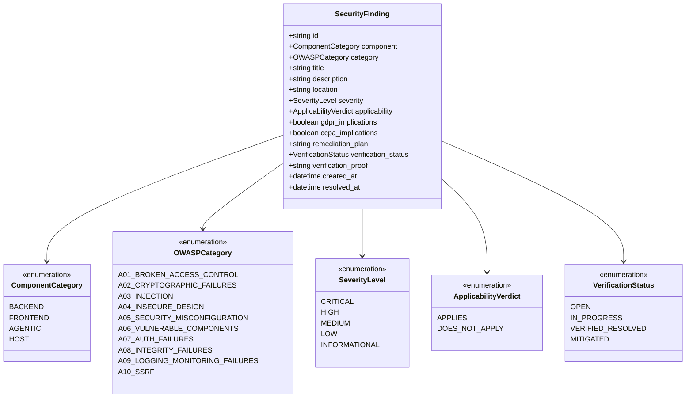
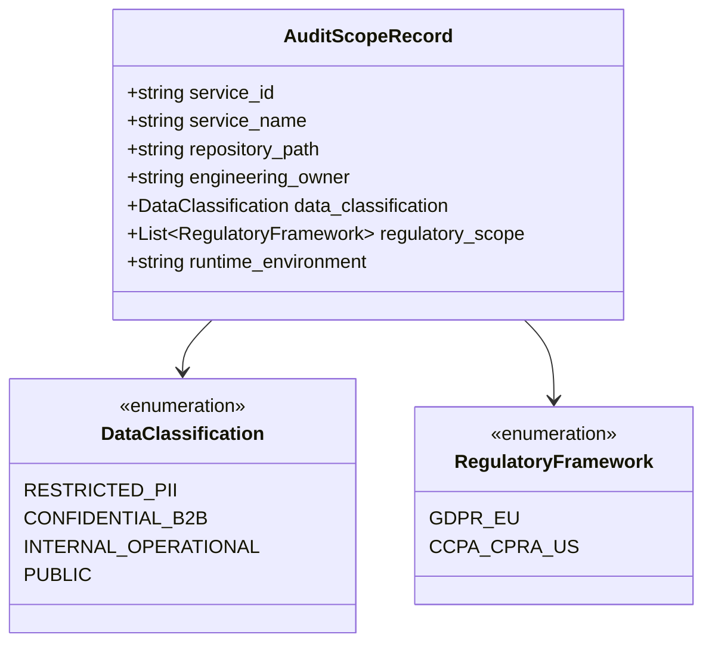
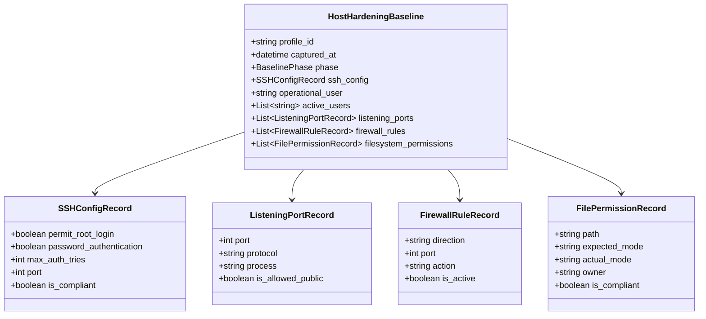
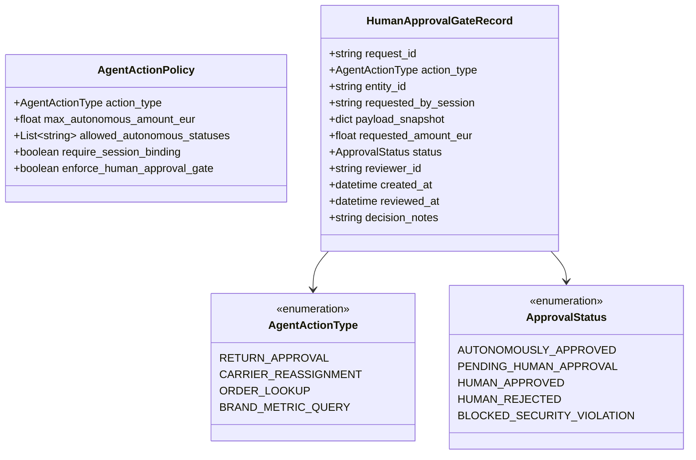
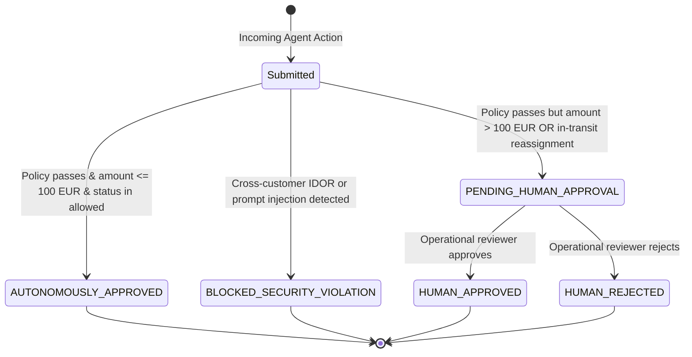

# Data Model: TrackFlow OWASP Top 10 Security Audit, Infrastructure Hardening, and Critical Remediation

**Feature Branch**: `feature/owasp-top10-audit`  
**Specification**: [specs/036-owasp-audit-hardening/spec.md](file:///j:/GitHub/mr-stegmann-ai-engineering-company-project-monorepo/specs/036-owasp-audit-hardening/spec.md)  
**Date**: 2026-11-25  

---

## 1. Entities & Schema Definitions

### 1.1 SecurityFinding

Represents an audited vulnerability or infrastructure hardening deficiency evaluated against the OWASP Top 10 (2021) and host baseline requirements.

#### Fields & Validation Rules:
- `id`: Non-empty string formatted as `SEC-[COMPONENT]-[0-9]{3}` (e.g. `SEC-BK-001`, `SEC-AG-002`).
- `component`: One of `BACKEND`, `FRONTEND`, `AGENTIC`, `HOST`.
- `category`: Must map to one of the 10 official OWASP Top 10 categories.
- `severity`: Must follow standard CVSS classification: `CRITICAL` ($\ge 9.0$), `HIGH` ($7.0 - 8.9$), `MEDIUM` ($4.0 - 6.9$), `LOW` ($0.1 - 3.9$), or `INFORMATIONAL` ($0.0$).
- `applicability`: When `DOES_NOT_APPLY`, `remediation_plan` documents why the risk is mitigated or architecturally absent. When `APPLIES`, `location` and `remediation_plan` are mandatory.
- `gdpr_implications`: `true` if vulnerability could lead to unauthorized disclosure of B2C personal data or breach of the 72-hour AEPD notification window.
- `ccpa_implications`: `true` if vulnerability impacts California consumer personal information or opt-out rights.
- `verification_proof`: Mandatory for any finding with severity `CRITICAL` prior to closing (`verification_status = VERIFIED_RESOLVED`).

---

### 1.2 AuditScopeRecord

Represents a distinct service or subsystem subject to security audit verification under FR-002.

#### Pre-populated Scope Records:
| Service ID | Service Name | Path | Classification | Frameworks |
|---|---|---|---|---|
| `cx-support-agent` | 24/7 CX Support Agent | `services/api/application/services/support_agent_service.py` | `RESTRICTED_PII` | `[GDPR_EU, CCPA_CPRA_US]` |
| `carrier-selection-engine` | Carrier Selection Engine | `services/api/application/services/` / `mcps/` | `CONFIDENTIAL_B2B` | `[GDPR_EU]` |
| `return-approval-engine` | Return Approval Engine | `services/api/application/services/` | `RESTRICTED_PII` | `[GDPR_EU, CCPA_CPRA_US]` |
| `return-policy-rag` | Return Policy RAG KB | `services/api/application/services/knowledge_service.py` | `CONFIDENTIAL_B2B` | `[GDPR_EU]` |
| `tracking-api` | Public Tracking API | `services/api/presentation/api/v1/` | `RESTRICTED_PII` | `[GDPR_EU, CCPA_CPRA_US]` |
| `operations-dashboard` | Real-time Operations Dashboard | `uis/backoffice/` | `INTERNAL_OPERATIONAL` | `[GDPR_EU]` |
| `b2b-brand-portal` | B2B Customer Brand Portals | `uis/website/` | `CONFIDENTIAL_B2B` | `[GDPR_EU, CCPA_CPRA_US]` |
| `host-server` | Linux Host Server & Network | Host OS / `infra/` | `RESTRICTED_PII` | `[GDPR_EU, CCPA_CPRA_US]` |

---

### 1.3 HostHardeningBaseline

Represents the measurable host and infrastructure security configuration state across pre-remediation and post-remediation phases.

#### Validation Rules:
- `ssh_config.permit_root_login`: Must be `false` in post-remediation baseline (`PermitRootLogin no`).
- `listening_ports`: Only ports `22` (SSH), `80` (HTTP), and `443` (HTTPS) may have `is_allowed_public = true`. All internal service ports (e.g. `8000`, `6379`, `6333`) must bind to `127.0.0.1` or be blocked externally.
- `filesystem_permissions`: All sensitive `.env` files must have `actual_mode` equal to `0600` or `0400` and owner matching `operational_user`.

---

### 1.4 AgentActionPolicy & HumanApprovalGateRecord

Represents the policy enforcement rules and human-in-the-loop audit records for irreversible actions.

#### State Transition Diagram:

