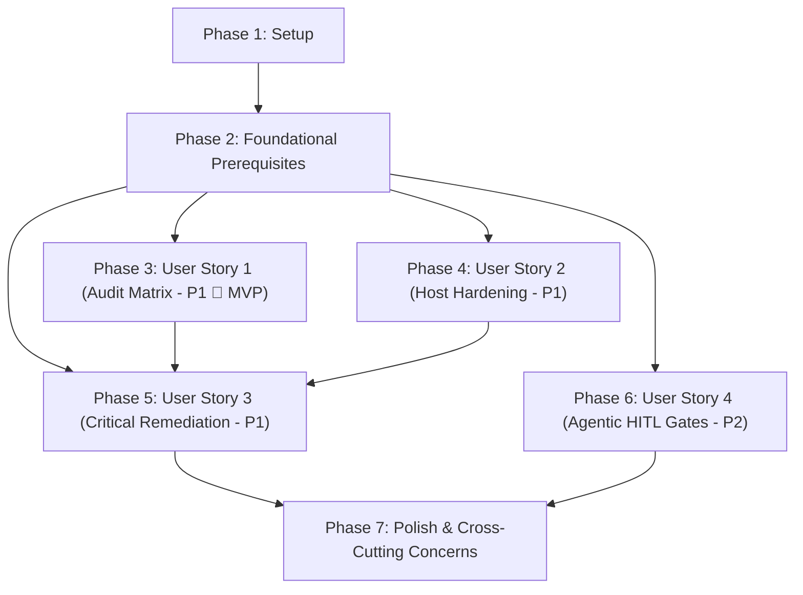

# Tasks: TrackFlow OWASP Top 10 Security Audit, Infrastructure Hardening, and Critical Remediation

**Input**: Design documents from `specs/036-owasp-audit-hardening/` (`spec.md`, `plan.md`, `research.md`, `data-model.md`, `contracts/`, `quickstart.md`)

**Prerequisites**: `plan.md` (required), `spec.md` (required for user stories), `research.md`, `data-model.md`, `contracts/`

**Tests**: Test tasks are included per Constitution Principle VI (Deterministic Verification Gates) and feature acceptance criteria. Write tests first and verify they fail before implementing changes.

**Organization**: Tasks are grouped by user story to enable independent implementation and testing of each story.

## Format: `- [ ] [TaskID] [P?] [Story?] Description with file path`

- **[P]**: Can run in parallel (different files, no dependencies)
- **[Story]**: Which user story this task belongs to (`[US1]`, `[US2]`, `[US3]`, `[US4]`)
- Setup, Foundational, and Polish phases omit story labels per specification rules.
- Include exact file paths in all task descriptions.

---

## Phase 1: Setup (Shared Infrastructure)

**Purpose**: Project initialization, directory structure setup, and baseline environment configuration.

- [X] T001 Create infrastructure hardening directory and audit artifact directory structure in infra/host/ and specs/036-owasp-audit-hardening/audit/
- [X] T002 [P] Register environment configuration variables for security origins (CORS_ALLOWED_ORIGINS), host operational settings, and agent HITL thresholds in services/api/.env.example
- [X] T003 [P] Verify Python and Node dependency toolchains and test runners in services/api/pyproject.toml and package.json

---

## Phase 2: Foundational (Blocking Prerequisites)

**Purpose**: Core domain entities, contracts, and repository ports that MUST be complete before ANY user story can be implemented.

**⚠️ CRITICAL**: No user story work can begin until this phase is complete.

- [X] T004 Define SecurityFinding, ComponentCategory, OWASPCategory, and AuditScopeRecord domain entities in services/api/domain/agent/entities.py
- [X] T005 [P] Define HostHardeningBaseline, SSHConfigRecord, and FilePermissionRecord schemas in services/api/domain/schemas/host_hardening.py
- [X] T006 [P] Define AgentActionPolicy and HumanApprovalGateRecord domain entities and state transition types in services/api/domain/agent/entities.py
- [X] T007 [P] Define repository ports for security audit records and human approval queues in services/api/domain/agent/ports.py
- [X] T008 Implement centralized Pydantic serialization models matching contract schemas in services/api/presentation/schemas/security_audit.py

**Checkpoint**: Foundation ready - user story implementation can now begin in parallel.

---

## Phase 3: User Story 1 - Comprehensive OWASP Top 10 Assessment Across Monorepo & Agentic Surface (Priority: P1) 🎯 MVP

**Goal**: Deliver an exhaustive evaluation of the TrackFlow monorepo across all 10 OWASP Top 10 categories, distinguishing between backend services, frontend applications, and agentic workflows with explicit applicability verdicts, severity classifications, and concrete source code citations, incorporating GDPR (72h AEPD reporting) and CCPA requirements.

**Independent Test**: Can be independently tested by inspecting the generated audit matrix in `specs/036-owasp-audit-hardening/audit/owasp_audit_matrix.json`, verifying that 100% of the 10 OWASP Top 10 categories are independently evaluated across Backend, Frontend, and Agentic components with explicit verdicts (`applies` vs. `does not apply`), severity ratings, and source citations conforming to `specs/036-owasp-audit-hardening/contracts/owasp-audit-matrix.schema.json`.

### Tests for User Story 1

> **NOTE: Write these tests FIRST, ensure they FAIL before implementation**

- [X] T009 [P] [US1] Contract test validating OWASP audit matrix schema adherence against owasp-audit-matrix.schema.json in services/api/tests/unit/test_security_audit_matrix.py
- [X] T010 [P] [US1] Integration test verifying completeness of the 8 audited subsystems and 30 discrete OWASP intersections in services/api/tests/unit/test_audit_matrix_completeness.py

### Implementation for User Story 1

- [X] T011 [P] [US1] Perform backend Track audit (FastAPI endpoints, SQLModel, auth, CORS) and document findings in specs/036-owasp-audit-hardening/audit/backend_audit.md
- [X] T012 [P] [US1] Perform frontend Track audit (Next.js components, DOM sanitation, CSP, session handling) and document findings in specs/036-owasp-audit-hardening/audit/frontend_audit.md
- [X] T013 [P] [US1] Perform agentic Track audit (CX support agent, carrier selection, return approval, Qdrant RAG KB) assessing prompt injection, tool IDOR, and cross-brand leaks in specs/036-owasp-audit-hardening/audit/agentic_audit.md
- [X] T014 [US1] Compile structured tri-track audit matrix JSON satisfying schema requirements in specs/036-owasp-audit-hardening/audit/owasp_audit_matrix.json
- [X] T015 [US1] Implement read-only audit retrieval service and FastAPI endpoint in services/api/presentation/api/v1/security_audit.py
- [X] T016 [US1] Mount security audit router under /api/v1/security-audit in services/api/main.py
- [X] T017 [US1] Document GDPR AEPD 72-hour breach reporting checklist and CCPA data boundary analysis in specs/036-owasp-audit-hardening/audit/regulatory_compliance.md

**Checkpoint**: At this point, User Story 1 delivers the full OWASP Top 10 audit baseline, schema-validated and accessible via API and documentation.

---

## Phase 4: User Story 2 - Host Server Baseline Infrastructure Hardening (Priority: P1)

**Goal**: Establish defense-in-depth on the host environment by enforcing a dedicated non-root operational user, rejecting direct root SSH logins (`PermitRootLogin no`), configuring a default-deny host firewall allowing only necessary ports (22, 80, 443), and enforcing strict filesystem permission masks on secrets.

**Independent Test**: Can be independently tested by executing host security verifications showing that direct root SSH authentication is rejected (`PermitRootLogin no`), operational tasks execute as non-root, the host firewall denies traffic on all non-essential ports, and sensitive `.env` files enforce 0600 permission masks.

### Tests for User Story 2

- [X] T018 [P] [US2] Contract test validating host baseline schema adherence against host-hardening-baseline.schema.json in services/api/tests/unit/test_host_baseline_schema.py
- [X] T019 [P] [US2] Integration test verifying host hardening configuration parsing and compliance rules in services/api/tests/integration/test_host_hardening_verification.py

### Implementation for User Story 2

- [X] T020 [P] [US2] Capture and document pre-remediation host baseline profile (listening ports, users, firewall, permissions) in infra/host/baseline_pre.json
- [X] T021 [P] [US2] Create hardened SSH daemon configuration enforcing PermitRootLogin no, PasswordAuthentication no, and MaxAuthTries 3 in infra/host/sshd_config.hardened
- [X] T022 [P] [US2] Create host firewall setup script implementing default-deny inbound policy and whitelisting ports 22, 80, 443 in infra/host/ufw_setup.sh
- [X] T023 [P] [US2] Create host filesystem permission enforcement script restricting .env to 0600 and directories to 0755 in infra/host/permissions_setup.sh
- [X] T024 [US2] Create host verification script that tests root SSH rejection, firewall rules, and secret file masks in infra/host/verify_hardening.sh
- [X] T025 [US2] Capture and document post-remediation host baseline profile demonstrating 100% compliance in infra/host/baseline_post.json
- [X] T026 [US2] Update infrastructure operational runbook and disaster recovery documentation in infra/README.md

**Checkpoint**: At this point, User Story 2 ensures the host server is fully hardened with automated verification scripts and before/after baseline snapshots.

---

## Phase 5: User Story 3 - Remediation and Verifiable Proof of Critical Vulnerabilities (Priority: P1)

**Goal**: Remediate all vulnerabilities classified as Critical with reproducible before-and-after proof: resolve CORS wildcard with credentials in `services/api/main.py`, sanitize carrier secrets and customer PII in logs, eliminate raw exception `str(e)` leaks, and run full monorepo verification gates.

**Independent Test**: Can be independently tested by executing automated security tests proving CORS rejects untrusted origins with credentials, logs mask sensitive secrets/PII, and zero regressions occur across monorepo static typecheck (`npm run typecheck`), build (`npm run build`), and pytest test suites.

### Tests for User Story 3

- [X] T027 [P] [US3] Unit test verifying CORS security configuration rejects unauthorized origins and credentials in services/api/tests/unit/test_security_cors_configuration.py
- [X] T028 [P] [US3] Unit test verifying PII and carrier credential masking in audit logging in services/api/tests/unit/test_guardrail_observability_redaction.py
- [X] T029 [P] [US3] Unit test verifying error handlers return sanitized messages without raw str(e) traces in services/api/tests/unit/test_error_handling_sanitization.py

### Implementation for User Story 3

- [X] T030 [US3] Remediate CORS configuration in services/api/main.py replacing wildcard origins with explicit CORS_ALLOWED_ORIGINS from environment
- [X] T031 [US3] Implement sensitive carrier credential (UPS, FedEx, DHL, MRW, SEUR) and PII masking in services/api/application/services/guardrail_observability.py
- [X] T032 [US3] Enforce sanitized exception responses across FastAPI exception handlers in services/api/core/exceptions.py
- [X] T033 [US3] Generate reproducible before-and-after verification report with execution artifacts for all critical findings in specs/036-owasp-audit-hardening/audit/critical_remediation_proof.md
- [X] T034 [US3] Execute monorepo static typecheck verification gate (npm run typecheck) and fix any compiler issues across uis/ and packages/
- [X] T035 [US3] Execute production build verification gate (npm run build) ensuring zero SSR or hydration regressions across frontends

**Checkpoint**: At this point, User Stories 1, 2, and 3 are fully operational with 0 unresolved critical findings and complete proof artifacts.

---

## Phase 6: User Story 4 - Agentic Guardrail Boundaries and Irreversible Action Authorization (Priority: P2)

**Goal**: Prevent financial loss and unauthorized operations in autonomous agent workflows by enforcing tool-level authorization boundaries (customer order isolation, cross-brand metric isolation) and programmatic human-in-the-loop authorization gates for high-impact actions (returns > 100.00 EUR and in-transit carrier changes).

**Independent Test**: Can be independently tested by submitting return requests exceeding 100.00 EUR or in-transit carrier changes and verifying execution transitions to `PENDING_HUMAN_APPROVAL`, and submitting cross-customer order queries to verify fail-closed access refusal without data disclosure.

### Tests for User Story 4

- [X] T036 [P] [US4] Contract test for agent guardrail HITL payload validation against agent-guardrail-hitl.schema.json in services/api/tests/unit/test_agent_guardrail_hitl_contract.py
- [X] T037 [P] [US4] Unit test verifying cross-customer order refusal and cross-brand metric isolation in services/api/tests/unit/test_agent_guardrails_authorization.py
- [X] T038 [P] [US4] Unit test verifying return approval threshold gate (> 100 EUR) and in-transit carrier reassignment refusal in services/api/tests/unit/test_agent_action_policies.py

### Implementation for User Story 4

- [X] T039 [US4] Implement session customer/brand ownership validation in agent tool execution layer in services/api/application/services/agent_guardrails.py
- [X] T040 [US4] Implement AgentActionPoliciesService enforcing 100.00 EUR return threshold and in-transit carrier status gates in services/api/application/services/agent_action_policies.py
- [X] T041 [US4] Wire human approval queue routing and decision transitions into services/api/application/services/support_agent_service.py
- [X] T042 [US4] Add human approval decision endpoints (/api/v1/agent/actions/review) in services/api/presentation/api/v1/agent.py
- [X] T043 [US4] Emit redacted audit telemetry for HITL queue events and security policy violations in services/api/application/services/guardrail_observability.py

**Checkpoint**: At this point, all four user stories are complete, establishing robust defense-in-depth across code, host, and autonomous agent workflows.

---

## Phase 7: Polish & Cross-Cutting Concerns

**Purpose**: Final audit documentation, end-to-end verification walkthrough, and repository hygiene.

- [X] T044 [P] Document audit executive summary, methodology, and OWASP compliance certification in specs/036-owasp-audit-hardening/audit/executive_summary.md
- [X] T045 Run end-to-end quickstart validation scenarios 1 through 6 per specs/036-owasp-audit-hardening/quickstart.md
- [X] T046 [P] Clean up temporary test artifacts and verify zero uncommitted secrets or debug logs across services/api/

---

## Dependencies & Execution Order

### Phase Dependencies



- **Setup (Phase 1)**: Can start immediately. No dependencies.
- **Foundational (Phase 2)**: Depends on Setup (Phase 1). Blocks all User Stories.
- **User Story 1 (Phase 3 - P1)**: Depends on Foundational completion. Establishes the full audit findings baseline.
- **User Story 2 (Phase 4 - P1)**: Depends on Foundational completion. Hardens OS and network layers independently.
- **User Story 3 (Phase 5 - P1)**: Depends on US1 (identifying critical findings) and US2 (host baseline). Resolves critical issues with before/after verification.
- **User Story 4 (Phase 6 - P2)**: Depends on Foundational completion and can proceed in parallel with US2/US3. Enforces agent action guardrails and HITL approval gates.
- **Polish (Phase 7)**: Depends on all User Stories being complete.

### User Story Dependencies

- **User Story 1 (P1)**: Independent of other stories once Foundation is complete.
- **User Story 2 (P1)**: Independent of US1/US4; operates primarily at the infrastructure and OS layer (`infra/host/`).
- **User Story 3 (P1)**: Depends on findings discovered in US1 and host configurations from US2 to execute and document reproducible before/after proofs.
- **User Story 4 (P2)**: Builds upon agent domain entities and guardrail services in `services/api/application/services/`.

---

## Parallel Opportunities

- **Phase 1 (Setup)**: `T002` and `T003` can run in parallel once `T001` initializes directories.
- **Phase 2 (Foundational)**: `T005`, `T006`, and `T007` can run in parallel across schema, domain, and port definitions after `T004`.
- **Phase 3 (User Story 1)**:
  - Tests `T009` and `T010` run in parallel.
  - Track audits `T011` (backend), `T012` (frontend), and `T013` (agentic) can execute concurrently in parallel by different reviewers or subagents.
- **Phase 4 (User Story 2)**:
  - Tests `T018` and `T019` run in parallel.
  - Hardening assets `T020`, `T021`, `T022`, and `T023` target distinct files and can be authored in parallel.
- **Phase 5 (User Story 3)**:
  - Unit tests `T027`, `T028`, and `T029` can be written in parallel.
  - Remediations in `T030`, `T031`, and `T032` touch separate files (`main.py`, `guardrail_observability.py`, `exceptions.py`) and can execute in parallel.
- **Phase 6 (User Story 4)**:
  - Tests `T036`, `T037`, and `T038` run in parallel.
- **Phase 7 (Polish)**: `T044` and `T046` can run concurrently with quickstart verification `T045`.

---

## Parallel Example: User Story 1

```bash
# Launch test authoring concurrently:
Task: "T009 [P] [US1] Contract test validating OWASP audit matrix schema adherence in services/api/tests/unit/test_security_audit_matrix.py"
Task: "T010 [P] [US1] Integration test verifying completeness of the 8 audited subsystems in services/api/tests/unit/test_audit_matrix_completeness.py"

# Launch tri-track audits across monorepo components simultaneously:
Task: "T011 [P] [US1] Perform backend Track audit in specs/036-owasp-audit-hardening/audit/backend_audit.md"
Task: "T012 [P] [US1] Perform frontend Track audit in specs/036-owasp-audit-hardening/audit/frontend_audit.md"
Task: "T013 [P] [US1] Perform agentic Track audit in specs/036-owasp-audit-hardening/audit/agentic_audit.md"
```

---

## Parallel Example: User Story 3

```bash
# Launch tests for critical remediation simultaneously:
Task: "T027 [P] [US3] Unit test verifying CORS security configuration in services/api/tests/unit/test_security_cors_configuration.py"
Task: "T028 [P] [US3] Unit test verifying PII and carrier credential masking in services/api/tests/unit/test_guardrail_observability_redaction.py"
Task: "T029 [P] [US3] Unit test verifying error handlers return sanitized messages in services/api/tests/unit/test_error_handling_sanitization.py"

# Launch remediation edits across independent backend files:
Task: "T030 [US3] Remediate CORS configuration in services/api/main.py"
Task: "T031 [US3] Implement sensitive carrier credential and PII masking in services/api/application/services/guardrail_observability.py"
Task: "T032 [US3] Enforce sanitized exception responses in services/api/core/exceptions.py"
```

---

## Implementation Strategy

### MVP First (User Story 1 Only)

1. Complete **Phase 1: Setup** (`T001`-`T003`).
2. Complete **Phase 2: Foundational** (`T004`-`T008`).
3. Complete **Phase 3: User Story 1** (`T009`-`T017`).
4. **STOP and VALIDATE**: Validate schema compliance with `pytest services/api/tests/unit/test_security_audit_matrix.py` and inspect `specs/036-owasp-audit-hardening/audit/owasp_audit_matrix.json`.
5. Deliver the comprehensive OWASP audit baseline across Backend, Frontend, and Agentic systems as the core MVP deliverable.

### Incremental Delivery

1. **Foundation Increment**: Setup + Foundational (`T001`-`T008`) provides typed entities, schemas, and ports.
2. **Audit Increment (MVP)**: User Story 1 (`T009`-`T017`) delivers full tri-track visibility, regulatory compliance mapping, and API endpoints.
3. **Host Security Increment**: User Story 2 (`T018`-`T026`) hardens SSH, firewall, and filesystem permissions with before/after baselines.
4. **Critical Remediation Increment**: User Story 3 (`T027`-`T035`) fixes critical findings (CORS wildcard, secret masking, raw exceptions) with reproducible proof.
5. **Agentic Boundary Increment**: User Story 4 (`T036`-`T043`) adds tool-level authorization boundaries and HITL approval gates for irreversible actions.
6. **Release Gate**: Phase 7 (`T044`-`T046`) verifies full end-to-end quickstart scenarios and produces executive sign-off certification.
