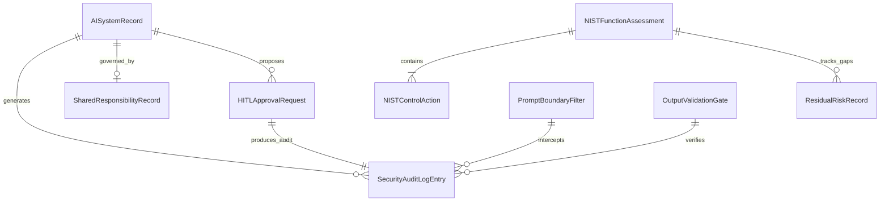
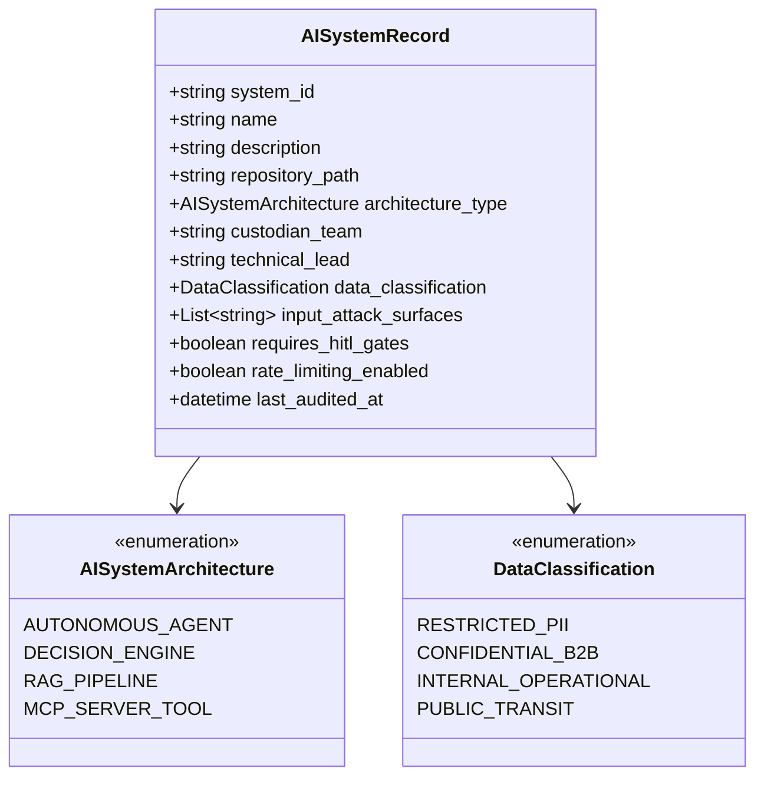
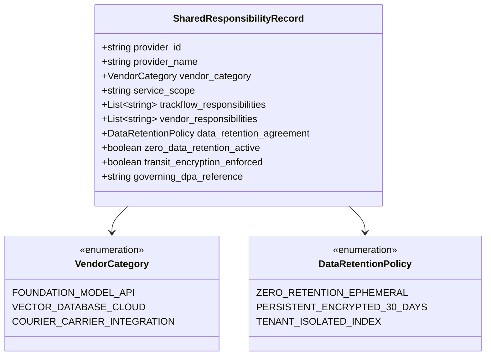
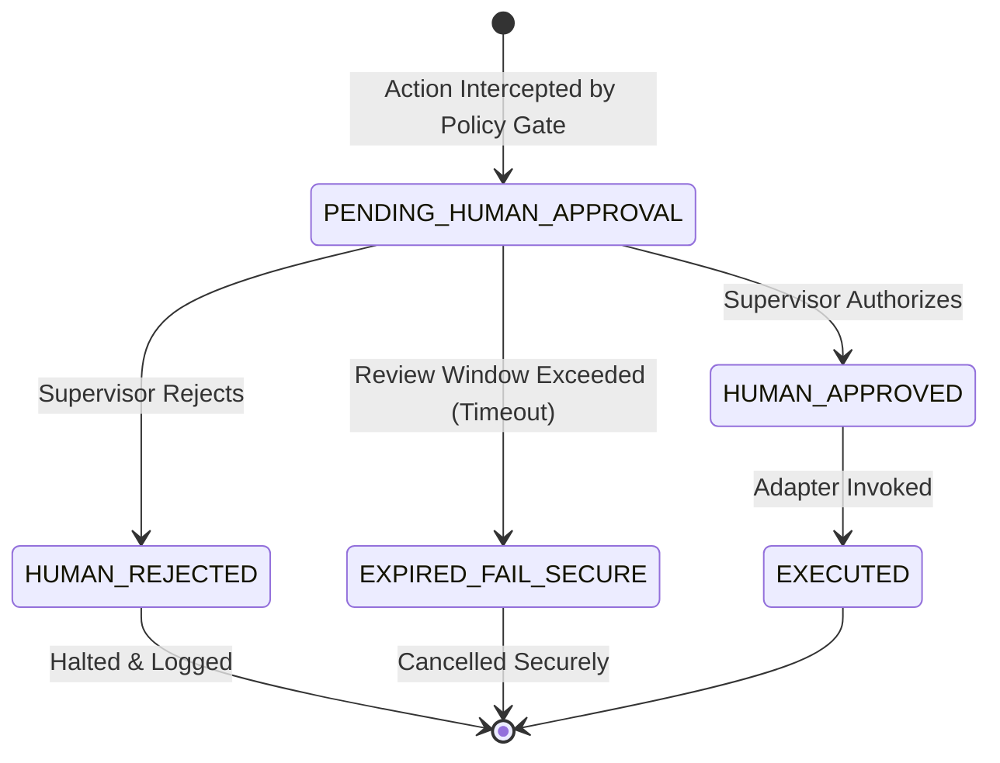
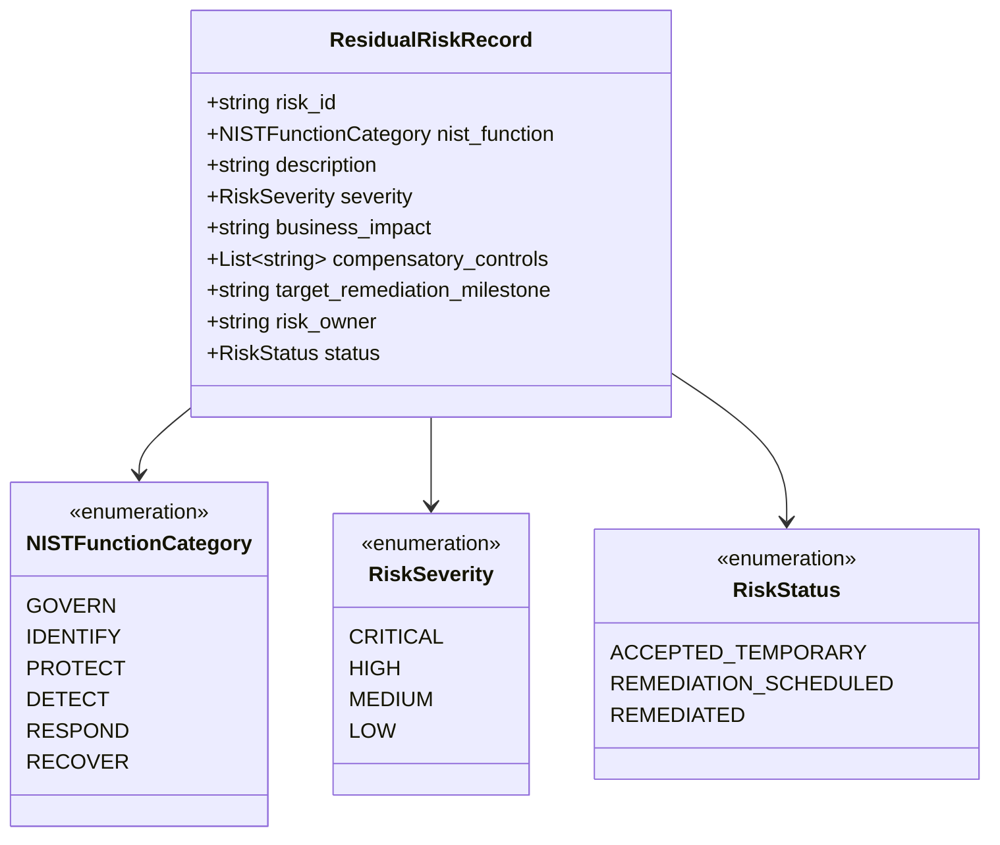
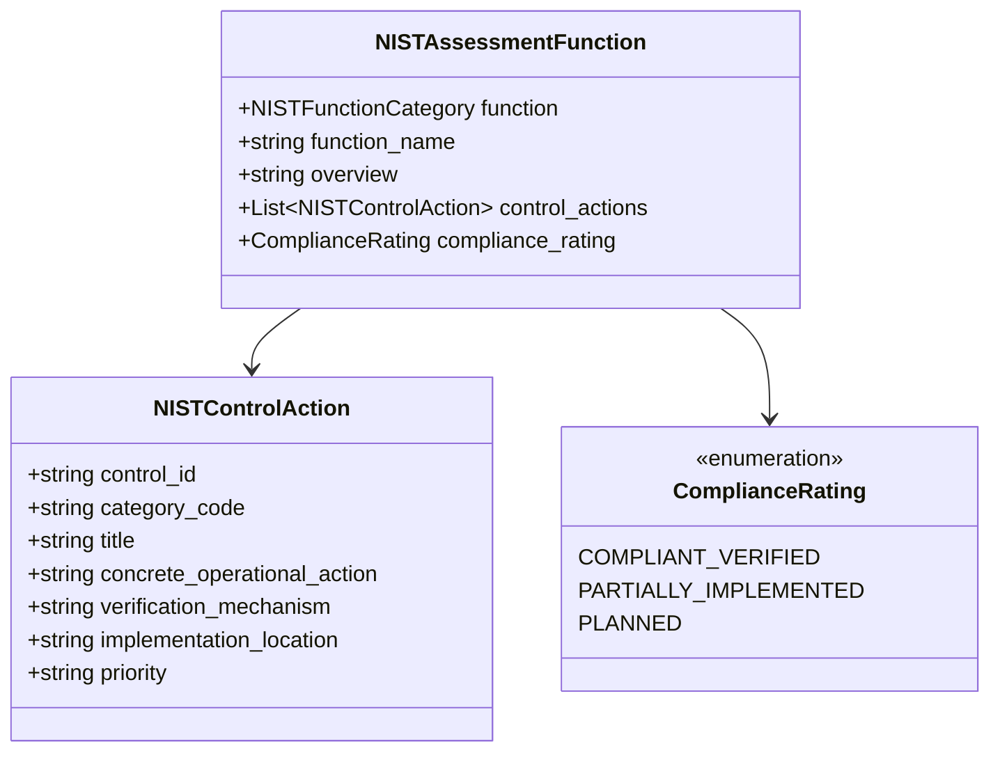
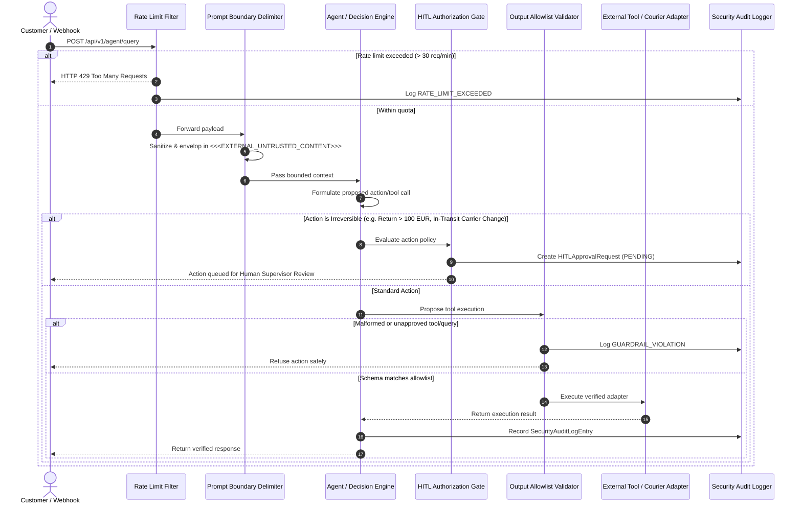
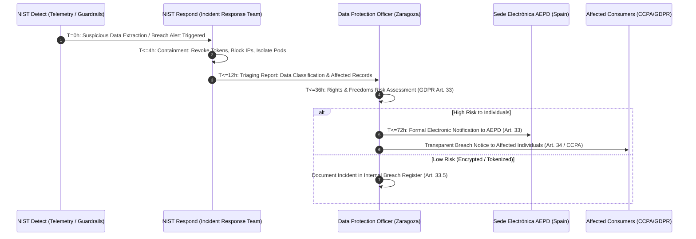

# Data Model: NIST Security Practices & AI Governance Baseline

**Feature Branch**: `037-nist-security-practices`  
**Specification**: [specs/037-nist-security-practices/spec.md](file:///j:/GitHub/mr-stegmann-ai-engineering-company-project-monorepo/specs/037-nist-security-practices/spec.md)  
**Date**: 2026-11-25  

---

## 1. Entity Relationship Overview

The data model for NIST Security Practices and AI Governance establishes structured domain entities for asset governance, third-party vendor accountability, security-by-design execution gates, human-in-the-loop operational reviews, and regulatory risk tracking.

---

## 2. Domain Entities & Schema Definitions

### 2.1 AISystemRecord

Represents an inventoried AI subsystem operating within the TrackFlow monorepo, identifying custodians, architectural scope, input attack surfaces, and sensitive data tier.

#### Field Specifications:
- `system_id` (string, required): Canonical identifier (e.g. `TF-AI-01-CX-AGENT`, `TF-AI-02-CARRIER-ENGINE`).
- `name` (string, required): Human-readable service name.
- `description` (string, required): Operational mandate and responsibility.
- `repository_path` (string, required): Relative path to implementation root.
- `architecture_type` (AISystemArchitecture, required): Categorization of AI design pattern.
- `custodian_team` (string, required): Department owning runtime maintenance.
- `technical_lead` (string, required): Designated engineer accountable for compliance.
- `data_classification` (DataClassification, required): Highest classification of processed data.
- `input_attack_surfaces` (List[string], required): Identified untrusted input vectors.
- `requires_hitl_gates` (boolean, required): Whether system interacts with irreversible actions.
- `rate_limiting_enabled` (boolean, required): Whether endpoint rate limiting is active.
- `last_audited_at` (datetime, required): UTC timestamp of latest governance audit.

---

### 2.2 SharedResponsibilityRecord

Delineates the security and compliance contract boundary between TrackFlow and external third-party model and infrastructure providers.

#### Field Specifications:
- `provider_id` (string, required): Unique identifier (e.g. `VEND-ANTHROPIC`, `VEND-QDRANT`, `VEND-UPS`).
- `provider_name` (string, required): Legal company entity.
- `vendor_category` (VendorCategory, required): Type of outsourced service.
- `service_scope` (string, required): Exact operational interface used by TrackFlow.
- `trackflow_responsibilities` (List[string], required): Mandatory controls enforced by TrackFlow.
- `vendor_responsibilities` (List[string], required): Controls guaranteed by provider contract/SLA.
- `zero_data_retention_active` (boolean, required): Confirms customer data is not retained for training.
- `transit_encryption_enforced` (boolean, required): Confirms TLS 1.3 in transit.
- `governing_dpa_reference` (string, required): Legal Data Processing Agreement document ID.

---

### 2.3 HITLApprovalRequest

Represents an irreversible or high-impact operational action intercepted by security policy gates awaiting human supervisor authorization.

#### Field Specifications:
- `request_id` (string, required): UUID identifier of approval request.
- `action_type` (string, required): One of the 4 irreversible actions:
  - `RETURN_APPROVAL` (High-value return > threshold EUR)
  - `HIGH_VALUE_DISPATCH` (Unverified parcel dispatch > threshold EUR)
  - `CARRIER_REASSIGNMENT` (In-transit parcel carrier change)
  - `CROSS_BRAND_METRIC_SHARE` (Cross-tenant brand metric query)
- `entity_id` (string, required): Target entity identifier (Order ID, Parcel ID, Brand ID).
- `requested_by_session` (string, required): Originating agent conversation/session identifier.
- `requested_by_agent` (string, required): Name/ID of proposing AI component.
- `payload_snapshot` (Dict[str, Any], required): Complete parameters of proposed action.
- `monetary_impact_eur` (float, optional): Financial amount involved.
- `status` (ApprovalStatus, required): `PENDING_HUMAN_APPROVAL`, `HUMAN_APPROVED`, `HUMAN_REJECTED`, `EXPIRED_FAIL_SECURE`.
- `reviewer_id` (string, optional): ID of supervisor resolving request.
- `decision_notes` (string, optional): Justification provided by reviewer.
- `created_at` (datetime, required): Interception timestamp in UTC.
- `expires_at` (datetime, required): Expiration deadline before failing secure.
- `resolved_at` (datetime, optional): Resolution timestamp in UTC.

---

### 2.4 SecurityAuditLogEntry

Structured, tamper-evident audit record capturing agent decisions, security guardrail interceptions, and supervisor actions.

#### Field Specifications:
- `event_id` (string, required): Unique cryptographic audit event identifier.
- `timestamp` (datetime, required): UTC ISO-8601 creation timestamp.
- `agent_id` (string, required): Identifier of agent emitting the event.
- `session_id` (string, required): Authenticated session identifier.
- `tenant_id` (string, required): B2B brand ID or B2C customer ID partition.
- `event_category` (AuditCategory, required): `PROMPT_BOUNDARY_CHECK`, `OUTPUT_VALIDATION`, `RATE_LIMIT_CHECK`, `HITL_GATE_TRIGGER`, `SUPERVISOR_RESOLUTION`.
- `action_attempted` (string, required): Operation or tool name.
- `input_parameters_redacted` (Dict[str, Any], required): Sanitized inputs with PII/tokens masked.
- `policy_rules_evaluated` (List[string], required): Business and security rules checked.
- `decision_outcome` (string, required): `ALLOWED`, `BLOCKED`, `PENDING_REVIEW`, `INTERCEPTED`.
- `reasoning_rationale` (string, required): Transparent explanation of decision.
- `client_ip` (string, optional): Hashed or masked client IP.

---

### 2.5 ResidualRiskRecord

Tracks identified security gaps, architectural limitations, or deferred mitigations with business impact assessments and remediation roadmaps.

#### Field Specifications:
- `risk_id` (string, required): Canonical risk identifier (e.g. `RISK-NIST-PR-01`).
- `nist_function` (NISTFunctionCategory, required): Associated NIST CSF 2.0 function.
- `description` (string, required): Detailed summary of technical limitation.
- `severity` (RiskSeverity, required): Impact rating (`CRITICAL`, `HIGH`, `MEDIUM`, `LOW`).
- `business_impact` (string, required): Operational, legal, or financial consequence if exploited.
- `compensatory_controls` (List[string], required): Active intermediate safeguards.
- `target_remediation_milestone` (string, required): Planned release or quarter for permanent fix.
- `risk_owner` (string, required): Designated engineering lead.
- `status` (RiskStatus, required): Active lifecycle state.

---

### 2.6 NIST CSF 2.0 Assessment & Control Action

---

## 3. Security-by-Design Execution Flow

The following sequence details how untrusted customer or external inputs flow through the prompt boundary delimiter, rate limiter, execution engine, and output validation allowlist.

---

## 4. GDPR 72-Hour Incident Response Lifecycle

---

## 5. Storage & Persistence Considerations

1. **In-Memory Thread-Safe Review Queue**: `HITLApprovalRequest` objects are maintained in thread-safe memory with concurrent lock protection, supporting high-throughput evaluation and supervisor resolution.
2. **Deterministic Audit Trail**: Audit entries are formatted in standardized JSON and persisted to structured log streams and security audit archives.
3. **Stateless Governance Endpoints**: Governance endpoints read canonical definitions directly from validated JSON artifacts in the repository specifications directory, guaranteeing zero drift between documentation and runtime APIs.
