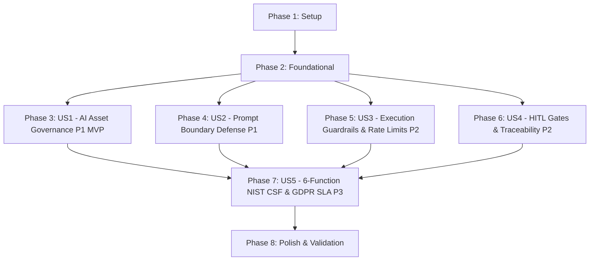

# Tasks: NIST Security Practices & AI Governance Baseline

**Input**: Design documents from `specs/037-nist-security-practices/`  
**Prerequisites**: [plan.md](file:///j:/GitHub/mr-stegmann-ai-engineering-company-project-monorepo/specs/037-nist-security-practices/plan.md), [spec.md](file:///j:/GitHub/mr-stegmann-ai-engineering-company-project-monorepo/specs/037-nist-security-practices/spec.md), [research.md](file:///j:/GitHub/mr-stegmann-ai-engineering-company-project-monorepo/specs/037-nist-security-practices/research.md), [data-model.md](file:///j:/GitHub/mr-stegmann-ai-engineering-company-project-monorepo/specs/037-nist-security-practices/data-model.md), [quickstart.md](file:///j:/GitHub/mr-stegmann-ai-engineering-company-project-monorepo/specs/037-nist-security-practices/quickstart.md), [contracts/](file:///j:/GitHub/mr-stegmann-ai-engineering-company-project-monorepo/specs/037-nist-security-practices/contracts/)

**Organization**: Tasks are grouped by user story to enable independent implementation and testing of each story.

## Format: `- [ ] [TaskID] [P?] [Story?] Description with file path`

- **[P]**: Can run in parallel (different files, no dependencies on incomplete tasks)
- **[Story]**: User story identifier ([US1], [US2], [US3], [US4], [US5])
- File paths are exact and linkable

---

## Phase 1: Setup (Shared Infrastructure)

**Purpose**: Project verification, baseline security checks, and initial schema artifact directories.

- [X] T001 Verify Python 3.11+ runtime dependencies and FastAPI/Pydantic packages in `services/api/pyproject.toml`
- [X] T002 [P] Verify environment variable configuration and zero plaintext credentials in `.env.example`
- [X] T003 [P] Create initial NIST CSF baseline seed data file in `specs/037-nist-security-practices/data/nist_csf_baseline.json`

---

## Phase 2: Foundational (Blocking Prerequisites)

**Purpose**: Core domain entities, exceptions, DTO schemas, and dependency injection providers required across all security and governance user stories.

**⚠️ CRITICAL**: No user story work can begin until this phase is complete.

- [X] T004 Define AISystemRecord, SharedResponsibilityRecord, HITLApprovalRequest, and ResidualRiskRecord domain models in `services/api/domain/agent/entities.py`
- [X] T005 [P] Define SecurityGuardrailException and RateLimitExceededException domain exceptions in `services/api/domain/agent/exceptions.py`
- [X] T006 [P] Implement Pydantic v2 DTO serialization schemas matching contracts in `services/api/presentation/schemas/security_audit.py`
- [X] T007 [P] Implement Pydantic v2 request and response schemas for HITL review in `services/api/presentation/schemas/agent.py`
- [X] T008 Implement governance data loading and dependency injection providers in `services/api/presentation/dependencies.py`

**Checkpoint**: Foundation ready - user story implementation can now begin in parallel or sequence.

---

## Phase 3: User Story 1 - AI Asset Governance, Inventory & Shared Responsibility Baseline (Priority: P1) 🎯 MVP

**Goal**: Deliver an authoritative inventory of all 5 operational AI components with internal custodians, input attack surfaces, and a third-party vendor shared responsibility matrix aligned with transatlantic privacy standards (GDPR/CCPA).

**Independent Test**: Execute `uv run pytest services/api/tests/unit/test_nist_ai_inventory.py services/api/tests/unit/test_nist_shared_responsibility.py -v` to verify inventory parsing and vendor boundary contracts.

### Tests for User Story 1

- [X] T009 [P] [US1] Unit test for authoritative AI systems inventory parsing and custodian validation in `services/api/tests/unit/test_nist_ai_inventory.py`
- [X] T010 [P] [US1] Unit test for third-party AI provider shared responsibility matrix boundaries in `services/api/tests/unit/test_nist_shared_responsibility.py`

### Implementation for User Story 1

- [X] T011 [US1] Create authoritative AI systems inventory catalog across all 5 components in `specs/037-nist-security-practices/data/ai_systems_inventory.json`
- [X] T012 [P] [US1] Create third-party provider shared responsibility matrix artifact in `specs/037-nist-security-practices/data/shared_responsibility_matrix.json`
- [X] T013 [US1] Implement JSON repository reader for AI inventory and shared responsibility in `services/api/infrastructure/adapters/nist_governance_repository.py`
- [X] T014 [US1] Implement `/api/v1/security-audit/ai-inventory` and `/api/v1/security-audit/shared-responsibility` endpoints in `services/api/presentation/api/v1/security_audit.py`

**Checkpoint**: User Story 1 fully functional as MVP. AI assets and vendor boundaries are auditable via REST APIs and unit tests.

---

## Phase 4: User Story 2 - Prompt Boundary Separation & Injection Defense for Customer Inquiries (Priority: P1)

**Goal**: Segregate untrusted customer prompts and ingested warehouse shipping notes using structural boundary delimiters (`<<<EXTERNAL_UNTRUSTED_CONTENT>>>`) to neutralize direct overrides and indirect prompt injections.

**Independent Test**: Execute `uv run pytest services/api/tests/unit/test_agent_guardrails_input.py services/api/tests/unit/test_carrier_indirect_injection.py -v` to confirm both direct and indirect injection neutralization without policy hijacking.

### Tests for User Story 2

- [X] T015 [P] [US2] Unit test for direct prompt injection override neutralization and address leak prevention in `services/api/tests/unit/test_agent_guardrails_input.py`
- [X] T016 [P] [US2] Unit test for indirect shipping note prompt injection neutralization in `services/api/tests/unit/test_carrier_indirect_injection.py`

### Implementation for User Story 2

- [X] T017 [US2] Implement structural boundary marker wrapping (`<<<EXTERNAL_UNTRUSTED_CONTENT>>>`) and input sanitization in `services/api/application/services/agent_guardrails.py`
- [X] T018 [US2] Integrate prompt boundary delimiter into customer inquiry pipeline in `services/api/application/services/support_agent_service.py`
- [X] T019 [US2] Implement deterministic rule-based parameter extractor stripping embedded prompt directives from warehouse notes in `services/api/application/services/carrier_service.py`
- [X] T020 [P] [US2] Integrate tenant filtering and citation tracking to prevent context poisoning in RAG retriever in `services/api/application/services/knowledge_service.py`

**Checkpoint**: User Story 2 complete. Both direct chat prompt overrides and indirect warehouse note injections are neutralized.

---

## Phase 5: User Story 3 - Execution Guardrails, Rate Limiting & Safe Output Validation (Priority: P2)

**Goal**: Implement intermediate execution validation allowlists for model tool invocations and enforce endpoint rate limiting (HTTP 429) to prevent denial-of-wallet and unbounded execution loops.

**Independent Test**: Execute `uv run pytest services/api/tests/unit/test_agent_guardrails_output.py services/api/tests/integration/test_rate_limiting_guardrail.py -v` to verify output validation gates and rate limit HTTP 429 responses.

### Tests for User Story 3

- [X] T021 [P] [US3] Unit test for tool execution allowlist schema validation and malformed tool call rejection in `services/api/tests/unit/test_agent_guardrails_output.py`
- [X] T022 [P] [US3] Integration test for LLM endpoint rate limiting enforcing HTTP 429 upon threshold breach in `services/api/tests/integration/test_rate_limiting_guardrail.py`

### Implementation for User Story 3

- [X] T023 [US3] Implement tool schema allowlist validator and parameter boundary checks in `services/api/application/services/agent_guardrails.py`
- [X] T024 [US3] Implement sliding-window rate limiting filter with HTTP 429 and Retry-After header in `services/api/presentation/dependencies.py`
- [X] T025 [US3] Apply rate limiting dependency to LLM-invoking routes in `services/api/presentation/api/v1/agent.py` and `services/api/presentation/api/v1/knowledge.py`
- [X] T026 [US3] Implement security guardrail violation logging with PII/token redaction in `services/api/application/services/guardrail_observability.py`

**Checkpoint**: User Story 3 complete. Model output cannot execute unapproved actions and API endpoints reject traffic over quota.

---

## Phase 6: User Story 4 - Agent Traceability & Human-in-the-Loop Safeguards for Irreversible Actions (Priority: P2)

**Goal**: Intercept all 4 defined irreversible operational actions (return > 100 EUR, unverified dispatch > 500 EUR, in-transit carrier change, cross-brand metric sharing) in a thread-safe review queue with structured audit logging.

**Independent Test**: Execute `uv run pytest services/api/tests/unit/test_agent_action_policies.py services/api/tests/unit/test_agent_guardrail_hitl_contract.py -v` to confirm policy interception, status transitions, and supervisor review.

### Tests for User Story 4

- [X] T027 [P] [US4] Unit test for the 4 irreversible action policy gates and threshold evaluation in `services/api/tests/unit/test_agent_action_policies.py`
- [X] T028 [P] [US4] Contract test for HITL approval request/response serialization in `services/api/tests/unit/test_agent_guardrail_hitl_contract.py`

### Implementation for User Story 4

- [X] T029 [US4] Implement thread-safe review queue and interception logic for the 4 irreversible actions in `services/api/application/services/agent_action_policies.py`
- [X] T030 [US4] Implement structured audit log event recording (`SecurityAuditLogEntry`) in `services/api/application/services/guardrail_observability.py`
- [X] T031 [US4] Implement supervisor review endpoint `POST /api/v1/agent/actions/review` in `services/api/presentation/api/v1/agent.py`
- [X] T032 [US4] Implement fail-secure expiration handling for timed-out approval requests in `services/api/application/services/agent_action_policies.py`

**Checkpoint**: User Story 4 complete. Irreversible actions cannot execute autonomously, and audit logs capture complete decision context.

---

## Phase 7: User Story 5 - Six-Function NIST CSF Alignment, Incident Response & Residual Risk Tracking (Priority: P3)

**Goal**: Provide comprehensive mapping across all 6 NIST CSF functions (Govern, Identify, Protect, Detect, Respond, Recover), residual risk management, and the GDPR 72-hour AEPD breach notification procedure.

**Independent Test**: Execute `uv run pytest services/api/tests/integration/test_nist_csf_report_api.py services/api/tests/unit/test_nist_gdpr_incident_sla.py -v` to verify report retrieval, risk query filtering, and incident response SLAs.

### Tests for User Story 5

- [X] T033 [P] [US5] Integration test for 6-function NIST CSF report and residual risk query filtering in `services/api/tests/integration/test_nist_csf_report_api.py`
- [X] T034 [P] [US5] Unit test for GDPR 72-hour AEPD incident response containment and notification protocol in `services/api/tests/unit/test_nist_gdpr_incident_sla.py`

### Implementation for User Story 5

- [X] T035 [US5] Create residual risks ledger artifact with severity and remediation targets in `specs/037-nist-security-practices/data/residual_risks.json`
- [X] T036 [US5] Implement `/api/v1/security-audit/nist-csf` and `/api/v1/security-audit/residual-risks` endpoints in `services/api/presentation/api/v1/security_audit.py`
- [X] T037 [US5] Document GDPR 72-hour AEPD containment protocol and CCPA/CPRA rights response runbook in `docs/cybersecurity-analysis/incident-response-gdpr-72h.md`

**Checkpoint**: User Story 5 complete. Complete NIST CSF report and transatlantic incident response procedures are fully accessible.

---

## Phase 8: Polish & Cross-Cutting Concerns

**Purpose**: Documentation synchronization, end-to-end quickstart validation, and type/test integrity verification.

- [X] T038 [P] Update OWASP and NIST security audit documentation in `docs/cybersecurity-analysis/owasp-top10-security-audit-report.md`
- [X] T039 Execute quickstart validation scenarios 1 through 8 per `specs/037-nist-security-practices/quickstart.md`
- [X] T040 [P] Run static type checking and monorepo test suites in `services/api/` and `uis/` to ensure zero regressions

---

## Dependencies & Execution Order

### Phase Dependencies

- **Setup (Phase 1)**: No dependencies - can start immediately.
- **Foundational (Phase 2)**: Depends on Phase 1 completion - BLOCKS all user stories.
- **User Stories (Phases 3-7)**:
  - User Story 1 (P1): Can start immediately after Phase 2 (MVP candidate).
  - User Story 2 (P1): Can start immediately after Phase 2; independent of US1.
  - User Story 3 (P2): Depends on Phase 2; integrates with agent and knowledge endpoints.
  - User Story 4 (P2): Depends on Phase 2; integrates with action policy service.
  - User Story 5 (P3): Depends on Phase 2; aggregates findings from US1-US4.
- **Polish (Phase 8)**: Depends on all desired user stories being completed.

### User Story Dependencies

### Within Each User Story

1. Write tests FIRST and verify failure (`tests/unit/` or `tests/integration/`).
2. Implement domain entities and data artifacts.
3. Implement application services and execution adapters.
4. Implement presentation controllers and routes.
5. Verify test pass before proceeding to next priority story.

---

## Parallel Execution Opportunities

- **Phase 1**: T002 and T003 can execute in parallel.
- **Phase 2**: T005, T006, and T007 can execute in parallel once T004 is drafted.
- **Phase 3 (US1)**:
  - Tests T009 and T010 can execute in parallel.
  - Data artifacts T011 and T012 can be authored in parallel.
- **Phase 4 (US2)**:
  - Tests T015 and T016 can execute in parallel.
  - Service implementations T019 and T020 can proceed in parallel once T017 is in place.
- **Phase 5 (US3)**:
  - Tests T021 and T022 can execute in parallel.
  - Rate limiting T024/T025 and observability T026 can proceed in parallel.
- **Phase 6 (US4)**:
  - Tests T027 and T028 can execute in parallel.
  - Review queue T029 and audit logging T030 can proceed in parallel.
- **Phase 7 (US5)**:
  - Tests T033 and T034 can execute in parallel.
  - Artifact T035 and documentation T037 can be authored in parallel.

---

## Implementation Strategy

### MVP First (User Story 1 Only)

1. Complete Phase 1 (Setup) and Phase 2 (Foundational).
2. Complete Phase 3 (User Story 1: AI Inventory & Shared Responsibility Matrix).
3. **STOP and VALIDATE**: Run `uv run pytest services/api/tests/unit/test_nist_ai_inventory.py services/api/tests/unit/test_nist_shared_responsibility.py -v`.
4. Demonstrate working AI asset inventory and vendor responsibility matrix endpoints.

### Incremental Delivery Flow

1. Foundation ready (Phase 1 + Phase 2).
2. Deliver US1 (Asset Governance & Vendor Responsibility) → MVP.
3. Deliver US2 (Prompt Boundary Isolation & Injection Defense).
4. Deliver US3 (Output Allowlist Validation & Endpoint Rate Limiting).
5. Deliver US4 (HITL Gates for 4 Irreversible Actions & Audit Traceability).
6. Deliver US5 (6-Function NIST CSF Report, Residual Risks & GDPR 72h SLA).
7. Final polish, quickstart validation, and regression checks.
